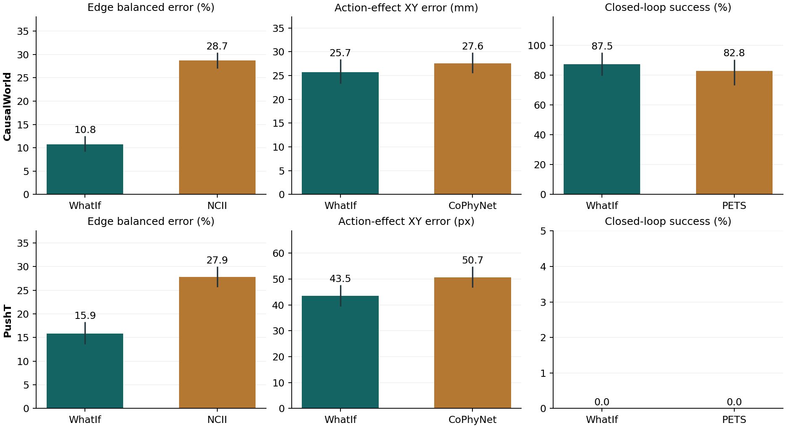
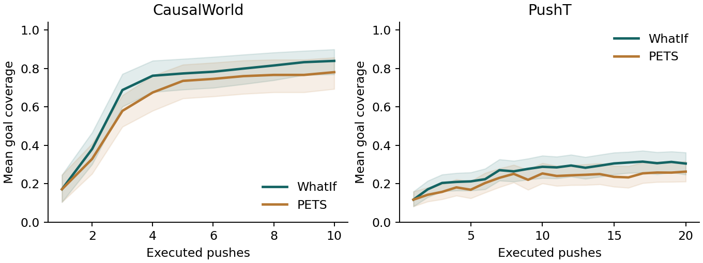
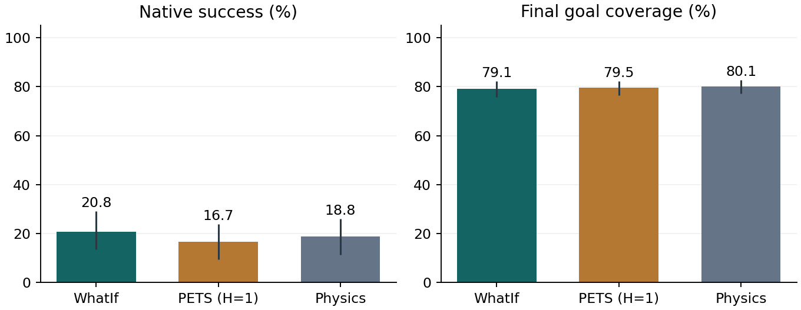

# Stage 07 · 换一种推法，世界模型能否说对结果、选对动作？

一组共享权重同时学三指推方块和圆形推手推 T 形块。给模型看一次真实试推，再问两个不同的问题。回到刚才的起点，从另一边推，会新接触哪条边、物体会多走多少？从现在的位置往下推，哪个动作最可能把物体送进目标？

第一问已经得到实验证据。两个任务上，接触边的平衡误判率和动作效果的平均位置误差都优于对应的论文基线。第二问更难。共享控制器在 CausalWorld 完成了 56/64 个布局，PETS 完成 53/64 个。两者在原来的 12 种推法下都没完成 PushT。引入能跟踪表面接触点的精细推法后，在同一批 96 个新布局上，WhatIf 从 0 次成功提高到 20 次，PETS 从 0 次提高到 16 次。纯机械反馈也能完成 18 次。改进动作接口的收益清楚，学习模型在控制上的额外收益仍小。

## 为什么选这两个任务和三种比较方法

| 论文里的实验 | 本次采用的设计 |
|---|---|
| CausalWorld 用 TriFinger 做 Pushing、Picking、Pick and Place、Stacking2，可按物理变量划分训练与测试。后续工作还在三指任务上比较过课程学习和跨任务迁移。 | 选择 Pushing。P1/P2 改方块质量，P7/P8 同时改变质量与块、目标的位置，数字成对对应 A/B 参数空间。模型用 P1、P7 学习，再评 P1、P7、P2、P8。这样可以单独读出换质量和换布局的效果。[原论文](https://arxiv.org/abs/2010.04296) · [官方协议](https://causal-world.readthedocs.io/en/latest/guide/evaluating_policy.html) · [迁移研究](https://arxiv.org/abs/2403.17266) |
| PushT 在 Implicit Behavioral Cloning、Diffusion Policy 等工作中用于研究平面接触操作，官方环境直接计算 T 形目标的面积覆盖。 | 使用 Diffusion Policy 仓库里的 Pymunk 环境。这个任务要求同时对准位置和朝向，平移误差很小仍有可能失败。测试一半用默认阻尼参数 0，一半换成 0.25。两部分都用原生随机重置。[研究设置](https://diffusion-policy.cs.columbia.edu/) · [环境源码](https://github.com/real-stanford/diffusion_policy/blob/5ba07ac6661db573af695b419a7947ecb704690f/diffusion_policy/env/pusht/pusht_env.py) |
| NCII 在随机图、Spriteworld、Air Hockey、Franka Kitchen 等环境推断交互。物理环境用实际接触标注边，表 1 把正、负边赋予相同总权重。 | **建图基线选 NCII–PointNet。** 按原文式 2–4 做状态接口复现，用屏蔽源后的概率动力学、似然差伪标签训练交互头。每个训练分叉都实际关闭一个随机源的碰撞。我们的主模型另用模拟器接触标签，因此也列出去掉接触标签的结果。该消融仍使用训练时的物理参数与执行偏差。[NCII，ICLR 2025](https://arxiv.org/html/2505.03172v1) |
| CoPhyNet 在 BlocktowerCF、BallsCF、CollisionCF 中观察一次事实演化，再用它推断改变初始条件之后会发生什么。 | **反事实预测基线选 CoPhyNet。** 运行作者仓库的状态图网络、事实序列 GRU 和带稳定性门控的预测器。将可观测物体、接触源、目标和命令编码为 7 个 token，干预改为替换推法。该状态适配器编码位姿与命令，没有独立速度 token。本次从头训练。训练数据和事实试推与我们的模型相同。[论文](https://arxiv.org/abs/1909.12000) · [作者代码](https://github.com/fabienbaradel/cophy) |
| PETS 用概率动力学集成、轨迹采样和在线规划，在连续控制中用少量交互学习决策。 | **控制基线选 PETS。** 使用 MBRL-Lib 的 GaussianMLP 与 CEM。5 个 bootstrap 成员，规划 3 推，每轮 48 个动作序列，更新 3 轮。同一条模拟轨迹固定成员，每次只执行第一推。所有策略面向同一目标、使用相同动作菜单和真实交互预算。[PETS，NeurIPS 2018](https://proceedings.neurips.cc/paper/2018/hash/3de568f8597b94bda53149c7d7f5958c-Abstract.html) · [MBRL-Lib](https://github.com/facebookresearch/mbrl-lib) |

你给的 JEPA 文章对这里最重要的启发，是把「追问刚发生的那一次」和「选择下一次行动」分开评测。前者的两条分叉共享同一扰动。后者只使用已经执行过的历史，新事件要重新抽取扰动。下面的控制结果都来自实际执行选中动作后的模拟器轨迹。三种论文基线按上表分工。[Counterfactual World Models，实验与继续控制协议](https://arxiv.org/html/2611.24778v1)

## 模型实际做了什么

**先建动作条件接触图。** 方块有三条候选入边，对应三根手指。T 形块也有三条，对应推手、横墙、纵墙。对每个候选动作重新计算接触概率。模型把各接触源的位置转入推的方向坐标系，同一组网络产生边概率和沿边传递的位姿变化。输入含可观察的场景类别、几何和速度。以下用 $z=(x,y,\theta)$ 表示目标物位姿。

$$
p^a_{j,k,u}=\sigma\!\left(h_\theta(s,a,r_j,P_k,u)\right),\qquad
F^a_{k,u}=d_\theta(s,a,P_k,u)+\sum_j p^a_{j,k,u}\,m_\theta(s,a,r_j,P_k,u).
$$

这里 $r_j$ 是接触源相对于物体的位置，$P_k$ 是一个物理条件粒子。本轮取低、中、高三档，CausalWorld 按质量 0.025、0.035 kg 分档，PushT 按阻尼参数 0.04、0.30 分档。三个执行扰动 $u$ 对应行程短、标准、长，偏差为物体单位的 $-0.04,0,0.04$。训练时知道物理档和扰动，部署时从九种组合的均匀先验开始。

**用事实更新，再显式预测两个动作的差。** 对已经执行的 $b$，观测到位姿增量 $o_b$。$\ominus$ 表示位置相减、角度按最短圆弧相减。用验证集选出的 $\Sigma^{1/2}=\mathrm{diag}(0.11,0.11,0.176)$ 计算每个解释与事实的相容程度，坐标是归一化位置和弧度。

$$
w_{k,u}\ \propto\ \pi_{k,u}
\exp\!\left[-\tfrac12\|F^b_{k,u}\ominus o_b\|^2_{\Sigma^{-1}}\right],\qquad
q(\Delta^{a,b}\mid o_b)
=\sum_{k,u} w_{k,u}\,\delta_{F^a_{k,u}\ominus F^b_{k,u}},
\quad \Delta^{a,b}=z^a_{t+1}\ominus z^b_{t+1}.
$$

事实动作和候选动作各有一个未来分布，两者按同一个粒子配对。这给出了动作效果差的分布，能保留「如果地面是这一档，两种动作会一起怎样变化」的信息。训练损失包含单步位姿、成对位姿差、覆盖率、动作间效用差、删除接触源后的位姿和接触边六项，系数依次为 $1,0.55,0.45,0.28,0.40,0.22$。位置和角度误差用平滑 L1，覆盖率用平方误差，边用交叉熵。[完整损失与推理代码](../../whatif/crossbench/models.py)

**用分布比较具体动作。** 下一步保留物理条件的后验，重新抽取执行扰动。连续观察多推时，把上一次物理权重的对数乘 0.85，再累加这次观测的对数似然。任务效用 $U$ 奖励覆盖率和过成功线的概率近似，以归一化中心距离和 PushT 的角度偏差作小幅扣分。令 $c$ 为覆盖率、$g$ 为目标、$d_T$ 表示 PushT，$\tau$ 为任务成功线，则

$$
U=c+0.28\sigma((c-\tau)/0.035)-0.09\|x-g\|_2-0.05d_T(1-\cos(\theta-\theta_g)).
$$

为了给能为后续推法创造机会的动作打分，从训练布局的真实分叉拟合三步价值 $V_h$。令 $V_0=U$，第 $h$ 轮用真实后继 $s'_a$ 监督 $V_h(s)$，目标为 $\max_a [U(s'_a)+0.8(1-D_a)(V_{h-1}(s'_a)-U(s'_a))]$，$D_a$ 表示已成功。读出器用物体位姿、目标、场景和覆盖率。候选粒子上的得分为 $v_a=U_a+\eta(1-D_a)(V_3-U_a)$。与名义直推 $a_0$ 配对后选

$$
a^*=\arg\max_a\ \mathbb{E}_{k,u}\!\left[v_a+0.22\tanh((v_a-v_{a_0})/0.20)\right].
$$

这个准则保留了效果差的方向，「两个分布相距很远」本身不能区分离目标更近还是更远。本轮实际优化的是配对效用差，没有优化 KL。32 个独立验证布局/任务从 $\eta\in\{0,0.4,0.8\}$ 选出共同的 0.4。覆盖率读出也在验证集比较过纯学习、纯几何和二者平均，共享模型选纯学习，PETS 选平均。[决策实现](../../whatif/crossbench/control.py) · [价值训练](../../whatif/crossbench/value.py)

## 同一轮如何评三件事

- 两个任务各有 600 个训练、96 个验证、192 个测试布局。PushT 给各方法共同增加 240 个近目标训练布局和 64 个近目标验证布局，帮助学习旋转对齐。普通 PushT 训练分叉最高覆盖率为 88.5%。测试保持原生随机起点。所有模型的训练种子为 11。
- 每个布局先随机执行 0–3 推，再记录两个相邻时刻。在每个时刻用同一初始种子和完整历史重建底层仿真，从相同状态实际执行 12 种推法。它们改变推的方向、侧偏和行程。主预测测试在第一个时刻揭示一条事实结果，预测其余 11 条。每个任务共有 2,112 个反事实动作、6,336 个候选边标签。训练面板共 34,560 条正常后继，另有等量删除源接触后的后继。
- 闭环另抽 64 个布局/任务，各方法从同一原生重置和同一事实首推开始。CausalWorld 最多 10 推、420 个环境步，物体与目标包围盒的重叠率超过 90% 即成功。PushT 最多 20 推、280 个环境步，T 形真实面积覆盖率超过 95% 即成功。任意底层步达标即停止。报告的覆盖率取终点。曲线在成功后保持最后观测值。
- 误差区间以**布局为单位**做 4,000 次配对 bootstrap。同一布局的分叉始终一起抽样。这些区间描述新布局的不确定性，训练种子数为一。



图中每行是一个任务。前两列越低越好，最后一列越高越好。第三列只比较共享模型和三步 PETS 在相同的原动作菜单上的效果。

## 一、换动作后的接触图

在一次短推内，只要某个源与物体出现有效物理接触，该入边就记为 1。主指标沿用 NCII 的平衡误判率 $\tfrac12(\mathrm{FPR}+\mathrm{FNR})$，恒猜无边会得到 50%。边概率阈值在验证布局上确定。AP 是平均精确率，适合读出稀有的新边、断边。这里能核对的是动作级直接接触，目标物以外的完整场景图没有真值评测。

| 任务 | 方法 | 平衡误判率 ↓ | 边 AP ↑ | 精确率 / 召回率 | 新边 AP / 断边 AP ↑ |
|---|---|---:|---:|---:|---:|
| CausalWorld | NCII | 28.69% | .753 | .459 / .912 | .177 / .443 |
| | WhatIf，训练去掉接触标签 | 17.92% | .828 | .619 / .889 | .229 / .307 |
| | **WhatIf** | **10.75%** | **.909** | .794 / .889 | **.639 / .696** |
| PushT | NCII | 27.85% | .668 | .598 / .600 | .136 / .178 |
| | WhatIf，训练去掉接触标签 | 21.41% | .829 | .847 / .615 | **.298** / .431 |
| | **WhatIf** | **15.88%** | **.836** | .707 / .814 | .279 / **.445** |

CausalWorld 与 PushT 的真实正边率分别为 31.1%、28.0%。换动作导致边状态改变的比例是 13.4%、12.0%。其中新边仅占所有候选的 5.4%、5.8%。主模型相对 NCII 的平衡误判率分别降低 17.94 个百分点（95% 区间 16.44–19.35）和 11.98 个百分点（9.82–14.23）。在提供事实结果之前，共享模型的误判率已经是 10.73%、16.42%。主要的建图收益来自动作条件几何和训练监督。更换动作后预测 PushT 新边仍比判断一条边通常是否存在困难。[逐项指标和测试数组](../../results/crossbench)

## 二、反事实动作效果

表中位置误差是预测的**动作位移差向量**与真值之差的平均长度。RMSE 对很大的误差赋予更大权重。角度也计算两个动作的效果差。Energy score 评价二维位置效果分布，兼顾样本离真值多远、预测样本之间相隔多远，单位与位置相同。CoPhyNet 在这里输出单个位姿。

| 任务 | 方法 | 平均位置误差 ↓ | 位置 RMSE ↓ | 角度误差 ↓ | Energy score ↓ |
|---|---|---:|---:|---:|---:|
| CausalWorld | CoPhyNet | 27.58 mm | **37.39 mm** | **18.10°** | 27.58 mm |
| | WhatIf，观察事实之前 | 27.16 mm | 40.42 mm | 19.91° | 24.85 mm |
| | **WhatIf，观察事实之后** | **25.72 mm** | 39.30 mm | 19.42° | **24.45 mm** |
| PushT | CoPhyNet | 50.71 px | 66.38 px | 27.96° | 50.71 px |
| | WhatIf，观察事实之前 | 45.25 px | 63.86 px | 23.59° | **40.17 px** |
| | **WhatIf，观察事实之后** | **43.47 px** | **62.16 px** | **23.24°** | 41.88 px |

相对 CoPhyNet，平均位置误差减少 1.86 mm（95% 区间 0.53–3.10）和 7.24 px（4.29–10.14）。CausalWorld 的大误差和转角仍由 CoPhyNet 处理得更好。在最难的 P8 联合干预上，两者平均位置误差为 35.01 和 34.63 mm。PushT 中事实更新改善了均值预测，但比均匀先验给出了更差的 energy score，这说明还值得校准后验的集中程度。

**共享了多少。** 每次用一套权重跑完整测试。只在 CausalWorld 训练，方块位置误差为 25.59 mm，换到 PushT 为 84.41 px。只在 PushT 训练，对应为 39.64 mm、43.88 px。联合训练的 25.72 mm、43.47 px 接近两个专用模型各自在本域的结果。证据支持一个模型覆盖两个已见场景。单域模型直接换模拟器仍有明显损失。

## 三、实际执行动作后的结果

| 共同的 12 种动作 | CausalWorld 成功 / 64 | 终点覆盖率 | PushT 成功 / 64 | 终点覆盖率 |
|---|---:|---:|---:|---:|
| PETS，三推规划 | 53 | .781 | 0 | .263 |
| 共享模型，只按目标中心距离选 | 57 | .843 | 0 | .149 |
| 共享模型，均匀先验、一步配对效用 | 55 | .831 | 0 | .273 |
| 共享模型，事实后验、仅期望任务效用 | 57 | .855 | 0 | .295 |
| 共享模型，事实后验、一步配对效用 | 57 | .855 | 0 | .289 |
| **共享模型，验证选出的三步价值 + 配对效用** | **56** | **.839** | **0** | **.305** |

在 CausalWorld，完整控制器相对 PETS 多完成 3 个布局，成功率差为 +4.7 个百分点，配对区间 −4.7 至 +14.1。按 P1、P2、P7、P8 拆开，完成数为 16、16、15、9，各有 16 个布局。PushT 的覆盖率差为 +.042，区间 −.017 至 +.098。单独加入配对优势项没有稳定提高成功率。共同的三步价值在 PushT 提高了终点覆盖，但在 CausalWorld 比一步少完成一个布局。这里的决策优化是世界模型驱动的在线动作选择。



### PushT 如何修正最后几厘米和最后几度

原菜单始终围绕物体中心选方向。在验证集上，即使控制器已把 T 形块送到目标附近，也常常找不到既能纠正角度、又能维持位置的下一推。我们保留 280 个原生控制步和相同的首推，改变了从几何接触到动作的接口。

1. 从 T 形外轮廓生成接触点，保留法线或力矩明显不同的 8 个候选，每个点给出 3 个行程。模型每次比较 24 个动作。控制器先绕开物体靠近所选表面。物体在移动时每两个环境步重新定位接触点，再沿法线短推。它能在任一原生步达到 95% 时停止。
2. 在物体坐标系中，用 $h_j=(n_x,n_y, (r_j\times n_j)/L^2)$ 近似单位行程带来的平移与偏航，$L=47$ px。把有效行程增益和滑行时间作为一个联合物理粒子，每推后根据实际质心位移和转角更新它的权重。图模型另用接触门预测该推法对机械先验的修正，以及推的过程中能达到的覆盖率。越接近目标，学习修正的权重越小。这里用 PushT 专门训练的局部模型，上文的跨场景预测、控制数字仍来自同一个共享检查点。
3. 核对了训练动作与实际执行方式是否一致。固定接触点、以终点为目标的版本在另一组布局上完成 0/64。开始跟踪接触点的中间版本完成 11/64。最终使用同一个跟踪执行器采集 900 个训练布局 × 24 种短推，另用 150 个布局选检查点，训练目标包含推的途中可达的覆盖率。两种学习方法都用这批数据。在 64 个闭环验证布局上各自选混合权重，图模型选 0.12，概率集成选 0.35，再冻结到下面的 96 个新布局。
4. 精细控制比较中，PETS 使用同一官方概率集成，单步枚举完全相同的 24 个接触动作，用每个高斯分量的对称采样计算期望效用。记为 **PETS（H=1）**。两种学习方法与物理规则都可使用同样的接触几何、运动跟踪和历史观测。主表的 **PETS（H=3）** 则是三推的 CEM 规划。

| PushT，96 个全新随机布局 | 原生成功 | 默认阻尼，成功 / 48 | 阻尼 0.25，成功 / 48 | 平均终点覆盖率 |
|---|---:|---:|---:|---:|
| 共同执行器，只按更新后的机械先验打分 | 18/96 | 14 | 4 | **.801** |
| 同一接触菜单，PETS（H=1） | 16/96 | 12 | 4 | .795 |
| **同一接触菜单，WhatIf 局部图模型** | **20/96** | **16** | **4** | .791 |

图模型相对 PETS 在成功率上高 4.2 个百分点，配对 95% 区间为 −2.1 至 +10.4。覆盖率差为 −.004，区间 −.028 至 +.018。它多完成的 4 个布局都来自默认阻尼。带物理反馈的纯机械规则已达到 18/96，因此，大部分绝对提升可以用更好的接触动作和执行方式解释。跨阻尼的学习与决策增益仍是这里最重要的问题。



同起点复跑给出了改动的量级。在上面这 96 个布局上，原共享控制器成功 0/96、终点覆盖率 .281，精细接触版本为 20/96、.791。PETS 的原三步版本成功 0/96、终点覆盖率 .251，使用精细菜单的单步版本为 16/96、.795。两种方法都从动作改进中获益。[原菜单逐步轨迹](../../results/crossbench/coarse-confirm.csv) · [精细控制逐布局结果与配对区间](../../results/crossbench/surface-summary.json)

## 按投稿标准看

我会把**动作条件接触图与成对效果预测**作为论文的主贡献。两个力学场景、一套权重、可以逐条核对的接触变化、可配对的效果真值，以及观察事实前后的变化，已经构成一条连贯的证据链。精细推法能实际完成 PushT，也给出了值得保留的控制方案。

以当前证据，我还不会投 oral 票。与学习基线相比，闭环成功率的差值区间跨过零。在 PushT 换阻尼时，图模型、PETS 和物理规则最终都成功 4/48。下一项最有价值的改动是让**同一个共享模型**学习多个接触时长下的滑行和角速度，把 PushT 的精确接触预测并回共同的世界模型。这样才能检验，事实试推估出的物理条件能否在换阻尼时帮控制器选对一个不同的动作。当前结果只覆盖基于状态的模拟推物任务和一个训练种子。

## 一处复现

代码、分叉数据、模型权重、预测指标和逐布局轨迹均随本次提交保存。主预测由一次事实和 11 个兄弟动作组成，主控制轨迹记录每次实际执行的动作、原生步数、覆盖率及是否成功。精细控制表记录每个布局的原生终点。读结果可直接从实验图和汇总 JSON 开始。[代码](../../whatif/crossbench) · [分叉数据](../../data/crossbench) · [主表与配对区间](../../results/crossbench/summary.json) · [精细控制原始记录](../../results/crossbench/tracked-control.csv)

两个 Python 环境分别负责旧版模拟器和训练。固定 CausalWorld `1045277`、Diffusion Policy `5ba07ac`、CoPhy `170fe46`、MBRL-Lib `3f93ccc`。下面的脚本自动克隆后三个精确提交。模拟器用 Python 3.10、NumPy 1.23.5、PyBullet 3.2.7、Gym 0.23.1、Pymunk 6.6.0、Pygame 2.5.2、Shapely 1.8.5.post1、scikit-image 0.20.0 和 opencv-python-headless 4.8.1.78。训练环境用 PyTorch 2.13、scikit-learn 1.6.1、Matplotlib 3.10、hydra-core、omegaconf、gymnasium 和 termcolor。安装 CausalWorld 的命令在仓库首页。脚本在仓库根目录运行。服务器工作目录是 `/NFS/T5/kailais/others/WM/whatif-pushing`。[复现脚本](../../whatif/crossbench/reproduce.sh) · [模拟器安装](../../README.md)

```bash
export SIM_PY=/tmp/whatif-push-venv/bin/python
export TRAIN_PY="$PWD/work/stage7/trainenv/bin/python"
export DEVICE=cuda WORKERS=16
bash whatif/crossbench/reproduce.sh figures   # 从已发布的原始结果重画三张图
bash whatif/crossbench/reproduce.sh evaluate  # 从已发布权重重新预测、跑模拟器、生成汇总
# 从头生成分叉并训练时，依次运行 collect、train、evaluate
```
