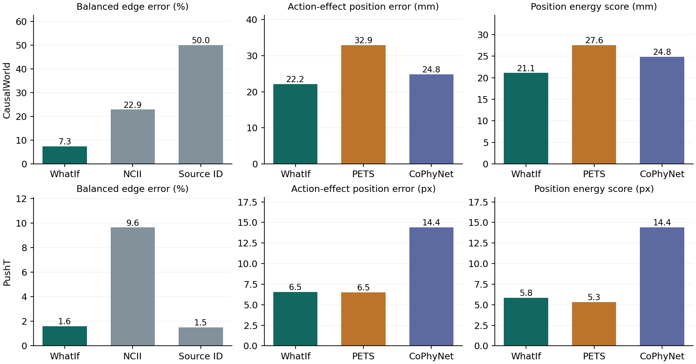
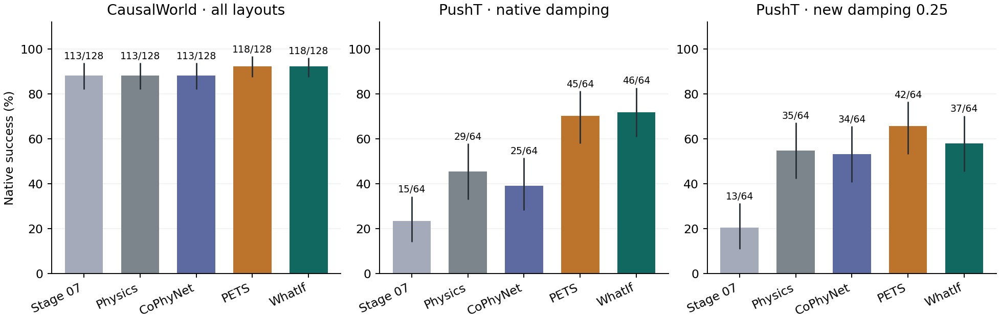

# Stage 08 · 在看不见阻尼时，同一个世界模型能否选好下一推？

同一份权重首次直接控制 CausalWorld 三指推块和 PushT 精细接触。在 128 个新 PushT 布局上，Stage 07 冻结控制器成功 28 次，本轮共享模型成功 83 次。同一新执行器只用物理规则成功 64 次，完整三步 PETS 成功 87 次。在 CausalWorld，共享模型和 PETS 都成功 118/128。

这一批针对 Stage 07 的两个问题开展实验。上轮 PushT 最好的精细控制器用了单独训练的局部模型，换阻尼后，图模型、单步高斯集成、物理控制器又都只完成了 4/48 个布局。本轮让三指推方块和单推手推 T 形块共用接触图、动力学权重和事实更新方式，并让 PETS 在精细动作空间里真正向前规划三推。

## 从哪些前人实验出发

| 研究 | 原实验怎样提问 | 本轮如何使用 |
|---|---|---|
| CoPhy，Baradel 等，ICLR 2020 | 在积木塔、碰撞和弹球场景中先观察一次真实演化，再改变初始条件，预测另一个结局。 | **主要基线一。** 保留作者 CoPhyNet 的事实序列 GRU、图卷积和稳定性门。本轮把干预换成动作。用 10 个三维 token 编码物体、三个接触源、目标、接触点与行程、方向与力臂、速度、滑行观测和任务信息。重新训练模型，比较位姿、动作效果及其用于选动作后的表现。[论文](https://arxiv.org/abs/1909.12000) · [作者代码](https://github.com/fabienbaradel/cophy) |
| PETS，Chua 等，NeurIPS 2018 | 在连续控制任务中，以概率动力学集成预测一组动作序列，执行选中序列的第一步，再根据实测状态重规划。 | **主要基线二。** 调用 MBRL-Lib 的 GaussianMLP 和 CEMOptimizer。5 个 bootstrap 成员、3 推视野、48 条候选序列、3 轮 CEM。每条轨迹固定一个模型成员，逐推采样过程噪声。报告其预测分布和真实闭环表现。[论文](https://proceedings.neurips.cc/paper/2018/hash/3de568f8597b94bda53149c7d7f5958c-Abstract.html) · [实现仓库](https://github.com/facebookresearch/mbrl-lib) |
| NCII，Chuck 等，ICLR 2025 | 在 Spriteworld、机械臂冰球、Franka Kitchen 等场景检查谁与目标发生了交互。物理场景用实际接触作为边的真值，表 1 对正负类等权。 | 仅作**边存在性专项参考**。按论文式 2–4 重新实现带遮罩 PointNet、动力学似然差和边分类器。在训练模拟器中真实关闭一个随机源的碰撞。本轮主图模型另用接触标签与训练物理参数。[论文及表 1](https://arxiv.org/html/2505.03172v1) |
| CausalWorld，Ahmed 等，ICLR 2021。PushT，Diffusion Policy 的公开实验 | 前者用参数化干预拆开质量变化和布局变化。后者要求在平面中同时对齐非对称物体的位置与朝向。 | CausalWorld 保留原生 P1/P2 质量干预和 P7/P8 质量与位置联合干预。PushT 使用官方重置、碰撞和 95% 面积覆盖成功线。训练数据来自本轮控制器实际执行的轨迹，包含靠近目标和明显转角的状态。未使用人类示范。[CausalWorld](https://arxiv.org/abs/2010.04296) · [评测协议](https://causal-world.readthedocs.io/en/latest/guide/evaluating_policy.html) · [PushT 研究与数据入口](https://diffusion-policy.cs.columbia.edu/) |
| Hogan 与 Rodriguez 的平面推动。Counterfactual World Models 预印本 | 前者用多种接触模式和有限视野控制平面物体。后者把同一次事件的反事实重放与下一事件的决策分开检验。 | 推 T 形块时改变接触点、力矩和行程。回到同一事件预测动作效果时，两个动作共享物理粒子和执行扰动。在线向前规划时，只保留已经观察得到的物理信念，未来扰动按步重采样。[平面接触控制](https://arxiv.org/abs/1611.08268) · [反事实评测设置](https://arxiv.org/html/2611.24778v1) |

## 改了什么

**动作先说清楚接触几何。** 每个动作都写成物体坐标系内的接触点 $r$、向内方向 $n$、行程 $\ell$、力臂 $r\times n$ 和移动到接触点的距离。CausalWorld 把 12 种接近方向、侧偏和推程转成这组量。PushT 从外轮廓选 4 个法线或力矩不同的接触点，每点试 3 种行程，倍率为 0.35、0.80、1.35。两个场景的执行器分别驱动三指和圆形推手，预测用同一份 graph.pt。模型能观察任务类型和物体几何，训练包含这两个场景。

**让事实轨迹告诉模型物体还会滑多久。** PushT 执行器绕开 T 形块，每两个原生步重算接近位置。推手与物体分离、物体仍在移动且远离墙面时，从可观测速度估计一个控制周期后的保留比例。令 $v=(v_x,v_y,47\omega)$，则 $\hat\rho\approx v_{t+1}^\top v_t/(v_t^\top v_t)$，对有效观测做指数平滑。以 $0.1\hat\rho/(1-\hat\rho)$ 估算滑行时间，沿选定接触面的法线逐步推进，预计剩余滑行足以覆盖目标行程时松开。该执行器供所有新控制器使用。计算模型的额外收益时，比较双方获得完全相同的执行反馈。

**共享动作条件接触图和一个物理先验。** 每个动作有三个候选入边，分别代表三根手指，或推手、横墙和纵墙。用一个物理索引 $P_k$ 表示本场景的响应强弱。训练标签在 CausalWorld 取三个质量档，在 PushT 取三个阻尼档。推理用五个插值粒子，配上短、标准、长三种行程扰动 $u$。一组参数从动作与各接触源的相对位置计算边概率 $e_j$、沿边的消息 $m_j$ 和位姿增量：

$$
e_j^a=\sigma(h_\theta(s,a,r_j,P_k,u)),\qquad
D^a_{k,u}=\psi_\theta\!\left(s,a,P_k,u,\sum_j e_j^a m_j^a\right)
  +\max_j(e_j^a)D_{\rm rigid}(s,a,P_k).
$$

机械项用 $\ell n$ 近似平移、用 $\ell(r\times n)$ 与物体转动尺度估计偏航，并加入观测速度产生的滑行。模型预测质心变化，转换回基准物体原点后计算误差。训练同时拟合真实和关闭接触源后的位姿、边、后继状态、覆盖率及动作间效用差。成对位姿损失直接比较 $D^a-D^b$ 与仿真分叉真值。[共享机制与先验](../../whatif/shared/model.py) · [各项损失](../../whatif/shared/train.py)

**先解释刚才那一推，再比较另一推。** 已执行动作 $b$，观测为 $o_b$。令 $F^a_{k,u}$ 为预测的下一位姿，$\ominus$ 对位置作差、对偏航取最短圆弧。把滑行事实与位姿事实合并为同一个后验。$c$ 是从有效滑行片段得到的观测置信度，CausalWorld 的该项为零。

$$
w_{k,u}\propto (\pi_k)^{0.7}
\exp\!\left[-\tfrac12\|F^b_{k,u}\ominus o_b\|^2_{\Sigma^{-1}}
             -\tfrac{c}{2}\left((\hat\rho-\rho_k)/0.065\right)^2\right],
\qquad
q(z^a_{t+1}\ominus z^b_{t+1}\mid o_b)
=\sum_{k,u}w_{k,u}\,\delta_{F^a_{k,u}\ominus F^b_{k,u}} .
$$

验证集选出的位姿似然标准差为 $(0.055,0.055,0.088)$，前两维按物体尺度归一化，最后一维为弧度。同一粒子下两个动作一起变快或变慢的相关性，保留在动作差分布中。

**用任务结果给一条动作序列打分。** 效用同时看终点覆盖率、途中达到的覆盖率、质心到目标的距离、T 形块的角度误差及接近成功线的奖励。对 PushT 的每个候选序列 $A$，在相同物理粒子和未来噪声下也展开一个名义序列 $A_0$，各粒子得到折扣任务分 $J_{k}(A)$。CEM 最大化

$$
\sum_k w_k\left[J_k(A)+0.12\tanh\!\big((J_k(A)-J_k(A_0))/0.30\big)\right].
$$

$J$ 逐推以 0.85 折扣，混合模型任务分与可部署的机械推法评分。在 PushT，验证最终为 WhatIf 和 PETS 都选中 35% 模型分、65% 机械分，以及完整三步规划。CausalWorld 的 WhatIf 则选中另一种更省计算的前瞻：先枚举所有第一推，再沿物理规则选出的下一推展开，用 0.65 和 0.35 合并两次预期效用。CausalWorld 的 PETS 使用三步 CEM 和在验证集选中的末端价值读出。CoPhyNet 本轮也实际参与控制，将它的点位姿预测转换为已知目标形状的覆盖率，再与同一机械评分混合。[候选与规划](../../whatif/shared/planning.py) · [冻结配置](../../results/shared/planning.json)

## 数据和比较口径

| 用途 | CausalWorld Pushing | PushT |
|---|---|---|
| 共享动力学训练 | 新采 320 个布局，加上沿用同一执行器的 Stage 07 训练集 1,200 个分叉状态 | 新采 1,680 个布局，每个动作经最终执行器实际运行。292 个起点的覆盖率已超过 .75，382 个起点距目标方向超过 1 rad |
| 监督与验证 | 每个起点跑 12 个正常分叉，训练时每个分叉另跑一次关闭随机源接触的版本。112 个新预测验证布局 | 同样的 12 个分叉与源删除。240 个新预测验证布局。训练阻尼参数为 0、0.08、0.55 |
| 规划选择 | 先在 48 个验证布局筛选，各主要方法最多保留两种，再到另外 64 个验证布局定型 | 同样分两步，只在第二组验证布局使用 0 或 0.18 的阻尼。主测试的 0.25 在所有选择结束后才评估 |
| 独立测试 | 192 个预测布局，每个揭示 1 个事实、评其余 11 个动作。另有 128 个真实闭环布局，预算 420 步，原生覆盖率超过 .90 成功 | 256 个预测布局，另有 128 个真实闭环布局。64 个默认阻尼、64 个阻尼 0.25。预算 280 步，原生面积覆盖率超过 .95 成功 |

新动力学训练集共 38,400 条正常后继，并有等量关闭接触源的后继。备选的末端价值头另用 CausalWorld 3,200 个、PushT 6,400 个真实延续状态训练：给定一个后继，再让共同的物理控制器推三次，观察最终可达的任务分。该读出同时提供给 WhatIf 和 PETS。所有网络只用训练种子 11。各新控制器从同一重置开始，先执行共同的事实首推，任一原生步达标就结束。步数统计包含首推、绕行、释放和失败用尽的步数。成功率与覆盖率的比较按相同布局配对，区间按布局重采样 6,000 次。[数据清单与校验值](../../data/shared/manifest.json) · [逐布局验证选择](../../results/shared/validation.csv)

## 结果一　模型有没有判对接触边？

平衡误判率 BMR 为 $\tfrac12(\mathrm{FPR}+\mathrm{FNR})$，越低越好。precision 和 recall 对实际存在的边计数。每个 CausalWorld 布局有 11 个未揭示动作 × 3 条边，一共 6,336 条。PushT 共 8,448 条。概率阈值全部在预测验证集选定。

| 任务 | 方法 | BMR ↓ | Precision | Recall | 换动作后边改变的召回率 |
|---|---|---:|---:|---:|---:|
| CausalWorld | WhatIf | **7.32%** | .883 | .908 | **77.1%** |
| | NCII | 22.87% | .558 | .850 | 35.6% |
| PushT | WhatIf | **1.59%** | .975 | .981 | 0.7% |
| | NCII | 9.63% | .817 | .908 | 20.4% |

CausalWorld 中 16.1% 的边随动作改变，共享图确实辨认出了多数改变。精细推法下，PushT 的推手与块接触率为 97.4%，横墙、纵墙只占 1.10%、0.60%。仅凭接触源的身份猜测，BMR 就是 1.50%。142 个实际发生的边改变中，主模型只检出 1 个。PushT 在这一列支持的是常见接触识别，稀有断边和撞墙事件仍缺训练覆盖。

## 结果二　换动作能多走多少、转多少？

位置误差是预测与实际动作效果差的平均欧氏距离。角度误差对最短圆弧取绝对值。二维 energy score 同时考察概率样本到真值的距离和样本自身离散程度，越小越好。直接位姿误差比较未揭示动作的预测终点与实际终点。CoPhyNet 在验证集选中观察到的事实终点作为参考，输出点预测。PETS 在两个兄弟动作上共用模型成员和过程噪声，使用其标准等权集成。

| 任务 | 方法 | 平均位置效果误差 ↓ | 角度效果误差 ↓ | 二维 energy ↓ | 直接终点位置误差 ↓ |
|---|---|---:|---:|---:|---:|
| CausalWorld | WhatIf | **22.16 mm** | 16.88° | **21.12 mm** | **19.39 mm** |
| | CoPhyNet | 24.83 mm | **15.84°** | 24.83 mm | 24.83 mm |
| | PETS | 32.90 mm | 22.89° | 27.56 mm | 25.87 mm |
| PushT | WhatIf | 6.54 px | 3.45° | 5.84 px | **5.80 px** |
| | CoPhyNet | 14.41 px | 6.81° | 14.41 px | 14.41 px |
| | PETS | **6.50 px** | **3.34°** | **5.31 px** | 6.30 px |

同一模型观看事实动作前后，CausalWorld 的位置效果误差从 24.90 降到 22.16 mm，配对减少 2.74 mm，95% 区间为 2.18–3.32。PushT 从 6.97 降到 6.54 px，减少 0.43 px，区间为 0.26–0.60。对新阻尼 0.25，每个控制周期的真实自由滑行速度保留率约为 .871。观看事实动作后，估计均值为 .842，绝对误差从 .050 降到 .033。对于默认阻尼，物体常常很快停止，松手后的速度比难以观测，估计仍偏高。

在 PushT，把各动作的真实任务效用与该布局的最佳可选动作比较，WhatIf 选中动作的平均效用损失为 .034，PETS 为 .040，CoPhyNet 为 .060，物理规则为 .050。这里衡量一次未执行动作的排序，下面的成功率则需要连续做对多次选择。



## 结果三　同样的控制器上，模型多完成了几个布局？

| 控制方法 | CausalWorld 成功 / 128 | 平均终点覆盖率 | 平均步数 | PushT 成功 / 128 | 平均终点覆盖率 | 平均步数 |
|---|---:|---:|---:|---:|---:|---:|
| **WhatIf 共享图模型** | **118** | .863 | **128.8** | **83** | .920 | 226.3 |
| PETS，三步 CEM | **118** | **.873** | 132.5 | **87** | **.921** | **219.3** |
| CoPhyNet，位姿读出选动作 | 113 | .839 | 143.3 | 59 | .906 | 237.6 |
| 相同执行器，只用物理评分 | 113 | .853 | 139.2 | 64 | .916 | 230.7 |
| 上轮冻结控制器 | 113 | .835 | 134.0 | 28 | .821 | 257.6 |

CausalWorld 的上轮行沿用 Stage 07 冻结的共享模型和价值控制规则，使用与本轮相同的首推。PushT 的上轮行完整复跑 Stage 07 的 tracked 控制器及其原首推。同一行的起点与其他方法配对。CausalWorld 新共享模型在 P1/P2/P7 各完成 32/32，在 P8 完成 22/32。与 PETS 成功数相同，PETS 在 P8 多完成一个，在 P2 少完成一个。

| PushT 真实成功数 | 默认阻尼 / 64 | 新阻尼 0.25 / 64 |
|---|---:|---:|
| WhatIf 共享图模型 | **46** | 37 |
| PETS，三步 CEM | 45 | **42** |
| CoPhyNet | 25 | 34 |
| 相同执行器的物理规则 | 29 | 35 |
| Stage 07 tracked | 15 | 13 |

共享模型较上轮多完成 **55/128**，成功率差为 +43.0 个百分点，配对 95% 区间 +32.0 至 +53.1。在新阻尼上单独比较为 **13/64 → 37/64**。其中重要一部分来自新执行器：只用共同的物理规则就完成 35/64。新模型在全体布局上比这个强物理规则多完成 **19/128**，差值 +14.8 个百分点，区间 +3.1 至 +25.8。换阻尼子集的增量只有 2/64，区间仍跨零。与 PETS 比较，共享模型少完成 4/128，差值区间 −13.3 至 +7.0 个百分点。



**事实后验在决策中的单独作用。** 将高层物理粒子固定为均匀权重，保留同一套网络、底层滑行反馈和已观察的状态，CausalWorld 完成 115/128，恢复事实更新后是 118/128。PushT 对应是 **91/128 → 83/128**。只用位姿似然更新、去掉额外的高层滑行似然，PushT 为 88/128，其中新阻尼为 42/64。这说明底层反馈和所学动作模型已能提高对齐成功率。针对同一次事件定位最可能的物理粒子，并不保证下一次动作规划选得更好。主表保留验证选出的设置，未用这个测试消融回选权重。

## 审稿判断与复现

现在可以支持的主张是：**一套接触模型能跨两个已见场景学习动作效果，并在真实 PushT 闭环中为已有物理控制器增加可测的收益。** 我会认可这部分实验。作为 oral 论据，“高层事实更新本身优于强概率规划”还缺证据。PETS 的 PushT 分布评分和成功数仍占优，尤其值得研究高层后验集中时怎样保持对未来扰动的覆盖。

服务器使用 Stage 07 固定版本的 CausalWorld、Diffusion Policy、CoPhy 与 MBRL-Lib，模拟和 PyTorch 分别运行在 Python 3.10 与 3.13 环境。所有新报告、数据和输出在 Stage 08 对应目录。下列命令在项目根目录运行。[环境与上游提交版本](07-crossbench.md) · [实现](../../whatif/shared) · [统计与配对区间](../../results/shared/summary.json) · [逐布局控制](../../results/shared/control.csv) · [实际执行轨迹](../../results/shared/trajectory.csv)

```bash
bash whatif/shared/reproduce.sh figures  # 用已保存记录重新出图和统计
bash whatif/shared/reproduce.sh test     # 用冻结设置重跑预测和真实闭环
# 完全重训依次执行 collect、train、select、test
```
