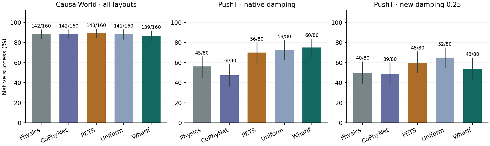

# Stage 09 · 上一推得到的事实，能帮助选择下一推吗？

真实试推能帮助解释物体刚才怎样移动。决策还要回答另一个问题：推手松开后，从现在的位置换一个接触点，是否更容易到达目标？这一轮把两次推动分开，先让模型看完第一推，然后封住第二推的结果，让它预测和选动作。

在 160 个新的 PushT 布局上，验证选出的共享模型成功 **103** 次，PETS 成功 **104** 次，CoPhyNet 成功 **77** 次。三者用同一套底层反馈。仅用物理规则成功 **85** 次。共享模型在这个物理控制器上有增益，换成新设计的高层物理后验却没有进一步提升成功率。沿用上一轮后验并让每个物理粒子都尝试三种未来扰动，成功 **116** 次，其中新阻尼成功 **54/80** 次。下面保留选型过程和全部同布局比较。

## 为什么选这两个任务和两条基线

CausalWorld 的 TriFinger Pushing 能主动改变质量和初始布局，适合检验模型能否从试推修正物理先验。PushT 需要将 T 形块的位置和角度同时对齐，推手绕行、接触位置、旋转后的滑行都会改变下一步选择。两个环境的动力学、动作执行代码不同，共享接触图和动力学网络在两个环境的联合训练集上拟合。本轮对这份网络保持冻结，单独改变基于事实的推理与规划。[CausalWorld](https://arxiv.org/abs/2010.04296) · [PushT 与数据](https://diffusion-policy.cs.columbia.edu/) · [上一轮的训练与调研](08-shared-contact.md)

| 方法 | 前人实验提供的参照 | 本轮实际比较什么 |
|---|---|---|
| CoPhyNet | 观察积木、碰撞和弹球的事实演化，推断改变初始条件后的轨迹 | 使用作者图网络和时序网络，用 10 个状态和动作 token 适配推动任务。预测位姿和成对动作效果；用预测位姿算目标重叠并选动作。它给出点预测，控制结果是本项目的适配。[论文](https://arxiv.org/abs/1909.12000) · [作者仓库](https://github.com/fabienbaradel/cophy) |
| PETS | 在连续控制中训练概率动力学集成，按模型展开动作序列，用 CEM 滚动规划 | 使用 MBRL-Lib 的五成员 GaussianMLP 和 CEMOptimizer。轨迹内固定模型成员，预测分布、动作排序和真实闭环均实测。[论文](https://proceedings.neurips.cc/paper/2018/hash/3de568f8597b94bda53149c7d7f5958c-Abstract.html) · [MBRL-Lib](https://github.com/facebookresearch/mbrl-lib) |
| NCII（边指标专项） | 根据移除某个来源后的动力学变化判断该来源是否与目标交互，物理任务用接触记录检查边 | 沿用按论文公式重实现的状态版模型，报告边存在性与换动作后的边切换。WhatIf 训练使用边和物理档位标签；NCII 用源移除数据和似然差训练。两者的监督条件不同。[NULL 论文及表 1](https://arxiv.org/html/2505.03172v1) |

同一事件的反事实重放和下一事件的动作选择分别测量，这种划分也见用户给出的反事实世界模型实验。两个主要基线都能接受同一套可观测状态、相同的候选接触与真实执行预算。[参考实验](https://arxiv.org/html/2611.24778v1)

## 模型如何使用事实

**1. 用上一推更新一个物理条件。** $P_k$ 是从弱到强的一个物理响应索引，每个场景取五个插值粒子。$u$ 代表三种执行行程扰动。共享图用动作的接触点、方向、行程和力臂为每条候选接触边算概率，沿边汇总消息，再叠加刚体运动先验，得到动作 $a$ 对应的下一位姿 $F^a_{k,u}$。三个候选源在 CausalWorld 是三根手指，在 PushT 是推手和两组墙。训练时取同状态兄弟动作的预测差，直接拟合真实分叉的位姿差。[建图与物理项](../../whatif/shared/model.py) · [训练损失](../../whatif/shared/train.py)

设上一推实际执行 $b$，在物体坐标系下观测到质心位姿变化 $d_b$。$r_{b,k}$ 为实测变化减去粒子 $k$ 对三种扰动的平均预测，角度取最短圆弧并乘以特征长度 0.47。只统计本次推动里新观测到的自由滑行速度比，记均值为 $\bar\rho_b$、数目为 $n_b$、置信权为 $c_b=n_b/(n_b+3)$。没有滑行测量时 $c_b=0$。定义从上一时刻权重 $m_k^-$ 到新权重的更新

$$
L_k=-3.5\log\!\left(1+\frac{\|r_{b,k}\|^2}{4\sigma^2}\right)
-\frac{c_b}{2}\min\!\left\{16,\frac{(\bar\rho_b-\rho_k)^2}{0.09^2}\right\},\qquad
m_k=\frac{1-\eta}{5}+\eta\frac{(m_k^-)^{0.8}e^{L_k}}{\sum_l(m_l^-)^{0.8}e^{L_l}} .
$$

$\rho_k$ 是该物理粒子的速度保留率。两个任务共用 $\sigma=0.08,\eta=0.95$。另试过把历史质心误差投影到接触推力方向，再沿下一推的方向修正位姿。在独立闭环验证中，两种方案在 CausalWorld 都完成 64/64，PushT 分别为只改粒子权重 43/64、加位姿修正 42/64。按事先定义的成功、覆盖和步数综合分，最终采用只更新权重的版本。[事实更新](../../whatif/prospective/filter.py) · [候选参数和拟合结果](../../results/prospective/fit.json) · [冻结选择](../../results/prospective/freeze.json)

**2. 在相同状态下显式预测换动作的效果。** 观察上一推后，模型从新状态 $s$ 分叉。每个动作都输出位姿分布；比较动作 $a$ 与参考动作 $b'$ 时，两个分支共享同一个 $P_k,u$。记 $\ominus$ 为位置差和包裹到主值区间的角度差，则

$$
q(z^a_{t+1}\mid s,H_t)=\sum_{k,u}\frac{m_k}{3}\,\delta_{F^a_{k,u}},\qquad
q(z^a_{t+1}\ominus z^{b'}_{t+1}\mid s,H_t)=
\sum_{k,u}\frac{m_k}{3}\,\delta_{F^a_{k,u}\ominus F^{b'}_{k,u}} .
$$

这里 $H_t$ 只包含截至 $s$ 的事实。若事后又看到了参考动作 $b'$ 的真实终点，则可以在同一批配对样本上再乘一个位姿似然，重新预测其余 11 个动作。本轮分别报告这两个时刻的误差。生成真值时先实际运行上一推，再从相同的新状态重放 12 个动作。这批兄弟动作共享一次新的扰动；它与上一推的扰动分别抽样。[原生分叉采集](../../whatif/prospective/collect.py) · [预测评测](../../whatif/prospective/evaluate.py)

**3. 让分布服务于到达目标。** PushT 的 CEM 展开三推，对每个物理粒子覆盖三种未来扰动；后续每步打乱三种扰动的次序，总计 15 条配对路径。候选序列 $A$ 与名义序列 $A_0$ 使用相同路径。令 $J_{k,u}(A)$ 为折扣 0.85 的任务回报，逐推融合模型分（0.35）与物理动作分（0.65）。模型分考虑终点覆盖、途中覆盖、位姿离目标有多远，以及是否接近成功线。选择

$$
A^*=\arg\max_A\sum_{k,u}\frac{m_k}{3}\left[J_{k,u}(A)+0.12\tanh\left(\frac{J_{k,u}(A)-J_{k,u}(A_0)}{0.30}\right)\right].
$$

每轮 48 条候选序列、3 轮 CEM。PETS 同样展开三步，验证为两个任务都选中每个成员三条过程扰动路径的版本，共 15 条轨迹，每一步使用对称高斯样本和中心样本。CausalWorld 的 WhatIf 沿用验证选出的两推策略：枚举第一推动作，再沿物理规则选择的第二推展开，以 0.65/0.35 合并效用。每次只执行当前选中的第一推，下一推重新观测。[规划实现](../../whatif/prospective/planner.py)

## 独立数据与原生预算

| 用途 | CausalWorld | PushT |
|---|---:|---:|
| 新采的事实→下一状态分叉，用来拟合后验参数 | 450 个起点 | 1,100 个起点 |
| 预测验证 / 最终预测测试 | 144 / 192 | 192 / 256 |
| 独立闭环验证 / 最终真实闭环测试 | 64 / 160 | 64 / 160 |
| 每次真实控制的预算、成功阈值 | 420 个原生步，覆盖率 > .90 | 280 个原生步，面积覆盖率 > .95 |

训练随机种子固定为 11。拟合时两域等权，用归一化后的下一动作效用损失（0.55）和中心化的相对位姿误差（0.45）筛选 27 个候选后验。用独立的 64 个闭环验证布局确定最终配置。预测测试和控制测试的布局号分别从 331000、351000 开始。PushT 的闭环验证阻尼为 0 和 .18，测试为 0 和 .25，各 80 个；CausalWorld 测试包含 P1/P2/P7/P8 各 40 个布局。控制从相同的真实首推开始，所有方法共用执行器、可观测状态和 12 个候选动作。推手的速度与姿态均来自仿真可观测量；主模型另外从同一条低层轨迹提取本推滑行样本数与均值，基线读取含滑行指数均值和置信度的共同状态。到达阈值就记录成功并停止，绕行、松手、试推与用尽预算的失败都计入平均步数。[数据清单与校验值](../../data/prospective/manifest.json) · [逐布局验证数据](../../results/prospective/validation.csv)

## 结果一　哪些接触能随动作变化？

BMR 是假阳性率与假阴性率的平均，越低越好。最后一列只看仿真器中确实因换动作而切换的接触边，给出预测成功的边数。阈值沿用 Stage 08 预测验证集的标定值。每个起点评 11 个备选动作 × 3 个接触源。

| 任务 | 模型 | BMR ↓ | Precision | Recall | 切换召回 |
|---|---|---:|---:|---:|---:|
| CausalWorld，6,336 条边 | WhatIf | **10.26%** | .831 | .876 | **637/981（64.9%）** |
| | NCII | 22.79% | .581 | .808 | 409/981（41.7%） |
| PushT，8,448 条边 | WhatIf | **1.97%** | .945 | .987 | **0/252** |
| | NCII | 11.46% | .832 | .851 | **116/252（46.0%）** |

PushT 有 97.0% 的边在换动作后保持原值。模型把常见的推手接触和常见的无墙接触判得很准，但在固定阈值下漏掉了全部 252 次真实切换。CausalWorld 的真实切换率为 15.5%，动作对接触路径的影响在共享图中更容易看到。[边与分叉结果](../../results/prospective/pred-test.json)

## 结果二　看到上一推后，能把下一推预测多准？

前瞻指标都在看到下一推的任何结果前计算。位置效果误差是预测与实际动作差的平均欧氏距离，角度是最短圆弧误差。二维 energy score 衡量样本分布与位置效果真值的距离，越低越好。直接终点按同一时刻读出；最右列额外揭示当前分叉的一个事实终点，检查同事件反事实预测。坐标以 65 mm 和 100 px 为各自的归一化尺度，表中已还原。

| 任务 | 方法 | 下一推位置效果误差 ↓ | 角度效果误差 ↓ | 二维 energy ↓ | 直接终点位置误差 ↓ | 揭示同事件事实后的位置效果误差 ↓ |
|---|---|---:|---:|---:|---:|---:|
| CausalWorld | WhatIf | **28.97 mm** | **19.69°** | **26.32 mm** | **22.62 mm** | 26.59 mm |
| | CoPhyNet | 38.82 mm | 23.69° | 38.82 mm | 38.48 mm | **25.56 mm** |
| | PETS | 36.03 mm | 23.84° | 31.07 mm | 27.64 mm | 36.03 mm |
| PushT | WhatIf | 4.96 px | 2.63° | 4.18 px | 4.49 px | **4.66 px** |
| | CoPhyNet | 13.88 px | 6.47° | 13.88 px | 22.31 px | 12.03 px |
| | PETS | **4.70 px** | **2.22°** | **3.75 px** | **4.17 px** | 4.70 px |

CausalWorld 的前瞻位置效果误差比 PETS 低 7.06 mm，按布局配对的 95% 区间为 4.93–9.24 mm。PushT 的差为 WhatIf 高 0.25 px，区间 −0.03 至 +0.52 px。PushT 上，共享模型、PETS 和 CoPhyNet 选中单个动作的平均效用损失为 .029、.030 和 .085，按该起点 12 个真实候选中最佳动作的效用作差。把物理粒子设为均匀权重，损失为 .028。此次新后验没有改善这项排序。[原始预测指标](../../results/prospective/pred-test.json) · [按布局配对统计](../../results/prospective/summary.json)

## 结果三　真实闭环能多完成多少个布局？

| 方法 | CausalWorld 成功 / 160 | 平均覆盖 | 平均步数 | PushT 成功 / 160 | 平均覆盖 | 平均步数 | 默认 / 80 | 新阻尼 .25 / 80 |
|---|---:|---:|---:|---:|---:|---:|---:|---:|
| **WhatIf，验证冻结主模型** | **139** | .833 | 149.7 | **103** | .920 | 222.7 | 60 | 43 |
| PETS，三步 CEM | 143 | .844 | 140.2 | 104 | .918 | 220.1 | 56 | 48 |
| CoPhyNet，状态和动作适配 | 142 | .843 | 141.6 | 77 | .896 | 239.9 | 38 | 39 |
| 相同执行器，仅物理规则 | 142 | .847 | 144.1 | 85 | .903 | 232.6 | 45 | 40 |
| 同一个模型，高层物理粒子均匀 | 141 | .848 | 145.9 | 110 | .909 | 220.9 | 58 | 52 |
| 上轮冻结模型与规划，重新实测 | 142 | .845 | 145.8 | 114 | .924 | 222.8 | 63 | 51 |
| 上轮后验，每粒子覆盖三种扰动 | — | — | — | **116** | .923 | 220.2 | 62 | **54** |



**可归因于共享模型的收益。** 在 PushT，把同一底层执行器从物理规则升级为冻结主模型，成功率提高 **11.25 个百分点**，按布局配对重采样 6,000 次的 95% 区间为 **+1.25 至 +21.25**；平均少用 9.9 个原生步。与 CoPhyNet 比提高 16.25 个百分点，区间 +5.62 至 +26.88。与完整 PETS 差 −0.63 个百分点，区间 −10.63 至 +9.38。只看新阻尼子集，主模型比物理规则多完成 3/80，差值区间跨零。CausalWorld 中，候选模型在验证集接近饱和；P8 联合干预移到测试后，WhatIf 完成 21/40、PETS 23/40、物理规则 26/40。这组布局解释了三种控制器间的大部分差距。

**后验应该保留多强。** PushT 使用相同 15 条规划路径时，均匀物理权重完成 110/160，上轮后验完成 116/160，本轮新后验完成 103/160。新后验对应的平均有效物理粒子数由上轮的 3.27 增到 3.78（满值 5）。在同一批测试状态上，仅将上一轮的单扰动积分改为每个粒子覆盖三种扰动，单步最佳动作平均只有 1.65% 的机会发生变化。116 对 114 的计数差本身也小。证据更支持保留历史后验作为强参照，以及继续改善少量关键换接触动作的排序。116/160 是预设的机制对照；主结果按验证选择固定为 103/160。[每个布局的控制结果](../../results/prospective/control.csv) · [逐次推动的动作、步数和覆盖](../../results/prospective/steps.csv)

## 审稿判断与复现入口

两个已见任务使用同一份动力学权重，CausalWorld 上的前瞻动作效果预测改善明确，PushT 上相对相同物理控制器的闭环增益已在 Stage 08、09 两批新布局复现。对于“事实后验能普遍提高闭环成功率”或“换动作后的新接触在两个任务上均可预测”，这批证据仍然不足。优先解决的具体问题是让 PushT 的图能识别一次换接触会何时失去推手、何时碰墙，再检查这些事件上的动作排序和原生成功数。训练种子为一，本轮区间描述不同测试布局造成的变动。

从工程根目录运行以下命令可用已保存的输入重画结果，也可重跑预测与闭环。新一阶段在独立目录记录每个布局，Stage 07、08 原始结果继续保留。[本阶段实现](../../whatif/prospective) · [阶段 08 报告](08-shared-contact.md)

```bash
bash whatif/prospective/reproduce.sh figures
bash whatif/prospective/reproduce.sh test
# 从头重采并选择后验，依次运行 collect、select、test。使用 Stage 08 已训练的检查点。
```
