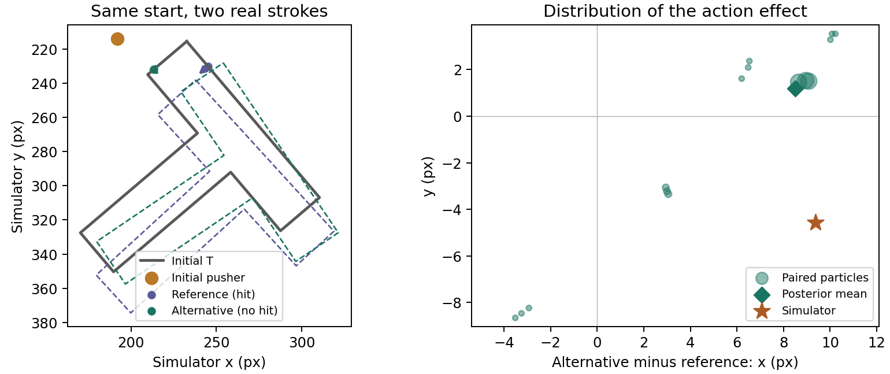
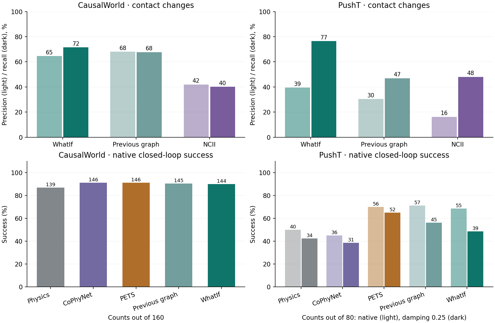

# Stage 10 · 让同一状态下的两个动作教会模型识别接触变化

**结果先看两项。** 给新旧模型同样的阈值标定后，在新的 PushT 测试分叉上，加入动作对训练让换接触召回从 **122/260 提高到 199/260**；同一批 160 个闭环布局上，本轮模型、PETS、CoPhyNet 和物理规则分别完成 **94、108、67 和 74** 个。新图能辨认更多真实接触变化，完整概率规划的成功率仍由 PETS 领先。

Stage 09 在 PushT 上遇到了一个具体问题。共享图对单条接触边的平衡误判率只有 1.97%，换动作引起的 252 次接触切换却一次也没检出。常见情形很容易猜中：推手通常会接触 T 形块，墙通常碰不到它。真正影响决策的问题是，在**同一布局**里，为什么从这个点推会接触，从另一个点推会落空？

## 增加一个直接对应这个问题的训练信号

还是同一个跨任务图网络、同一个物理先验 $P_k$、同一个事实更新和同一组低层动作。初始权重来自 Stage 08 的联合模型。把训练数据按“起点 $s$、接触源 $j$”分组。12 个动作中实际接触该源的动作组成 $A^+_{sj}$，没有接触的组成 $A^-_{sj}$。只要两组都非空，就有了一个可直接验证的接触切换。原训练数据重新组织后，PushT 的 1,680 个训练起点中，有 467 个可让推手接触随动作改变，有 24 个可让横墙接触改变，16 个可让纵墙接触改变；同一起点可计入多个来源。没有为本轮主模型增加基线看不到的新轨迹。[原数据清单](../../data/shared/manifest.json)

记 $l_a$ 为该源在动作 $a$、物理粒子及执行扰动给定时的边 logit。保留原来的事实/反事实位姿、物理先验、源删除与任务效用训练目标 $L_0$，仅对有上述两类动作的组增加两项。每个任务先独立对其有效组求平均，再对两个任务等权合并：

$$
L_{\mathrm{edge}}=\tfrac12\left(
\mathbb E_{a\in A^+}\log(1+e^{-l_a})+
\mathbb E_{b\in A^-}\log(1+e^{l_b})\right),\qquad
L_{\mathrm{pair}}=\mathbb E_{a\in A^+,b\in A^-}\log(1+e^{-(l_a-l_b)}),
$$

$$
L=L_0+0.32L_{\mathrm{edge}}+0.18L_{\mathrm{pair}} .
$$

第一项让同组的“会接触”和“会落空”得到相同分量，第二项直接要求前一个动作的边得分高于后一个。软边 $e^a_j=\sigma(l_a)$ 仍然乘到源消息和刚体运动项上。把图改好会改变对位姿、终点覆盖率和任务分的预测，闭环直接读取同一份更新后的权重。联合微调 48 轮，训练种子 11，按 Stage 08 的独立预测验证集选检查点。两个任务没有各训一个模型。[两项损失与训练代码](../../whatif/contact_switch/train.py) · [共享图与物理项](../../whatif/shared/model.py)

**从事实到下一推。** 沿用 Stage 08 的高斯事实后验：上一推为 $b$，已知其终点 $o_b$，将每个 $P_k$ 的历史权重、位姿似然，有观测时再加上松手后的速度保留率似然，共同归一化。先在这一次推动的扰动 $u$ 上求和得到 $m_k$，到下一次推动重新取三个等权扰动。$\hat z^a_{k,u}$ 是图沿动作 $a$ 的接触边推理所得的下一位姿。候选 $a$ 与参考 $b'$ 共用同一个 $k,u$：

$$
m_k \propto (m_k^-)^{0.7}\!\sum_u \exp\!\left[
-\tfrac12\|\hat z^b_{k,u}\ominus o_b\|_{\Sigma^{-1}}^2
-\tfrac c2\big((\hat\rho-\rho_k)/0.065\big)^2\right],\qquad
q(z^a_{t+1}\ominus z^{b'}_{t+1}\mid s,H_t)=
\sum_{k,u}\tfrac{m_k}{3}\,\delta_{\hat z^a_{k,u}\ominus\hat z^{b'}_{k,u}}.
$$

位姿似然的标准差为 $(.055,.055,.088)$，位置按物体尺度归一化，偏航单位为弧度。分支位姿和成对效果分布都保留了两种不确定性：持续的物理条件和本次新的执行扰动。对同一次分叉事后揭示参考终点时，只需再更新成对样本的权重。[物理后验](../../whatif/shared/model.py) · [预测评测](../../whatif/contact_switch/evaluate.py)

**从效果分布到动作。** 每条动作序列仍按目标覆盖、位姿和真实步数预算评价。另在验证集比较一种简单的决策代价。若所有可施力的执行源都碰不到目标，则在该粒子的模型任务分中扣除 $\lambda\prod_{j\in\mathcal A}(1-e^a_j)$。$\mathcal A$ 在 CausalWorld 为三根手指，在 PushT 为推手。取 $\lambda\in\{0,0.25\}$，在两个任务的验证布局上共同选一个值。边仍在两种候选方案的动力学中参与消息传播。PushT 的三步 CEM 对每个候选使用五个物理粒子和每粒子三条扰动路径，比较同粒子上的任务回报及相对名义序列的回报差；CausalWorld 的图模型沿用两推前瞻。[控制实现](../../whatif/contact_switch/control.py) · [规划目标](../../whatif/prospective/planner.py)

## 场景、基线与选型

| 评估 | CausalWorld TriFinger Pushing | PushT |
|---|---|---|
| 实验依据 | 可干预质量和布局；三根手指分别提供接触边。P1/P2/P7/P8 在闭环验证、测试各占四分之一。[CausalWorld](https://arxiv.org/abs/2010.04296) | 非对称物体需要完整 SE(2) 对齐，原生环境保留推手和墙的冲量信号。验证使用阻尼 0/.18，测试使用 0/.25。[PushT 与公开演示](https://diffusion-policy.cs.columbia.edu/) |
| 离线预测 | 160 个新验证起点，192 个新测试起点 | 160 个新验证起点，256 个新测试起点 |
| 真实控制 | 80 个新验证、160 个新测试布局。最多 420 个原生步，覆盖率 > .90 成功 | 80 个新验证、160 个新测试布局。最多 280 个原生步，覆盖率 > .95 成功 |
| 两个主基线 | 跨任务重训的 CoPhyNet 与五成员 PETS。对 CoPhyNet 使用作者图网络、事实轨迹 GRU 和 10 个状态/动作 token 的适配，输出点位姿，再换算目标重叠选动作。[CoPhy](https://arxiv.org/abs/1909.12000) | 同两条基线。PETS 通过官方 MBRL-Lib GaussianMLP 与 CEMOptimizer 搜索三步动作，每轮 48 个候选、3 轮优化、15 条不确定性路径。[PETS](https://proceedings.neurips.cc/paper/2018/hash/3de568f8597b94bda53149c7d7f5958c-Abstract.html) · [MBRL-Lib](https://github.com/facebookresearch/mbrl-lib) |

用于识别真实边的 NCII 单独列在建图表中。它沿用按论文公式重实现的状态版似然差与边分类器。WhatIf 使用接触标签以及训练时的物理档位。两者的训练监督条件不同。每种建图方法都获得同等的阈值选择机会：在新验证集上，每域独立选取使 $\mathrm{BMR}+1-\mathrm{F1}_{\rm switch}$ 最小的单个阈值。这里的硬阈值只用于计算边指标。规划和状态预测始终使用连续的边概率。[NULL 论文表 1](https://arxiv.org/html/2505.03172v1) · [各方法冻结阈值](../../results/contact_switch/thresholds.json)

预测时先观察一推，从该状态重放 12 个兄弟动作。两次推动独立抽取推程扰动，12 个兄弟动作共用第二次的扰动；在线控制按原生执行器默认指令推动。这样区分决策前的预测和事后揭示事实分支的预测。预测验证、预测测试、闭环验证和闭环测试分别从独立的布局号 411000、421000、431000、441000 开始。闭环控制器从同一初始布局和首推开始，之后每个方法沿自己选出的轨迹继续。训练数据、动作/状态表示、反馈执行器及重置协议沿用前两轮。[分叉数据与校验值](../../data/contact_switch/manifest.json) · [Stage 09 对两种预测时刻的定义](09-prospective-control.md)

## 一　换动作之后，图能分清哪条边变了吗？

本轮验证选择的 PushT 阈值为新图 .35、旧图 .85、NCII .45。新图和旧图获得相同的阈值搜索机会，这使同一批布局上的差值可以区分重新标定与训练的作用。

| 场景 | 模型 | 边存在 BMR ↓ | 边精确率 / 召回率 | 切换精确率 / 召回率 | 切换 F1 | 检出的真实切换 |
|---|---|---:|---:|---:|---:|---:|
| CausalWorld | **共享图，加入动作对训练** | **10.38%** | 84.1% / 86.7% | 64.6% / **71.5%** | 67.9% | 890/1,244 |
| | 原共享图，重新标定 | 11.20% | 85.6% / 84.0% | 68.1% / 67.7% | 67.9% | 842/1,244 |
| | NCII 专项参考 | 25.54% | 75.6% / 57.3% | 42.0% / 40.2% | 41.1% | 500/1,244 |
| PushT | **共享图，加入动作对训练** | **3.57%** | 97.4% / 94.1% | **39.5% / 76.5%** | **52.1%** | **199/260** |
| | 原共享图，重新标定 | 4.58% | 97.7% / 91.9% | 30.3% / 46.9% | 36.9% | 122/260 |
| | NCII 专项参考 | 11.13% | 89.1% / 82.5% | 16.2% / 48.1% | 24.3% | 125/260 |

BMR 是 $\tfrac12(\mathrm{FPR}+\mathrm{FNR})$。上表的切换把“由有到无”和“由无到有”视为同一类，度量是否意识到换动作改变了边；下面进一步要求判断对方向。测试分别有 6,336、8,448 个“起点 × 对照动作 × 接触源”判断。Stage 09 的旧图报告 0/252，本轮按切换 F1 也校准旧图后可检出 122/260。因此，新训练本身带来的增益应读作同一新测试集上的 **122 → 199**。按布局配对重采样，PushT 的切换召回增加 29.6 个百分点（95% 区间 +19.7 至 +40.6），切换 F1 增加 15.2 个百分点（+7.1 至 +23.5）。新图另有 305 次切换预测未与真实切换对应；高召回仍然付出了误报代价。[逐项预测指标](../../results/contact_switch/prediction-test.json)

**形成与断开分别看。** 对方向也作要求，PushT 新图检出 **154/204** 条新形成的边、**39/56** 条断开的边。260 次真实切换中，推手占 257 次，横墙 0 次、纵墙 3 次。199 次检出全部来自推手，三次墙接触切换都漏检。CausalWorld 对应为 **348/527** 条新边和 **515/717** 条断边。读者可以据此区分跨任务的推手/手指接触改善与当前样本较稀少的墙接触表现。

**一个实际分叉。** 为了能直接看到动作、边和位姿差的关系，按布局号和动作号取测试集中第一个“新图判对了推手接触切换、旧图漏判”的实例。布局 421001 中，参考动作 2 成功接触，备选动作 6 落空。新图给两个动作的接触概率分别为 .944 和 .236，旧图为 .961 和 .922。改推后，相对位移真值是 $(9.36,-4.56)$ px，新图预测均值为 $(8.50,1.18)$ px。模型判对了接触变化与横向位移方向，纵向分量仍有偏差。这张图展示一个具体错误模式；总体频率见上表。[实例的原始数值](../../results/contact_switch/example.json)



## 二　动作效果分布能把位移和旋转预测多准？

每个测试布局的 11 个备选动作均参与评测。位置效果误差是 $z^a-z^{b'}$ 预测均值与仿真真值的二维欧氏距离；角度用最短圆弧。二维 energy score 同时考察每个样本距真值的距离和样本间的离散程度，越小越好。直接终点用同一前瞻分布计算。最右列先揭示当前分叉的一个参考动作终点，再检查其余动作。CoPhyNet 给出点预测，因此二维 energy 等于位置效果误差。

| 场景 | 模型 | 前瞻位置效果误差 ↓ | 角度效果误差 ↓ | 二维 energy ↓ | 直接终点误差 ↓ | 揭示当前分叉参考后的位置效果误差 ↓ |
|---|---|---:|---:|---:|---:|---:|
| CausalWorld | **本轮 WhatIf** | 29.92 mm | 20.92° | 27.91 mm | **22.82 mm** | **27.16 mm** |
| | 原共享图 | 29.55 mm | 20.73° | 27.61 mm | 22.90 mm | 27.34 mm |
| | CoPhyNet | 41.89 mm | 24.69° | 41.89 mm | 41.19 mm | 28.26 mm |
| | PETS | 36.79 mm | 23.77° | 31.75 mm | 28.47 mm | 36.79 mm |
| PushT | **本轮 WhatIf** | 5.25 px | 2.82° | 4.51 px | 5.19 px | 4.99 px |
| | 原共享图 | 4.86 px | 2.76° | 4.22 px | 4.82 px | 4.73 px |
| | CoPhyNet | 14.23 px | 6.15° | 14.23 px | 24.49 px | 12.16 px |
| | PETS | **4.61 px** | **2.33°** | **3.61 px** | **4.70 px** | **4.61 px** |

CausalWorld 的动作效果预测优于两个论文基线，新图与原图的整体位姿误差接近。PushT 换边识别改善后，平均位置效果误差比原图高 0.39 px。对确有可切换接触的 51 个 PushT 起点，比较每个控制器预测最优动作与真实最优动作的效用差，新图 .044、原图 .049、PETS .019、CoPhyNet .083；全部 256 个起点分别为 .033、.032、.025、.092。这个对照说明，学会识别接触切换对部分动作选择有帮助；精确位姿和后续收益仍决定最终排序。[按布局的预测误差](../../results/contact_switch/paired-test.npz)

## 三　改善接触判断能否提高真实闭环成功率？

在闭环验证的 80 个布局上，保留图推理、直接用任务分选动作的版本在 PushT 完成 56 个，增加显式接触失败代价后为 55 个，原图为 57 个。CausalWorld 分别为 70、70、71。两个域等权，根据成功率、终点覆盖和步数的综合分，选定 $\lambda=0$，之后冻结模型与规划。新旧图比较使用相同的事实更新、15 条扰动路径和真实动作接口。单独报告这个新方法在测试上的表现，原图一行用于判断改动的净效果。[验证逐布局记录](../../results/contact_switch/validation.csv) · [冻结决策](../../results/contact_switch/freeze.json)

| 方法 | CausalWorld 成功 / 160 | 平均覆盖 | 平均步数 | PushT 成功 / 160 | 平均覆盖 | 平均步数 | 默认 / 80 | 新阻尼 .25 / 80 |
|---|---:|---:|---:|---:|---:|---:|---:|---:|
| **WhatIf，本轮共享图** | 144 | 0.849 | 136.1 | 94 | 0.903 | 234.4 | 55 | 39 |
| PETS，三步 CEM | 146 | 0.873 | 131.8 | 108 | 0.919 | 225.8 | 56 | 52 |
| CoPhyNet，位姿读出 | 146 | 0.874 | 129.7 | 67 | 0.899 | 249.6 | 36 | 31 |
| 原共享图，同一后验和规划 | 145 | 0.857 | 134.7 | 102 | 0.907 | 228.2 | 57 | 45 |
| 相同执行器，仅物理规则 | 139 | 0.845 | 142.2 | 74 | 0.889 | 244.3 | 40 | 34 |
| 本轮图，高层物理权重均匀 | 145 | 0.857 | 140.6 | 92 | 0.901 | 232.4 | 53 | 39 |
| 本轮图，额外扣接触失败代价 | 143 | 0.846 | 134.8 | 90 | 0.886 | 236.0 | 63 | 27 |



**相同执行器上的实际增益。** PushT 的物理规则完成 74/160，加入共享图与前瞻规划后为 94/160，多完成 20 个布局，平均少用 10.0 个原生步。按相同布局配对重采样 6,000 次，成功率差为 +12.5 个百分点，95% 区间为 +2.5 至 +22.5。对 CoPhyNet 为 +16.9 个百分点（+6.9 至 +26.9），对 PETS 为 −8.8 个百分点（-17.5 至 +0.6）。原共享图在相同规划下完成 102/160，本轮为 94/160，差值区间为 -13.1 至 +3.1 个百分点。训练边时的改善不能直接解释为成功率提升。

**物理后验与新阻尼。** 在 PushT，全体布局的事实后验比均匀高层物理权重多完成 2 个（94 对 92），差值区间 -7.5 至 +9.4 个百分点；阻尼 .25 两者都是 39/80。同组下 PETS 为 52/80，物理规则为 34/80。给可能落空的动作额外扣分，在默认阻尼完成 63/80，但在新阻尼降至 27/80；验证筛选保留了没有额外扣分的主模型。CausalWorld 主模型完成 144/160，对物理规则提高 3.1 个百分点（-1.9 至 +8.8）。P8 联合干预中，WhatIf 完成 25/40，PETS 28/40，CoPhyNet 27/40。

## 审稿判断与复现

对“共享世界模型能否推断换动作将改变接触”这个问题，现在有了直接的肯定证据，尤其是 PushT 的推手接触，且有同等调阈值的原图作对照。对“这项建图改进能否持续战胜强模型规划”这个问题，答案仍然开放。PETS 在 PushT 上的分布预测、闭环控制和新阻尼泛化仍然较好。在原生 Pushing，三个高分模型的成功数接近，区分建图质量、动作效果预测与最终策略强弱尤其重要。三阶段均为单个训练种子；区间只刻画独立布局之间的波动。论文目前最扎实的结果是跨两个已见任务的同模型推理、可测的动作条件接触变化，以及在同一 PushT 反馈执行器上反复测到的规划收益。

本阶段复用 Stage 08 固定的模拟器与上游仓库版本。已有数据与检查点可直接在项目根目录重画两张图，也可重新运行独立测试。原生仿真轨迹、权重、验证选择和测试数据均在本次提交中。[完整代码](../../whatif/contact_switch) · [逐布局控制](../../results/contact_switch/control.csv) · [逐推决策与覆盖](../../results/contact_switch/trajectory.csv) · [配对统计](../../results/contact_switch/summary.json)

```bash
bash whatif/contact_switch/reproduce.sh figures
bash whatif/contact_switch/reproduce.sh test
# 从头复现依次运行 collect、train、select、test。
```
