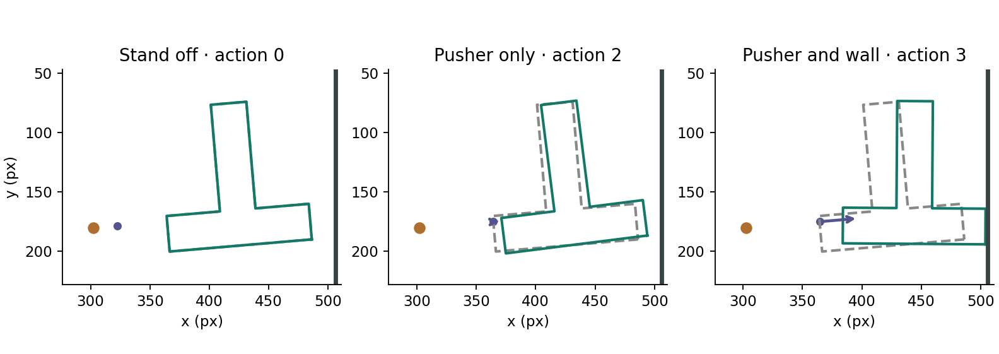
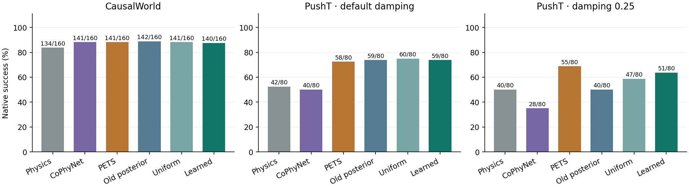
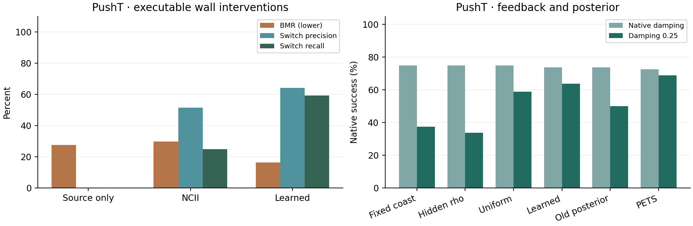

# Stage 11 · 用上一推学习下一推的物理响应

在新阻尼 0.25 的 80 个真实 PushT 布局上，旧高斯后验完成 **40** 个，直接按未来效果训练的新后验完成 **51** 个，PETS 完成 **55** 个。相同执行器、同一新图上，把物理粒子固定为均匀权重可完成 **47** 个，固定为验证集平均后验可完成 **48** 个。新模型明显改善了与旧更新规则的比较；当前数据里，针对每一次具体事实单独调整权重的增量较小。

这次还让 T 形块真实接近墙面，在同一状态尝试留出间隙、直接推和向墙施力。在 192 个新布局里，图模型识别出 **203/369** 次横墙接触切换和 **216/376** 次纵墙接触切换。接触切换和控制成功分别测量，预测和控制共用模型权重。

## 前人怎样设实验，本轮怎样比较

| 研究 | 原实验与本轮的关系 |
|---|---|
| CoPhy，ICLR 2020 | 原论文先观察积木塔、球碰撞或弹球的事实演化，再改变初始条件，预测另一条轨迹。本轮把干预换成推动动作。复用作者 CoPhyNet 的图网络、事实 GRU 和稳定门，将物体、接触源、目标和动作编码为 10 个三维 token。给模型提供上一推的完整可观测输入，并在真实的“上一推→下一推”数据上重新训练。它输出点位姿，控制时换算目标覆盖。[论文](https://arxiv.org/abs/1909.12000) · [作者实现](https://github.com/fabienbaradel/cophy) |
| PETS，NeurIPS 2018 | 原论文用概率集成、轨迹采样和滚动规划做连续控制。本轮沿用 MBRL-Lib 的 GaussianMLP 与 CEMOptimizer，5 个 bootstrap 成员，每条候选展开 3 推、15 条粒子路径，48 条候选、3 轮 CEM。给其输入补上与共享模型相同的上一推证据，重新训练集成；在验证集为每个任务选择是否使用终点价值。[论文](https://arxiv.org/abs/1805.12114) · [MBRL-Lib](https://github.com/facebookresearch/mbrl-lib) |
| CaDM，ICML 2020；Counterfactual World Models | CaDM 在动力学变化的控制任务里用近期转移编码环境上下文；后者用配对分叉检查同一事件的反事实。我们的目标结合两者：看完上一推，从新状态对两个候选动作预测配对差，测量在不同物理条件下能否据此做出更好的选择。[CaDM](https://proceedings.mlr.press/v119/lee20g.html) · [反事实实验设置](https://arxiv.org/html/2611.24778v1) |
| CausalWorld、PushT 和 NULL | 三指推块使用 CausalWorld 的质量及初始位置干预；不对称 T 形块要求位置和朝向同时对齐。NCII 按 NULL 论文的源删除似然差重实现，仅作边存在性专项参照。本轮又在近墙训练分叉中实际关闭一个来源的碰撞来适配 NCII。WhatIf 训练使用真实接触标签和基础数据中的物理档位，NCII 的边学习使用动力学似然差；其检查点选择可见验证集接触标签。[CausalWorld](https://arxiv.org/abs/2010.04296) · [PushT](https://diffusion-policy.cs.columbia.edu/) · [NULL](https://arxiv.org/abs/2505.03172) |

两个主基线与 WhatIf 获得相同的新增正常分叉和事实历史。CoPhyNet 同时保留旧数据的同事件任务，PETS 在无历史的旧样本上接收带缺失标记的零向量。三个方法的网络结构、损失及使用源删除监督的方式各依其设计。上游版本固定为 CausalWorld `1045277`、Diffusion Policy `5ba07ac`、CoPhy `170fe46`、MBRL-Lib `3f93ccc`。新代码位于本项目的适配目录。[实现入口](../../whatif/factual) · [上游环境版本](07-crossbench.md)

## 共享模型具体如何改

**物理先验和动作条件接触图。** 仍用一个物理索引 $P_k\in\{-1,-0.5,0,0.5,1\}$ 表示由弱到强的响应，初始 $\pi_k=1/5$。每个粒子有三种行程扰动 $u$。动作给出物体坐标系里的接触点、推力方向、行程 $\ell$、力臂和接近距离。对来源 $j$ 重新计算 $e^a_{j,k,u}=\sigma(h_\theta(s,a,j,P_k,u))$。质心位姿增量为

$$
D^a_{k,u}=\psi_\theta\!\left(s,a,P_k,u,\sum_j e^a_{j,k,u}M^a_{j,k,u}\right)
+\max_j e^a_{j,k,u}\,D_{\rm rigid}(s,a,P_k).
$$

刚体项把行程沿接触法线投到平移，用力臂乘以行程给出旋转，并按已有速度与 $P_k$ 估计滑行。网络沿图预测剩余量及覆盖和任务效用。CausalWorld 和 PushT 各有自己的原生执行器，两个任务共用同一个图、事实编码器和检查点。[物理项与动力学](../../whatif/shared/model.py)

**上一推怎样修改物理条件。** 历史 $H=(s_0,b,s_1)$ 含上一状态、实际动作、观测后继。$v(H)$ 包含上一推的可观测状态/动作描述、实测质心位姿变化、它相对名义刚体响应的误差，以及末端速度、滑行估计和置信度。一个两层、每层 64 单元的共享编码器给出

$$
m_k(H)=0.96\,\mathrm{softmax}_k(f_\phi(v(H)))+0.04\pi_k .
$$

该后验重新分配动力学项中不同物理响应的概率。其方差来自这些粒子的离散分布。在本轮主方法，每次真实推动后用最近一次转移重算权重；可观测状态里的滑行估计持续更新。在旧后验消融，继续把上一次粒子权重与高斯事实似然递归相乘。模型在推理时只看轨迹，不读取仿真器的质量或阻尼。[事实编码器](../../whatif/factual/model.py) · [历史诊断](../../whatif/factual/history.py)

**未来两个动作的分布与训练。** 从 $s_1$ 考察 $a$ 和 $b'$。$F^a_{k,u}$ 为由 $D^a_{k,u}$ 得到的下一位姿，$\ominus$ 为位置作差、角度取最短圆弧。两条候选分支共用同一次 $P_k,u$，下一次未来事件再抽取新扰动：

$$
q(z^a\mid H,s_1)=\sum_{k,u}\frac{m_k}{3}\delta_{F^a_{k,u}},\qquad
q(\Delta^{a,b'}\mid H,s_1)=\sum_{k,u}\frac{m_k}{3}\delta_{F^a_{k,u}\ominus F^{b'}_{k,u}},
\qquad \Delta^{a,b'}=z^a_{t+1}\ominus z^{b'}_{t+1}.
$$

用真实分叉差 $y$ 训练效果分布的 energy score。$X,X'$ 独立来自这个**配对差分布**。训练指标的范数包含平移与按 0.47 特征长度换算的角度；报告里的二维 energy 只计算平移，保留 mm 或 px 单位。

$$
L_{\rm ES}=\mathbb E\|X-y\| - \tfrac12\mathbb E\|X-X'\| .
$$

另拟合绝对位姿、覆盖、接触边和状态后继。给真实动作效用做同起点中心化并拟合预测效用差，同时以真实效用的 softmax 训练动作排序。如此，未来动作差、分布评分和排序三者的梯度均能回到 $f_\phi$ 与图动力学。保留 Stage 10 同一布局下接触/不接触动作对的分类和排序损失，另抽取原始源删除样本保持机械先验。图损失权重在 .12 和 .32 两档间用独立验证数据选择，统一验证损失为 .855 和 .836，采用 .32。Stage 11 从 Stage 08 共享动力学初始化，重新联合学习，不沿用 Stage 10 检查点的硬阈值。[完整训练损失](../../whatif/factual/train.py) · [图权重选择](../../results/factual/graph-choice.json)

**分布怎样变成真实动作。** 用 $J_{k,u}(A)$ 表示候选序列的任务回报，奖励包含目标覆盖、质心和角度误差、接近成功线及机械可行性。比较候选与同粒子下的参考序列 $A_0$，最大化

$$
\mathbb E_{m_k/3}\big[J_{k,u}(A)+0.12\tanh((J_{k,u}(A)-J_{k,u}(A_0))/0.30)\big] .
$$

在闭环验证试了三种用法：前期规划器；穷举第一推和第二推的全部 $12\times12$ 个动作组合，两步保持同一物理粒子并精确对两个独立扰动求平均；以及只把事实相对均匀先验的优势校正施加在第一推。穷举方案的模型分、机械分各占一半，并给第二推加权 .24 的通用延续价值。验证为 CausalWorld 选择两步穷举，为 PushT 选择三步 CEM。后者保留每步 .35 模型分、.65 机械分、.85 折扣与配对相对回报。每次只执行第一推，然后根据新事实重算。PETS 在 CausalWorld 选中不加末端价值，在 PushT 选中加末端价值；CoPhyNet 的位姿评分权重分别为 .25 和 .70。三种主比较方法使用相同可观测信息、菜单、原生步数预算和首推。[规划实现](../../whatif/factual/planning.py) · [冻结配置](../../results/factual/freeze.json)

## 采集了什么

| 数据用途 | CausalWorld 三指推块 | PushT 普通推块 | PushT 近墙诊断 |
|---|---:|---:|---:|
| 新增训练起点 × 候选动作 | 384 × 12 | 768 × 12 | 640 × 8 |
| 合并已有事实→未来训练起点 | 另加 450 | 另加 1,100 | 每条正常分叉另跑一次随机删除接触源 |
| 新预测验证 / 测试起点 | 160 / 192 | 192 / 256 | 160 / 192，墙边与阻尼完全交叉的独立校准及最终评测 |
| 新闭环验证 / 测试布局 | 64 / 160 | 64 / 160 | 图和预测专项；正式控制使用原生布局 |
| 原生成功线与预算 | 覆盖率 > .90，420 步 | 面积覆盖率 > .95，280 步 | 测真实冲量与位姿 |

以上另复用 38,400 条 Stage 08 常规分叉及其源删除分叉。监督网络只用训练种子 11。本阶段实际新采了 18,944 条正常训练分叉，另有 5,120 条近墙源删除分叉。普通训练、预测验证、预测测试、闭环验证和闭环测试分别从布局号 511000、521000、531000、541000、551000 起。PushT 普通任务的阻尼训练档为 0/.08/.55，验证档为 0/.18，测试档为 0/.25，各 80 个闭环布局。CausalWorld 测试用 P1/P2/P7/P8 各 40 个布局。成功当步即停止，统计所有失败和预算耗尽布局。另在每域 96 个新布局使用同一物理规则实际推五次，用于观察持续物理条件下后验怎样随时间变化。[数据清单及校验值](../../data/factual/manifest.json) · [逐布局验证](../../results/factual/validation.csv)

**近墙动作怎么执行。** 随机化物体朝向，让旋转后的外轮廓距选中墙面 4–27 px，推手从墙对侧起步。先做一推形成可观察历史，再从同一状态执行八个动作：两种留有间隙的接近、沿墙法线的短中长行程、偏心施力、切向推及离墙推。所有动作都使用同一 7 维接触描述与反馈执行器，留间隙动作的推进行程为零。真值来自原生碰撞冲量，推手、横墙、纵墙分别打标签。训练、验证、测试使用相同的动作接口。早期诊断脚本按种子奇偶同时选择墙轴与测试阻尼；正式图表另用了独立的平衡面板：四侧墙分别与两种阻尼交叉，每个组合 20 个校准布局和 24 个测试布局。更换面板时冻结全部模型与控制器，只在新校准面板重新选接触判定阈值。普通原生闭环的重置与阈值始终不变。[诊断采集](../../whatif/factual/collect.py) · [平衡面板的校准值](../../results/factual/crossed-calibration.json)

## 结果一　接触图能否预见新边和断边？

每个未揭示动作与一个同起点参考动作比较。BMR 是假阳性率和假阴性率的均值；切换的精确率和召回率按仿真中改变了接触的边计算。每域在独立验证分叉上用同一规则选诊断阈值，使 BMR + 1 − 切换 F1 最小。只看源身份的参照用训练接触率给每个源赋常数。它能测出普通布局有多少分数来自“推手常碰到、墙很少碰到”。

| 测试分叉 | 方法 | BMR ↓ | 边精确率 | 边召回率 | 切换精确率 | 切换召回率 | 切换 F1 |
|---|---:|---:|---:|---:|---:|---:|---:|
| CausalWorld | **WhatIf 学习后验** | 10.9% | 80.4% | 88.2% | 55.4% | 71.1% | 62.2% |
| CausalWorld | NCII 专项参考 | 32.3% | 73.1% | 42.7% | 40.7% | 42.2% | 41.4% |
| CausalWorld | 只看接触源身份 | 39.8% | 38.3% | 80.6% | 0.0% | 0.0% | 0.0% |
| PushT 原生布局 | **WhatIf 学习后验** | 3.4% | 95.2% | 95.5% | 37.5% | 80.3% | 51.1% |
| PushT 原生布局 | NCII 专项参考 | 10.6% | 93.0% | 81.6% | 10.9% | 32.5% | 16.3% |
| PushT 原生布局 | 只看接触源身份 | 1.9% | 94.6% | 98.9% | 0.0% | 0.0% | 0.0% |
| PushT 近墙 | **WhatIf 学习后验** | 16.3% | 88.4% | 74.5% | 64.2% | 59.2% | 61.6% |
| PushT 近墙 | NCII 专项参考 | 29.6% | 84.1% | 47.3% | 51.5% | 24.9% | 33.6% |
| PushT 近墙 | 只看接触源身份 | 27.5% | 75.3% | 59.4% | 0.0% | 0.0% | 0.0% |

在普通 PushT 布局，仅凭源身份即可取得更低的边存在性 BMR，但它对换动作后的真实接触切换召回为零。近墙分叉共有 4,032 个待判断的接触源，真实改变 1,322 次。要求连变化方向也判对时，WhatIf 检出 **371/670 条新边**和 **392/652 条断边**。同一场景中，改变推手、横墙、纵墙接触的无方向召回分别为 363/577、203/369、216/376。CausalWorld 常规任务中的三指切换依然可测。



图取第一个同时出现三种结果的布局 537000。动作 0 留出间隙，三个源都无接触；动作 2 只碰到推手；动作 3 进一步形成纵墙接触。模型给纵墙边的概率依次为 .138、.290、.464。最后一个概率随行程上升，但低于冻结的 .575 阈值，该例的纵墙边仍然漏判。总体检出数见上表。[实例原始值](../../results/factual/example.json) · [近墙完整指标](../../results/factual/prediction-crossed-test.json)

## 结果二　反事实效果与分布质量

下面预测的是两个**都尚未执行**的动作从同一状态出发会造成多大的位置、角度差。每个 CausalWorld/普通 PushT 起点评 11 个备选，近墙起点评 7 个备选。二维 energy score 越低越好；CoPhyNet 的点预测使其等于平均二维位置效果误差。最右列额外揭示当前分叉的参考终点：WhatIf 按验证集标定的位姿噪声再更新同一事件的联合粒子，CoPhyNet 将参考轨迹送入事实编码器，PETS 保留原预测。

| 任务 | 模型 | 前瞻位置效果误差 ↓ | 角度效果误差 ↓ | 二维 energy ↓ | 直接终点位置误差 ↓ | 同事件揭示后的位置效果误差 ↓ |
|---|---:|---:|---:|---:|---:|---:|
| CausalWorld | **WhatIf 学习后验** | 29.12 mm | 18.51° | 24.05 mm | 23.92 mm | 26.67 mm |
| CausalWorld | CoPhyNet，事实历史适配 | 32.15 mm | 22.27° | 32.15 mm | 26.49 mm | 26.82 mm |
| CausalWorld | PETS，条件集成 + 三步 CEM | 36.45 mm | 23.84° | 31.41 mm | 29.71 mm | 36.45 mm |
| PushT 原生布局 | **WhatIf 学习后验** | 5.78 px | 3.49° | 4.57 px | 5.64 px | 5.39 px |
| PushT 原生布局 | CoPhyNet，事实历史适配 | 12.66 px | 5.89° | 12.66 px | 12.67 px | 12.89 px |
| PushT 原生布局 | PETS，条件集成 + 三步 CEM | 4.47 px | 2.37° | 3.56 px | 4.00 px | 4.47 px |
| PushT 近墙 | **WhatIf 学习后验** | 33.51 px | 13.04° | 27.38 px | 22.93 px | 31.61 px |
| PushT 近墙 | CoPhyNet，事实历史适配 | 43.21 px | 16.13° | 43.21 px | 31.00 px | 36.17 px |
| PushT 近墙 | PETS，条件集成 + 三步 CEM | 36.88 px | 12.82° | 30.23 px | 23.96 px | 36.88 px |

**单独看上一推提供多少信息。** 下表保持当前已观测状态和同一图网络不变。打乱对照交换各布局上一推的动作和运动证据，保留接收布局当前的速度、滑行估计、置信度和全部候选动作。固定平均对照使用本域验证集的平均学习后验。每格为“位置效果误差 / 二维 energy”。

| 权重来源 | CausalWorld（mm） | PushT 原生（px） | PushT 近墙（px） |
|---|---:|---:|---:|
| 均匀权重，保留滑行观测 | 29.09 / 24.18 | 5.57 / 4.38 | 33.80 / 27.61 |
| 固定为验证集平均后验 | 29.06 / 23.95 | 5.73 / 4.49 | 33.74 / 27.55 |
| 打乱上一推，保留当前状态 | 29.14 / 24.06 | 5.82 / 4.64 | 33.85 / 27.79 |
| 旧高斯后验，同一新图 | 29.31 / 25.48 | 5.72 / 4.65 | 34.37 / 29.01 |
| 按域放宽旧似然，同一新图 | 29.09 / 24.38 | 5.71 / 4.61 | 33.90 / 27.92 |
| **WhatIf 学习后验** | 29.12 / 24.05 | 5.78 / 4.57 | 33.51 / 27.38 |

在近墙测试，正确配对上一推比打乱上一推的二维 energy 低 **0.41 px**，按布局配对的 95% 区间为 -0.8 至 -0.1 px（学习后验减打乱）。相对 PETS 的位置效果误差低 **3.36 px**。普通 PushT 上，PETS 的预测最精确，均匀权重的同一张图也比学习后验的前瞻位置误差低 0.21 px。揭示同一事件的参考终点有助于恢复该事件的扰动，但这与控制时估计未知未来的扰动是两个不同的信息条件。[常规预测指标](../../results/factual/prediction-test.json) · [配对误差与区间](../../results/factual/summary.json)

## 结果三　真实闭环和物理反馈

测试前冻结配置。表中覆盖为终止时原生覆盖比例；步数含首推、接近、松手以及失败用尽的全部原生步。末两列给出两个 PushT 阻尼组各自的成功数。

| 方法 | CausalWorld 成功 /160 | 覆盖 | 步数 | PushT 成功 /160 | 覆盖 | 步数 | 默认 /80 | .25 /80 |
|---|---:|---:|---:|---:|---:|---:|---:|---:|
| **WhatIf 学习后验** | 140 | 0.840 | 140.5 | 110 | 0.918 | 221.7 | 59 | 51 |
| CoPhyNet，事实历史适配 | 141 | 0.855 | 141.5 | 68 | 0.890 | 244.2 | 40 | 28 |
| PETS，条件集成 + 三步 CEM | 141 | 0.834 | 141.3 | 113 | 0.922 | 223.2 | 58 | 55 |
| 相同执行器，仅物理规则 | 134 | 0.822 | 152.0 | 82 | 0.914 | 235.7 | 42 | 40 |
| 均匀权重，保留滑行观测 | 141 | 0.845 | 141.0 | 107 | 0.919 | 222.4 | 60 | 47 |
| 固定为验证集平均后验 | 140 | 0.841 | 140.7 | 109 | 0.917 | 221.4 | 61 | 48 |
| 旧高斯后验，同一新图 | 142 | 0.853 | 140.1 | 99 | 0.918 | 230.2 | 59 | 40 |
| 均匀，遮住高层滑行观测 | — | — | — | 87 | 0.863 | 233.6 | 60 | 27 |
| 均匀，遮住滑行观测并固定执行器滑行系数 | — | — | — | 90 | 0.883 | 235.1 | 60 | 30 |



PushT 学习后验比同一执行器的物理规则多完成 **28/160**，差 **+17.5 个百分点**，配对布局 95% 区间 +8.1 至 +26.9；比重新适配后的 CoPhyNet 多 42 个，比 PETS 少 3 个，对 PETS 的差值区间为 -11.9 至 +8.1 个百分点。相对旧后验的 11 个净增全在新阻尼：两者默认阻尼都是 59/80，新阻尼为 51 对 40，差 **+13.75 个百分点**，区间 +1.2 至 +26.2。新阻尼下相对均匀权重为 +4/80，相对固定平均权重为 +3/80；相对固定平均的区间 -10.0 至 +17.5 个百分点。相同布局配对、重采样 6,000 次。CausalWorld 在 P8 中主方法、两条论文基线均为 21/40；四协议合计三者成功数仅差一个。[逐布局控制](../../results/factual/control.csv) · [逐次动作及覆盖](../../results/factual/trajectory.csv)

**三种“使用事实”的含义和对应对照。**

| 只改变这一层（其余相同） | PushT 成功数变化 | 成功率差（配对 95% 区间） |
|---|---:|---:|
| 底层执行器，高层已遮住滑行估计且粒子均匀。固定滑行系数 .45 → 用实测速比反馈控制松手时机 | 90 → 87 | −1.9 pp（-9.4 至 +5.0） |
| 高层观测，保留同一反馈执行器和均匀粒子。遮住滑行估计与置信度 → 提供实际观测 | 87 → 107 | +12.5 pp（+5.0 至 +20.0） |
| 显式事实后验，保留观测和反馈。均匀物理粒子 → 按上一推重新加权 | 107 → 110 | +1.9 pp（-6.2 至 +10.0） |

三行按这个顺序做条件对照。遮住高层观测时把输入替换为初始值，仍保留物体可见速度；这种替换本身可能造成输入分布变化，不能把 +12.5 pp 推广为滑行估计在所有控制器上的独立贡献。此次最清楚的增益来自让规划器看到物体会滑多久。单独用本次试推替代固定平均后验，整体增加 1/160，区间跨零。



## 为什么旧后验容易吃亏，什么仍需改进

旧规则给两个任务都用归一化标准差 $(.055,.055,.088)$，前两维为物体尺度、末维为弧度。用新的共享图预测事实动作，在独立验证中估计的残差均方根为 CausalWorld $(.312,.385,.378)$、普通 PushT $(.092,.066,.112)$。这些值包含模型误差和执行变异。仅用它们替换旧高斯尺度，CausalWorld 的前瞻 energy 从 25.48 降至 24.38 mm，普通 PushT 从 4.65 降至 4.61 px，近墙从 29.01 降至 27.92 px。共用过窄似然确实解释了一部分差距。

五个滑行粒子的速度保留率锚点约为 0、.388、.777、.859、.942；新阻尼 .25 对应约 .871，位于支持范围内。独立的每域 96 个布局、连续五次同动作规则试推中，CausalWorld 从相邻两次事实得到的平均后验总变差，旧规则为 .289、学习后验为 .153；PushT 为 .224、.200。新后验相对平稳。在新阻尼下，按锚点读出的速度保留率误差，旧后验由第一推 .081 降至第五推 .035，学习后验由 .230 降至 .051。旧后验的滑行参数更接近真值，控制成功数却更低。因此学习权重适合解释为对任务有用的物理响应信念；还不能当成更准的阻尼估计量。这批五推轨迹里，“以前有观测、本推无新滑行样本”的步数为零，数据未显示重复使用陈旧观测是本次控制差距的主因。[连续试推结果](../../results/factual/history.json) · [各步粒子权重](../../results/factual/history-weights.npz)

**审稿判断。** 这轮能支持三条具体结论：同一份权重能在两个已见任务上按动作重建接触；近墙分叉的反事实分布优于两个适配基线；学习后验在未知阻尼上改善了旧高斯后验的真实闭环表现。普通 PushT 的位姿和分布预测仍由 PETS 领先，针对单次事实的决策增量也没有和固定平均权重明显拉开。要把后一项写成 oral 级别的主贡献，最值得研究的是接近 .95 成功线时，上一推动作留下的角速度与剩余滑行量能否改变下一推的接触点或短行程排序。现在的区间只反映布局差异，所有训练都只跑了种子 11。

## 复现

项目根目录包含两个适配基线和共享模型的权重、原始分叉、逐布局记录及配对统计。已有 Stage 08/09 数据与环境时可按下列方式复现。训练与模拟分别使用固定的 PyTorch 和原生环境解释器。[复现脚本](../../whatif/factual/reproduce.sh) · [原阶段对照](10-contact-switch.md)

```bash
bash whatif/factual/reproduce.sh figures
bash whatif/factual/reproduce.sh test
# 从头运行依次执行 collect、train、select、test。
```
