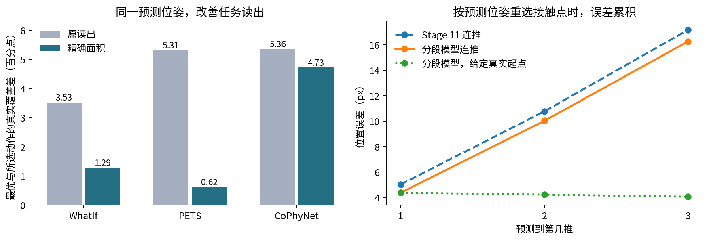
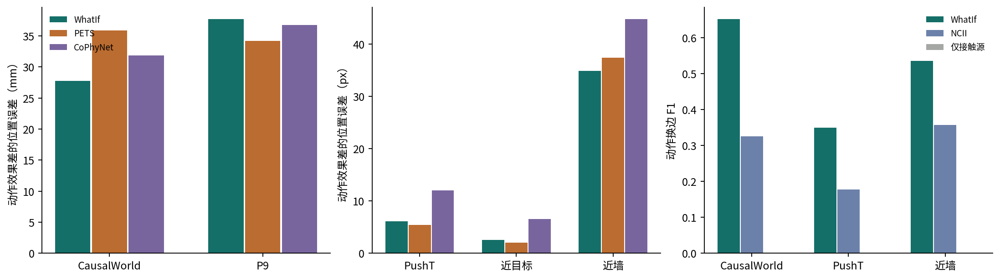
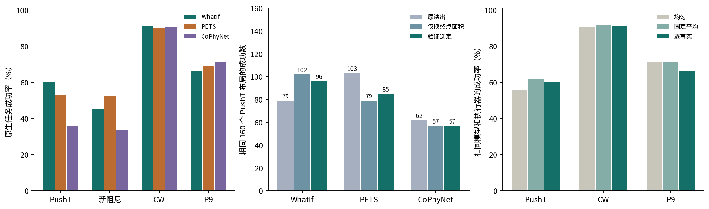

# Stage 12　从接触过程预测位姿，再用目标几何选动作

同一批 160 个新 PushT 布局，Stage 11 复测完成 **87** 个，分段预测与几何规划完成 **96** 个。验证集选出的 PETS 完成 **85** 个，保留原学习读出的 PETS 完成 **103** 个。新方法改善了自己的平移效果预测和真实控制，PETS 原读出配置的结果为 103/160。CausalWorld 主协议完成 **146/160**，PETS 为 **144/160**，CoPhyNet 为 **145/160**。额外留出的质量、位置与地面摩擦联合干预 P9 上，三者分别完成 **53/80、55/80、57/80**。

## 先定位普通 PushT 的误差

把 Stage 11 权重固定，在 192 个独立验证布局各执行 12 个动作。对每种预测，分别按原来的终点覆盖率和按预测位姿计算的精确覆盖率选一步动作。评价用的是这 12 个分叉的真实终点。表中的“选择损失”是最佳动作与被选动作之间的真实覆盖差。0 表示选到了同样好的动作。

| 冻结的模型 | 终点覆盖 MAE，原读出 → 精确几何（百分点） | 选择损失，原读出 → 精确几何（百分点） |
|---|---:|---:|
| WhatIf | 5.52 → 2.53 | 3.53 → 1.29 |
| PETS | 5.11 → 1.59 | 5.31 → 0.62 |
| CoPhyNet | 5.73 → 5.52 | 5.36 → 4.73 |

WhatIf 和 PETS 原来分别学习覆盖率，CoPhyNet 原来已用 112 个点近似 T 形交面积。后者换读出收益较小。几何能改善“这个预测位姿离成功还有多远”的判断，却修不准预测位姿本身。普通验证集的单推终点误差为 WhatIf **5.19 px**、PETS **3.40 px**。另取一条三推轨迹，后两推在原生环境使用标称行程。固定三个连续动作的菜单编号，每一步从模型预测的状态重新解出实际接触指令，WhatIf 的位置误差为 **5.03、10.78、17.18 px**。逐步给回真实起点时，对应为 **5.03、4.53、4.72 px**。这里真实中间状态只用于定位误差。规划全程使用模型输出，执行第一推之后才获得新的观测。[验证分叉与误差分解](../../results/precision/frozen-val.json)

## 前人怎么设实验，这轮沿用什么

| 研究 | 前人的场景和问题 | 在本轮实验中的对应 |
|---|---|---|
| CoPhy | 积木塔、球碰撞和弹球场景。给出一次事实演化，改变条件后预测另一条轨迹。 | 主基线之一。复用官方图网络、事实 GRU 和稳定性门，沿用本项目的 10 个三维状态与动作 token。给出同样的上一推和候选动作，输出物体位姿。[论文](https://arxiv.org/abs/1909.12000) · [作者代码](https://github.com/fabienbaradel/cophy) |
| PETS | 用概率动力学集成和轨迹采样做连续控制，比较规划后实际获得的任务回报。 | 主基线之二。用 MBRL-Lib 的五成员 GaussianMLP、轨迹采样和三轮 CEM。可见和 WhatIf 相同的上一推。终点几何也用于 PETS 的预测粒子。[论文](https://arxiv.org/abs/1805.12114) · [MBRL-Lib](https://github.com/facebookresearch/mbrl-lib) |
| Counterfactual World Models | 在相同事件上改变动作，分别量化执行器和受控物体的响应。其 Push-T 主坐标是推手位置，另有 T 块接触速度诊断。 | 本文直接预测 T 块的平移和转动。在同一起点真实执行所有候选动作，另起新布局验证实际拼合任务。上一推揭示事实，下一推的真实结果对规划器隐藏。[实验与附录](https://arxiv.org/html/2611.24778v1) |
| CaDM、CausalWorld 和 Diffusion Policy | CaDM 根据近期状态转移适应变化的动力学。CausalWorld 提供受控物理干预。PushT 以形状覆盖同时检验位置和朝向。 | 训练共享动力学，在 CausalWorld 官方 P9 上检验新增地面摩擦干预；在 PushT 的同一原生成功标准下检验默认和新阻尼。[CaDM](https://proceedings.mlr.press/v119/lee20g.html) · [CausalWorld](https://arxiv.org/abs/2010.04296) · [PushT](https://diffusion-policy.cs.columbia.edu/) |
| NULL | 通过去掉一个影响源，比较动力学响应，用于判断因子间是否存在交互。 | NCII 沿用本项目根据论文重实现的源删除似然方法，专门比较边存在性和换边。标签取自仿真实际接触。[论文](https://arxiv.org/abs/2505.03172) |

上游版本与 Stage 11 相同。CausalWorld 为 1045277，Diffusion Policy 为 5ba07ac，CoPhy 为 170fe46，MBRL-Lib 为 3f93ccc。推块和 PushT 都使用可观测状态；这批实验检验两个已训练任务的共享机制和任务内物理泛化。P9 的物理干预组合仅用于测试。[原生覆盖率实现](https://github.com/real-stanford/diffusion_policy/blob/5ba07ac6661db573af695b419a7947ecb704690f/diffusion_policy/env/pusht/pusht_env.py) · [CausalWorld 协议源码](https://github.com/rr-learning/CausalWorld/blob/1045277/causal_world/benchmark/benchmarks.py)

## 方法和实现

**事实怎样修正物理先验。** 模型在五种响应强度 $P_k\in\{-1,-0.5,0,0.5,1\}$ 上取均匀先验。设上一推为 $h=(s_0,b,s_1)$，$D_{\rm obs}$ 为物体坐标系下的实测位姿增量，$D_{\rm rigid}$ 为含平移、力臂转动与已有速度的刚体项。事实编码器根据已执行动作的接触几何、实际运动、相对标称响应的偏差和末端运动状态计算

$$
\pi_k(h)=0.96\,\mathrm{softmax}_k E_\phi
 \big[\mathrm{feat}(s_0,b),\,D_{\rm obs},\,D_{\rm obs}-D_{\rm rigid}(s_0,b,0),\,s_1^{\rm motion},\,1\big]+0.04/5 .
$$

对下一推的每个候选动作 $a$，共享图重新预测推手、墙或各手指接触物体的概率 $e^a_{jku}$。$u$ 是这一次行程的扰动。粒子先经过已有的图动力学，得到整推的粗预测

$$
D^{a,0}_{ku}=\max_j e^a_{jku}\,D_{\rm rigid}(s_1,a,P_k)
   +\psi_\theta\!\left(s_1,a,P_k,u,\sum_j e^a_{jku}M^a_{jku}\right).
$$

**新增的分段校正。** 一个两层、每层 128 单元的共享网络，输入动作几何、$D^{a,0}_{ku}$、三个接触概率和 $(P_k,u)$，输出各阶段校正量和松手速度。以下增量都在起点的物体坐标系中表达。$A$ 是接近结束，$B$ 是推动结束，$C$ 是释放结束。

$$
D_A=r_A,\qquad D_B=D_A+D^{a,0}_{ku}+r_B,\qquad
D_C=D_B+\lambda\,\hat v_B+r_C,\qquad z^a_{t+1,ku}=\mathrm{SE2Pose}(s_1,D_C).
$$

PushT 从自由运动时相邻速度的比例得到 $\rho_{\rm obs}$，以有效观测数形成置信度 $c=\min(n,6)/6$。计算 $\rho=c\rho_{\rm obs}+(1-c)(0.48+0.39P_k)$，$\lambda=\rho+\rho^2+\rho^3$，对应松手后的三个原生步。CausalWorld 在第 24、33、42 个原生步分别记录接近、推动和抬指结束，将 $\lambda$ 固定为 1，由共享校正项学习推动末段的运动。网络也修正下一推所需的速度和接触源位置。三个阶段共用宏动作的接触概率。训练更新分段网络和事实编码器，保留 Stage 11 学得的接触消息与粗动力学。一个检查点同时用于两个域。[共享分段动力学](../../whatif/precision/model.py) · [原生阶段观测](../../whatif/shared/sim.py)

**输出真正配对的动作差分。** 对同一状态的候选 $a$ 和参考 $b'$，两条分支共享物理粒子和本次行程扰动。下一次事件重新取扰动，物理条件持续。令 $\ominus$ 表示位置相减、角度差折回 $[-\pi,\pi]$，分布为

$$
\widehat p(z^a_{t+1}\ominus z^{b'}_{t+1}\mid s_1,h)=
 \sum_{k=1}^5\sum_{u\in\{-1,0,1\}}\frac{\pi_k(h)}{3}\,
 \delta_{\,z^a_{t+1,ku}\ominus z^{b'}_{t+1,ku}} .
$$

训练直接对配对差分使用能量分数 $\mathbb E\|X-y\|-\tfrac12\mathbb E\|X-X'\|$，其中训练距离给角度乘以 0.47 的力臂尺度；另监督 $A,B$ 两个位姿、$B$ 时刻速度、释放终点和接触源状态。报告中的分布评分单独在平面位置差上计算，以保留 mm 或 px 单位。三个方法从 Stage 11 起点在同一新增面板上更新。PETS 和 CoPhyNet 在训练时各有一个两阶段辅助位姿头，测试用各自的原始预测接口。所有模型只在训练时观看候选动作的阶段真值。[训练目标与选点](../../whatif/precision/train.py)

**规划优化的是拼合任务。** 将本体和目标的 T 各分为两个内部不相交的矩形。对预测位姿 $z$ 和目标 $g$，原生终点覆盖为

$$
C(z,g)=\frac{\sum_{i=1}^2\sum_{j=1}^2 |R_i(z)\cap R_j(g)|}{|R_1(g)|+|R_2(g)|}.
$$

在目标坐标系内对裁剪边界积分，批量得到每个预测粒子的覆盖率。用官方 Shapely 计算 18,004 个验证位姿，包括远离、接近、紧贴目标和特殊转角。双精度最大误差 $2.0\times10^{-15}$，规划 GPU 的单精度最大误差 $7.32\times10^{-7}$；两者在 0.95 阈值处均无判定分歧。[面积计算](../../whatif/precision/geometry.py) · [官方几何对照数据](../../data/precision/geometry-ref.npz)

PushT 选定的 WhatIf 和 PETS 都令 $\widetilde C_{\max}=\max(C(s),C(z))$ 近似这一推的最高覆盖。任务分 $U$ 包含终点覆盖、估算峰值、接近成功线的 sigmoid 奖励，以及质心距离与朝向误差。每推的即时分 $r=0.35U+0.65M$，其中 $M$ 是所有方法可用的机械动作分。令 $R(a)$ 为三推折扣回报，折扣为 0.85，$R(b')$ 为固定参考菜单动作序列的回报。WhatIf 用相同的物理样本估计

$$
J(a\mid h)=\mathbb E_{\pi(h),u_{1:3}}\!\left[R(a)+0.12\tanh\!\left(\frac{R(a)-R(b')}{0.30}\right)\right].
$$

每次只执行第一推，重新观察后再规划。PETS 采用集成样本平均回报和已有终点价值。两者的 CEM 都评估 48 条候选、3 轮、3 推、每条 15 个粒子。CoPhyNet 给菜单中 12 个动作预测点位姿，按覆盖率、目标距离和机械分排序。CausalWorld 沿用冻结的 WhatIf 两推枚举及 PETS 三推 CEM，任务分来自原生推块接口。因果图和物理后验在两域共享，规划深度按上阶段验证设置固定。本轮进行了基于模型的在线动作优化。[控制实现](../../whatif/precision/control.py) · [CEM 与配对优势](../../whatif/prospective/planner.py)

## 数据、对照和选择规则

| 数据用途 | CausalWorld | 普通 PushT | 近目标 PushT | 近墙 PushT | P9 |
|---|---:|---:|---:|---:|---:|
| 新训练布局 | 360 | 1,000 | 420 | 复用 Stage 11 训练布局 | 0 |
| 预测验证布局 | 128 | 192 | 160 | 128 | 0 |
| 独立预测测试布局 | 192 | 256 | 160 | 160 | 128 |
| 策略验证布局 | 沿用原规划协议 | 64 | — | — | 0 |
| 闭环测试布局 | 160 | 160 | — | — | 80 |

训练种子为 11。训练、预测验证、预测测试分别从 611000、621000、631000 起取连续布局编号；近目标、近墙、P9 再分别加 2000、4000、6000。普通任务使用 12 个真实分叉，近墙用 8 个含留出间隙、推手接触与墙接触的分叉。场景完全复位后重放事实，兄弟动作使用同一次未来执行扰动。近墙面板交叉布置墙轴与阻尼。PushT 新训练阻尼取 0、0.08、0.55；迁移验证取 0、0.18；主测试各 80 个默认阻尼 0 与新阻尼 0.25 的布局。闭环从 641000 验证、651000 测试；P9 在 657000–657079 原生起点运行。P9 的预测和控制共 208 个重置，仿真实际地面摩擦为 0.600–0.798，物块质量为 0.0455–0.0996 kg。这些真值仅用于核对协议，三个规划器获得同样的可观测运动历史。[数据清单与校验和](../../data/precision/manifest.json) · [P9 实测物理取值](../../results/precision/p9-conditions.csv)

先在预测验证集按位姿与动作差分选检查点，再在独立闭环验证布局按成功数、最终覆盖、步数依次择优。PushT 试了原读出、仅替换终点覆盖、用几何更新终点与效用，以及接近目标后缩短前瞻。CausalWorld 的控制器设置直接迁移到 P9。所有测试沿用相同首推、动作菜单、执行器及原生成功阈值，PushT 覆盖超过 0.95，预算 280 原生步；CausalWorld 超过 0.90，预算 420 原生步。模型在训练时用阶段标签，部署时无法访问下一推的碰撞或真实位姿。[验证成绩与冻结配置](../../results/precision/freeze.json)

## 结果一　按动作建立的接触图

BMR 是假阳性率和假阴性率的均值。边存在的精确率与召回率按候选动作计数。新边、断边分别要求相对参考动作的方向也正确。表中分子为判对条数，分母为实际条数。各方法在独立验证集上以 BMR + 1 − 换边 F1 选阈值，P9 直接使用 CausalWorld 阈值。

| 布局 | 方法 | BMR ↓ | 边精确率 / 召回率 | 换边精确率 / 召回率 | 换边 F1 | 新边正确 / 实际 | 断边正确 / 实际 |
|---|---:|---:|---:|---:|---:|---:|---:|
| CausalWorld 主任务 | WhatIf | 10.72% | 0.831 / 0.867 | 0.593 / 0.723 | 0.652 | 339/500 | 424/576 |
| CausalWorld 主任务 | NCII | 28.17% | 0.585 / 0.650 | 0.279 / 0.391 | 0.326 | 159/500 | 197/576 |
| CausalWorld 主任务 | 仅接触源 | 39.57% | 0.384 / 0.809 | 0.000 / 0.000 | 0.000 | 0/500 | 0/576 |
| 普通 PushT | WhatIf | 3.44% | 0.935 / 0.964 | 0.251 / 0.575 | 0.350 | 29/74 | 65/107 |
| 普通 PushT | NCII | 11.74% | 0.913 / 0.802 | 0.109 / 0.475 | 0.177 | 17/74 | 31/107 |
| 普通 PushT | 仅接触源 | 1.95% | 0.958 / 0.981 | 0.000 / 0.000 | 0.000 | 0/74 | 0/107 |
| PushT 近墙 | WhatIf | 16.80% | 0.807 / 0.811 | 0.559 / 0.514 | 0.536 | 247/534 | 267/505 |
| PushT 近墙 | NCII | 28.72% | 0.817 / 0.512 | 0.526 / 0.269 | 0.356 | 126/534 | 124/505 |
| PushT 近墙 | 仅接触源 | 28.12% | 0.754 / 0.582 | 0.000 / 0.000 | 0.000 | 0/534 | 0/505 |
| CausalWorld P9 | WhatIf | 17.29% | 0.738 / 0.792 | 0.492 / 0.567 | 0.527 | 258/379 | 145/356 |
| CausalWorld P9 | NCII | 42.54% | 0.468 / 0.335 | 0.302 / 0.359 | 0.328 | 135/379 | 102/356 |
| CausalWorld P9 | 仅接触源 | 47.94% | 0.342 / 0.694 | 0.000 / 0.000 | 0.000 | 0/379 | 0/356 |

普通 PushT 以推手接触为主。只记每个接触源的训练出现率就能得到很低的 BMR，但对同一起点换动作给出恒定概率，换边 F1 为零。真正考验换边的是近墙分叉和三指推块。模型在近墙识别了 247/534 条新边、267/505 条断边；两个方向都优于源删除参照。这里评的是物理接触边，图标签和评分来源均为仿真实际接触。[各边、方向与阈值明细](../../results/precision/refined-test.json)

## 结果二　同状态换动作后，物块会相差多远

每个测试布局先观察上一推，再从同一新状态预测所有分叉。以下按布局等权。位姿列是下一推绝对终点的位置误差，后面三列评估相对参考动作的效果。CoPhyNet 给出点估计，其平面能量分数等于点误差。

| 布局与平移单位 | 方法 | 终点位置 ↓ | 动作效果位置差 ↓ | 动作效果偏航差 ↓ | 位置能量分数 ↓ |
|---|---:|---:|---:|---:|---:|
| CausalWorld 主任务（mm） | WhatIf | 21.82 | 27.73 | 20.09° | 22.85 |
| CausalWorld 主任务（mm） | PETS | 27.84 | 35.89 | 23.68° | 30.85 |
| CausalWorld 主任务（mm） | CoPhyNet | 25.95 | 31.84 | 22.05° | 31.84 |
| 普通 PushT（px） | WhatIf | 5.81 | 6.15 | 3.42° | 5.08 |
| 普通 PushT（px） | PETS | 4.77 | 5.43 | 2.79° | 4.36 |
| 普通 PushT（px） | CoPhyNet | 11.26 | 12.04 | 6.47° | 12.04 |
| PushT 近目标（px） | WhatIf | 2.81 | 2.55 | 1.43° | 2.11 |
| PushT 近目标（px） | PETS | 2.06 | 2.03 | 1.17° | 1.58 |
| PushT 近目标（px） | CoPhyNet | 6.66 | 6.58 | 3.45° | 6.58 |
| PushT 近墙（px） | WhatIf | 25.03 | 34.88 | 13.44° | 29.06 |
| PushT 近墙（px） | PETS | 25.85 | 37.37 | 13.34° | 31.12 |
| PushT 近墙（px） | CoPhyNet | 34.11 | 44.76 | 17.53° | 44.76 |
| CausalWorld P9（mm） | WhatIf | 33.93 | 37.71 | 34.38° | 31.69 |
| CausalWorld P9（mm） | PETS | 35.71 | 34.19 | 34.38° | 29.10 |
| CausalWorld P9（mm） | CoPhyNet | 33.59 | 36.73 | 33.47° | 36.73 |

相同新布局上，普通 PushT 的动作效果误差从 Stage 11 的 **6.51** 降至 **6.15 px**，PETS 为 **5.43 px**。三推连续外推从 **19.27** 降至 **18.25 px**，给定第三推真实起点时新模型为 **4.40 px**。阶段监督改善了运动预测，剩余的开环误差仍足以改变接触点。近墙的平移效果和分布评分由共享图领先；P9 中 PETS 的平移效果和分布评分更好。各方法的角度和绝对终点名次也列于表中。[同布局旧模型复测](../../results/precision/frozen-test.json) · [预测差值及布局自助区间](../../results/precision/paired-prediction.json)

## 结果三　模拟器里能否完成原生任务

每项“成功”都来自该策略自己选动作、自己执行得到的轨迹。平均覆盖和原生步数包含预算用完的失败布局。新阻尼行是 PushT 主测试的预定一半。P9 独立列出。

每格依次为 **成功数/布局数 · 平均最终覆盖 · 平均原生步数**。

| 协议 | WhatIf | PETS | CoPhyNet | 物理控制器 |
|---|---:|---:|---:|---:|
| 普通 PushT | 96/160 · 0.906 · 228.4 | 85/160 · 0.903 · 239.0 | 57/160 · 0.874 · 252.4 | 74/160 · 0.892 · 247.0 |
| 　默认阻尼 0 | 60/80 · 0.943 · 217.1 | 43/80 · 0.935 · 235.8 | 30/80 · 0.900 · 252.3 | 38/80 · 0.915 · 245.1 |
| 　新阻尼 0.25 | 36/80 · 0.868 · 239.8 | 42/80 · 0.872 · 242.2 | 27/80 · 0.848 · 252.6 | 36/80 · 0.869 · 248.9 |
| CausalWorld 主任务 | 146/160 · 0.863 · 129.7 | 144/160 · 0.859 · 129.2 | 145/160 · 0.857 · 127.4 | 141/160 · 0.839 · 133.5 |
| 　协议 P1 | 40/40 · 0.939 · 81.2 | 40/40 · 0.938 · 79.1 | 40/40 · 0.938 · 79.1 | 40/40 · 0.939 · 78.2 |
| 　协议 P2 | 39/40 · 0.912 · 121.0 | 40/40 · 0.915 · 108.7 | 40/40 · 0.916 · 108.8 | 40/40 · 0.916 · 108.8 |
| 　协议 P7 | 40/40 · 0.946 · 50.9 | 40/40 · 0.944 · 50.1 | 40/40 · 0.944 · 50.0 | 38/40 · 0.926 · 70.7 |
| 　协议 P8 | 27/40 · 0.656 · 265.8 | 24/40 · 0.639 · 279.1 | 25/40 · 0.629 · 271.8 | 23/40 · 0.577 · 276.3 |
| 独立 P9 | 53/80 · 0.697 · 253.0 | 55/80 · 0.693 · 253.3 | 57/80 · 0.699 · 241.4 | 52/80 · 0.681 · 254.2 |

**同一推法接口上，改进来自哪一步。**

| 同一 PushT 测试集 | 成功 | 默认阻尼 | 新阻尼 | 平均覆盖 | 平均步数 |
|---|---:|---:|---:|---:|---:|
| Stage 11 权重与规划 | 87/160 | 58/80 | 29/80 | 0.8999 | 235.7 |
| 分段 WhatIf，原读出 | 79/160 | 51/80 | 28/80 | 0.9037 | 238.1 |
| 分段 WhatIf，仅换终点面积 | 102/160 | 63/80 | 39/80 | 0.9154 | 225.9 |
| 分段 WhatIf，验证选定 | 96/160 | 60/80 | 36/80 | 0.9055 | 228.4 |
| PETS，原读出 | 103/160 | 58/80 | 45/80 | 0.8968 | 228.0 |
| PETS，仅换终点面积 | 79/160 | 32/80 | 47/80 | 0.9077 | 241.3 |
| PETS，验证选定 | 85/160 | 43/80 | 42/80 | 0.9034 | 239.0 |
| CoPhyNet，原读出 | 62/160 | 37/80 | 25/80 | 0.8752 | 249.0 |
| CoPhyNet，验证选定，仅换终点面积 | 57/160 | 30/80 | 27/80 | 0.8743 | 252.4 |

原读出下，旧模型 87/160，加入本轮训练数据和分段校正后为 79/160。固定新权重，仅替换终点覆盖由 79/160 升到 **102/160**，差 **+14.4 个百分点**，95% 配对区间为 **+6.3 至 +22.5**。同时换几何效用则为 96/160。102/160 是预列消融，验证集冻结的主成绩仍为 96/160。整套新方案相对旧模型为 **+5.6 pp，95% 配对区间 -3.8 至 +15.0 pp**。PETS 用几何效用在验证集多做成 2/64，到了测试集却由原读出 103/160 降到 85/160，其中默认阻尼损失 15 个成功。对冻结的 PETS 主配置，WhatIf 为 +6.9 pp，95% 配对区间 -2.5 至 +16.9 pp；对同批原读出 PETS，则为 -4.4 pp，95% 配对区间 -15.0 至 +6.2 pp。两组结果共同限定了控制结论。

原生任务按**推的途中首次过线**终止。普通测试分叉中，从未成功的起点出发有 17 次推在途中超过 0.95，其中 **7 次**在释放结束时已回到阈值下，连三个阶段交接点也都错过了过线时刻。精确终点面积无法补回这类信息。这个计数说明了遗漏的事件，尚不能把 PETS 的 18 次闭环差额全归给它。[真实逐步峰值核对](../../results/precision/native-crossings.json)

**事实修正的独立作用。** 均匀和固定平均都保留可见的速度、滑行估计和相同反馈执行器，区别只在高层物理粒子的权重。固定平均取自对应域的独立验证面板；P9 借用 CausalWorld 的平均后验。下面同时列出预测的平面能量分数和闭环成功数。

| 测试布局 | 均匀粒子 | 固定平均后验 | 上一推的事实后验 |
|---|---:|---:|---:|
| 普通 PushT | 5.09 px · 89/160 | 5.08 px · 99/160 | 5.08 px · 96/160 |
| CausalWorld 主任务 | 22.85 mm · 145/160 | 22.69 mm · 147/160 | 22.85 mm · 146/160 |
| CausalWorld P9 | 31.93 mm · 57/80 | 31.51 mm · 57/80 | 31.69 mm · 53/80 |

**这批实验支持的论文论点。** 一个含物理先验的共享图能预测换动作引起的接触变化，在三指推块和近墙 PushT 上给出比两个主基线更准的平移效果。阶段监督把普通 PushT 的位姿误差向 PETS 拉近了。控制上，固定平均后验在 PushT 为 99/160、P9 为 57/80，分别高于逐事实后验的 96/160、53/80。下一轮将用事实轨迹中的接触速度和松手时刻，学习动作过程中首次达到目标的概率，并据此改进新阻尼下的接触点和短行程选择。

共享模型与两基线的检查点、逐布局预测误差、逐推原生控制记录和图表均随服务器提交。6000 次配对 bootstrap 的采样单位是布局，区间描述这一个训练种子在新布局上的差异。[配对控制区间](../../results/precision/paired-control.json) · [逐任务控制汇总](../../results/precision/control-summary.json) · [复现入口](../../whatif/precision/reproduce.sh)
