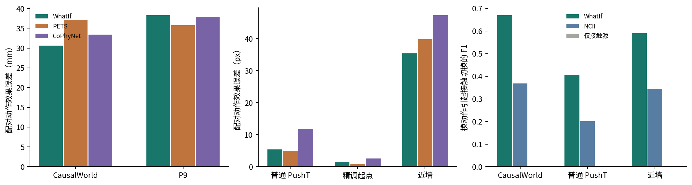
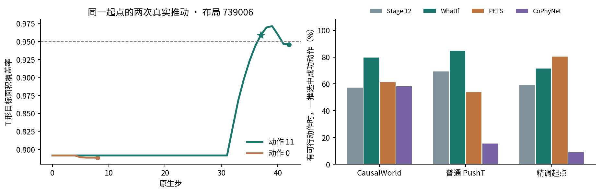
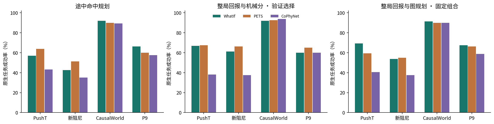

# Stage 13　换一个推法，能否在预算内完成任务？

末次独立测试中，同一份世界模型在 **PushT 完成 111/160、CausalWorld 完成 146/160、P9 完成 54/80**。普通 PushT 上，把整局反事实回报加到原有两推图规划，成功数从 102 提到 111，平均原生步数从 224.5 降到 218.4；PETS 完成 95/160，CoPhyNet 完成 65/160。CausalWorld 和 P9 上，原两推规划分别完成 148 和 58 个，胜过加入整局回报后的策略。

本轮首先让模型预测“物体途中是否进入目标”，再实测“若先执行另一推，整局会怎样”。两类目标需要不同的训练信号。下文保留每次冻结时选中的策略和相应的新测试布局，最后一张表可直接对照三种方法。

## 两个任务和两个主基线怎样选

CausalWorld Pushing 让三指机器人把方块推到目标位置。动作会改变哪根手指接触方块，同样的推法在质量和摩擦变化后会有不同响应。PushT 要把 T 形块的位置和角度同时对准；同一个推手可以让物体碰到墙，也可以在松手前短暂越过成功线。这两种任务共享“接近、接触、运动、释放”的物理过程，接触源和目标几何各有差异。两个域使用同一份动力学权重，读入各自的状态，动作统一表示为接触位置、方向、行程、力臂和接近距离。这里检验两个训练域上的共享机制，以及各域内的新布局和新物理条件。[CausalWorld](https://arxiv.org/abs/2010.04296) · [官方 PushT 环境](https://github.com/real-stanford/diffusion_policy/blob/5ba07ac6661db573af695b419a7947ecb704690f/diffusion_policy/env/pusht/pusht_env.py)

| 研究 | 原论文如何设实验 | 本轮采用的部分 |
|---|---|---|
| CoPhy | 观察积木塔、球碰撞或弹球的一次事实演化，再改变物理场景条件，预测另一条轨迹。 | **反事实预测主基线**。复用作者的图网络、事实 GRU 和稳定性门，用状态、接触源和动作 token 适配推动。它输出点位姿。原控制接口在相同菜单里按目标覆盖和机械分选动作。[论文](https://arxiv.org/abs/1909.12000) · [作者仓库](https://github.com/fabienbaradel/cophy) |
| PETS | 在连续控制中训练概率动力学集成，用轨迹采样和滚动规划选择动作。 | **概率世界模型与控制主基线**。沿用 MBRL-Lib 的五成员 GaussianMLP 和 CEMOptimizer，每轮 48 个候选、三轮优化、三推前瞻、15 条粒子路径。输入含同一上一推事实。主比较固定原读出，每个任务用一套配置。[论文](https://arxiv.org/abs/1805.12114) · [MBRL-Lib](https://github.com/facebookresearch/mbrl-lib) |
| Counterfactual World Models | 固定事件起点和扰动，改变动作。Push-T 实验分别考察推手运动和物块接触响应，并区分同一次事件与下一次事件。 | 参考其配对分叉设置。我们先观察上一推，从下一状态分叉，直接测物体的平移、转动和整局任务完成。[论文实验](https://arxiv.org/html/2611.24778v1) |
| NULL / NCII | 在 Spriteworld、Air Hockey、Robosuite 和 Franka Kitchen 等场景，用实际接触核对推断的局部交互。 | **边存在性专项参照**。沿用项目按论文重实现的源删除似然方法。报告实际接触的平衡误判率、精确率、召回率，以及换动作引起的新边与断边。[原文第 5 节](https://arxiv.org/html/2505.03172v1) |
| CausalWorld 上的任务泛化研究 | Kang 等在 CausalWorld 的推动等操控任务中改变训练任务分布，比较策略的成功与泛化；CaDM 则在变化动力学的控制场景中用近期转移估计环境上下文。 | 主任务保留官方 P1/P2/P7/P8，额外将官方 P9 的位置、质量和地面摩擦联合干预约为迁移诊断。PushT 的普通原生重置与精调起点单独报告。[Kang 等](https://proceedings.mlr.press/v205/kang23a.html) · [CaDM](https://proceedings.mlr.press/v119/lee20g.html) |

上游代码版本为 CausalWorld 1045277、Diffusion Policy 5ba07ac、CoPhy 170fe46、MBRL-Lib 3f93ccc。PETS、CoPhyNet 和 WhatIf 的既有训练面板一致。第一项实验在 Stage 12 的已有面板上训练新的物理响应和过线预测，两个主基线使用已有适配权重。第二项实验给三个模型同样的新整局回报标签，并另外保留原版控制器成绩。[本轮代码](../../whatif/passage) · [数据字段与校验和](../../data/passage/manifest.json)

## 共享模型怎样利用一次事实，比较两种未来

**从事实上修正物理条件。** 将已完成的一推记为 $h=(s_0,b,s)$。编码器输入接触几何、实际物体位姿增量、相对标称刚体预测的残差，以及实测速度和滑行信息。它把五个先验物理响应粒子 $P_k\in\{-1,-0.5,0,0.5,1\}$ 的权重更新为

$$
\pi_k(h)=0.96\,\mathrm{softmax}_k E_\phi(h)+0.04/5 .
$$

下一状态下每个动作 $a$ 单独计算接触概率 $e^a_{jku}$。$j$ 是手指、推手或墙，$u$ 是本次的行程扰动。模型用接触概率汇聚消息，并保留门控的平移、转动和滑行先验。原有分段模型据此给出接近结束、推动结束、释放结束的物体系位姿增量 $D^a_{A,B,C}$。本轮用同一个网络，根据上一推实测运动和候选动作的接触信息校正这三个位置。对候选 $a$ 与参考 $b'$，输出的反事实分布为

$$
\widehat p(\Delta^{a,b'}\mid s,h)
=\sum_{k,u}\frac{\pi_k(h)}{3}\,
  \delta_{z^{a}_{t+1,ku}\ominus z^{b'}_{t+1,ku}}.
$$

两条分支用同一个 $P_k$ 和同一个当次扰动，$\ominus$ 对平移取差、对角度取绕回后的差。预测后一推时保留物理粒子，另取行程扰动。这种配对保留了同一物体在两种动作下共同受到的物理影响。[共享物理与接触图](../../whatif/shared/model.py) · [本轮事实校正与分布](../../whatif/passage/model.py)

**估计这一推途中会不会成功。** 起点和三个预测位姿形成三段路径。在平移与偏航的加权坐标中，将目标投影到每段，计算投影点和段末的覆盖率，取最高值 $C_*$。PushT 使用精确 T 形交面积。CausalWorld 使用平面包围框近似，再用原生任务的实测峰值校准。一个小网络输出覆盖修正量 $r$ 和尺度 $q$。给定成功阈值 $\tau$，每个粒子的命中概率为

$$
\mu=\max\{C(s),\operatorname{clip}(C_*+0.16\tanh r,0,1)\},\qquad
\sigma=0.004+0.032\,\mathrm{softplus}(q),\qquad
p_{\rm hit}=\operatorname{sigmoid}\big((\mu-\tau)/\sigma\big).
$$

训练同时监督配对动作效果的能量分数、三个位姿和真实最高覆盖；用 0.55 到 0.97 的八个覆盖阈值学习超过各阈值的概率。第一次决策实验对 12 个根动作进行两推前瞻。每个根动作的第二推保留 4 个菜单候选，枚举三个新的扰动。设第一推即时分为 $r_a$，第二推延续价值为 $V_a$，则 $R_a=r_a+0.85[p_{\rm hit}r_a+(1-p_{\rm hit})V_a]$。模型按物理后验求 $\mathbb E[R_a+0.12\tanh((R_a-R_{b'})/0.30)]$，执行得分最高动作，再观察真实状态。到了成功区的分支可提前完成任务。[训练目标](../../whatif/passage/train.py) · [两推规划](../../whatif/passage/planning.py)

**直接学习同一起点的整局动作优势。** 第一项独立闭环测试显示，预测哪一推能过线，有时仍选不到在整局预算内能完成的动作。于是又从新布局执行每个候选动作，之后让**同一机械反馈策略**沿各自分支一直推到成功或预算耗尽。对每个动作记录原生成功 $H_a$、最终覆盖 $C_a$、从分叉起消耗的步数 $T_a$ 和起点剩余预算 $L$，形成实测回报

$$
Y_a=H_a+0.45C_a-0.12T_a/L,\qquad A_{ab}=Y_a-Y_b .
$$

第二项实验冻结世界模型。一个回报预测头读取物体系配对位姿差的均值和离散程度、覆盖和途中命中预测、接触信息及剩余步数，预测上述三个回报分量。训练让预测分量接近原生结果，也让同一布局内两动作的回报差排序接近真实 $A_{ab}$。部署时按 $\lambda\,\mathrm{scale}(\widehat Y)+(1-\lambda)\,\mathrm{scale}(M)$ 选动作，$M$ 是机械反馈打分。每个模型用独立的同结构预测头和同一批回报标签。预测头只读候选动作的模型输出与当前可观测信息。验证候选包括各自原控制器和 $\lambda\in\{0.30,0.60,0.90\}$；在独立真实闭环验证中选择后冻结。[真实分叉回报采集](../../whatif/passage/returns.py) · [整局回报训练](../../whatif/passage/advantage.py)

## 数据怎样分，成绩怎样读

- **预测测试**选取 320 个普通 PushT、240 个 CausalWorld、192 个近墙、192 个近目标、384 个精调起点和 128 个 P9 布局。普通任务和精调起点从相同事实状态执行 12 个动作，近墙用 8 个能改变接触源的动作。预测验证和测试编号分别从 721000、731000 开始，各面板有独立偏移。精调起点是额外诊断，机器人仍实际执行事实推和未来动作。
- **分布测试**另外取普通 PushT、CausalWorld 各 96 个布局和 128 个精调布局。固定每个布局的物理条件和上一推，将 12 个动作逐个在三种未来行程扰动下重放，共 **11,520 条真实动作分支**。这样可以直接对照配对动作差的经验分布。对应验证布局为 48、48、64。
- **闭环测试**保留训练种子 11。普通 PushT 各含 80 个默认阻尼与 80 个新阻尼 0.25，成功线为原生覆盖 0.95，总预算 280 原生步。CausalWorld 的 P1/P2/P7/P8 各 40 个布局，成功线 0.90，预算 420 原生步。P9 有 80 个独立布局，沿用 CausalWorld 的策略配置。每个方法具有相同状态信息、首推、菜单和原生执行器。
- **整局回报数据**包括 PushT 1,800 个训练和 256 个验证布局，CausalWorld 640 个训练和 160 个验证布局。每个布局实跑 12 个完整动作分支。PushT 将三种训练阻尼和三种预定试推深度交叉取样；遇到已完成的布局会提前截取有效起点。第一项闭环验证和测试从 741000、751000 开始。新增整局回报头之后重新用 811000 验证、821000 测试，两个测试面板分别保留。下文的差值均在同一批布局内计算。[第一项冻结配置](../../results/passage/freeze.json) · [第二项冻结配置](../../results/passage/return-freeze.json)

## 一、接触图是否随动作换边

BMR 取假阳性率与假阴性率的平均。新边指参考动作没有、候选动作有的接触，断边反之。表中的正确数要求方向也正确。训练时 WhatIf 使用接触标签，NCII 的交互分数来自项目的源删除动力学估计。各方法在独立验证布局选阈值，P9 直接沿用 CausalWorld 阈值。

| 场景 | 方法 | BMR ↓ | 边精确率 / 召回率 | 换边精确率 / 召回率 | 新边正确 / 实际 | 断边正确 / 实际 |
|---|---:|---:|---:|---:|---:|---:|
| CausalWorld 主任务 | WhatIf | 10.39% | 0.778 / 0.911 | 0.619 / 0.728 | 489/712 | 582/806 |
| CausalWorld 主任务 | NCII | 30.91% | 0.653 / 0.505 | 0.348 / 0.389 | 261/712 | 260/806 |
| CausalWorld 主任务 | 仅接触源 | 43.08% | 0.359 / 0.762 | 0.000 / 0.000 | 0/712 | 0/806 |
| 普通 PushT | WhatIf | 4.20% | 0.970 / 0.930 | 0.313 / 0.581 | 96/157 | 80/172 |
| 普通 PushT | NCII | 13.36% | 0.941 / 0.755 | 0.136 / 0.389 | 44/157 | 34/172 |
| 普通 PushT | 仅接触源 | 1.68% | 0.954 / 0.989 | 0.000 / 0.000 | 0/157 | 0/172 |
| PushT 近墙 | WhatIf | 17.80% | 0.832 / 0.763 | 0.634 / 0.550 | 318/627 | 345/614 |
| PushT 近墙 | NCII | 30.23% | 0.860 / 0.453 | 0.497 / 0.262 | 125/627 | 177/614 |
| PushT 近墙 | 仅接触源 | 28.67% | 0.752 / 0.573 | 0.000 / 0.000 | 0/627 | 0/614 |
| CausalWorld P9 | WhatIf | 14.80% | 0.729 / 0.860 | 0.418 / 0.544 | 179/282 | 111/269 |
| CausalWorld P9 | NCII | 43.04% | 0.555 / 0.229 | 0.205 / 0.236 | 47/282 | 60/269 |
| CausalWorld P9 | 仅接触源 | 49.21% | 0.334 / 0.677 | 0.000 / 0.000 | 0/282 | 0/269 |

普通 PushT 的推手频繁接触物体，只记每个源在训练集中的接触频率，BMR 可达 **1.68%**，但同一起点换动作时它给出恒定判断，换边 F1 为 **0**。近墙更能看出动作的作用。WhatIf 找对了 **318/627** 条新边和 **345/614** 条断边，换边 F1 为 **0.589**，NCII 为 **0.343**。

## 二、动作效果分布预测得多准

以下是未执行候选动作的前瞻预测。平移误差和能量分数在同状态的“候选动作减参考动作”上计算；角度误差取绕回后的绝对偏差。能量分数比较预测样本与真实动作差，同时计入样本间分散程度。CoPhyNet 的点预测作为单点分布计分。

每格为 **动作效果平移误差 / 偏航误差 / 位置能量分数**，三项均越小越好。

| 布局与平移单位 | WhatIf | PETS | CoPhyNet |
|---|---:|---:|---:|
| CausalWorld 主任务（mm） | 30.63 / 22.98° / 24.91 | 37.14 / 27.73° / 32.11 | 33.41 / 26.01° / 33.41 |
| 普通 PushT（px） | 5.39 / 3.21° / 4.39 | 4.86 / 2.76° / 3.84 | 11.76 / 6.36° / 11.76 |
| PushT 精调（px） | 1.52 / 0.82° / 1.17 | 0.96 / 0.65° / 0.76 | 2.58 / 1.65° / 2.58 |
| PushT 近墙（px） | 35.38 / 13.66° / 29.53 | 39.84 / 12.82° / 33.28 | 47.27 / 16.07° / 47.27 |
| CausalWorld P9（mm） | 38.29 / 29.68° / 31.56 | 35.78 / 28.59° / 30.59 | 37.92 / 28.00° / 37.92 |

同一普通 PushT 测试面板上，新模型相对 Stage 12 的位置差误差由 **5.57 降至 5.39 px**，PETS 为 **4.86 px**。在三指推块和近墙 PushT 上，WhatIf 的平移动作效果优于两种论文基线。P9 的位姿预测仍由 PETS 领先。在固定事实和物理条件的三扰动重放中，普通 PushT 的位置能量分数为 WhatIf **4.05 px**、PETS **3.46 px**；CausalWorld 为 **22.21 mm**、**32.27 mm**。在普通 PushT 上，真实执行扰动引起的位置差均方根波动约 **0.55 px**，WhatIf 在固定物理粒子内预测 **5.48 px**。这一分解把行程扰动的尺度和不知道真实物理条件造成的离散程度区分开，能指导下一次校准。[预测与边指标](../../results/passage/prediction-test.json) · [同起点三扰动结果](../../results/passage/repeated-test.json)

**预测途中命中是否改变动作排序？** CausalWorld 有 98 个起点至少存在一种能在一推内成功的动作。按预测命中概率选一个动作，WhatIf 在 **78/98** 个起点选中，Stage 12 为 **56/98**，PETS 为 **60/98**，CoPhyNet 为 **57/98**。精调 PushT 有 56 个这样的起点，WhatIf 选中 **40/56**，PETS **45/56**；WhatIf 的概率 Brier 分数更低，分别为 **0.0223 和 0.0308**。概率误差与“12 选 1”分别测量，名次可以不同。

图中的例子按真实轨迹顺序选取。布局 739006 从 79.1% 覆盖开始，动作 11 在第 37 个原生步越过 95%，最高到 97.1%，第 42 步回落至 94.6%。动作 0 在第 8 步结束，覆盖 78.8%。WhatIf 在行动前给两者的命中概率分别为 34.5% 和接近零。[该布局的逐步覆盖与预测](../../results/passage/crossing-example.json)

## 三、是否真的提高了闭环决策

**途中命中规划。** 每个数字都是该方法自己在模拟器选动作后取得的成绩。第一组独立测试在 CausalWorld 主任务上完成 147/160，在 P9 完成 53/80。P9 用同一网络和同一搜索、改为按终点判断时完成 43/80。中途命中规划增加 **12.5 个百分点**，按布局配对重采样的 95% 区间为 **+5.0 至 +21.2**。普通 PushT 的相同改动从 94/160 变为 91/160。把上一推的历史替换成训练集均值、保留当前状态、速度、反馈执行器和动作菜单后，普通 PushT 得到 95/160，P9 得到 54/80。这轮的 P9 收益主要体现在任务事件的规划方式上。

下表及后续闭环表每格依次为 **成功数/布局数 · 平均最终覆盖 · 平均原生步数**。

| 原生任务 | 途中命中规划 | PETS | CoPhyNet | 同布局 Stage 12 |
|---|---:|---:|---:|---:|
| 普通 PushT | 91/160 · 0.882 · 224.7 | 102/160 · 0.884 · 227.6 | 69/160 · 0.874 · 243.8 | 90/160 · 0.894 · 227.8 |
| CausalWorld 主任务 | 147/160 · 0.864 · 126.4 | 144/160 · 0.842 · 140.6 | 143/160 · 0.845 · 140.3 | 141/160 · 0.835 · 138.4 |
| CausalWorld P9 | 53/80 · 0.652 · 259.8 | 48/80 · 0.628 · 286.4 | 46/80 · 0.622 · 283.5 | 45/80 · 0.601 · 284.3 |

**用整局回报选动作。** 第二组使用全新的测试布局。为看清同等附加数据的作用，表中同时列出两种论文基线的原配置、获得相同整局回报标签后的配置，以及上一套 WhatIf 策略在同一新面板上的复测。

| 原生任务 | WhatIf 验证选定 | 两推图规划 | PETS 原版 | PETS 同数据适配 | CoPhy 原版 | CoPhy 同数据适配 |
|---|---:|---:|---:|---:|---:|---:|
| 普通 PushT | 107/160 · 0.916 · 226.2 | 107/160 · 0.916 · 226.2 | 108/160 · 0.917 · 229.4 | 108/160 · 0.917 · 229.4 | 61/160 · 0.884 · 256.5 | 81/160 · 0.902 · 245.7 |
| CausalWorld 主任务 | 147/160 · 0.861 · 121.9 | 150/160 · 0.876 · 113.6 | 148/160 · 0.871 · 123.2 | 148/160 · 0.871 · 123.2 | 150/160 · 0.877 · 119.4 | 150/160 · 0.877 · 119.4 |
| CausalWorld P9 | 48/80 · 0.641 · 284.4 | 58/80 · 0.753 · 269.3 | 52/80 · 0.667 · 269.5 | 52/80 · 0.667 · 269.5 | 48/80 · 0.653 · 276.7 | 48/80 · 0.653 · 276.7 |

在 256 个其他 PushT 验证布局，从每个起点只选择第一推，再执行统一的机械反馈策略。机械首选最终成功 133 次，WhatIf 回报头选首推成功 **153 次**，PETS、CoPhyNet 回报头分别为 **146、145 次**。同一个回报头如果每一推都用较大权重重选，在新的真实闭环验证 64 局中只完成 25 局。二者的差别在于训练标签测量的是后续**固定策略**下的回报，部署时后续动作也被改变。PushT 的第二组冻结结果因此沿用了两推图规划，表中的两个 107/160 对应同一策略。强制执行验证最优的学习头混合版本，则为 86/160。[完整续推的配对验证](../../results/passage/return-ranking-validation.json)

**最终组合将长期回报加回图规划。** 保留每个动作完整的两推图规划分数 $J_a$，只在排序时加入已经训练好的长期动作回报。单一规则为

$$
a^*=\arg\max_a\left[0.70\,\mathrm{scale}(J_a)+0.30\,\mathrm{scale}(\widehat Y_a)\right].
$$

两项分数都在当前 12 个动作内按极差归一化。两个任务使用同一固定系数。831000 开始的独立验证中，PushT 从 43/64 到 46/64，CausalWorld 从 60/64 到 63/64。权重在查看这组验证和测试之前已写入配置。下面用 841000 开始的新布局做最终对照，P9 从 847000 开始。[整合代码](../../whatif/passage/joint.py) · [预先固定的系数和权重哈希](../../results/passage/joint-freeze.json)

| 原生任务 | 整局回报 + 两推图规划 | 同布局两推图规划 | PETS 原版 | CoPhy 原版 | 整合模型用平均事实 |
|---|---:|---:|---:|---:|---:|
| 普通 PushT | 111/160 · 0.906 · 218.4 | 102/160 · 0.894 · 224.5 | 95/160 · 0.904 · 229.5 | 65/160 · 0.888 · 248.1 | 107/160 · 0.905 · 219.8 |
| 　默认阻尼 0 | 68/80 · 0.935 · 208.7 | 63/80 · 0.923 · 216.5 | 51/80 · 0.917 · 227.7 | 35/80 · 0.907 · 248.2 | 67/80 · 0.927 · 205.1 |
| 　新阻尼 0.25 | 43/80 · 0.877 · 228.1 | 39/80 · 0.865 · 232.5 | 44/80 · 0.892 · 231.4 | 30/80 · 0.869 · 247.9 | 40/80 · 0.883 · 234.6 |
| CausalWorld 主任务 | 146/160 · 0.863 · 125.6 | 148/160 · 0.873 · 126.2 | 144/160 · 0.848 · 134.0 | 144/160 · 0.848 · 133.2 | 149/160 · 0.874 · 122.8 |
| 　P1 | 40/40 · 0.948 · 75.1 | 40/40 · 0.948 · 75.1 | 40/40 · 0.950 · 77.1 | 40/40 · 0.948 · 75.1 | 40/40 · 0.948 · 75.1 |
| 　P2 | 40/40 · 0.923 · 108.8 | 40/40 · 0.924 · 108.7 | 39/40 · 0.894 · 122.8 | 40/40 · 0.916 · 117.3 | 40/40 · 0.920 · 109.0 |
| 　P7 | 40/40 · 0.945 · 74.8 | 39/40 · 0.925 · 77.2 | 39/40 · 0.922 · 82.6 | 39/40 · 0.921 · 81.8 | 39/40 · 0.921 · 78.3 |
| 　P8 | 26/40 · 0.636 · 243.9 | 29/40 · 0.694 · 243.8 | 26/40 · 0.625 · 253.3 | 25/40 · 0.604 · 258.4 | 30/40 · 0.706 · 228.7 |
| 独立 P9 | 54/80 · 0.686 · 273.5 | 58/80 · 0.704 · 269.9 | 53/80 · 0.718 · 283.4 | 47/80 · 0.667 · 292.1 | 46/80 · 0.610 · 290.6 |

新布局上的 PushT 相对原两推规划为 **+5.6 个百分点（95% 配对区间 -1.9 至 +12.5）**，相对 PETS 为 **+10.0 个百分点（95% 配对区间 +0.0 至 +20.0）**。同样提供整局回报数据、按独立验证选择配置后，CoPhyNet 在这批 PushT 布局上完成 **90/160**，PETS 选用原控制器。P9 上，用本次真实事实代替训练集平均历史，从 **46/80 到 54/80**；同场景的原两推策略完成 **58/80**。这两种对照分别回答了“上一推有没有帮助”和“额外加入长期回报有没有帮助”。

**审稿判断。** 两个物理系统上的同状态动作分叉、近墙时的新边与断边、三扰动下的重复动作效果，以及 P9 中途中命中项的闭环收益，已经形成了一条完整的实验链。PushT 的长期信号适合修正多步排序，单凭它接管控制更差。论文目前可主张“共享模型在接触和目标事件上提供了对决策有用的信息”。要把结论扩大到跨任务稳定提升，普通 PushT 的精确运动预测、未知阻尼下的控制，以及学习到的扰动尺度仍是最需要改善的三项。[最终闭环与配对统计](../../results/passage/joint-control-paired.json)

本轮在服务器保留了一份阶段报告，附图从原始数据生成。逐布局成功、覆盖、步数、逐推动作及模型权重均包含在同一提交中。文中配对区间以独立布局为采样单位，覆盖和步数均包含用满预算的失败布局。[第一组闭环汇总](../../results/passage/control-summary.json) · [第二组闭环汇总](../../results/passage/return-control-summary.json) · [复现脚本](../../whatif/passage/reproduce.sh)
