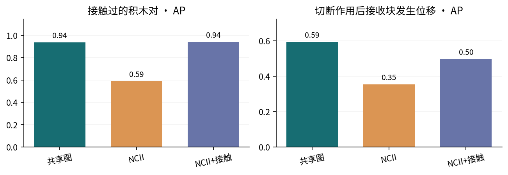

# Stage 15 · 积木接触过，和接触改变了结果，是两件事

在 CoPhy 的三层、四层积木塔上，共享图模型判断直接接触的 AP 为 **0.936**。逐对关闭碰撞，再问另一块积木的终点是否改变，AP 降到 **0.594**。带同样接触监督的 NCII 分别为 0.940 和 0.498。两种模型都容易认出相邻积木，区分哪些接触真正左右了后果更难。

## 数据和真值

调用作者 BlocktowerCF 生成器的建塔、移动单块、重置物理和读取状态函数。塔高各占一半。每块质量从 1、10 中选，摩擦从 0.5、1 中选，横向重力在一个轴上取 −0.5、0、0.5。事实塔自然演化 6 秒，再从同一初始塔沿 x 或 y 平移一块积木，重跑四种干预。PyBullet 每秒 5 个采样时刻，每步 5 个子步。记录初末位姿和各采样时刻力大于 0.001 的接触。训练、验证、测试分别有 384、72、128 座塔，跨集合的种子互不重合。这是用官方生成代码新建的可记录碰撞的配对集，未使用发布压缩包、图像或原版样本筛选。

对验证、测试中的每次干预，再枚举所有积木对，关闭一对之间的碰撞，保留其他碰撞、物理参数、初始位姿与干预。若接收块 $j$ 的终点变化超过 0.10 个块边长，就给有向检验 $i\to j$ 记正。一次物理关闭同时影响双方，分别以两端的位移标记两个方向。它测的是关闭这一相互作用对终点的总影响，包含经第三块传播的效果。模型只在训练时见过接触标签。删边标签用于确定验证阈值和报告测试表现。

## 一个模型怎样接受不同对象和干预

一套权重同时训练三个环境。塔里有 3 或 4 块积木，CausalWorld 有物块、三根手指和地面，Push-T 有 T 块、推杆和四面墙。角色编码为可移动体、执行器、静态体。输入取位置和旋转矩阵前两列，即 $X_i\in\mathbb R^9$。目标位姿只给奖励读出。对象两两配对，排除自身和空位。批处理中最多填到 6 个槽位，网络的线性层不依赖槽位数。动作 token 有 7 维，包含激活位和相对执行器的两个三维位移。CoPhy 把 do 位移写入被移动积木的 token。推物任务只写入被命令的一个执行器。模型不接收环境 ID、质量、摩擦、阻尼和实际接触图。

设 $T^F=(X^F,a^F,Y^F)$。每个对象先编码事实证据 $e_i=E(X_i^F,Y_i^F-X_i^F,a_i^F,\mathrm{role}_i)$。网络由事实起点和事实动作生成先验边 logit $\ell^0_{ij}$，将对应行的平均边概率与 $e_i$ 输入第一层物理、扰动后验，再显式更新整张事实图。

$$
 m_i^0=\sum_{k=1}^{16}\pi^0_{ik}c_k,\quad
 \ell^F_{ij}=\ell^0_{ij}
   +C(e_i,m_i^0,\mu_i^0,e_j,m_j^0,\mu_j^0,\ell^0_{ij}).
$$

先验图和修正图的平均边概率一同反馈给后验网络。最终物理量 $m_i=\sum_k\mathrm{softmax}(b_i)_k c_k$ 是 16 个可学习的 12 维基向量的连续组合。扰动 $u_i=\mu_i+\exp(s_i)\epsilon_i$ 有四个高斯维度。两次后验更新和边修正端到端训练。编码表达的是对观测响应有用的隐变量，目前没有逐维标定它对应多少公斤或多少摩擦。前瞻分支沿用事实推断的物理，重新从标准正态取扰动。重建同一次事件时沿用事实扰动后验。同一组备选动作始终共享一次采样。

每个动作在修正后的事实边上生成独立的对象门、因子门和强度。每个对象的三个因子分别对应位置、第一旋转轴和第二旋转轴。每条对象边有 $3\times3$ 个因子连接。

$$
 \ell^a_{ij}=\ell^F_{ij}+B(h_i,a_i,h_j,a_j,\ell^F_{ij}),\qquad
 W^{a,fg}_{ij}
  ={\bf1}[\ell^a_{ij}\ge0]\,{\bf1}[b^{a,fg}_{ij}\ge0]\tanh w^{a,fg}_{ij}.
$$
$$
 M_{jg}=\sum_{i,f}W^{a,fg}_{ij}h_{if},\qquad
 h'_{jg}=h_{jg}+\mathrm{MLP}([h_{jg},M_{jg}]).
$$

前向用硬门，反向通过 sigmoid 传导梯度。命令只直接进入被干预对象，两轮消息传递后逐对象读出未来位姿。没有经过激活边的对象不会收到其他对象的动作 token。因子门和边强度由预测误差学习，此批只能独立核对对象层的边。

## 训练和结果

三个环境各 384 个训练布局，每个布局 4 个分叉。一批 64 个布局，AdamW，学习率从 0.0015 余弦降到 0.00015，单种子 271，每个模型 60 个 epoch，均按验证损失保留权重。35% 的训练布局随机揭示一个分支作为事实，用来训练同次事件的反推。主损失为位姿 Huber、任务奖励 Huber、配对位姿和奖励差分布损失、预测图和事实图的接触 BCE，以及高斯 KL 和因子稀疏项。相应权重依次为 1、2、0.65、1.5、0.32、0.16、0.002、0.002。CoPhy 没有操控奖励，屏蔽该损失。主模型 66,585 个参数。

建图比较按 NCII 的定义，每个任务在验证集选使 $(\mathrm{FPR}+\mathrm{FNR})/2$ 最小的阈值，然后在测试集固定该阈值。AP 使用连续边分数。NCII 是通用状态适配版，用 PointNet 屏蔽源，比较完整预测与删去源的高斯似然，似然损失增加超过 0.10 给交互头正伪标签。另列相同架构加真实接触监督的结果。两者均按固定预算完整训练，验证集分别保留第 1、60 个 epoch。模型输入、对象角色和干预数据一致。

| 测试目标 | 模型 | AP ↑ | 平衡误判率 ↓ | 精确率 / 召回率 |
|---|---|---:|---:|---:|
| 实际接触 | 共享图 | 0.936 | 15.8% | 0.884 / 0.794 |
| 实际接触 | NCII | 0.588 | 46.6% | 0.569 / 0.334 |
| 实际接触 | NCII + 接触 | **0.940** | **14.5%** | 0.886 / 0.820 |
| 删边后接收块位移超过 0.10 | 共享图 | **0.594** | **30.3%** | 0.541 / 0.745 |
| 同上 | NCII | 0.354 | 49.2% | 0.529 / 0.033 |
| 同上 | NCII + 接触 | 0.498 | 30.9% | 0.569 / 0.662 |

测试共 4,608 个有向对象对观测，接触正率 51.3%，删边位移正率 35.8%。共享图的删边 AP 在三层塔为 0.540，四层塔为 0.618。两种塔高都参加过训练。对没有被两个候选动作直接移动的积木，位移差 RMSE 为 1.303 个块边长，CoPhyNet 为 1.299。边排序的改善尚未转化为更准确的远端位移。

本轮从 Stage 15 编号，保留暂停的旧 Stage 14。本文所有数字来自本轮新训练的模型。生成器、图修正、训练和逐项数值见 [采集](../../whatif/mechanism/collect.py)、[配对删碰撞](../../whatif/mechanism/excision.py)、[模型](../../whatif/mechanism/model.py)、[训练](../../whatif/mechanism/train.py)、[测试指标](../../results/mechanism/edges.json)。
