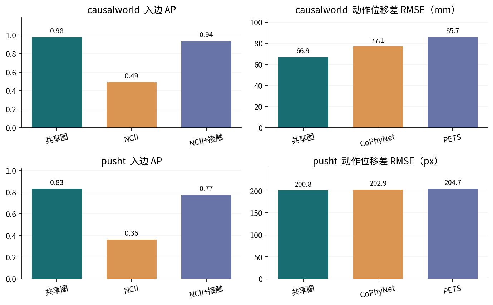

# Stage 16 · 换一个动作，物块会多移动多少

每个测试场景做完一段事实动作后，把模拟器放回同一个分叉点，分别执行四个候选动作。共享图在 CausalWorld 上把两动作的位移差 RMSE 从 CoPhyNet 的 77.1 mm 降到 **66.9 mm**。Push-T 从 202.9 px 降到 **200.8 px**，绝对误差仍大。两项任务上，动作差的空间分布预测均有改善，奖励差的分布则没有一致领先。

## 模型看见什么

CausalWorld 使用官方 pushing 环境和 P1/P7 训练布局；测试含 P1/P2/P7/P8。结构化 observation 提供指端、物块和目标位姿。Push-T 的公开 observation 含推杆坐标、T 块坐标和朝向，目标来自环境公布的 goal pose，四面墙取自固定场景。训练阻尼为 0、0.08、0.55，测试为 0、0.25。可见位姿换算成统一对象坐标，长度单位分别为 65 mm 和 100 px。质量和阻尼只在模拟器内起作用，网络看不到这些数值。三维旋转的前两个轴避免角度在 $2\pi$ 处跳变。

两域各有 384/72/128 个训练、验证、测试布局。每个布局先执行 1 到 4 个随机宏动作。四个候选分支各自重建同一环境、回放同一事实前缀，再执行不同动作。模型只读最后一个事实转移与当前对象集合。共享采样器在物体周围取方向和偏移，选最靠近入口的执行器，发两个位置命令，每个保持 12 个原生控制步。采样器不看目标。基线与主模型使用相同命令和分叉，不访问未来接触。

## 怎样预测两种动作的差分布

先按 Stage 15 的事实后验生成物理系数、扰动和修正图。分支 $a,b$ 共用同一组隐变量，各自在自己的图上传两轮消息，得到局部表示 $h_a,h_b$ 和未来预测 $Y_a,Y_b$。差分头显式学习一个对角高斯。下式省略对象下标，$v=h_a-h_b$。

$$
 \mu_{ab}=\hat Y_a-\hat Y_b+\tfrac12\{L(v)-L(-v)\},\qquad
 \sigma_{ab}=\mathrm{softplus}(S(|v|))\,\mathrm{mean}(|v|).
$$

交换两个动作会翻转均值并保留尺度。奖励差采用相同参数化，输入换成受控物体汇总表示和预测位姿相对目标的差。训练目标是同一次分叉实测的 $Y_a-Y_b$ 和 $R_a-R_b$。对每一项用

$$
 |\mu-\Delta|+0.035\left[\log(\sigma+c)+
          \frac{(\mu-\Delta)^2}{2(\sigma+c)^2}\right],
 \quad c_{\rm state}=0.12,\quad c_{\rm reward}=0.055 .
$$

训练枚举四个候选的六个无序配对。分辨率下限 $c$ 参与训练和概率评分；当两分支表示完全一致时，头本身输出零差和零额外尺度。测试使用四个共享、对称采样的扰动形成混合分布。前瞻只看之前发生的转移；回顾指标再揭示同一分叉的第 0 个结果，用 $Y_0^{\rm obs}+\hat\Delta_{a0}$ 预测其余三个。

CoPhyNet 运行作者的状态 GCN、GRU、稳定性门及预测器，外接共享的三通道对象投影、九维状态和奖励读出。PETS 采用 MBRL-Lib 的五成员 GaussianMLP，三层、宽 96，按成员对布局做 Poisson bootstrap。各成员接收当前对象和汇总的可见场景，成员间取均值作点预测。计算两动作差分布时，同一成员的两个分支共享标准高斯噪声。CoPhyNet 的点输出按退化分布计分。二者每个训练 60 个 epoch，沿用相同的输入信息与验证选点。这里比较状态接口适配后的模型。

## 结果

入边评测只计算通向可移动物体的候选边。有效接触取自 Bullet 正接触力或 Pymunk 碰撞冲量。阈值和 NCII 的训练方法见 Stage 15。两项环境的接触正率分别为 54.8%、38.3%。

| 环境 | 模型 | 入边 AP ↑ | 平衡误判率 ↓ | F1 ↑ |
|---|---|---:|---:|---:|
| CausalWorld | 共享图 | **0.976** | **8.9%** | **0.920** |
| | NCII | 0.492 | 50.7% | 0.009 |
| | NCII + 同等接触监督 | 0.936 | 13.9% | 0.877 |
| Push-T | 共享图 | **0.831** | **19.1%** | **0.765** |
| | NCII | 0.363 | 51.3% | 0.516 |
| | NCII + 同等接触监督 | 0.774 | 22.5% | 0.729 |

每域 128 个独立布局，512 个候选未来，768 个配对。下表位置 RMSE 先计算三维位移误差的长度，再取均方根；位置差 CRPS 按三个坐标分别计算后取平均，平面任务含恒定 z 坐标。奖励取 24 个环境步原生 reward 的均值。所有误差越低越好。

| 环境 | 模型 | 未来位置 RMSE | 两动作位移差 RMSE | 位移差 CRPS | 回顾锚定位置 RMSE | 未来奖励 RMSE | 奖励差 RMSE / CRPS |
|---|---|---:|---:|---:|---:|---:|---:|
| CausalWorld，mm | 共享图 | **52.1** | **66.9** | **19.8** | **66.7** | .0487 | .0652 / **.0342** |
| | CoPhyNet | 58.8 | 77.1 | 26.8 | 77.6 | .0502 | .0650 / .0442 |
| | PETS | 64.0 | 85.7 | 29.4 | 86.1 | **.0481** | **.0649** / .0394 |
| Push-T，px | 共享图 | 180.6 | **200.8** | **51.2** | **194.8** | **.0482** | **.0448** / .0219 |
| | CoPhyNet | **178.9** | 202.9 | 62.1 | 197.2 | .0563 | .0452 / .0159 |
| | PETS | 185.2 | 204.7 | 61.8 | 199.2 | .0509 | .0451 / **.0150** |

Push-T 连单步未来位置都有约 180 px 误差，在 512 px 的工作区里偏差很大。奖励边际和动作差是两个不同目标，奖励差 RMSE 的细小差距不足以证明控制有效。实际重置和连续执行动作的结果另记 Stage 17。完整记录见 [状态适配基线](../../whatif/mechanism/baselines.py)、[差分头](../../whatif/mechanism/model.py)、[评测](../../whatif/mechanism/evaluate.py)、[分域预测值](../../results/mechanism/prediction.json)。
