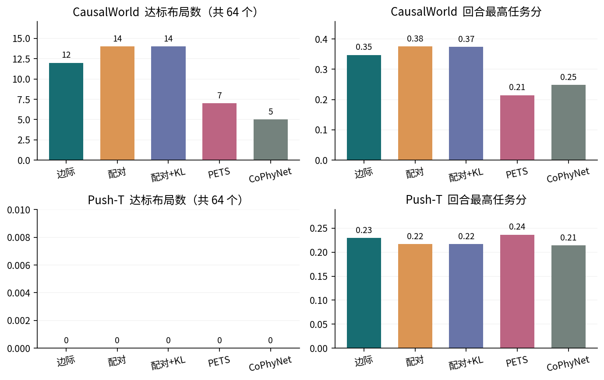

# Stage 17 · 配对优势在 CausalWorld 多完成了两个布局，KL 的增益仍未出现

在同样的 64 个 CausalWorld 布局上，按预测终点分数选动作完成 **12 个**；读取配对差分布、限制换动作的下行风险后完成 **14 个**；再加有方向的 KL 仍是 **14 个**。Push-T 五种策略全部为 **0/64**。

## 控制器实际做了什么

使用 Stage 15 的固定权重。每域 64 个新布局，种子 423000–423063，同一布局给五种策略。第一推是相同的随机试探，也计入预算。之后每次提供相同随机种子生成的 24 个局部动作，控制器选一个交给原生模拟器，拿到真实后继后重算事实后验。策略轨迹分开后，候选会随各自的可见物体位置平移。每回合最多 12 个宏动作、288 个原生步，达到官方成功条件就停止。CausalWorld 的阈值是覆盖分大于 0.90，Push-T 是真实形状覆盖率大于 0.95。记录 Push-T 分数时沿用环境给出的 $\min(\mathrm{coverage}/0.95,1)$。

主模型选取四个共享、对称的高斯扰动。令 $V(a)$ 为四次预测的平均终点任务分，候选中的参考动作为 $b=\arg\max_a V(a)$。对其余动作，在同一扰动 $m$ 下用差分头输出 $R(a)-R(b)$ 的均值 $\mu_m$、尺度 $s_m=\sigma_m+0.055$。

$$
 p_a=\tfrac14\sum_m\Phi(\mu_m/s_m),\quad
 h_a=\tfrac14\sum_m\Phi((-.04-\mu_m)/s_m),\quad
 \bar\Delta_a=\tfrac14\sum_m\mu_m .
$$

这里 $p_a$ 是切换后得分上升的概率，$h_a$ 是分数下降超过 0.04 的概率。实际比较三个准则。

| 策略 | 选动作的准则 |
|---|---|
| 边际价值 | 直接执行 $b$，规划器不读取差分头 |
| 配对 | 在 $h_a\le0.4$ 的候选中最大化 $\bar\Delta_a$ |
| 配对 + KL | 在同一可行集合中最大化 $\bar\Delta_a+0.12\,\mathrm{sign}(p_a-0.5)D_{\rm KL}(\mathrm{Bern}(p_a)\Vert\mathrm{Bern}(0.5))$ |

参考动作永远可选，分数置零。KL 比较的是“这次换动作会更好吗”的伯努利分布与五五开的参考分布。方向由 $p_a-0.5$ 提供。图的改变先影响传播与预测，规划器没有额外给“改边多”加分。三个策略使用同一检查点和同样的四次共享采样。PETS 和 CoPhyNet 用各自学到的终点任务分选同样 24 个候选，PETS 对五个高斯成员取均值。所有策略搜索一步，每次重规划。该实现覆盖初稿的共享情境、配对优势和伤害概率约束；初稿的多步轨迹搜索、失败重试和策略蒸馏仍是独立研究内容。

## 实际执行结果

| 策略 | CausalWorld 达标 | 终点分 / 回合最高分 | Push-T 达标 | 终点分 / 回合最高分 |
|---|---:|---:|---:|---:|
| 边际价值 | 12/64 | .182 / .347 | 0/64 | .009 / .230 |
| 配对 | **14/64** | **.209 / .375** | 0/64 | .012 / .217 |
| 配对 + KL | **14/64** | .208 / .374 | 0/64 | .012 / .217 |
| PETS | 7/64 | .104 / .214 | 0/64 | **.013 / .237** |
| CoPhyNet | 5/64 | .092 / .248 | 0/64 | .005 / .214 |

CausalWorld 从边际改为配对后，有 3 个布局从失败变为达标，1 个反向变化。成功率净增 3.1 个百分点，按布局配对 bootstrap 的 95% 区间为 −3.1 到 +9.4 个百分点（4,000 次抽样，种子 71）。两个配对版本在相同布局达标。Push-T 的回合最高分也低，主要缺口在到达目标的控制能力上。Stage 18 另用新布局检验小位移动作和稠密目标监督。

逐回合可查布局、成功、终点、最高分和动作数。[动作选择](../../whatif/mechanism/planner.py) · [真实环境闭环](../../whatif/mechanism/control.py) · [640 个回合](../../results/mechanism/control.json)
