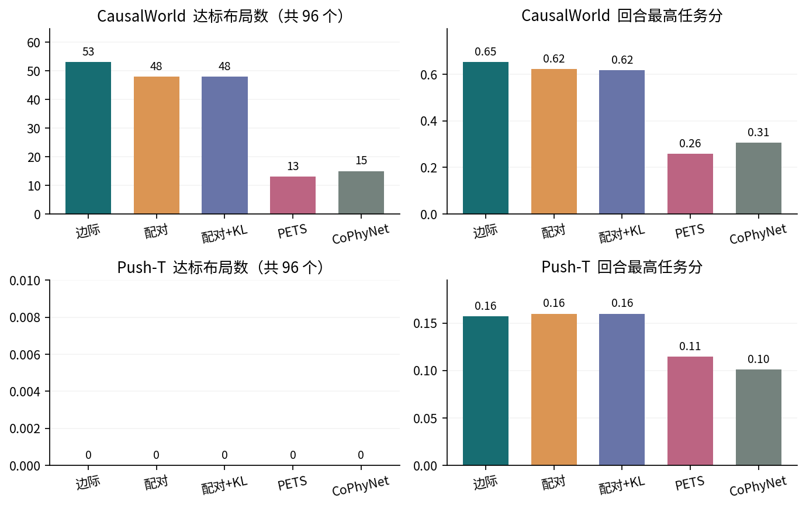

# Stage 18 · 更小的动作让 CausalWorld 达到 53/96，Push-T 仍然困难

过去的动作把入口和出口分别放在物块两侧，很难只轻推一下。这次让两点间距可以小到 0.06 个物体长度，并限制执行器每个控制步的目标位移。三个模型使用相同动作接口，从头训练。CausalWorld 的最高成功率为 **55.2%（53/96）**，来自共享图的边际价值策略。配对和配对加 KL 都完成 48 个布局。Push-T 的单步位置预测有改善，各策略仍然没有完成任务。

## 两个环境共用的改动

1. 给定动作方向、侧偏和入口，沿同一方向采样长度 $L$，其中 $\log L\sim U(\log 0.06,\log 2)$。入口距离物体中心 0.38–1.35 个长度。每个宏动作仍为两段、每段 12 步。每步把命令向路点推进至多 0.12 个长度。CausalWorld 和 Push-T 使用同一函数，分别映射到米和像素。
2. 两个推物任务各新增 1,536/144/160 个训练、验证、测试布局。每布局四个共起点的候选。CoPhy 保留相同的 384 个训练布局。三模型各自训练 60 个 epoch，每 epoch 54 个 batch，合计 3,240 次参数更新，训练种子都是 271。基线的规模、优化器及候选预算延续上一批，单次按验证损失选权重。
3. 原生 reward 均值与终点任务分继续单独监督。第三个读出改学稠密目标值，便于比较离目标还远、原生覆盖分同为零的两个动作。令 $\delta p$ 为受控物体与目标中心之差，$\delta R_2$ 为其两个旋转轴相对目标的差，训练标签为
$$
 J_g(Y)=-\log\!\left(1+\sqrt{\|\delta p\|_2^2+0.25\|\delta R_2\|_F^2}\right).
$$
   对 40% 的推物训练布局，用实际到达的位姿作为目标；一半取自本布局，另一半取自随机批次中的其他行。这些样本只监督 $J_g$ 及其配对差，屏蔽原生奖励和终点任务分。模型在推理时通过学习的头预测 $J_g$，不查看候选的真实后果。固定的距离和方向系数属于两个任务共享的训练目标设计。
4. 控制时用预测的 $J_g$ 替代 Stage 17 的预测终点任务分。配对收益、风险约束和有方向的 KL 均按 $J_g(a)-J_g(b)$ 计算。实际成功仍按环境自身标准统计。搜索预算保持每步 24 个候选、最长 288 原生步。

## 在新布局上的测量

| 方法 | CausalWorld 成功 | 终点 / 最高分 | Push-T 成功 | 终点 / 最高分 |
|---|---:|---:|---:|---:|
| 共享图，边际 | **53/96** | **.597 / .653** | 0/96 | **.039** / .157 |
| 共享图，配对 | 48/96 | .563 / .623 | 0/96 | .036 / **.160** |
| 共享图，配对 + KL | 48/96 | .563 / .618 | 0/96 | .036 / **.160** |
| PETS | 13/96 | .177 / .258 | 0/96 | .031 / .115 |
| CoPhyNet | 15/96 | .165 / .306 | 0/96 | .021 / .101 |

闭环种子为 823000–823095，与训练、模型选择及前几批控制测试互不重合。同批边际与配对的成功率可直接比较。跨批同时改变了动作、训练数据量与目标监督，不能把跨批差额单独归到其中一项。

| 测试环境 | 方法 | 未来位置 RMSE ↓ | 位移差 RMSE ↓ | 位移差 CRPS ↓ | 原生奖励差 RMSE ↓ |
|---|---|---:|---:|---:|---:|
| CausalWorld，mm | 共享图 | **19.7** | **25.5** | **7.65** | **.0299** |
| | CoPhyNet | 25.1 | 32.2 | 11.89 | .0326 |
| | PETS | 36.3 | 40.6 | 13.02 | .0325 |
| Push-T，px | 共享图 | **85.5** | **105.2** | **23.54** | .0389 |
| | CoPhyNet | 88.0 | 109.9 | 30.56 | .0433 |
| | PETS | 96.9 | 111.2 | 29.55 | **.0388** |

三个模型在同一批 160 个测试布局上各自预测 640 个未来。共享图的候选接触边 AP 为 0.978 和 0.854，平衡误判率为 8.8% 和 13.9%。这些误差对应新动作分布，运动幅度也发生了变化。控制器在 Push-T 上仍难把 T 块长时间保持在目标附近，仅缩小动作没有解决选择接触方向的问题。

[精细动作接口](../../whatif/mechanism/native.py) · [稠密目标与训练](../../whatif/mechanism/train.py) · [离线指标](../../results/mechanism/fine/prediction.json) · [960 个真实回合](../../results/mechanism/fine/control.json)
