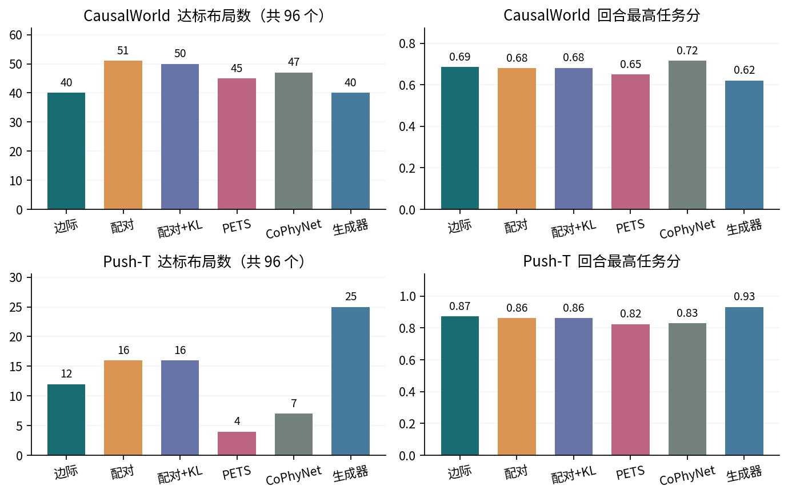
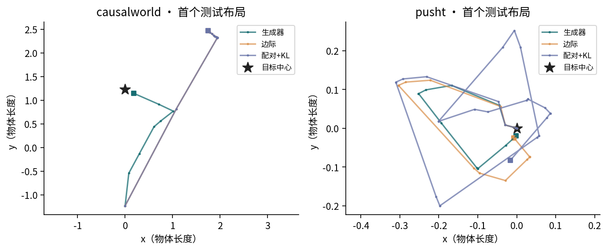

# Stage 19 · 让模型看到人会考虑的推法

Push-T 首次在新通用架构下出现真实成功。单独执行学习到的候选生成器完成 **25/96**，用图模型配对选动作完成 **16/96**，边际重排为 **12/96**。CausalWorld 上顺序不同，配对策略完成 **51/96**，生成器和边际重排都完成 **40/96**。这批同时改变了候选和动作时长，增加了人类演示。表内各策略使用同一个生成器，因此能看出世界模型重排带来了什么。

## 动作从哪里来

下载 Diffusion Policy 作者发布的 Push-T 遥操作数据，使用其中 206 个 episode、25,650 个原生时刻的状态和动作。以完整 episode 划分，编号模 10 等于 9 的 20 个布局用于验证，其余 186 个训练。CausalWorld 的生成器监督来自 Stage 18 的训练和验证分叉。每个分叉组提供一个对原目标打分最高的动作（终点分减 $0.35$ 倍位姿距离），其余监督来自把四个实际到达的位姿各自当作目标。两个环境合计 30,902 个训练例和 3,148 个验证例。[作者数据说明](https://github.com/real-stanford/diffusion_policy#training)

一个三隐藏层、宽 192 的网络为每个执行器输出六个动作模式，分别预测概率和两个三维路点。把执行器相对物体的位置、目标相对物体的位姿、可见物体的世界位姿和执行器数输入同一个网络。相对量在物体坐标系中编码。Push-T 的监督路点取演示当前时刻之后第 3 和第 7 个索引的命令；CausalWorld 取数据中实际执行动作的两个命令点。训练用固定尺度 0.28 的混合 Laplace 负对数似然。

$$
 \mathcal L_{\rm actor}=-\log\sum_k\pi_{i^\*,k}
      \exp(-\|a-\hat a_{i^\*,k}\|_1/0.28).
$$

归一化在全部有效执行器和模式上进行。模型学选择执行器、方向和路点。训练 110 个 epoch，batch 256，第 45 个 epoch 的验证损失最低。部署时保留概率最高的四个模式，其他 20 个按混合权重采样并加入标准差 0.075 的路点扰动。只执行最高概率模式构成“生成器”这一对照。两点分别用四个原生控制步线性插值，两个环境共用该执行方式。

## 从同一组候选里选动作

在新候选分布上给每个推物任务重新采集 1,536/144/160 个训练、验证、测试布局，每个分叉含生成器首选和三个其他动作。从头训练共享图、PETS、CoPhyNet 各 60 个 epoch，沿用 Stage 18 相同的 3,240 次更新、稠密目标 $J_g$ 及基线配置。没有给某个世界模型独占演示或额外搜索。

对每个候选加入生成器的相对先验 $b_a=0.075\max(-6,\log\pi_a-\max_c\log\pi_c)$。边际规划选择 $\arg\max_a[\hat J_g(a)+b_a]$。配对版本将该动作为参考，在 Stage 17 的伤害概率约束下最大化 $\overline{\Delta J_g}+b_a-b_{\rm ref}$；KL 版本再加相同的有符号伯努利 KL。比较 PETS、CoPhyNet 时同样加 $b_a$。所有策略每步 24 个候选，最多 36 个宏动作，共 288 个原生步，第一步共同执行生成器首选。

## 新的 96 个真实布局

| 策略 | CausalWorld 成功 | 终点 / 最高分 | Push-T 成功 | 终点 / 最高分 |
|---|---:|---:|---:|---:|
| 生成器直接执行 | 40/96 | .486 / .620 | **25/96** | **.801 / .933** |
| 共享图，边际 | 40/96 | .495 / .686 | 12/96 | .641 / .872 |
| 共享图，配对 | **51/96** | .556 / .681 | 16/96 | .615 / .862 |
| 共享图，配对 + KL | 50/96 | .547 / .681 | 16/96 | .620 / .862 |
| PETS | 45/96 | .502 / .651 | 4/96 | .583 / .825 |
| CoPhyNet | 47/96 | **.568 / .715** | 7/96 | .597 / .831 |

同一 CausalWorld 布局下，配对相对边际有 18 次从失败转为达标、7 次反向。Push-T 对应 12 次和 8 次。但对比直接执行生成器，Push-T 有 11 次改好、20 次改坏。单步目标值会放弃一些人类示范中适合后续微调的动作。该解释有待用后续动作的实测回报检验。加入 KL 没有提高成功数。

上图固定取本批第一个布局，轨迹显示物体中心，成功判定还取决于物体的朝向和形状重合。

| 环境和模型 | 未来位置 RMSE | 位移差 RMSE | 位移差 CRPS | 原生奖励 RMSE / 奖励差 RMSE |
|---|---:|---:|---:|---:|
| CausalWorld 共享图，mm | **18.2** | **14.4** | **4.06** | .0527 / **.0470** |
| CausalWorld CoPhyNet | 18.5 | 17.0 | 5.16 | .0534 / .0542 |
| CausalWorld PETS | 28.6 | 21.3 | 5.10 | **.0464** / .0515 |
| Push-T 共享图，px | 26.1 | **14.5** | 4.11 | .0672 / **.0229** |
| Push-T CoPhyNet | **22.1** | 15.4 | 3.34 | .0731 / .0286 |
| Push-T PETS | 27.7 | 15.3 | **2.86** | **.0653** / .0246 |

离线位置误差对应八步原生命令，Stage 18 对应 24 步。两个阶段的 RMSE 不能直接当作同一预测问题的提升幅度。本批支持“更好的候选使 Push-T 可完成”，对“世界模型稳定胜过生成器”和“KL 有额外控制收益”仍缺证据。

[生成器与混合分布](../../whatif/mechanism/proposals.py) · [监督来源与拟合](../../whatif/mechanism/fit_proposal.py) · [上游版本、数据校验值和预算](../../results/mechanism/demonstrations/protocol.json) · [离线指标](../../results/mechanism/demonstrations/prediction.json) · [1,152 个真实回合](../../results/mechanism/demonstrations/control.json) · [按阶段运行](../../whatif/mechanism/reproduce.sh)
