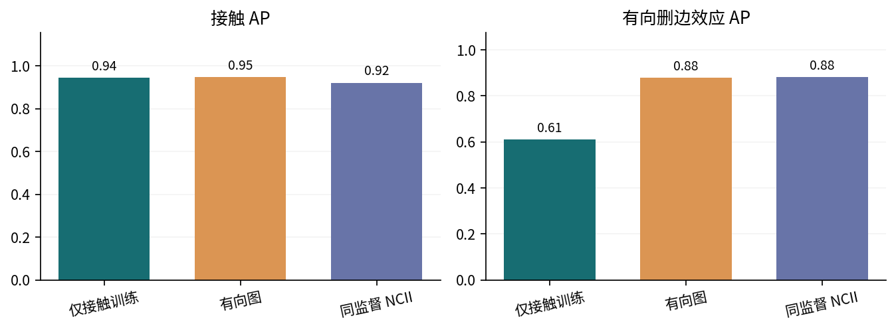

# Stage 20 · 用实际切断碰撞的后果教模型认方向

同一座塔里，下方积木承托上方积木，两块一定接触，但关闭这对碰撞后，它们自己的终点变化可能很不对称。这次把两个方向各自的位移交给模型学习。在 **160 座全新的测试塔**上，识别“关闭这对碰撞会显著改变接收块终点”的 AP 从 **0.610 提高到 0.879**。得到同等干预监督的 NCII 达到 **0.881**。

## 具体改变

Stage 15 只有接触标签进入训练。这次对其 384 座训练塔的四种动作逐对关闭碰撞，记录接收块终点位移

\[
 d_{ij}=\|p_j^{\rm intact}-p_j^{\rm disable(i,j)}\|_2,\qquad t_{ij}={\bf 1}[d_{ij}>0.10].
\]

从原有事实平滑器读出物理组合系数、扰动和修正事实边，对候选动作重新生成图。用两个可学习的头分别问“是否接触”与“给定接触，它是否会实质影响接收块”。传播用的激活概率和新增损失为

\[
 p^{\rm effect}_{ij}=p^{\rm contact}_{ij}\,
     \sigma(1.5+T_\theta(h_i,a_i,h_j,a_j,\ell^F_{ij})),
\]
\[
 \mathcal L_{\rm new}=\mathcal L_{\rm stage15}
  +1.2\,{\rm BCE}(p^{\rm effect}_{ij},t_{ij})
  +0.45\,{\rm Huber}_{0.2}(\mathrm{softplus}(\hat v_{ij}),\log(1+d_{ij})).
\]

对象消息的硬门现在按 \(p^{\rm effect}_{ij}\ge0.5\) 激活，之后再通过已有的因子门和边强度。训练仍混合三个环境，两个新增损失只计算有真实删碰撞记录的 CoPhy 行。大小为 1.5 的固定偏置用于初始化条件门的工作区间。NCII 的同监督版本保留 PointNet 的屏蔽及似然差训练，也增加接触 BCE、条件作用头及位移强度头。它和共享图读取完全相同的训练标签。

两个模型都从头训练一次，种子 271，60 个 epoch，batch 64，每个模型 1,080 次参数更新。共享图选到第 51 个 epoch，NCII 第 60 个。每个指标在原有 72 座验证塔上定阈值。新测试种子 1323000–1323159，三层、四层各 80 座，共 640 个干预未来、5,760 个有向对。接触正率 51.0%，显著删边效应正率 35.9%。此前只用接触训练的共享图也在**这同一批新塔**上重新测量。

## 实际结果

| 模型 | 接触 AP ↑ | 接触平衡误判 ↓ | 有向效应 AP ↑ | 效应平衡误判 ↓ | 效应精确率 / 召回率 | 对数位移强度 MAE ↓ |
|---|---:|---:|---:|---:|---:|---:|
| Stage 15 共享图，只学接触 | .943 | 14.7% | .610 | 29.6% | .545 / .766 | 无该读出 |
| 显式有向传播图 | **.946** | **13.6%** | .879 | 18.5% | .741 / .784 | **.153** |
| NCII，相同删边监督 | .921 | 15.4% | **.881** | **16.9%** | .760 / .805 | .174 |

删边监督大幅提高了对相互作用后果的识别。共享图在接触和强度上领先，同监督 NCII 在有向边二分类上略好。未被两个候选动作直接移动的块，其动作位移差 RMSE 为 1.490 个块边长；只学接触的模型为 1.491。作用概率预测得更准，还没有明显改善远端终点位置。该实验只发布 CoPhy 结构和预测结果，Stage 19 的推物成功率对应其原检查点。

[真删边数据](../../whatif/mechanism/causal_data.py) · [进入消息传播的有向门](../../whatif/mechanism/model.py) · [同监督比较](../../whatif/mechanism/directed.py) · [原始指标](../../results/mechanism/directed/metrics.json)

