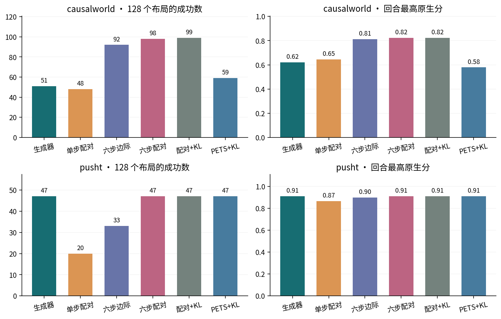
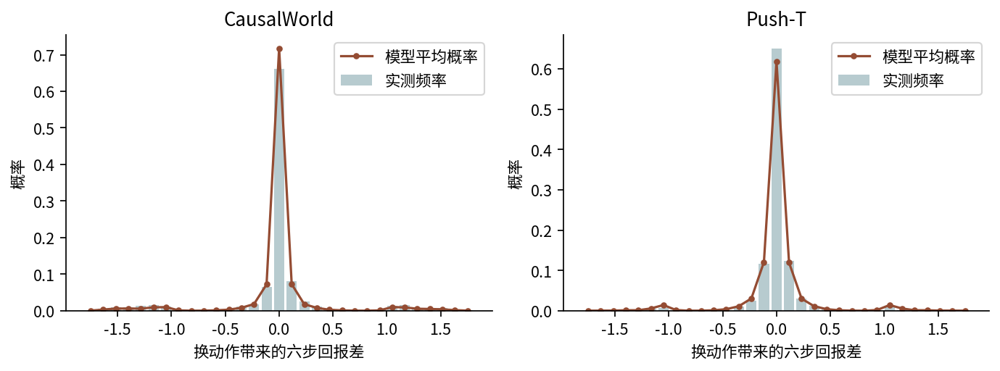

# Stage 21 · 哪一步值得改，看换完以后还能不能做成

在两个环境各 128 个新的真实布局上，读取六步配对回报差的图模型分别完成 **98 个 CausalWorld 和 47 个 Push-T**。加 KL 后分别为 **99 和 47**。使用同一训练数据、同一图模型、同一候选生成器，只按边际回报选择则为 **92 和 33**。直接执行生成器的成绩是 **51 和 47**。这次模型在 CausalWorld 明显帮助了生成器，在 Push-T 主要起到避免错误重排的作用。

## 六步差值是怎样得到的

固定 Stage 19 的候选生成器和世界模型权重。每个任务新采 1,024 个训练布局、160 个验证布局、192 个离线测试布局。先执行最多 18 个以生成器为主的历史动作，保留达标之前的分叉点。对 4 个候选分别重置并回放同一历史。第 0 个候选是生成器首选；仅替换第一步，接下来的最多五步都由同一个确定性生成器继续执行。每步 8 个原生控制时刻，成功即停止。这样，候选之间的差值包括“当前接触为后面的动作创造了什么条件”。

用模拟器真实成绩计算短期回报，$s$ 为这最多六步内是否达标，$c_{\max}$ 和 $c_{\rm last}$ 为最高分和终点分。

$$
 G(a)=s+0.5c_{\max}+0.25c_{\rm last},\qquad
 \Delta_{ab}=G(a)-G(b)\in[-1.75,1.75].
$$

预测头只看第一步之前的信息。共享图给出各候选的物体预测、相对目标位姿、奖励预测和图上传来的隐藏表示。这里取共享扰动的均值，六步结果的不确定性由新训练的分布头表示。固定骨干上训练一个边际回报头和一个配对回报头。对照的 PETS 也接受全部六步标签，输入换成它的五成员预测。每种头仅训练一次，种子 271、90 个 epoch、batch 64、AdamW；图模型选第 48 个 epoch，PETS 选第 27 个。每个 epoch 有 32 次更新。

配对头在 $[-1.75,1.75]$ 上输出 31 个等距档位的概率。它学的是**换第一步会怎样改变之后的原生回报**。交换动作为相反方向的分布，因此先对 logits 作对称化。$k^\prime=30-k$。

$$
 \ell^{ab}_k=\tfrac12\{L_k(h_a,h_b,h_a-h_b)+L_{k^\prime}(h_b,h_a,h_b-h_a)\},
 \qquad P_{ab}=\mathrm{softmax}(\ell^{ab}).
$$

把实测差值线性分到左右相邻的两个档位。损失为边际回报的 Huber，加 0.8 倍差分布交叉熵和 0.35 倍差均值 Huber。两个 Huber 的转折点均为 0.12。每布局的六个不同动作对都进入训练。

## 只在值得时偏离生成器

固定参考动作 $a_0$ 为生成器首选。每个候选有来自 Stage 19 的先验项 $b_a=0.075\max(-6,\log\pi_a-\log\pi_0)$。由 $P_{a0}$ 算出 $M_a=E[\Delta]$，$H_a=P(\Delta<-0.10)$，以及把平局算半票的 $p_a=P(\Delta>0)+P(\Delta=0)/2$。

- **六步边际**用 $\hat G(a)-\hat G(a_0)+b_a-0.04$ 评分。
- **六步配对**用 $M_a+b_a-0.04$ 评分，只考虑 $H_a\le0.20$ 的替代动作。
- **六步配对 + KL** 保留同一约束，额外加 $0.12\,\mathrm{sign}(p_a-.5)D_{\rm KL}(\mathrm{Bern}(p_a)\Vert\mathrm{Bern}(.5))$。

参考动作固定零分，替代动作必须超过它才切换。这几个系数对两个任务一致。线上每次看 24 个候选，只交付第一步给环境再重规划；6 步续推只用于采集训练和离线测试标签，线上不查询模拟器来选动作。各方法最多 36 个宏动作、288 个原生步，同一布局首次执行同一生成器动作。

## 结果

| 策略 | CausalWorld 达标 | 终点 / 最高分 | Push-T 达标 | 终点 / 最高分 |
|---|---:|---:|---:|---:|
| 直接执行生成器 | 51/128 | .469 / .620 | **47/128** | .791 / .909 |
| Stage 19 单步配对，在本批重测 | 48/128 | .448 / .645 | 20/128 | .645 / .866 |
| 六步边际，图模型 | 92/128 | .737 / .812 | 33/128 | .741 / .898 |
| 六步配对，图模型 | 98/128 | .783 / **.823** | **47/128** | .791 / .909 |
| 六步配对 + KL，图模型 | **99/128** | **.783** / .822 | **47/128** | .791 / .909 |
| PETS 六步配对 + KL，同监督 | 59/128 | .535 / .579 | **47/128** | .791 / .909 |

所有行使用相同闭环种子 1723000–1723127，合计 1,536 个真实回合。CausalWorld 的配对策略相对生成器让 50 个布局从失败转为达标，3 个反向，净增 36.7 个百分点；配对 bootstrap 95% 区间为 +27.3 至 +46.1 个百分点。相对边际多完成 6 个，区间为 −0.8 至 +10.2 个百分点。Push-T 的配对策略相对边际多完成 14 个，区间为 +3.1 至 +18.8 个百分点。它与生成器完成的布局逐一相同，只有 1 个布局的完整记录（成功、终点、峰值、步数）出现差异。KL 只在 CausalWorld 净多完成 1 个，现有证据不足以把主要提升归给 KL。

| 离线六步回报差 | 图模型 RMSE / CRPS ↓ | PETS RMSE / CRPS ↓ | 图模型配对策略改动首选的比例 |
|---|---:|---:|---:|
| CausalWorld | **.445 / .168** | .455 / .169 | 3.6% |
| Push-T | **.194** / .071 | .195 / **.070** | 0.5% |

离线每布局只观察 4 个候选，其中包含生成器首选；闭环每步有 24 个候选，并可连续重规划，两种测量不能直接换算。把回报看远、把生成器放在参考位置、增加实测续推监督，是相对 Stage 19 同时发生的改动。边际、配对、KL 三行才是固定这些条件后的决策比较。以上均为单训练种子。

[六步同起点分叉](../../whatif/mechanism/continuations.py) · [学习和动作评分](../../whatif/mechanism/return_model.py) · [逐回合结果](../../results/mechanism/continuations/control.json) · [配对统计](../../results/mechanism/continuations/summary.json) · [离线分布评分](../../results/mechanism/continuations/offline.json)
