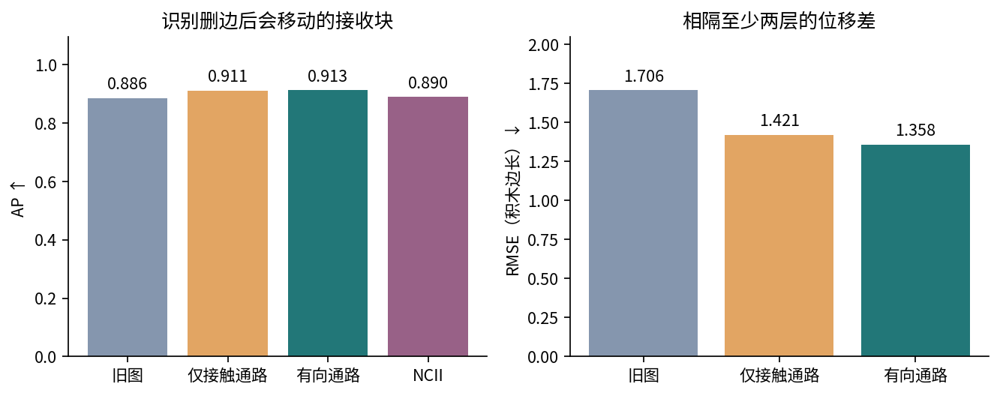
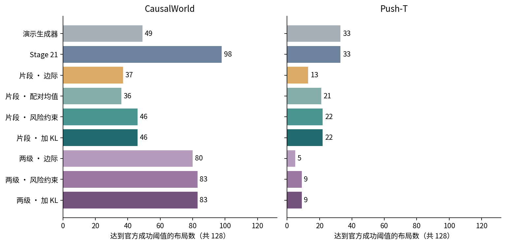

# Stage 22 · 作用图改善了远端位移预测，Push-T 仍欠缺可靠的换动作信号

**这批值得保留的是世界模型。** 在 192 座全新的 CoPhy 塔上，预测相隔至少两层的积木会因换动作而多移动多少，RMSE 从 Stage 20 的 **1.706** 降至 **1.358 个块边长**。只把本轮模型的消息通路换回接触门，使用相同训练数据和预算，误差回升到 **1.421**。在 CausalWorld、Push-T 上，新模型预测未来位置、原生奖励和两动作位移差的点误差也都低于原来的 Stage 19 共享图。

**闭环控制保留 Stage 21 为主结果。** 最后一组在两个环境各 128 个布局上测试同一批动作片段。用配对风险选动作，CausalWorld 从边际打分的 37 次成功提高到 46 次，Push-T 从 13 次提高到 22 次。直接执行原演示生成器分别成功 49、33 次，Stage 21 分别成功 98、33 次。KL 改过个别动作，未增加这组实验的成功数。

## 1. 把有向作用送进状态预测器

三个环境使用同一套网络。可移动体、执行器、静态体有各自的角色标记；每个对象用位置和两个旋转轴构成三个因子。CoPhy 输入真的塔和一次事实演化，CausalWorld 和 Push-T 输入可见对象与此前的事实转移。模拟器的接触、删边效果和未来状态只用作标签。

事实转移 $F=(X^F,a^F,Y^F)$ 先得到每个对象的证据 $e_i=E(X_i^F,Y_i^F-X_i^F,a_i^F,\mathrm{role}_i)$。先验边 $\ell^0_{ij}$ 的平均概率进入第一层物理、扰动后验。用两端的证据与第一层后验显式修正事实图，再用修正前后的边概率更新物理和扰动。

$$
\ell^F_{ij}=\ell^0_{ij}+C(e_i,m_i^0,\mu_i^0,e_j,m_j^0,\mu_j^0,\ell^0_{ij}),\qquad
m_i=\sum_{k=1}^{16}\pi_{ik}c_k,\quad \pi_i=\mathrm{softmax}(b_i).
$$

$c_k$ 是 12 维可学习向量。四维扰动在同次反事实中取 $u_i=\mu_i+\exp(s_i)\epsilon_i$；前瞻保留从事实反推的物理，扰动取标准高斯。同一比较中的分支共享扰动。位移和边的网络都从数据训练。

本轮给关系网络增加两端的相对位置和事实位移之差。每条候选边预测接触概率 $p^c$、给定接触后的作用概率 $\rho$ 和非负作用强度 $v$。$p^c\rho$ 对应“关闭这对碰撞会使接收块终点移动超过 0.10 个块边长”。$v$ 拟合 $\log(1+d_{ij})$，$d_{ij}$ 是真实关闭该对碰撞后接收块的终点位移。因子 $f$ 至 $g$ 的传播权重为

$$
W_{ij}^{fg}={\bf1}[p^c_{ij}\ge.5]\,\rho_{ij}(1+\tanh v_{ij})
\,{\bf1}[p_{ij}^{fg}\ge.5]\tanh w_{ij}^{fg}.
$$

每轮汇总 $M_{jg}=\sum_{i,f}W_{ij}^{fg}h_{if}$，再执行 $h_{jg}\leftarrow h_{jg}+\mathrm{GRUCell}(M_{jg},h_{jg})$，共四轮。动作只写入受干预节点及其关联边。一个对象要受到其他对象的动作影响，必须有激活的消息通路。**仅接触通路消融**在上式中将 $\rho(1+\tanh v)$ 换成 1；两种模型都学习接触、作用存在性和位移强度，其他结构、监督、采样、种子和训练次数相同。

前瞻状态为 $X+\delta(h^a)$。如果已有同一事件的事实终点，则改用 $Y^F+\delta(h^a)-\delta(h^{a^F})$。另设反对称差分头。令 $z=h^a-h^b$，状态或奖励的差均值为两支预测之差加 $[L(z)-L(-z)]/2$，额外标准差为 $\mathrm{softplus}(S(|z|))\,\mathrm{mean}(|z|)$。离线概率评分使用四个对称扰动样本，沿用位姿尺度底限 .12、奖励尺度底限 .055。训练增加一项未被两个候选直接寻址的可移动物体的位置差 MSE。

$$
\mathcal L=\mathcal L_{\mathrm{shared}}
+.75\,\mathrm{BCE}_{\mathrm{excision}}
+.20\,\mathrm{Huber}_{.2}(v,\log(1+d))
+.85\,\mathrm{MSE}_{\mathrm{untouched}}.
$$

原有共享损失依次包括位姿 Huber、奖励 Huber、位姿和奖励配对损失、候选和事实接触 BCE、高斯 KL、稀疏项，权重为 1、2、.65、1.5、.32、.16、.002、.002。配对损失为 MAE 加 .035 倍高斯负对数似然（略常数）。CoPhy 屏蔽奖励；只有有删碰撞标签的行计算新增的边监督。

| CoPhy，192 座塔 | 接触 AP / 平衡误判率 | 有向作用 AP / 平衡误判率 | 未来位置 RMSE | 全部位移差 RMSE | 未直接移动的块 | 至少相隔两层的块 |
|---|---:|---:|---:|---:|---:|---:|
| Stage 20 有向图，冻结重测 | .942 / 14.1% | .886 / 17.6% | 1.254 | 1.444 | 1.443 | 1.706 |
| Stage 22，仅接触通路 | .960 / **11.3%** | .911 / **15.3%** | 1.068 | 1.201 | 1.245 | 1.421 |
| Stage 22，有向强度通路 | **.961** / 11.8% | **.913** / 15.7% | **1.044** | **1.184** | **1.217** | **1.358** |
| 固定 NCII，同删边监督 | .924 / 15.6% | .890 / 16.6% | — | — | — | — |

“至少相隔两层”要求接收块在初始塔中与两个候选各自干预的块都相距至少两层。共有 541 个合格的接收块－动作对观测。按整座塔配对 bootstrap 4,000 次，新模型远端 RMSE 减仅接触通路为 **−0.063**，95% 区间 **[−0.110, −0.008]**；减 Stage 20 为 −0.348，区间 [−0.479, −0.218]。后一个差值还包括新增塔数据、四轮传播、事实锚定和损失变化。前一个比较才隔离了将有向强度乘进消息通路的作用。距离按初始塔层级定义，不能据此认定实际动力学只经过一条路径。

## 2. 推物中的图、未来状态、奖励和动作差

两域各有 256 个新测试布局，每个布局从同一状态和物理条件执行五个动作，产生 1,280 个候选未来、2,560 对动作差。单步对应八个原生控制时刻，提前达标时截止。图评测计算指向可移动体的接触边；平衡误判率为 $(\mathrm{FPR}+\mathrm{FNR})/2$。新模型在验证集定阈值，冻结模型沿用原阈值。

| 入边 AP / 平衡误判率 | 新有向通路 | 新仅接触通路 | Stage 19 共享图 | NCII | NCII + 接触监督 |
|---|---:|---:|---:|---:|---:|
| CausalWorld | .975 / 8.1% | .975 / 7.8% | .966 / 10.0% | .535 / 47.3% | .795 / 20.1% |
| Push-T | .807 / 6.0% | .798 / 6.4% | .769 / 5.9% | .083 / 47.3% | .586 / 25.2% |

| 环境与模型 | 未来位置 RMSE | 两动作位移差 RMSE | 位移差 CRPS | 原生奖励 RMSE | 原生奖励差 RMSE |
|---|---:|---:|---:|---:|---:|
| CausalWorld 新有向通路，mm | 17.08 | 13.14 | 4.44 | .0785 | .0601 |
| 仅接触通路 | **16.02** | **12.47** | 4.45 | .0785 | **.0599** |
| Stage 19 共享图 | 18.16 | 13.38 | 3.81 | .0809 | .0613 |
| CoPhyNet | 17.65 | 14.95 | 4.07 | .0785 | .0634 |
| PETS | 23.96 | 16.03 | **3.47** | **.0748** | .0631 |
| Push-T 新有向通路，px | 19.88 | 18.85 | 6.11 | **.0774** | **.0622** |
| 仅接触通路 | **18.59** | **18.84** | 6.09 | .0803 | .0645 |
| Stage 19 共享图 | 20.83 | 20.11 | 5.36 | .1053 | .0759 |
| CoPhyNet | 22.89 | 21.31 | 5.65 | .1288 | .0801 |
| PETS | 24.16 | 22.28 | **5.00** | .1305 | .0817 |

位置 RMSE 是三维误差长度的均方根，位移差 CRPS 按坐标计算再平均；原生奖励为一次宏动作内环境奖励的平均。两个任务上点预测改善，但位移差分布的 CRPS 都高于 Stage 19 和 PETS。作用强度通路的明确增益出现在 CoPhy 远端，推物的只用接触通路版本在若干位置指标上更好。

## 3. 决策头把“救回”和“改坏”分别计数

每个分叉得到未来最多 12 个宏动作的达标标记 $s$、最高任务分 $c_{\max}$、最后任务分 $c_l$。剩余预算不足时截短。令 $u=.5c_{\max}+.25c_l$，回报 $G=s+u$。对两个候选 $a,b$，网络学习三个概率，即结果不同的概率 $d$，结果不同时 $a$ 成功的条件概率 $q$，结果相同时双方都成功的条件概率 $t$。于是四种结果的概率为

$$
P_{00}=(1-d)(1-t),\quad P_{01}=d(1-q),\quad P_{10}=dq,\quad P_{11}=(1-d)t.
$$

$P_{10}$ 表示候选能救回参考会失败的回合，$P_{01}$ 表示会改坏一个参考可完成的回合。网络在四个结果类别内各学 $\Delta u$ 的 Laplace 位置 $\mu_c$ 和尺度 $b_c$，完整回报差服从四分量混合，分量中心为 $s_a-s_b+\mu_c$。交换候选会交换 01/10，均值翻转、尺度对应交换。同一模型另有三个边际读出，分别预测单个动作的成功率、最高分和终点分。

三个预测步中的动作都经对象图传播，再汇总可移动体的表示、预测位姿和奖励。物理与修正的事实图始终来自真实已观察转移。线上想象只使用模型；达标和改坏标签来自离线模拟器分叉。头部损失为边际成功 BCE、边际分数 MSE、三个事件的 BCE，以及 .22 倍真实事件类别下的 Laplace 负对数似然。$q$ 仅用结果不同的样本训练，$t$ 仅用结果相同的样本训练。

**KL 确实进入动作排序。** 把救回、改坏两类的概率总量固定，将这两类等分得到参考分布，00 和 11 维持原概率。实际加入的有方向项为

$$
K=d\,\mathrm{sign}(q-.5)\,[q\log(2q)+(1-q)\log(2(1-q))].
$$

同一检查点比较四种选择。边际版本只读取边际头；配对均值读取 $P_{10}-P_{01}+w\sum_cP_c\mu_c$；风险版本再要求 $P_{01}\le\epsilon$；KL 版本再加 $0.5K$。除参考动作固定为零分外，候选还扣除切换成本，可加生成器相对对数先验。这个比较也区分了“学到了配对均值”和“使用了差分布的其他信息”。

## 4. 三组闭环各自回答什么

每一列下的策略共用相同测试布局。三组之间更换布局，分别汇报。每个真实回合的首个八步动作都由原生成器执行并计入预算；最多 36 个宏动作、288 个原生步。CausalWorld 达标为官方覆盖分大于 .90，Push-T 为物体覆盖率大于 .95。

| 动作选择 | A 即时重排 CW / Push-T | B 有切换成本和续推 CW / Push-T |
|---|---:|---:|
| 原生成器 | 46 / 31 | 44 / 30 |
| 冻结 Stage 21 | **93 / 32** | **95** / 30 |
| 冻结 PETS，Stage 21 配置 | 64 / 31 | — |
| 新边际 | 76 / 5 | **95 / 31** |
| 新配对均值 | 75 / 7 | — |
| 新配对 + 风险约束 | 77 / 7 | 93 / 30 |
| 再加 KL | 80 / 7 | 92 / 30 |
| Stage 21 优先，随后用新风险头 / 再加 KL | — | 94 / 30；93 / 30 |

A 把 24 个候选中的后 12 个替换为生成器模式周围的位移扰动。训练时只偏离一次，之后由生成器续推；执行时每一步都重新打分。离线五候选验证用真实增益选到先验权重 .015、切换成本 0、风险上限 .20，$w=1$。Push-T 的 KL 策略在 4,386 个可选时刻里改选 3,848 次，最终只成功 7/128。单次替换的标签对这种连续偏离的轨迹描述不足。

B 恢复原生成器的 24 个候选，把连续分数权重降到 $w=.2$、先验权重设为 .05、改坏风险上限设为 .15。两个任务各 48 个独立验证布局共同选择切换成本（.06 或 .16）与改选后强制原生成器续推的步数（5 或 11）。四个配置均成功 48/96，终点分破同分后取成本 .16、续推 5 步。Push-T 的风险和 KL 版本在测试中均未改选，成绩回到生成器水平。A 与 B 的数据、动作菜单和准则都发生过变化，跨列差距不能只归给续推。

**C 直接比较三步动作段。** 从原有训练数据存储 30,902 条带动作的对象坐标系记录。Push-T 取原来的训练演示，在同一次人工操作中连续取第 4、8、12、16、20、24 个目标命令。CausalWorld 从原训练分叉取相同时间点的命令路点，每组按原生终点分减 .35 倍位姿距离选一个原目标样本，另保留四个实际达到的位姿作为目标。这项既有人工打分只用于 CausalWorld 训练样本的选择。两个域用同一个按训练特征标准差归一化的近邻检索。四种选项分别是原生成器、最近样本、八个近邻中终点偏移相对最近样本最大的一条、八个近邻的距离加权平均。真实和想象执行都按当前执行器位置换算命令。只学习和评测本研究的片段选择，不训练新增基线。

每次替换从同一状态执行完整三个宏动作，再由同一个生成器补足至最多 12 步。另用这批标签训练相同架构的回报头。按验证布局选择成本 0、风险上限 .10；四个选项共用零先验，$w=.2$。纯片段策略每三个宏动作才重新打分。两级策略先用冻结 Stage 21 检查原有 24 个候选，若它选了非首选就执行一步；否则比较四个片段。两级策略选择首选时下一步可再决策，选择检索片段时执行满三步。因此两级策略使用了更多模型打分，“两级边际”仅指第二级使用边际头。

| C，均为 128 个新布局 | CausalWorld 成功 | 终点 / 最高分 | Push-T 成功 | 终点 / 最高分 |
|---|---:|---:|---:|---:|
| 原生成器 | 49 | .430 / .609 | **33** | **.778 / .923** |
| 冻结 Stage 21 | **98** | **.731 / .809** | **33** | **.778 / .923** |
| 片段边际，无配对分布 | 37 | .330 / .549 | 13 | .535 / .741 |
| 片段配对，只用均值 | 36 | .300 / .548 | 21 | .522 / .759 |
| 片段配对 + 风险约束 | 46 | .370 / .557 | 22 | .513 / .759 |
| 再加 KL | 46 | .371 / .557 | 22 | .513 / .763 |
| 两级边际 | 80 | .629 / .751 | 5 | .396 / .649 |
| 两级配对 + 风险约束 | 83 | .661 / .765 | 9 | .404 / .657 |
| 两级再加 KL | 83 | .659 / .765 | 9 | .401 / .665 |

C 的纯片段风险版本相对边际版本，两域都各有 18 个布局从失败变为成功、9 个反向，净增 **7.0 个百分点**，布局配对 bootstrap 95% 区间均为 **[−0.8, +14.8] 个百分点**。在 KL 策略自己访问的状态上，加入 KL 改变了 6/1,110 个 CausalWorld 和 13/1,444 个 Push-T 片段决策；成功布局逐一与无 KL 版本相同。

离线可区分“候选里有没有救回机会”和“模型认不认得”。在 256 个新 Push-T 分叉里，**25 个**至少有一个检索片段能把参考失败变为成功。逐一比较三个替代片段时，真正能救回的占 4.43%，网络识别这些机会的 AP 仅 **.073**。片段回报差 RMSE / CRPS 为 .354 / .154，CausalWorld 为 .494 / .187。增加完整动作段提供了可执行的机会，排序精度还不足以在闭环超过原生成器。

## 5. 训练预算与复现

- 图模型训练为每个域新增 2,048 个布局。每次更新从每域旧训练数据取 8 行、新数据取 16 行，共 72 行、每行随机取 4 个候选。25% 的行另揭示同一分叉的一个事实后继，推物沿用 40% 的达到目标重标记并屏蔽对应原生奖励。AdamW 共 3,200 次更新，学习率从 .0015 余弦降到 .00015。两套模型都选到第 3,040 步。CoPhy 训练中的真实删边监督来自原 384 座训练塔；本批验证、测试塔均另做真实删碰撞。新增训练/验证/测试起始种子分别为 1823000/1923000/2023000，CoPhy 验证/测试 128/192 座，推物每域 240/256 个布局。
- A/B 头和 C 头各用两域合计 4,096 个训练布局。C 的训练/验证/离线测试起始种子分别为 2423000/2523000/2623000，每域 2,048/224/256 个。两个头各一次 AdamW，75 个 epoch，batch 96，学习率 .001 余弦降至 .0001；验证损失分别选到第 9、12 个 epoch。训练种子 271，所有系数跨任务共享。三步想象取扰动均值，差分布由配对回报头给出。
- A/B/C 的闭环测试起始种子分别为 2123000/2323000/2723000，B 的闭环验证从 2223000 开始。合计 **5,888 个测试回合**和 **384 个选参回合**。NCII、CoPhyNet、PETS 均使用已提交的检查点和原配置，PETS 闭环只在 A 组运行。单训练种子下，这批支持更新结构与预测主结果，控制主结果仍用 Stage 21。

[模型与损失](../../whatif/paired/world.py) · [状态与图评测](../../whatif/paired/evaluate.py) · [差分布与 KL](../../whatif/paired/decision.py) · [三步片段](../../whatif/paired/segments.py) · [离线数值](../../results/paired/offline.json) · [各组闭环与配对统计](../../results/paired/summary.json) · [分步复现](../../whatif/paired/reproduce.sh)
