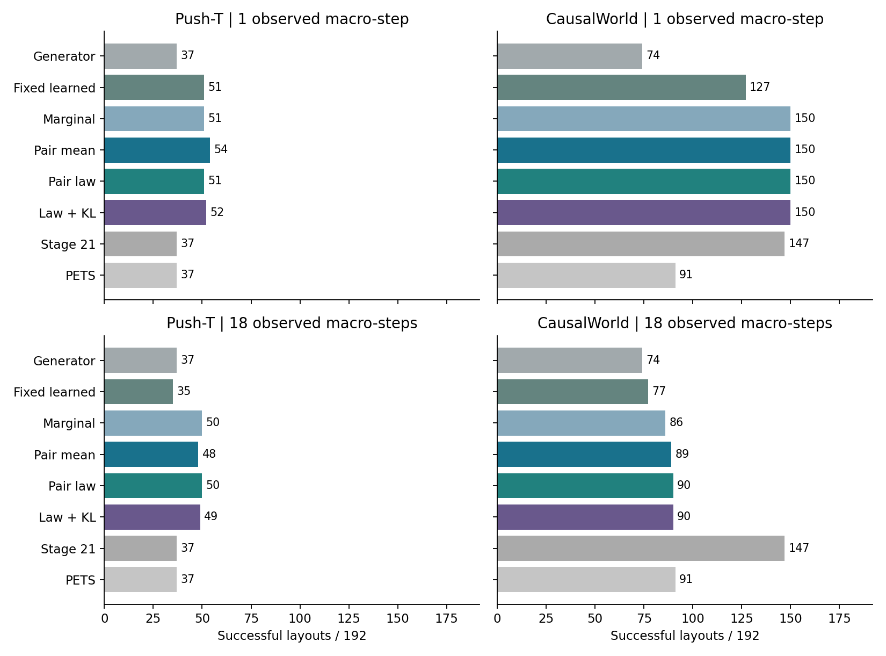
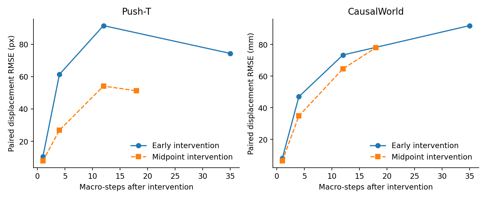

# Stage 23 · 从同一布局预测换反馈策略的后果

这次让世界模型选择“接下来怎样根据观测出动作”。在两域各 192 个独立闭环布局、每回合最多 288 个原生步的条件下，**Push-T 的原生成器成功 37 次，固定使用训练选出的策略成功 51 次，图模型按配对回报差均值选策略成功 54 次**。CausalWorld 三者分别为 **74、127、150 次**，同场重跑的 Stage 21 为 147 次。

Push-T 的增益有两个来源。把生成器输出改成从实际回报学到的反馈策略，已经贡献了这组样本中 17 次净增里的 14 次。再按当前布局选择，配对均值比固定策略多成功 3 次，布局配对的 95% 区间为 **−3.1 至 +6.2 个百分点**。加 KL 的版本成功 52 次。另有 160 个独立布局实际执行了全部七个候选，配对均值在这组只以 **39 比 38** 领先生成器。合并两组，配对均值 **93/352**，生成器 **75/352**，差 **+5.1 个百分点**，按两组分别重采样的 95% 区间 **[−0.3, +10.5]**。这是单种子的性能进展，稳定性和 KL 的独立增益仍有限。

## 1. 在真实环境里学习可以持续执行的干预

上一批只改变最初一步或几步，随后用生成器续推，却在部署时反复重新排序。这批让训练分叉和部署执行同一种干预。给定相同的事实轨迹与物理条件，一个候选代表一个反馈函数 $\pi_w(X_t,g)$。选中后，它每一步都重新读取执行器、可移动体和目标的当前位姿，输出两个新的路点。环境原生成功判定随时结束回合。

原神经生成器提供节点和两个三维位移 $d_1,d_2$。设 $Q$ 的三行为物体局部坐标轴，$E$ 的三行为目标与当前物体的位置差、第一和第二朝向轴之差。新输出层含 11 个系数。代码中的位移修正为

$$
q=\tanh\|E\|_F,\quad g_k=w_{k-1}+w_{5+k}q,\quad
b=\left(w_{2:5}+w_{8:11}^{\mathsf T}\tanh(EQ^{\mathsf T})\right)Q,
$$
$$
d'_1=(1+g_1)d_1+b,\qquad d'_2=(1+g_2)d_2+b+w_5(d_2-d_1).
$$

这里 $k=1,2$，$w$ 从 0 编号，切片右端不包含。零系数复现原生成器。最初的六参数族把最后五项置零。低维输出层是人工选的函数形式；系数由两个原生环境中的完整训练回合学习。训练不需要专家新动作、任务 ID、接触解法或成功时的动作标签。搜索中用成对的正负参数扰动、相同训练布局和实测回报更新精英均值。用不同的两域训练权重保留不同候选，最终每个模型只有**一组两域共用的七个候选**，其中含原生成器。固定策略对照是在独立训练筛选布局上两域平均回报最高的一个，部署时两个域都用它。

我们训练了两种干预时点。**早决策**先执行生成器一次，用测得的事实转移选择余下 35 步的策略。**中途决策**先实走 18 步，用第 1、6、12、18 步的事实转移选择余下 18 步的策略。中途已经达标的回合直接计成功。两组分别采集续推数据、筛选七个候选、训练模型；两组之间的差值同时包含干预时点、可用证据、训练分布及候选的变化。各组内部的四种神经决策使用完全相同的检查点、候选和观测。

## 2. 神经世界模型怎样从事实推到后果

节点集合来自场景对象及其角色。Push-T 包含 T 形块、推动器和墙，CausalWorld 包含物块、三个指尖和地面，CoPhy 每个真实积木一个节点。每个对象分位置和两个朝向轴三个因子。坐标及动作转换、生成器的对象坐标系、环境执行和成功标签仍由适配器给出。两项推物任务共用下述长程网络的全部权重。CoPhy 延用三域共同训练的 Stage 22 短程模型，长程模型的事实推理层由其初始化。本轮没有给 CoPhy 塔假设反馈策略或构造控制回报。

**联合事实推理。** 对已观测的转移 $t$，计算 $e_{it}=E_\theta(X_{it},Y_{it}-X_{it},a_{it},r_i)$，这里 $r_i$ 为对象角色。早决策直接使用一次转移。中途模型学习每个对象四个时刻的权重 $\alpha_{it}=\operatorname{softmax}_t(A(e_{it})+b_t)$，证据为 $e_i=\sum_t\alpha_{it}e_{it}$。事实边先验使用两端权重的平均，对各时刻先验 logit 加权。令 $d_i(\ell)$ 表示现存邻居的平均边概率，计算

$$
v_i^0=L(e_i,d_i(\ell^0)),\qquad
\ell^F_{ij}=\ell^0_{ij}+C(e_i,m_i^0,\mu_i^0,e_j,m_j^0,\mu_j^0,\ell^0_{ij}),
$$
$$
v_i=v_i^0+R(e_i,d_i(\ell^0),d_i(\ell^F)),\qquad
m_i=\sum_{c=1}^{16}\operatorname{softmax}(v_{i,1:16})_c\,c_c,\qquad
u_i=\mu_i+\exp(s_i)\epsilon_i.
$$

每个机制向量 $c_c$ 有 12 维，$u_i$ 有 4 维。先由第一轮后验修正事实边，再细化物理与扰动。长程模型把扰动当作同一回合的持续残差；训练时每个事实样本的一次高斯抽样由所有候选共享。选择和本轮长程概率评测取其后验均值，配对头仍输出完整的结果分布。短程 Stage 22 的概率评测继续使用四个对称扰动样本。

**图上的动作传播。** 节点初始表示由当前位姿、相对目标位姿、事实位移、角色、$m_i,u_i$ 得到。候选的首个真实动作只写入被指派的执行器，持续策略的参数写入可被控制的执行器节点。局部输入 $v$ 通过 $P(v)-P(0)$ 注入，零输入的初始动作贡献严格为零。所有候选之间变化的输入都从这里进入图，读出层只汇总可移动物体。对四个预测时点 $h$，关系网络用两端因子状态、相对位置、事实位移之差、时点嵌入及事实边，计算附加 logit、因子门 $p^{fg}$ 与权重 $w^{fg}$。

$$
p_{ij}^h=\sigma(\ell^F_{ij}+B_h(i,j)),\quad
W_{ij,h}^{fg}={\bf1}_{i,j\ {\rm present},\,i\ne j}\,{\bf1}[p_{ij}^h\ge .5]\,
{\bf1}[p_{ij}^{fg}\ge .5]\tanh(w_{ij}^{fg}),\quad
M_{jg}=\sum_{i,f}W_{ij,h}^{fg}H_{if}.
$$

每个时点执行两轮 $H\leftarrow\operatorname{LayerNorm}(H+.5\,\operatorname{GRUCell}(M,H))$，硬门用直通梯度。时点之间重新注入四分之一的局部干预表示。各时点学习从分叉以来是否出现过接触、累计位姿增量、当时的原生奖励、是否成功、最高分和最后分。位姿为 $X+\delta_\theta(H_h)$。这里的推物图标签是累计接触，CoPhy 的定向物理作用另用真实关闭碰撞的标签评估。

**同状态的差分布。** 状态和原生奖励使用对称尺度、反对称均值的高斯差分头。令 $z=H_a^{\rm read}-H_b^{\rm read}$，$v_a$ 为可移动物体位置与奖励的边际预测，则
$$
\mu_{ab}=v_a-v_b+\tfrac12[L(z)-L(-z)],\qquad
\sigma_{ab}=.012+\operatorname{softplus}(S(|z|)).
$$
回合结束后的成功记为 $S$，辅助分 $C=.5\,c_{\max}+.25\,c_{\rm last}$，回报 $G=S+C$。网络直接预测 $p_{ab}(s,c)$，即同一事实条件下 $\Delta S\in\{-1,0,1\}$ 和 $\Delta C$ 的联合分布。后者用 $[-.75,.75]$ 的 17 个等距点表示，真实值线性分配给相邻两格。交换两支，联合 logit 在两个轴上反转。51 格联合分布经 $\Delta G=s+c$ 得到回报差分布，保留“救回”“改坏”和双方结果相同三类情况。

一个检查点共同训练以上输出。损失为联合分布交叉熵、.55 倍成功结果不同时方向的条件交叉熵、边际成功 BCE、2 倍最高和最后分 MSE、移动体位姿 Huber（宽 .18）、.5 倍累计边 BCE、.15 倍事实边 BCE、原生奖励 MSE、.4 倍位置与奖励差 MAE、.08 倍高斯差 NLL 及 .002 倍扰动先验 KL。几何标签和模拟器回报只参与训练与评测。

## 3. 分布怎样进入真实决策

候选 $a$ 和其余六个候选逐对比较。记 $\langle\cdot\rangle_b$ 为对其余候选的平均，符号函数在零处取零。

| 选择方式 | 实际最大化的分数 |
|---|---|
| 边际 | $\hat P(S_a=1)+.5\,\hat c_{\max,a}+.25\,\hat c_{{\rm last},a}$ |
| 配对均值 | $\langle E_{p_{ab}}[\Delta G]\rangle_b$ |
| 配对分布 | $\langle E[\Delta G]+.25\,E[\operatorname{sign}(\Delta G)]\rangle_b$ |
| 配对分布加 KL | 上一行 $+.5\langle K_{ab}\rangle_b$ |

令 $d=P(\Delta S\ne0)$，$q=P(\Delta S=1\mid\Delta S\ne0)$。把“只有一支成功”的质量等分作为参考，实际使用的有方向散度为

$$
K_{ab}=d\,\operatorname{sign}(q-.5)\,[q\log(2q)+(1-q)\log(2(1-q))].
$$

所有系数对两个域相同。线上只用已观测事实选择，随后每步仍用当前观测出动作。选择函数不读取模拟器候选后果，也没有切换惩罚、成功保护阈值或改选后冷却计数。

| 决策方法，每域 192 个相同布局 | 早选 Push-T | 早选 CausalWorld | 中途选 Push-T | 中途选 CausalWorld |
|---|---:|---:|---:|---:|
| 原生成器 | 37 | 74 | 37 | 74 |
| 固定使用训练筛选最优策略 | 51 | 127 | 35 | 77 |
| 世界模型边际 | 51 | 150 | 50 | 86 |
| 世界模型配对均值 | **54** | **150** | 48 | 89 |
| 世界模型配对分布 | 51 | **150** | **50** | **90** |
| 再加 KL | 52 | **150** | 49 | **90** |
| 冻结 Stage 21 | 37 | 147 | 37 | 147 |
| 冻结 PETS，Stage 21 配置 | 37 | 91 | 37 | 91 |

- **Push-T。** 早选配对均值相对生成器救回 38 个布局、改坏 21 个，成功率从 19.3% 到 28.1%，差值区间 [+1.0, +16.7] 个百分点。相对边际头是救回 8、改坏 5，区间 [−2.1, +5.2]。原生成器、早选边际、早选配对均值的终点分 / 最高分分别为 .745/.888、.745/.904、.746/.905。成功数的上升主要体现在更多回合跨过原生成功线。配对分布加 KL 在 192 次早决策里改选 2 次，成功净增 1；在 181 次中途决策里也改选 2 次，成功净减 1。
- **CausalWorld。** 早选配对均值相对固定策略救回 29 个、改坏 6 个，净增 12.0 个百分点，区间 [+6.2, +17.7]。相对已很强的 Stage 21 是救回 12、改坏 9，区间 [−3.1, +6.2]。早选边际与配对均值成功数相同，两者各有 3 个对方没成功的布局。配对均值的终点分 / 最高分为 .756/.802，Stage 21 为 .759/.793。加入 KL 改变 0/189 次早决策、2/128 次中途决策，均未改变成功数。
- **原本能成功的回合。** Push-T 中途配对均值救回 21 个、改坏 10 个；早选两者都是较大的数。CausalWorld 中途配对均值救回 18 个、改坏 3 个。推迟选择保护了一部分原有成功，也失去了早期干预可以利用的机会。现阶段保留两套检查点和旧模型，以早选配对均值作为这批控制结果。
- **完整分叉给出的第二份证据。** 在 160 个另行留出的 Push-T 早选布局上，原生成器成功 38 次，训练选出的固定策略成功 37 次。64 个布局存在至少一种可救回的替代方案；配对均值认出其中 20 个，同时改坏 19 个原有成功布局，净增 1 次。CausalWorld 对应的 93 个可救布局中认出 78 个、改坏 6 个，成功数由 57 到 129。这里先在每个布局执行了全部七条反馈分支，再读取预测所选的实测分支。上面的 192 布局闭环则先根据观测写入选择结果，再在原生环境执行所选策略。在线不需要七倍试错。

## 4. 图、状态、奖励和动作差预测

**CoPhy。** 在 160 座新塔上，冻结的 Stage 22 模型接触 AP / 平衡误判率为 **.954 / 12.3%**，有向作用为 **.911 / 16.8%**。使用相同删碰撞监督的固定 NCII 分别为 .916 / 16.9%、.894 / 17.1%。作用标签是关闭一对碰撞后接收块位置改变超过 0.10 个块边长。图模型未来位置 RMSE 为 1.018，全部两动作位移差为 1.206，未直接干预的块为 1.251，与两个干预块在原塔都至少相隔两层的块为 **1.457**（392 个接收块－动作对观测，单位均为块边长）。这组数字是原推理器在独立塔上的复测。

下表在推物早选的 160 个完整分叉布局上评价第一个宏动作，每个布局 7 个未来、21 个配对。位移用三维位置误差长度的 RMSE，CRPS 按坐标平均。奖励是宏动作内原生奖励均值。固定模型沿用原来的阈值；新时程图在验证布局按时点选平衡误判率最低的阈值。实际传播硬门仍为 .5。AP 用连续边分数，平衡误判率为 $(\mathrm{FPR}+\mathrm{FNR})/2$。

| 环境、模型 | 接触入边 AP / 平衡误判率 | 未来位置 RMSE | 位移差 RMSE / CRPS | 奖励 RMSE / 奖励差 RMSE |
|---|---:|---:|---:|---:|
| Push-T 新反馈图，px | .703 / 7.0% | 20.13 | **10.56** / 2.24 | .0688 / **.0122** |
| Stage 22 短程图 | .712 / 6.6% | 17.86 | 11.61 / 4.25 | .0579 / .0130 |
| 固定 PETS | — | **17.44** | 10.85 / **1.97** | **.0416** / .0166 |
| 固定 CoPhyNet | — | 19.66 | 11.91 / 2.77 | .0543 / .0206 |
| NCII / 加接触监督的 NCII | .047 / 54.3%；.436 / 25.3% | — | — | — |
| CausalWorld 新反馈图，mm | **.989** / 5.5% | **26.11** | **8.15 / 2.30** | **.0577 / .0254** |
| Stage 22 短程图 | .953 / **4.5%** | 28.83 | 11.73 / 4.43 | .0790 / .0349 |
| 固定 PETS | — | 41.34 | 11.80 / 3.09 | .0797 / .0307 |
| 固定 CoPhyNet | — | 31.45 | 12.03 / 3.74 | .0878 / .0337 |
| NCII / 加接触监督的 NCII | .393 / 50.0%；.898 / 5.2% | — | — | — |

| 干预时点、任务 | 余下步数 | 期间接触 AP / 平衡误判率 | 最终位置 RMSE | 最终位移差 RMSE / CRPS | 原生奖励 / 奖励差 RMSE | 全回报差 RMSE / CRPS |
|---|---:|---:|---:|---:|---:|---:|
| 早选 Push-T | 35 | .964 / 6.9% | 60.18 px | 74.39 / 19.66 px | .2984 / .3370 | .600 / .313 |
| 早选 CausalWorld | 35 | .972 / 13.0% | 75.16 mm | 91.85 / 22.49 mm | .0864 / .0993 | .801 / .403 |
| 中途 Push-T | 18 | .980 / 2.5% | 46.51 px | 51.22 / 12.80 px | .2599 / .2775 | .497 / .228 |
| 中途 CausalWorld | 18 | .977 / 7.9% | 73.89 mm | 78.00 / 17.96 mm | .0445 / .0559 | .382 / .117 |

中途离线测试每域另起 192 个布局，表中预测指标只纳入第 18 步仍可干预的 173 个 Push-T 和 128 个 CausalWorld 布局。提前达标后未来位姿与最后一次实测奖励沿用终止值。回报差 CRPS 由 51 格诱导的离散分布精确计算。早选 Push-T 对“替代策略救回生成器”的 AP 为 .189，真实正例率 .102；CausalWorld 为 .685，对应正例率 .378。推物长程图识别“曾经接触过”相对容易，精确预测接触以后往哪推、能否达标仍困难。

## 5. 数据、预算与复现

| 项目 | 本批实际设置 |
|---|---|
| 策略筛选 | 初始 6 参数搜索 3 轮，每轮 12 个候选 × 16 个共同布局 × 2 域。早选扩展搜索两条训练权重线，各 4 轮 × 16 × 40 × 2 域，23 个归档候选另用 144 布局/域筛选。中途各 3 轮 × 14 × 40 × 2 域，19 个候选另用 160 布局/域筛选。合计 30,816 个原生训练回合。 |
| 世界模型训练 | 早选每域 640 个初始候选族布局，加 1,408 个扩展族布局；每布局执行七个反馈策略。初始族原生奖励只用第一时点的标签。中途每域采 2,304 布局，训练使用仍可干预的 2,165 个 Push-T 和 1,226 个 CausalWorld 布局。两组模型合计采集 60,928 条训练分支，独立于搜索回合。 |
| 优化 | 单种子 271，AdamW，batch 80，共 64 个 epoch。早选 3,328 次更新，学习率从 .0014 余弦降到 .00016；中途自早选权重初始化，2,752 次更新，从 .0008 降到 .00016。按两域平均验证损失选择第 52 和 19 个 epoch；验证原生布局数分别为每域 112、192。训练 GPU 0。 |
| 布局编号 | 初始搜索从 2900000 开始；早选扩展搜索从 4000000 开始，筛选从 4100000 开始；中途对应 4700000、4800000。早选两族训练从 3000000、3600000 开始，扩展验证/测试从 3700000/3800000 开始；中途训练/验证/测试从 4300000/4400000/4500000 开始。CoPhy 从 3400000 开始，三层和四层各 80 座，每塔 4 个干预。 |
| 原生闭环 | 两个干预时点及所有参照均从 3300000 开始，各域 192 个相同布局。CausalWorld 用官方推动协议干预，训练 P1/P7，测试按种子覆盖 P1/P2/P7/P8，覆盖分大于 .90 达标；Push-T 训练阻尼集合为 0/.08/.55，测试为 0/.25，原生覆盖率大于 .95 达标。宏动作含两个路点、最多 8 个原生时刻，36 个宏动作上限。 |
| 闭环执行量 | 同一布局上不同打分器选中同一个确定性策略时共用一次原生执行。早选 Push-T/CausalWorld 实跑 430/530 个不同的布局－策略组合，中途分别 531/561 个。冻结 Stage 21 与 PETS 各另跑 384 个回合。逐布局保留选项、成功、最高和终点分；区间按整布局配对 bootstrap 5,000 次。 |
| 基线 | 本批基线新增训练更新数为零。NCII 沿用 PointNet 屏蔽源的似然差模型及既有同监督配置；CoPhy 同监督 NCII 原预算 1,080 次更新。CoPhyNet 和 PETS 复用 Stage 19 各 3,240 次更新的预测权重；PETS 闭环复用 Stage 21 的原回报读出及每步 24 候选。新方法每回合只对七个持续策略做一次模型选择。基线没有参与新候选搜索，也没有得到本批的完整策略轨迹监督。 |

[原生分叉与反馈动作](../../whatif/feedback/native.py) · [训练布局搜索](../../whatif/feedback/search.py) · [中途分叉](../../whatif/feedback/history.py) · [联合事实推理](../../whatif/feedback/smoother.py) · [图传播、差分布与决策](../../whatif/feedback/model.py) · [训练目标](../../whatif/feedback/fit.py) · [复现命令](../../whatif/feedback/reproduce.sh)

[闭环计数与区间](../../results/feedback/summary.json) · [逐布局早选](../../results/feedback/episodes.json) · [逐布局中途选择](../../results/feedback/history-episodes.json) · [短程及 CoPhy 指标](../../results/feedback/short.json) · [早选长程指标](../../results/feedback/long.json) · [中途长程指标](../../results/feedback/history-long.json)
