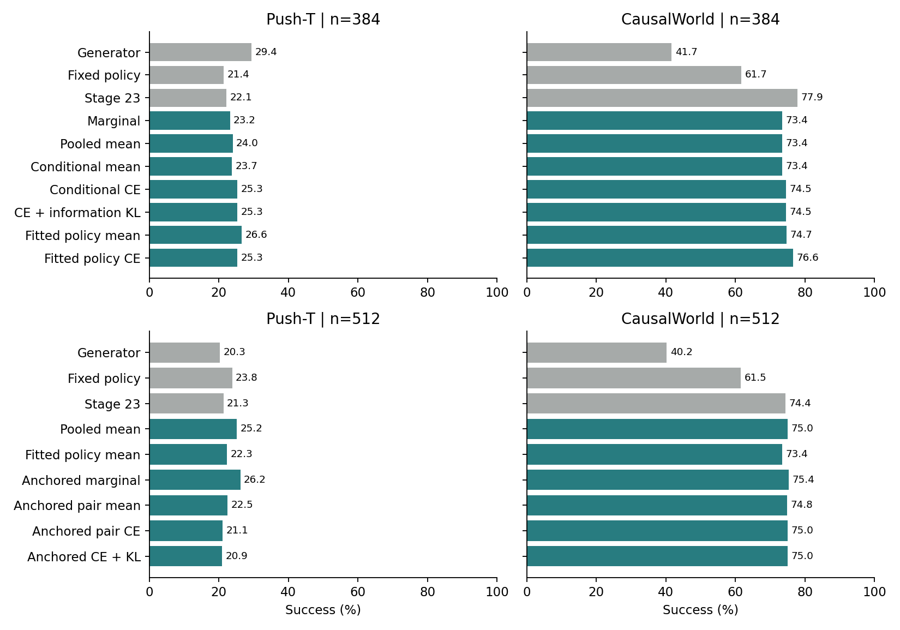
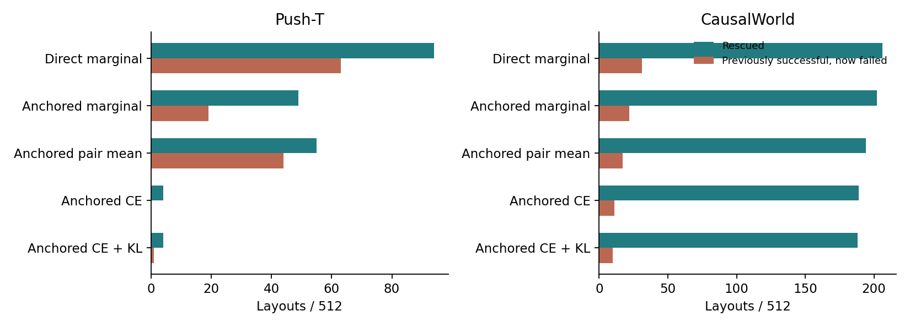
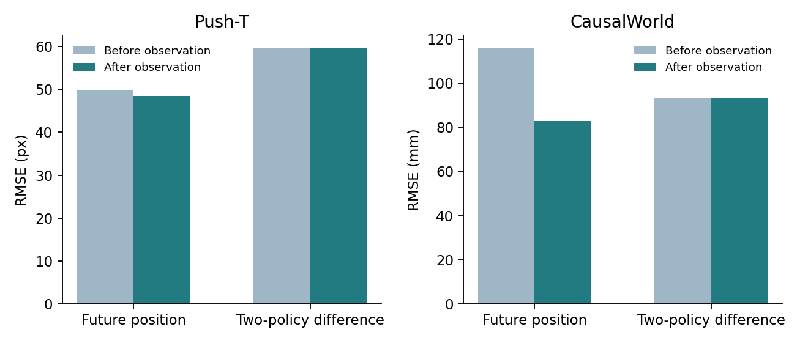

# Stage 24 · 学习中途改选的后果，并把原策略作为完整反事实

**本轮没有再搜索反馈策略。** 七个候选及其输出系数全部来自 Stage 23。新学的是三域共享的物理图、看到下一段运动后各候选的后果，以及同一布局上改动策略会救回还是改坏一次尝试。

最终在两域各 **512 个新布局**上，验证集选出的策略在 **Push-T 成功 134 次**，原生成器 104 次，固定反馈策略 122 次，冻结 Stage 23 为 109 次。在 **CausalWorld 成功 386 次**，上述三个参照分别为 206、315、381 次，冻结 Stage 21 为 391 次。Push-T 相对生成器净增 **5.86 个百分点**，按布局配对的 95% 区间为 **[+2.7, +9.0]**；相对固定策略净增 2.34 个百分点，区间 **[−2.5, +7.4]**。

这组收益不能全部归给分布决策。最终选中的做法是第一步用边际回报选计划，第二步用配对回报差均值选动作策略。相同第一步、第二步也只用边际预测时，Push-T 为 **132/512**，CausalWorld 为 **387/512**。第一步改用完整差分布的风险敏感分数后，Push-T 原先成功的回合全部保住了，同时只救回 4 次失败。进一步加 KL 得到 107 次成功，少于不加 KL 的 108 次。下面保留促使我们修改方法的首批 384 个布局、修改后独立的 512 个布局，以及实际用于选模型的验证结果。

## 1. 原生实验中构造了什么反事实

每回合先让原生成器执行一个宏动作，形成事实转移。随后有两个选择时刻。第一次选择策略 $a$，实走 8 个宏动作；第 9 个宏动作结束时看到新的位姿，第二次选择策略 $b$，用剩下的 27 个宏动作完成任务。$\pi_a,\pi_b$ 每一步均读取当前观测并输出两个路点。所有方法最多 36 个宏动作、288 个原生步，环境提前达标即结束。

采集时固定初始布局和物理状态，先执行同一个 $a$，再从可复现的中间状态分别执行全部七个 $b$。同一 $a$ 的七条轨迹必须有相同的已观测历史。标签包括位姿、原生奖励、接触、最终成功 $S$、最高分和最后分。令辅助分 $C=.5\,c_{\max}+.25\,c_{\rm last}$，回报 $G=S+C$。在线选择只读取到选择时刻为止的事实；每一批选项先落盘，再在原生环境实际执行。

| 检查点或候选 | 在哪里学习 | 本报告测什么 |
|---|---|---|
| Stage 24 共享世界模型 world.pt | 从 Stage 22 图初始化，CoPhy、CausalWorld、Push-T 联合更新同一组图参数。后段反馈、目标及回报读出由两项推物任务训练 | 本轮三域短程图与动力学；两个推物任务的中途预测、两段选择 |
| Stage 24 回报头 backup.pt、anchor.pt | 冻结上述共享图；用两个推物任务真实执行后续控制器的配对轨迹训练 | 第一步各计划的联合潜在结果、救回与改坏、闭环选择。两头均不用于 CoPhy 表格 |
| 固定 Stage 22 图 | 原三域训练权重 | 同一批新样本的结构与短程预测参照 |
| 固定 Stage 23 | 早选反馈模型来自两项推物任务，七个策略及原生成器参数原样读取 | 同一批布局复测其闭环。Stage 23 自身报告的 CoPhy 结果来自 Stage 22 |

**本报告标为“Stage 24 共享图”的 CoPhy 数字，均由本批联合训练的检查点算出。** CoPhy 塔中没有推物反馈控制问题，因此不训练、也不评测这两个回报头。

## 2. 如何从事实反推机制并预测两个动作的后果

### 事实、物理和图

对象特征为位置、两个旋转轴及角色；每个对象的三个三维量单独作为因子。有效节点按场景生成，包括塔中实际存在的积木，或推物场景的物体、执行器、静态物。可变集合通过存在掩码进入图。目标和位姿来自观测适配器，接触和删碰撞结果用于监督。模型不接收任务 ID。

对事实转移 $(X_t,A_t,Y_t)$，节点证据为 $e_{it}=E(X_{it},Y_{it}-X_{it},A_{it},r_i)$。第一决策只有一条事实；中途使用第 1、5、9 个宏动作的转移。注意力 $\alpha_{it}=\operatorname{softmax}_t(A(e_{it})+b_t)$ 得到 $e_i=\sum_t\alpha_{it}e_{it}$。初始事实边 logit $\ell^0_{ij}$ 按两端注意力的平均汇总。令 $d_i$ 为对有效邻居的平均边概率，网络显式修正事实图与后验

$$
v_i^0=L(e_i,d_i(\ell^0)),\qquad
\ell^F_{ij}=\ell^0_{ij}+B(e_i,m_i^0,\mu_i^0,e_j,m_j^0,\mu_j^0,\ell^0_{ij}),
$$
$$
v_i=v_i^0+R(e_i,d_i(\ell^0),d_i(\ell^F)),\qquad
m_i=\sum_{k=1}^{16}\operatorname{softmax}(v_{i,1:16})_k c_k,\quad
u_i=\mu_i+\exp(s_i)\epsilon_i .
$$

每个机制基向量 $c_k$ 有 12 维，扰动 $u_i$ 有 4 维，$s_i$ 限于 $[-4,2]$。同次前向比较的分支共享扰动。推物长程决策取后验均值；短程概率指标继续用四个对称扰动样本。

动作只写入受干预对象。表示持续反馈时，执行器节点另接收 $\operatorname{MLP}(\text{本地命令},w,\text{目标相对位姿},h/35)$，$w$ 为冻结候选的参数，$h$ 为要预测的持续时长。其他对象通过图接收影响。关系网络对两端状态、相对位置、事实位移之差和 $\ell^F$ 输出接触概率 $p_{ij}$、给定接触的有向作用系数 $\rho_{ij}$、非负强度 $v_{ij}$、因子门和权重。实际传播为

$$
W_{ij}^{fg}={\bf1}_{i,j\ {\rm valid},\,i\ne j}\,
{\bf1}[p_{ij}\ge .5]\,\rho_{ij}(1+\tanh v_{ij})\,
{\bf1}[p^{fg}_{ij}\ge .5]\tanh w^{fg}_{ij}.
$$

四轮更新以 $\sum_{i,f}W_{ij}^{fg}H_{if}$ 为消息输入 GRU。用于选择的候选特征必须先传播到可移动物体；读出可另看与动作无关的观测上下文。短程前瞻输出 $X+\delta_a$；已知同一事件的事实终点时输出 $Y^F+\delta_a-\delta_{a^F}$。短程位姿和奖励差使用反对称均值头和对称尺度头。训练包括删碰撞存在性、作用强度、真实接触、未被直接干预对象的位移差及原有位姿、奖励和配对损失。

### 第 9 步将看到什么

从训练布局的公开位姿计算物体在自身坐标系的运动、目标偏差及最后一次事实位姿增量，共 27 维。仅在训练集标准化并用 K-means 学得 8 个代表性观测。$Z$ 表示未来**可观测的运动类别**，与上面的隐含物理机制 $m_i$ 分开。第一步只有模型预测的 $q_z=P_\theta(Z=z\mid F,a)$；真实中间位姿到达后，用事实序列重新建图。

第一步的网络以传播后的 $a,b$ 特征和假设的 $z$ 为条件；第二步的网络直接使用实测中间状态上 $b$ 的图表示。二者学习位姿、奖励、成功和分数。任意两支输出状态或奖励差 $N(\mu_\Delta,\sigma_\Delta^2)$，其中
$$
\mu_\Delta=\hat v_b-\hat v_j+[L(h_b-h_j)-L(h_j-h_b)]/2,\qquad
\sigma_\Delta=.012+\operatorname{softplus}(D(|h_b-h_j|)).
$$
另学 51 格联合律 $p_z(\Delta S,\Delta C)$，成功差取 $-1,0,1$，辅助分差在 $[-.75,.75]$ 用 17 个等距格表示。交换两个候选会反转两个坐标。训练用分布交叉熵、发生成功翻转时的方向交叉熵、回报差 MSE、边际成功 BCE、分数及原生奖励误差、位姿 Huber 和差值高斯 NLL。看见中点前的概率评测对 $q_z$ 积分，没有把真实类别交给预测器。

### 四种决策到底用了什么

第二步的参考 $j$ 为继续执行第一次选择的策略 $a$。记 $m_{z,b}$ 为边际预测的 $G$，$P_{z,b}$ 为 $b$ 相对参考的差分布，$D$ 为其中的回报差。风险敏感分数用确定性等价 $\mathrm{CE}(P)=-\log E_P[e^{-.8D}]/.8$，同一均值下对大幅负差更敏感。下表给出第一次选择 $a$ 时的实际分数，均取最大者。

| 读出 | 第一步分数 |
|---|---|
| 全程边际 | $\sum_z q_z\max_b m_{z,b}$ |
| 先平均再选择（pooled） | $\max_b\sum_z q_z(m_{z,a}+E_{P_{z,b}}D)$ |
| 条件配对均值 | $\sum_z q_z[m_{z,a}+\max_b E_{P_{z,b}}D]$ |
| 完整条件分布 | 同上，以 $\mathrm{CE}(P_{z,b})$ 替换配对均值 |
| 完整分布加观测信息 KL | 在上行取最大前，再加 $.2D_{\rm KL}(P_{z,b}\Vert\sum_u q_uP_{u,b})$ |

到第 9 步，边际版本按边际回报选，两个均值版本按实测事实下的配对均值选，后两者按实测事实下的 CE 选。观测信息 KL 只加在还能获取新观测的第一步。全程边际也预测未来状态的不确定性，排序时不读取**配对效果分布**。另记录了只优化成功的边际版本和配对成功差 $P(\Delta S=1)-P(\Delta S=-1)$ 版本。

## 3. 为什么还要实测后续策略的回报

第一批模型用 8 类运动预估下一次选择。两种均值公式在每域 384 个布局上都只改变了 1 次首选；单靠模型预期的“以后可以再选”几乎没有带来收益。我们因此冻结中途配对均值控制器 $\pi_2$，让每个训练布局真实执行全部七种首段，再根据各自实测运动调用同一个 $\pi_2$，一直运行到终止。监督量是 $G(a,\pi_2(O_9^a))$ 以及真实终点状态、原生奖励。网络学习实际回报，不模仿被选动作。

**拟合七条可执行轨迹。** 令 $\omega$ 为 6 类共享结果假设，$\pi_\omega$ 从固定参考分支的图表示预测。各候选由自身的图表示输出 $p_{a,\omega}(S,C)$，其中 $C\in[0,.75]$ 分 9 格。七条潜在结果的联合模型及其两动作差分布为

$$
p(\{y_a\}\mid F)=\sum_\omega\pi_\omega\prod_a p_{a,\omega}(y_a),\qquad
P_{ab}(d)=\sum_\omega\pi_\omega\!\!\sum_{y-y'=d}p_{a,\omega}(y)p_{b,\omega}(y').
$$

同一动作与自身的差恒为零。每个 $\omega$ 还输出终点位姿和原生奖励的对角高斯，$\Delta$ 在给定 $\omega$ 时的方差为两支方差之和。优化同布局全部候选的联合软标签对数损失，并加入边际、配对分布、单支与配对连续值的混合高斯损失。这里 $E[G_a-G_b]=E[G_a]-E[G_b]$，因此同一模型的边际与配对期望有完全相同的排序。另比较共享 $\omega$ 与两支独立抽 $\omega$ 的 CE。

**补入真正未改动的策略。** 上一组的七个候选都允许第 9 步改选，包括首段用生成器的那一条。在首批 384 个 Push-T 布局上，七分支边际成功 102 次，原生成器成功 113 次。这暴露了一个具体缺口：模型没有见到“整回合保持生成器”相对“允许改选”的成对结果。

补采第八条潜在结果 $G_0$，即同样的布局、整回合执行原生成器。其图表示用 35 步持续干预编码，另外七项仍用 8 步首段编码，随后真实执行 $\pi_2$。额外加入“没有改变成功和辅助分”的概率原子
$$
P_{a0}(d)=\eta_a{\bf1}[d=0]+(1-\eta_a)\operatorname{softmax}\big(\log P^{\rm joint}_{a0}(d)+B_a(d)\big).
$$
$\eta_a,B_a$ 只读两支图表示及其差。用实测 $\Delta S=0,\ |\Delta C|<10^{-6}$ 监督 $\eta_a$，在其余样本上学习条件分布。相同回报可以对应不同终点，状态差保留单独的高斯混合。这样可以直接学习改动后救回或改坏一个真实参考回合的概率。

对八个计划分别比较边际 $E[G_a]$、直接拟合的 $E_{P_{a0}}D$、$\mathrm{CE}(P_{a0})$、以及 $\mathrm{CE}+.2K$。最后一个 $K$ 是相对正负对称参考分布的**有方向 KL 贡献**
$$
K=\sum_d \operatorname{sign}(\Delta G_d)\,P(d)\log\frac{P(d)}{[P(d)+P(-d)]/2}.
$$
它与第二节度量未来观测信息的 KL 有不同含义。八计划模型选择完整原策略时直接执行到底；选择可改选计划时，中途统一使用训练标签对应的配对均值控制器。所有权重和系数在两域共享。没有增加切换代价或手工风险门槛。

## 4. 两批真实闭环

两个批次用不同布局。第一批用于定位缺失的完整参考分支；第二批在补入该分支后另取，与第一批分开报告。两批内各方法共享相同布局和原生步数上限。

| 方法 | 首批 Push-T / CW，各 384 | 新批 Push-T / CW，各 512 |
|---|---:|---:|
| 原生成器 | **113** / 160 | 104 / 206 |
| 固定 Stage 23 搜出的反馈策略 | 82 / 237 | 122 / 315 |
| 冻结 Stage 23 早选配对均值 | 85 / **299** | 109 / 381 |
| 冻结 Stage 21 / 冻结 PETS | 111 / **299**；113 / 185 | 103 / **391**；104 / 256 |
| 两段全程边际 | 89 / 282 | **135** / 381 |
| 先平均再选择 | 92 / 282 | 129 / 384 |
| 条件配对均值 | 91 / 282 | 130 / 384 |
| 完整条件分布 CE | 97 / 286 | 106 / 378 |
| 再加观测信息 KL | 97 / 286 | 107 / 378 |
| 仅以成功排序，边际 / 配对 | 91 / 283；96 / 285 | — |
| 拟合七条实际轨迹，边际或配对期望 | 102 / 287 | 114 / 376 |
| 七分支独立 CE / 共享假设 CE / 再加有方向 KL | 三者均 97 / 294 | — |
| 八计划，首步边际、后续配对均值（验证选中） | — | **134 / 386** |
| 八计划，同样的首选，后续也用边际 | — | **132 / 387** |
| 八计划，首步配对均值 | — | 115 / 383 |
| 八计划，首步完整分布 CE | — | 108 / 384 |
| 八计划，首步 CE 加有方向 KL | — | 107 / 384 |

第一批按已有验证树的三个可用首选、全部七个后选比较，依据两域成功数之和、同分时依据 $G$ 选中“先平均再选择”。验证成功为 37/160 和 128/160，进入首批闭环为 92/384 和 282/384。第二批八计划在每域 192 个独立验证布局上均有全部八条真实结果；首步边际成功 34 和 176 次，两域合计最高，先确定该读出再评估新闭环。512 个布局中最高的单个 Push-T 数字来自全程边际 135 次；这并非验证选中的策略。原生成器在两批 Push-T 上的成功率分别为 29.4% 和 20.3%，不能用跨批百分比给模型排位。

- **Push-T 的实际取舍。** 八计划首步边际相对生成器救回 49 个、改坏 19 个，终点分 / 最高分从 .729/.874 到 .741/.887。相对 Stage 23 救回 90 个、改坏 65 个，差 +4.88 个百分点，95% 区间 [+0.2, +9.6]。全程边际虽然成功 135 次，却救回 94 个、改坏 63 个。两个策略总成功数接近，对原本能完成的尝试影响明显不同。八计划首步边际实际有 295/512 个布局两段都执行生成器，只有 4 个是第一步直接承诺全程保持。
- **真正只改第二步打分。** 保持八计划的同一批首选，第二步从边际改用配对均值，Push-T 改变 59 条策略路径，救回 9 个、改坏 7 个，净增 2 次，区间 [−1.2, +2.0] 个百分点；CausalWorld 改变 44 条路径，净减 1 次。这里后续全用边际的对照改变了执行时读出，其首步训练标签仍来自统一的配对均值后续控制器。
- **完整分布和 KL。** 八计划 CE 在 Push-T 救回 4 个、改坏 0 个，492/512 条实际策略路径全程保持生成器；加 KL 后救回 4 个、改坏 1 个。KL 改变 23 个首步计划，但其中只有 11 个最终执行了不同的两段策略编号。CausalWorld 的 CE 救回 189、改坏 11，加 KL 救回 188、改坏 10，总成功数持平。直接规划的观测信息 KL 在首批两域均没有增加成功数，在新批 Push-T 增加 1 次。**这批没有得到完整差分布或 KL 稳定提高总成功数的证据。**
- **CausalWorld。** 验证选中的八计划模型相对固定策略多成功 71 次，差 +13.9 个百分点，区间 [+9.8, +18.0]。相对生成器为救回 202、改坏 22。相对冻结 Stage 21 少成功 5 次，区间 [−3.9, +2.0] 个百分点，仍保留 Stage 21 的检查点。
- **另外 192 个全分叉布局。** 补齐完整生成器分支后，Push-T 的原生成器、八计划边际、配对均值、CE、CE 加 KL 分别成功 49、51、59、48、50 次；CausalWorld 分别为 81、155、148、145、145 次。这里七条可改选分支也用于前一版七分支模型的离线评测，新加的是第八条真实参照。与独立 512 布局闭环分开计数，配对均值和边际的排序并不一致。

## 5. 图建对了吗，能否预测动作造成的状态和奖励差

CoPhy 使用 192 座新塔，三层四层各半，每塔四个干预。有向作用标签来自关闭一对碰撞后接收块移动超过 .10 个边长。平衡误判率为 $(\mathrm{FPR}+\mathrm{FNR})/2$，AP 用连续边分数。

| CoPhy，同一批塔 | 接触 AP / 平衡误判率 | 有向作用 AP / 平衡误判率 | 未来位置 RMSE | 两动作位移差 RMSE | 远端位移差 RMSE |
|---|---:|---:|---:|---:|---:|
| **Stage 24 三域共享图** | .960 / 11.3% | .917 / 15.3% | 1.047 | 1.206 | 1.274 |
| 冻结 Stage 22 | .961 / 11.5% | .917 / 15.8% | 1.056 | 1.216 | 1.259 |
| 固定 NCII，同删碰撞监督 | .915 / 16.5% | .895 / 16.1% | — | — | — |

远端要求接收块与两个被干预的块在初始塔内都至少相隔两层，共 501 个接收块－动作对。单位为块边长。新共享模型保持了作用边排序，未来位置和全部位移差略低，远端误差略高。

推物短程统一在第 9 步仍可执行动作的状态上测试。每个布局取第一个预先抽到的首段，共 191 个 Push-T、104 个 CausalWorld 布局，每个状态执行七个后续动作。各模型得到相同的最近一次事实转移。图是指向可移动体的原生接触边；因果删边指标只在有该种标签的 CoPhy 使用。新图用验证集定评估阈值，冻结模型沿用原阈值。位置是三维误差长度的 RMSE，CRPS 按坐标平均，奖励是宏动作内原生奖励均值。

| 模型 | Push-T 接触 AP / BER | 位置 / 位移差 / 差 CRPS，px | 奖励 / 奖励差 RMSE | CW 接触 AP / BER | 位置 / 位移差 / 差 CRPS，mm | 奖励 / 奖励差 RMSE |
|---|---:|---:|---:|---:|---:|---:|
| Stage 24 共享图 | .859 / 6.1% | 22.34 / 11.51 / 5.05 | .0810 / .0358 | .936 / 12.5% | 21.99 / 9.00 / 3.26 | .0767 / .0248 |
| 冻结 Stage 22 | .875 / 6.1% | 22.13 / 11.21 / 4.74 | .0857 / .0351 | .971 / 8.4% | 20.97 / 9.04 / 3.18 | .0745 / .0259 |
| 固定 CoPhyNet | — | 25.93 / 12.25 / 3.25 | .0926 / .0354 | — | 19.26 / 7.92 / 2.31 | .0656 / .0242 |
| 固定 PETS | — | 27.02 / 12.42 / 2.83 | .0950 / .0344 | — | 23.15 / 7.67 / 1.77 | .0643 / .0254 |
| 固定 NCII | .090 / 51.6% | — | — | .486 / 51.3% | — | — |
| 固定 NCII 加接触监督 | .706 / 24.8% | — | — | .778 / 19.9% | — | — |

同一布局的长程预测可以在两个时刻做。第一步只知道 $a$，必须对尚未看到的中间运动积分；第 9 步知道真实运动，再预测同样的七条后续轨迹。下表使用完全相同的可行动中点，Push-T 为 192 个布局中的 761 个分支，CW 为 161 个布局中的 414 个分支。最后奖励取最后一个实际执行宏动作的原生均值，成功后沿用终点。

| 任务与预测时刻 | 最终位置 / 位移差 / 差 CRPS | 最终原生奖励 / 奖励差 RMSE | 全回报差 RMSE / CRPS | 成功翻转正向 / 反向 AP |
|---|---:|---:|---:|---:|
| Push-T，看见中点前 | 49.96 / 59.56 / 17.29 px | .302 / .308 | .563 / .285 | .204 / .144 |
| Push-T，实测中点后 | 48.43 / 59.54 / 16.50 px | .281 / .306 | .560 / .282 | .239 / .169 |
| CW，看见中点前 | 115.69 / 93.23 / 21.97 mm | .070 / .067 | .519 / .212 | .096 / .092 |
| CW，实测中点后 | 82.67 / 93.36 / 21.90 mm | .065 / .067 | .520 / .202 | .146 / .141 |

实测中点主要改善了最终状态和成功翻转的排序；两动作位移差的点误差变化很小。独立七分支拟合回报头对“换首段、后续均用同一控制器”的终点位置 / 位移差 RMSE 为 Push-T 39.78/48.92 px、CW 75.43/93.74 mm，对应原生奖励 / 差 RMSE 为 .261/.311、.093/.106。八计划模型相对**完整生成器**的回报差 RMSE / CRPS 为 Push-T .628/.313、CW .773/.383。Push-T 识别救回的 AP 为 .191，发生率 .155；识别改坏的 AP 为 .190，发生率 .142。CW 对救回的 AP 为 .568，发生率 .283。机会识别精度解释了为何 Push-T 的风险敏感排序容易保住成功，也容易错过可救回的布局。

## 6. 训练预算、评测口径和复现

- 共享图先做 960 次 AdamW 更新，学习率 .00035。每次从本轮 640 座带真实删碰撞监督的训练塔、原有带监督训练塔、Stage 22 三域短程训练集各抽 9 行。再做 2,640 次联合更新，每次取 56 个推物分叉，也从上述五源各取 5 行做短程物理重放。长程目标系数为首段条件结果 .7、中途实测结果 1、观测类别交叉熵 .65、中点位姿与奖励各 1、两个累计接触损失各 .32、两段扰动 KL 合计乘 .002，另加 .9 倍短程物理损失。新增参数初始学习率 .00125，已有图参数 .00012，余弦衰减。根据两域平均预测损失加 .6 倍 CoPhy 验证损失选到第 2,400 步。
- 直接模型每域训练 1,536 个布局 × 3 个首段 × 7 个后段，两域共 64,512 条完整训练轨迹。验证每域 160 × 3 × 7，测试每域 192 × 4 × 7。训练、验证、测试起始种子为 5100000、5200000、5300000。CoPhy 新训练/测试从 5500000/5600000 开始，验证沿用 Stage 22 的验证塔。
- 可执行回报头每域另采 1,792 个训练布局，每个布局实际执行七个首选及其模型所选的后段，共 25,088 条完整训练轨迹。再补每域 1,792 条完整生成器训练轨迹。对应训练/验证/完整分叉测试从 5700000/5800000/5900000 开始，后两组每域各 192 布局。七分支头训练 56 个 epoch、batch 80，学习率 .001 余弦降到 .0001，验证选第 54 个 epoch。八计划头从该权重继续训练 48 个 epoch，学习率 .00065 降到 .00007，选第 32 个 epoch。两者均冻结物理图。全批单训练种子 271，GPU 0。
- 首批闭环从 5400000 开始，各域 384 个布局；后续独立闭环从 6100000 开始，各域 512 个布局。每种方法先生成每布局的首选，中间事实测得后再生成后选。相同布局执行相同的两段策略时共用一次确定性原生结果。归档的不同布局－策略路径数，首批 Push-T/CW 为 1,930/1,466，新批为 2,338/1,907。冻结 Stage 21 和 PETS 在两批各自另跑全部布局。区间均按整布局配对 bootstrap 5,000 次。
- CausalWorld 采用工程沿用的官方 pushing 干预协议，训练 P1/P7、测试按种子覆盖 P1/P2/P7/P8；覆盖分大于 .90 达标。Push-T 沿用训练阻尼 0/.08/.55、测试 0/.25，按原生覆盖率大于 .95 达标。两域保留各自的观测、路点执行和计分适配。基线本批新增参数更新为零。NCII 仍使用原 PointNet 屏蔽源模型或原同监督检查点，CoPhy 同监督预算原为 1,080 次更新；CoPhyNet、PETS 预测权重原为各 3,240 次更新，PETS 控制继续用 Stage 21 的每步 24 候选。本批新增的两段配对监督专门投入本研究模型。

已提交原生分叉、每布局的两次选择、逐回合结果和检查点。新检出工程可先执行复现脚本的 features 模式，从已存观测恢复图特征缓存，再用 results 模式重算指标和图。

[图与连续后验](../../whatif/recourse/core.py) · [条件未来与决策公式](../../whatif/recourse/model.py) · [联合结果模型](../../whatif/recourse/backup.py) · [完整参考分支与零差原子](../../whatif/recourse/anchor.py) · [复现入口](../../whatif/recourse/reproduce.sh)

[逐布局选择与闭环汇总](../../results/recourse/summary.json) · [图和短程指标](../../results/recourse/graphs.json) · [中点前后预测](../../results/recourse/long.json) · [八计划的验证选择和完整分叉测试](../../results/recourse/anchor-panel.json)
