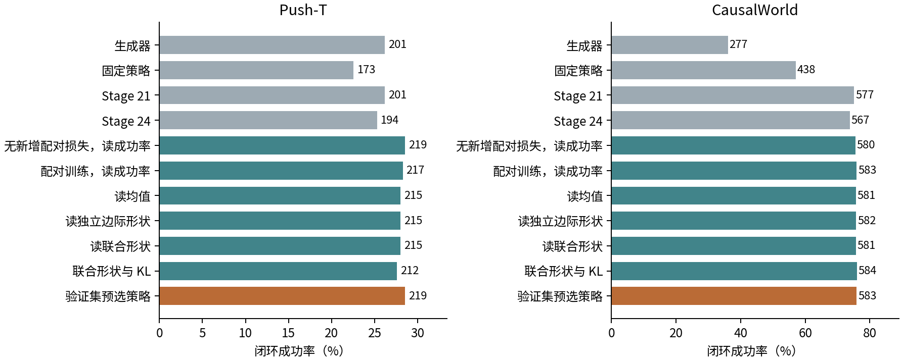
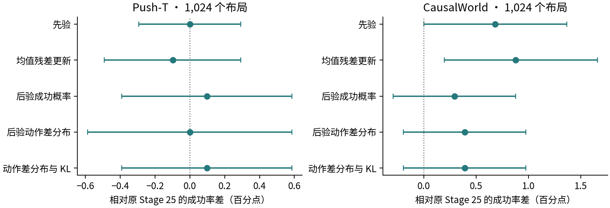
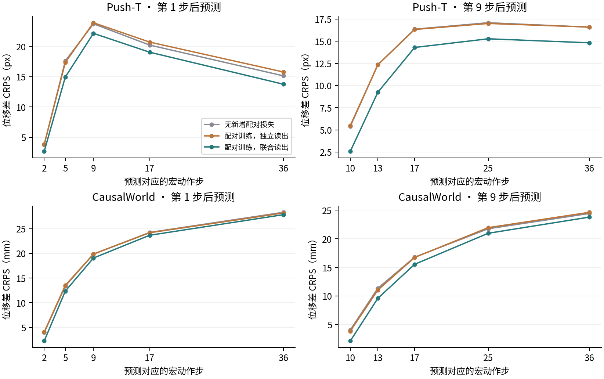

# Stage 25 · 同一布局的两条未来，能帮策略多成功几次？

在相同的七个反馈策略上，我们重新训练了世界模型。它先从实际运动修正物理机制和事实图，再预测两个动作各自会在哪里、何时达标，以及它们的效果差有多大。首批闭环结束后，我们又检验了另一种更新方法。第 9 步真的看到物体如何运动时，能否用这条观测更新剩余动作的成功概率？两次闭环使用不同的新布局。

| 预先选定的策略 | 每域布局数 | Push-T 成功 | CausalWorld 成功 |
|---|---:|---:|---:|
| 首批，Stage 25 第一步读成功概率，第二步读均值特征 | 768 | **219** | **583** |
| 同批冻结 Stage 24 | 768 | 194 | 567 |
| 同批生成器 / 固定反馈策略 | 768 | 201 / 173 | 277 / 438 |
| 第二批，完全相同的 Stage 25 策略 | 1,024 | 288 | 770 |
| 第二批，保持首选，用中途实测运动更新分布，再读动作差和 KL | 1,024 | **289** | **774** |
| 第二批，同批生成器 | 1,024 | 262 | 354 |

**对策略提升最有把握的结论**来自两批都原样执行的 Stage 25 策略。两批共 1,792 个布局，Push-T 成功 507 次，生成器 463 次，差 **+2.46 个百分点**，按批分层、同布局配对的 95% bootstrap 区间 **[+0.17, +4.74]**。CausalWorld 为 1,353 对 631，差 **+40.29 个百分点**，区间 **[+37.72, +42.91]**。这个合并只用两次执行方式完全相同的策略。首批单独与冻结 Stage 24 比，Push-T 为 +3.26 点 [−0.26, +6.90]，CW 为 +2.08 点 [0.00, +4.17]。

**从分布本身得到的收益，预测强于控制。** 首批两个任务上，读取完整形状和只读均值都分别得到 215、581 次成功。第二批在相同后验动作差分布上加 KL，只给 Push-T 多带来 1 次成功，CW 持平。CW 的中途证据把成功概率的 Brier 误差从 .1762 降到 .1308，但闭环用简单的运动残差校正反而比完整后验多成功 6 次。以下把这些结果拆到同一检查点、同一首选、同一批布局来比较。

## 1. 模型怎样从事实推断物理，再在图上施加动作

CoPhy 使用上游 Blocktower 生成器和 Bullet 动力学重新采样的三层、四层塔。观测为积木的位姿。干预移动一块积木，再从相同条件实际禁用一对积木的碰撞，以接收块的位置变化标注**有向作用边**。受测分支运行 30 个物理步。碰撞删除虽然是对称操作，两个端点受到的位移影响可以不同。推物的对象集合由场景适配器提供。Push-T 有 T 块、推杆、墙。CW 有活动块、三指、地面。共享网络只收到对象位姿、角色、目标、命令和事实转移，没有任务编号。两项推物的墙和地面表示、单位换算、路点执行以及奖励/成功口径仍由各自的环境适配。可用技能是旧 Stage 23 的七个反馈策略，生成器是其中的第 0 个。本轮没有搜索新的策略输出系数。

每个对象有位置和两个旋转轴，三者各是一个三维因子。按实际存在的对象屏蔽 padding、自环。第一决策可见第 1 个宏动作的事实转移，中途可见第 1、5、9 个。对每个事实转移 $(x_t,a_t,y_t)$，网络先用 $x_t,a_t$、角色和先验图预测本应出现的运动，再用预测和实测的差来修正事实图。简写为

$$
\ell^0_{ijt}=P_\theta(x_{it},a_{it},r_i,x_{jt},a_{jt},r_j),\quad
\widehat d_{jt}=D_\theta\!\left(h_{jt},\frac{\sum_i \sigma(\ell^0_{ijt}) h_{it}}{\max(1,\sum_i\sigma(\ell^0_{ijt}))}\right),\quad
e_{jt}=y_{jt}-x_{jt}-\widehat d_{jt}.
$$

节点证据为 $v_{it}=E(x_{it},y_{it}-x_{it},a_{it},r_i)+C(\widehat d_{it},e_{it})$。网络用每个节点的时间注意力汇总 $v_i,e_i$，边先验用两端注意力的平均汇总为 $\bar\ell^0_{ij}$。令 $d_i(\ell)$ 为该节点在有效邻居上的平均边概率。先从 $[v_i,d_i(\bar\ell^0)]$ 得到初始后验参数 $t_i^0$，再执行

$$
\ell^F_{ij}=\bar\ell^0_{ij}
 +B_\theta(v_i,m_i^0,\mu_i^0,v_j,m_j^0,\mu_j^0,\bar\ell^0_{ij})
 +I_\theta(e_i,e_j,\bar\ell^0_{ij}),\qquad
t_i=t_i^0+R_\theta(v_i,d_i(\bar\ell^0),d_i(\ell^F)).
$$

$t_i$ 分出 16 个系数 logit 和四维高斯的均值、对数标准差。$m_i=\sum_{k=1}^{16}\operatorname{softmax}(t_{i,1:16})_k c_k$，每个可学习基 $c_k\in\mathbb R^{12}$。$u_i=\mu_i+\exp(s_i)\epsilon_i$，$s_i\in[-4,2]$。同一事实的候选共享机制和扰动。长程选动作取后验均值，短程概率评测沿用四个正负对称扰动样本。这里没有把 $m_i$ 的某个坐标解释成已恢复的真实质量或摩擦。

候选的路点、冻结反馈策略的 11 个系数、目标和时长只在执行器节点注入。短程图继承四轮有向对象—因子传播。对象硬边、因子硬边、可学习的方向/作用强度共同决定传递权重。硬边反向用直通梯度。首选还增加了一个**从现在到第 9 步**的接触图。有些推杆现在碰不到物体，走完首段却会碰到。这个图以首段真实累计接触训练，用显式修正后的事实边作为 logit 起点。对每个程序 $a$，

$$
g^a_{ij}=\mathbf1\{\sigma(\ell^F_{ij}+H_\theta(i,j,a))\ge .5\}\,\mathrm{mask}_{ij},\qquad
v^a_{jg}=\sum_{i,f}g^a_{ij}\tanh(W^a_{ijfg})\,t^a_{if}.
$$

$t^a$ 只在执行器节点非零。长程预测头读取移动物体上汇聚的 $v^a$、原图传播结果和所有候选共用的场景事实。没有从程序编号或系数直接连到成功分类器的支路。短程原子图与首段接触图的时间尺度不同。首段接触图测试 AP / BER 在 Push-T 为 **.944 / 7.1%**，CW 为 **.957 / 13.7%**。每布局评估七个不同首段。

## 2. 怎样学两条未来，以及它们的差

每回合最多 36 个宏动作，每个最多 8 个原生步，提前达标即结束。第一个宏动作由生成器执行。第 1 步末的八个程序包括完整生成器，以及七个“先执行该策略 8 步、第 9 步末按实测观测再选”的程序。第 9 步末的候选是七个后续反馈策略，最多再执行 27 步。训练首次选择时，每个程序的后段均由已经在验证集选定的后续控制器实际执行。所有候选分支从同一布局、同一隐藏物理条件重放。动作效果的监督直接来自模拟器对同一布局的两次干预。

**首次达标时间。** 每个动作的图读出 $z_a$ 预测六档边际 $p_a$。前五档为首次达标的时段，最后一档为至第 36 步仍未成功。首次决策的档末为 2、5、9、17、36。中途为 10、13、17、25、36。为区分“机会大致相同”与“会在不同布局救回不同尝试”，模型额外学习两动作的联合时间表。将单位区间分成 8 格，定义 $B_a[t,i]=8\,|[F_a(t-1),F_a(t)]\cap[i/8,(i+1)/8]|$。网络根据 $(z_a,z_b,z_a-z_b)$ 为 16 个平移/反射排列矩阵和一个均匀矩阵预测混合权重，得到行列和均为 $1/8$ 的 $W_{ab}$。交换两分支并转置后对称化，再混入 1% 的独立均匀质量。于是

$$
J_{ab}=B_a W_{ab}B_b^\top,\qquad
P(T_a-T_b=d)=\sum_{t-s=d}J_{ab}[t,s].
$$

$J_{ab}$ 的两边际严格为 $p_a,p_b$。因此两动作期望成功率之差就是各自成功率之差，本轮合并了数学上相同的均值计算。时间表是逐对建模，只保证每对边际、交换关系。没有据此声称构造了八个首次达标时间的全局联合分布。

**位姿和奖励。** 五个时刻各预测移动体相对当前物体坐标系的九维位姿变化及一维原生奖励。对同一时刻和坐标，以三个载荷和一个独立噪声尺度表示两条未来，$\mu,\lambda,\tau$ 均由图读出学习。

$$
Y_a=\mu_a+\lambda_a^\top \xi+\tau_a\epsilon_a,\qquad
Y_a-Y_b\sim\mathcal N\!\left(\mu_a-\mu_b,\ \|\lambda_a-\lambda_b\|^2+\tau_a^2+\tau_b^2\right).
$$

$\xi$ 是同一布局各候选共享的标准高斯，$\epsilon_a$ 为分支噪声，$\tau=.018+\mathrm{softplus}(\cdot)$。这层输出的载荷与事实反推的四维物理扰动是不同变量。只用独立边际时，差的方差改成 $\|\lambda_a\|^2+\|\lambda_b\|^2+\tau_a^2+\tau_b^2$。点预测完全相同。该实现评估每个时刻、每个坐标的差分布，没有估计任意跨时刻、跨坐标的完整协方差。

**训练消融。** 两套模型均学首次达标 CE、最高分与最后分、位姿奖励的边际高斯，以及配对差的点误差。记 $\mathcal N(e,\sigma)=\log\sigma+e^2/(2\sigma^2)$，$e_a=\mu_a-Y_a$，$\sigma_a^2=\|\lambda_a\|^2+\tau_a^2$。两者共有的长程损失为

$$
L_0=\mathrm{CE}(p,T)+2\,\mathrm{MSE}(\hat c,c)+\mathrm{Huber}_{.15}(e_a)
 +.55\,\mathbb E|e_a-e_b|+.16\,\mathbb E\mathcal N(e_a,\sigma_a).
$$

配对分布训练另加
$$
.8\,\mathbb E\log\frac{p_a[T_a]p_b[T_b]}{J_{ab}[T_a,T_b]}
+.13\,\mathbb E\mathcal N(e_a-e_b,\sigma_{a-b}).
$$
联合时间项固定边际的反向梯度，梯度仍进入依赖网络和共享特征。两套从同一 Stage 25 物理初始化出发。历史 Stage 24 骨干本身已经接受过配对监督。因此“无本轮配对损失”仅关闭新增的两项**分布监督**，仍保留相同的配对点值、边际分布和原有物理监督。

## 3. 用同一个预测器，分别让决策看见什么

冻结世界模型，在另一组真实分叉上训练一个对候选排列等变的选择网络。它收到的 24 个点值包括成功概率、期望达标档、最高/最后分的期望，以及五个时刻的三维位置和原生奖励的均值。场景上下文为当前移动体位姿、目标差、最近事实运动和执行器相对位置。下表列出每种读法能看到的信息。

| 读法 | 成对消息能看到的信息 |
|---|---|
| 直接成功概率 | 直接取 $1-p_a[\text{未成功}]$ 的最大者，跳过选择网络 |
| 均值 | 自身点值、与另一候选的点值差 |
| 独立边际形状 | 再加 $p_ap_b^\top$ 的 36 个格子，以及独立假设下五个时刻的位置和奖励差对数标准差 |
| 联合形状 | 将上述输入替换为 $J_{ab}$ 和共享扰动下的差对数标准差 |
| 联合形状加 KL | 再加 $D_{\rm KL}(P_{J}(T_b-T_a)\,\|\,P_{\mathrm{ind}}(T_b-T_a))$，系数由网络学习 |

同一网络、同一批样本在四种输入掩码下训练。令 $M_{ab}$ 为成对消息，$C$ 为共同事实，$s_a$ 为成功概率，则
$$
l_a=\operatorname{logit}(s_a)+f_\theta(m_a,C,\mathrm{mean}_{b\ne a}M_{ab},\mathrm{max}_{b\ne a}M_{ab}),\qquad a^*=\arg\max_a l_a .
$$
以实际成功 $S_a$、最高分和最后分 $c_a$ 训练。目标是各候选成功 BCE，加 .4 倍仅对一成一败的配对计算的排序损失 $\mathrm{softplus}[-(l_a-l_b)(S_a-S_b)]$，再减 .35 倍按 $\mathrm{softmax}(l)$ 加权的中心化实测收益 $S_a+.05(c_{\max,a}+c_{\rm last,a})$。没有指定 KL 应该鼓励还是阻止换动作。

**闭环各 768 布局。** 测试前，先在两个域分别计成功率，按两域之和选读法，同分再按辅助收益。首选验证每域 256 个布局，直接成功概率在 Push-T / CW 为 59 / 222，均值 49 / 220，联合形状 50 / 220，KL 54 / 219。第二次决策的五种读法在 509 / 226 个可行动验证中点上均为 98 / 51，辅助收益选中均值。下表每格按 **Push-T / CW** 排列。各列改变的只有指定部分。第一列的共同后段就是训练首选时实际执行的后段。后两列的其他后段用于测部署时替换读法会怎样。

| 读法 | 只换第一次，后段固定均值 | 只换第二次，首段固定直接成功概率 | 两次均用该读法 |
|---|---:|---:|---:|
| 无本轮配对损失，直接成功概率 | 224 / 576 | 210 / 584 | 219 / 580 |
| 配对训练，直接成功概率 | **219 / 583** | 217 / 583 | 217 / 583 |
| 配对训练，均值 | 215 / 581 | **219 / 583** | 215 / 581 |
| 配对训练，独立边际形状 | 215 / 582 | 219 / 583 | 215 / 582 |
| 配对训练，联合形状 | 215 / 581 | 219 / 583 | 215 / 581 |
| 配对训练，联合形状加 KL | 212 / 583 | 219 / 583 | 212 / 584 |

仅改变训练损失、两段均直接取成功概率时，Push-T 从 219 到 217，CW 从 580 到 583。仅改变选择网络输入、两段均读取联合形状时，与均值相比，Push-T 救回 8、改坏 8。CW 救回 1、改坏 1。再加入 KL，Push-T 救回 7、改坏 10，CW 救回 3、改坏 0。KL 改变了实际选择，收益方向随任务变化。

| 同一批实际执行的策略 | Push-T 成功 / 平均最高分 / 平均最后分 | CW 成功 / 平均最高分 / 平均最后分 |
|---|---:|---:|
| 生成器 | 201 / .899 / .764 | 277 / .573 / .412 |
| 固定反馈策略 | 173 / .899 / .750 | 438 / .751 / .614 |
| 冻结 Stage 21 | 201 / .899 / .764 | 577 / .793 / .743 |
| 冻结 PETS | 201 / .899 / .764 | 343 / .582 / .511 |
| 冻结 Stage 24 | 194 / .900 / .758 | 567 / .785 / .724 |
| Stage 25 验证预选 | **219 / .894 / .761** | **583 / .797 / .735** |

Push-T 的 219 次成功中，相对生成器**救回 108、改坏 90**。相对固定策略多 46 次，差 +5.99 点 [2.08, 10.03]。相对生成器多 18 次，差 +2.34 点 [−1.30, 5.99]。CW 相对生成器救回 333、改坏 27，相对冻结 Stage 21 多 6 次，差 +0.78 点 [−1.69, 3.39]。Push-T 虽有更多回合跨过成功线，平均最高分和最后分没有随之上升。

## 4. 新观测能给决策增加多少信息

首批完成后才增加这项实验。保持已学三域图和已选首段完全固定，只在宏动作 9 结束时改进后段选择。模型在第 1 步看到事实和首段计划 $a$，同时预测“第 9 步会看到怎样的运动”和“七种后续动作分别能否成功”。运动 $w$ 为移动体的九维位姿变化，以及执行器中心的三维位移，均转到第 1 步移动体坐标系，以训练集均值和尺度标准化。真实 $w$ 只在第 9 步进入更新。

令 $h$ 表示六种可学习的响应成分，图特征产生共享先验 $\pi_h$、各成分对 $w$ 的对角高斯，以及每个后续动作在该成分下的成功概率 $s_{bh}$。它们在第 1 步都可计算。模型定义
$$
p(w,S_1,\ldots,S_7\mid F_1,a)=
 \sum_h\pi_h\,\mathcal N(w;\mu_h,\operatorname{diag}\sigma_h^2)
 \prod_b\operatorname{Bern}(S_b;s_{bh}).
$$
这里 $h$ 是预测整段运动与成功的混合成分。三域物理骨干仍使用第 1 节的连续 $m_i,u_i$。看到真实运动后，
$$
q_h(w)\propto \pi_h \mathcal N(w;\mu_h,\operatorname{diag}\sigma_h^2),\quad
P(S_b=1\mid w)=\sum_h q_h(w)s_{bh},\quad
P(S_b-S_c=1\mid w)=\sum_h q_h(w)s_{bh}(1-s_{ch}).
$$
对换 $b,c$ 得到 $-1$ 档，其余质量落在 0。一套较简单的观测对照使用相同的实测运动，只给更新网络运动与预测均值的残差，$q^{\rm mean}=\mathrm{softmax}[\log\pi+g_\theta(z_a,w-\sum_h\pi_h\mu_h)]$。因此可以比较“能看见中途运动”和“用预测密度的形状解释这次运动”。

世界模型的损失为 $.24[-\log p(w)]/12 - \log p(S_1,\ldots,S_7\mid w)/7$，加上贝叶斯后验、均值残差更新及先验三者的边际成功 BCE，权重依次为 1、.5、.2。决策端在冻结的原 Stage 25 中途均值选择网络分数上加一项共享神经网络校正。它读取校正前分数、当前成功概率和成对消息。不同掩码决定是否再给三档动作差分布、以及 $D_{\rm KL}(P(\Delta S\mid w)\|P(\Delta S))$。这个 KL 衡量**这条实测运动让同一对动作的效果判断改变了多少**，与主实验比较联合表和独立表的 KL 不同。校正的训练目标仍是第 3 节的成功、配对排序和实测收益。

五种更新在验证集看到相同中点。按成功数，原 Stage 25 为 98 / 51，先验为 98 / 64，均值残差 98 / 62，后验均值 98 / 69，给动作差形状 98 / 68，再给 KL 为 **98 / 70**。在执行第二批测试前已选定最后一种。以下测试每域 1,024 个新布局，首个程序若选中完整生成器，所有读法都执行到底。

| 中途选择看到的信息 | Push-T 成功 | CW 成功 |
|---|---:|---:|
| 原 Stage 25 | 288 | 770 |
| 加入新模型的先验成功概率 | 288 | 777 |
| 实测运动，以均值残差更新 | 287 | **779** |
| 实测运动，按完整运动似然更新，读后验成功概率 | 289 | 773 |
| 再给条件动作差的三档概率 | 288 | 774 |
| 再给效果分布的先验—后验 KL，验证预选 | **289** | 774 |
| 完整生成器 | 262 | 354 |

与原 Stage 25 比，预选更新在 Push-T 真正改变了 51 个可执行路径，救回 4、改坏 3，净差 +0.10 点 [−0.39, +0.59]。CW 改变 61 个，救回 7、改坏 3，净差 +0.39 点 [−0.20, +0.98]。单独开放 KL，Push-T 改了 2 个可执行路径，多 1 个成功。CW 改了 9 个，成功数不变。完整似然更新相对均值残差更新，在 Push-T 多 2 次，在 CW 少 6 次。把 774 全部归功于 KL，或者事后把 779 写成验证选中的成绩，都会夸大这一轮的结果。

在与训练布局分开的完整后段分叉测试上，预测变化如下。Brier 是成功概率均方误差，NLL 是同布局双动作成功差三档的负对数似然，二者越低越好。

| 观测更新 | Push-T 成功 Brier / 动作差 NLL | CW 成功 Brier / 动作差 NLL |
|---|---:|---:|
| 先验 | .1306 / .6945 | .1762 / .5582 |
| 均值残差 | .1300 / .6922 | .1482 / .5834 |
| 完整似然后验 | **.1291 / .6906** | **.1308 / .5477** |

验证中的 CW 后验优势没有按相同幅度转化到全回合。测试时，均值残差与完整后验真正选了不同可执行路径的 CW 布局只有 29 个，完整后验在其中少保住 6 次成功。对所有候选的概率估计更准，与在少数关键布局上把最好的动作排第一，是两项不同的实测结果。

## 5. 三域图、未来状态、奖励与动作差

**CoPhy 结构和动力学。** 224 座新塔、8,064 个有效有向候选边。逐分支累计接触是接触标签。对于作用边，如果禁用该碰撞后接收块终点改变超过 .10 个块边长，则记为正。AP 越高越好，BER 是假阳性率和假阴性率的平均，越低越好。新模型的阈值在验证塔上选择，冻结模型沿用原阈值。远端接收块到两个被移动块均至少隔两层，共 570 个接收块—动作对。位置误差单位为积木边长。

| 检查点 | 接触 AP / BER | 删碰撞作用 AP / BER | 未来位置 RMSE | 位移差 RMSE，全部 / 未直接移动 / 远端 |
|---|---:|---:|---:|---:|
| Stage 25 配对分布训练 | .961 / .119 | .917 / .150 | .969 | 1.111 / 1.145 / **1.169** |
| Stage 25 无本轮配对损失 | .961 / .120 | .917 / .151 | .970 | 1.112 / 1.147 / 1.173 |
| 冻结 Stage 24 | .957 / .124 | .915 / .153 | .976 | 1.121 / 1.155 / 1.207 |
| 冻结 NCII，同删碰撞监督 | .919 / .160 | .889 / .163 | — | — |

Stage 25 作用边 F1 为 .805，接触边 F1 为 .871。两种训练对 CoPhy 的结果很接近。远端从 1.207 降到 1.169 的变化属于本轮整个共享模型更新，不能单独归因于开了配对分布损失。

**推物短程。** 测试前每个布局预抽两个首段，原子预测只取第一个。第 9 步仍可行动的 Push-T / CW 布局数为 319 / 176。各模型收到同一条最近事实转移和七个相同候选，测试下一个宏动作。这里只有指向移动物的模拟器接触真值，没有用接触替代 CoPhy 式删碰撞真值。表内依次为未来位置、同状态两动作位移差、逐坐标位移差 CRPS。位置单位为 px 或 mm，奖励为宏动作内原生奖励均值。

| 模型 | Push-T 接触 AP / BER | 位置 / 位移差 / 差 CRPS | 奖励 / 奖励差 RMSE | CW 接触 AP / BER | 位置 / 位移差 / 差 CRPS | 奖励 / 奖励差 RMSE |
|---|---:|---:|---:|---:|---:|---:|
| Stage 25 配对 | .872 / .063 | 23.04 / 10.14 / 5.30 | .1013 / .0358 | .966 / .085 | 17.21 / 8.50 / 3.47 | .0804 / .0528 |
| Stage 25 无本轮配对损失 | .869 / .062 | 22.90 / 9.99 / 5.34 | .1005 / .0367 | .968 / .091 | 17.03 / 8.48 / 3.45 | .0796 / .0527 |
| 冻结 Stage 24 | .853 / .064 | 23.29 / 10.41 / 5.03 | .0935 / .0336 | .930 / .116 | 16.34 / 8.67 / 3.36 | .0801 / .0522 |
| 冻结 CoPhyNet | — | 26.26 / 11.31 / 3.08 | .0958 / .0367 | — | 15.17 / 9.09 / 2.49 | .0715 / .0519 |
| 冻结 PETS | — | 28.25 / 11.29 / 2.64 | .0923 / .0340 | — | 16.40 / 8.08 / 1.78 | .0690 / .0519 |
| 冻结 NCII | .092 / .539 | — | — | .498 / .504 | — | — |
| 冻结 NCII，加接触监督 | .702 / .256 | — | — | .828 / .193 | — | — |

推物接触边排序改善，CW 短程位置和 Push-T 短程奖励未超过冻结 Stage 24。冻结 PETS 在两域的短程位移差 CRPS 最低。

**长程终点。** 首次决策测试每域 320 个布局，每布局八条完整可执行程序。中途预测从另外每域 320 个布局采集。Push-T 有 320 布局的 636 个可行动中点，CW 有 234 布局的 350 个。每中点七个真实后段。两种训练使用相同样本。兑现本轮中途策略的首选目标与旧 Stage 24 不同，所以旧模型只在后段目标相同处比较。表内取第 36 步或提前达标的终点，成功后沿用最终状态和最后一个实际执行宏动作的奖励。RMSE 和 CRPS 均越低越好。

| 任务、预测时刻 | 模型 | 位置 / 位移差 RMSE | 奖励 / 奖励差 RMSE | 位移差 / 奖励差 CRPS |
|---|---|---:|---:|---:|
| Push-T 首次 | 无本轮配对损失 | 51.55 / 57.62 | .2892 / .3080 | 15.14 / .1899 |
| | 配对 | 57.55 / 58.19 | .2841 / .3099 | **13.75 / .1679** |
| Push-T 中途 | 无本轮配对损失 | 49.07 / 55.13 | .3081 / .2990 | 16.59 / .1760 |
| | 配对 | 53.99 / 55.21 | .3023 / .2995 | 14.82 / .1645 |
| | 冻结 Stage 24 | **42.48 / 54.63** | **.2829 / .2914** | 15.70 / .1592 |
| CW 首次 | 无本轮配对损失 | 92.00 / 111.77 | .0852 / .1056 | 28.30 / .0580 |
| | 配对 | 94.93 / 111.36 | .0834 / .1061 | **27.82 / .0562** |
| CW 中途 | 无本轮配对损失 | 88.49 / 99.01 | .0628 / .0795 | 24.43 / .0342 |
| | 配对 | 89.62 / 99.27 | .0629 / .0793 | 23.79 / .0331 |
| | 冻结 Stage 24 | 89.53 / 99.39 | .0702 / .0794 | 23.12 / .0340 |

**同一配对检查点，只在计算差分布时切断分支相关性**，Push-T 首次位移差 CRPS 由 13.75 变成 15.77，中途由 14.82 变成 16.60。CW 分别由 27.82 变成 28.16、23.79 变成 24.62。四处点预测均不变。由此可以直接定位共享扰动对差分布宽度的贡献。另一方面，配对训练的 Push-T 中途终点位置 RMSE 比冻结 Stage 24 高 11.51 px，说明概率尺度学得更好可以与位置均值退步同时发生。

下表单独固定边际时间分布，比较联合首次达标时间表与两边际相乘。离散差的 CRPS 是 11 档时间差 CDF 与实测阶跃 CDF 的累计平方差，单位为**有序档**，并非原生步数。最后两列给出配对训练对边际成功与成功差点值的误差。

| 任务与决策时刻 | 两动作时间联合 NLL，独立 → 联合 | 时间差 CRPS，独立 → 联合 | 成功 Brier | 成功差 RMSE |
|---|---:|---:|---:|---:|
| Push-T 首次 | 1.385 → 1.359 | .347 → .346 | .1825 | .5522 |
| Push-T 中途 | 1.230 → 1.220 | .432 → .429 | .1288 | .4792 |
| CW 首次 | 2.476 → 2.393 | .880 → .849 | .1947 | .5789 |
| CW 中途 | 1.302 → 1.250 | .457 → .444 | .1152 | .3926 |

相对完整生成器，首次选其他程序救回 / 改坏的实测概率为 Push-T .136 / .138、CW .279 / .112。配对模型在这两类事件的 AP 为 Push-T .175 / .202、CW .536 / .189。Push-T 对救回机会的排序仍弱。在首次完整分叉测试的 320 个布局，按“直接成功概率 / 均值 / 独立形状 / 联合形状 / KL”选，Push-T 分别为 69 / 84 / 85 / 86 / 87，CW 为 241 / 240 / 239 / 241 / 239。完整生成器为 78 / 130。这个队列的 Push-T 排序与 768 布局主闭环不同，报告保留了测试前的验证选择。

## 6. 哪些参数跨任务共享，怎样复现

| 权重或参照 | 训练范围与用途 |
|---|---|
| Stage 25 两套 world.pt | 均以 Stage 24 共享物理图为起点，在 CoPhy、Push-T、CW 更新同一份对象—因子图和机制后验。长程策略条件的达标、位姿和奖励头由两项推物共同训练。表中 Stage 25 的 CoPhy 与原子推物指标来自本轮相应 world.pt。 |
| 两套 early.pt | 各自冻结自己的三域骨干、场景编码与原图读出。用两项推物的八程序数据更新首段接触图和首次预测头。两者的后段训练标签都由预选的同一个配对模型中途策略生成。 |
| early/late-selector.pt | 冻结配对世界模型，以两项推物共同训练的单网络实现四种输入掩码。直接成功概率无需选择网络。 |
| belief.pt、belief-readout.pt | 两项推物共同训练。使用上述同一个三域骨干的冻结图表示。只测试实际中途运动的条件分布与后段决策。CoPhy 没有这项控制指标。 |
| 生成器、固定策略、Stage 21、Stage 24、NCII、CoPhyNet、PETS | 沿用已有权重与任务适配。NCII 评边存在性，同时列普通屏蔽源训练和已有同监督权重。CoPhy 删碰撞 NCII 原预算 1,080 更新。CoPhyNet 和 PETS 推物预测原预算各 3,240 更新。PETS 控制用冻结六步回报头，每次 24 候选，与冻结 Stage 21 在同批全部 768 个布局运行。所有外部基线本轮新增更新为零。 |

- **原生数据。** 后段数据按世界模型训练 / 策略训练 / 验证 / 完整分叉测试，每域分别为 2,048 / 1,280 / 256 / 320 个布局，从 7100000 / 7200000 / 7300000 / 7400000 起。每布局在未知结果时抽两个不同首段，各实际执行七个后段。只用达标前的中点拟合后段。首段数据使用上述种子各加 1000000，规模相同，每布局实际执行八个完整程序。首段接触取第 2 到第 9 个宏动作真实接触的并集。两个域合计，世界模型训练部分包含 57,344 条后段完整重放和 32,768 条首段完整程序。策略训练另有 35,840 和 20,480 条。CoPhy 新训练和测试分别为 512 和 224 座塔，起始种子 9100000、9200000，验证沿用先前验证塔。控制两批起始种子为 7500000 和 7600000。CW 训练 P1/P7、测试 P1/P2/P7/P8，覆盖分大于 .90 达标。Push-T 训练阻尼 0/.08/.55、测试 0/.25，沿用原生成功判据。新采集的两段及运动标签专门训练本研究模型。
- **共享骨干、配对头。** 种子 271，GPU 0、3。先做 960 次 AdamW 物理预训练，学习率 .00033。每次从六源各取 8 行（本轮塔、Stage 24 塔、更早的有删除监督塔、原有三域短程数据），每行抽四个干预分支。物理目标含位姿、奖励、事实与干预接触、物理扰动 KL、图稀疏项和配对效果，另加 .75 删碰撞 BCE、.20 强度误差、.85 未直接移动物体的位移差均方误差、.45 事实运动重建。后段联合训练每套 2,240 次，每域 32 个分叉中点，物理重放每源 4 行。长程目标另加 .25 累计接触 BCE、.002 扰动 KL、.75 物理重放、.18 事实重建。原图参数学习率 .00015，新增及命令参数 .0011，余弦降到 .000055。两套均按两域平均共有预测损失加 .45 倍 CoPhy 验证损失选中第 1,920 步。
- **首次程序与选择。** 各训练 1,920 步，每域 40 个布局，学习率 .0009 余弦降至 .00006，目标另加 .35 首段接触 BCE，按共有验证损失选择。两套均选第 1,920 步。两次决策的选择网络各训练 960 步，每域每步 48 个分叉，学习率 .0008 到 .00008，选中首段第 660 步、后段第 480 步。追加的运动—成功联合模型用原有后段世界训练集训练 1,440 步，决策校正用分开的策略集训练 800 步，batch 同为每域 48、学习率同为 .0008 到 .00008。分别选第 1,440 / 640 步。第二批全部继续用原首段。实际允许且需要重新选后段的有 Push-T 1,009 / CW 202 个布局，成功数分母始终是全体 1,024。
- **统计。** 按整布局做 5,000 次配对 bootstrap。合并相同策略时分别在两批内部抽样。区间反映布局差异，所有神经网络均为单训练种子。首批先落盘首选、测量实际中点，再落盘后选并执行，共执行 3,186 / 3,439 种不同的 Push-T / CW 布局与两段策略组合。相同组合的多个读法共用确定性结果。每对动作的概率指标平均了全部相关的分叉，不把同一布局的多个动作对当成独立布局。
- **复现入口。** 仓库根目录依次执行 `bash whatif/hitting/reproduce.sh collect`、`world`、`early`、`control`、`results`、`evidence`（后五项为同一脚本的参数）。脚本使用现有模拟器和训练环境，GPU 默认 0。原始数据、逐布局动作与收益、验证轨迹、两套检查点及追加实验权重分别在 `data/hitting`、`results/hitting`。核心实现在 `whatif/hitting/core.py`、`path.py`、`model.py`，决策在 `policy.py`、`evidence.py`，两次闭环的实际执行分别在 `native.py`、`evidence_native.py`。
