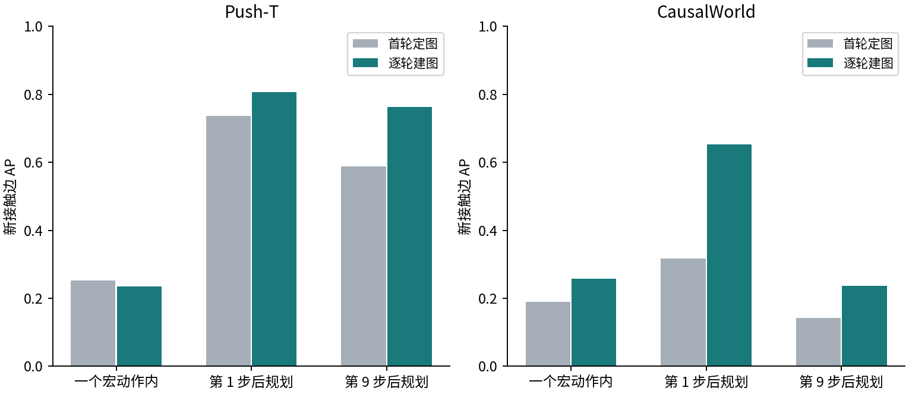
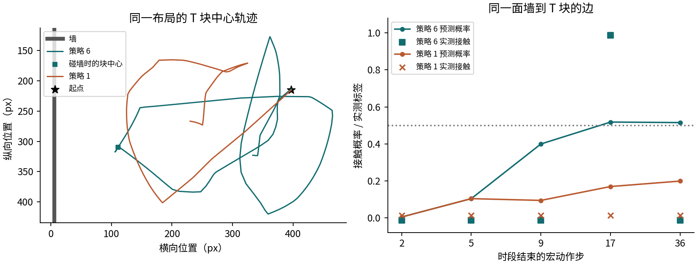
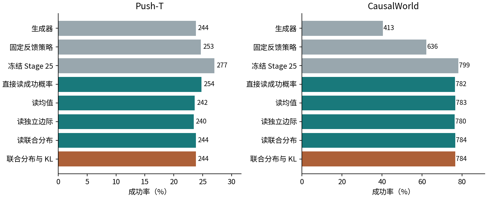
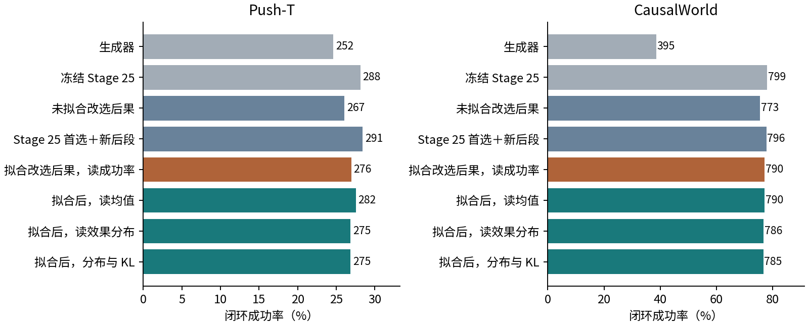

# Stage 26 · 推杆先改变 T 块的运动，模型能否随后打开墙边？

**能，但只做对了其中一部分。** 新模型在一次预测内部重建五次对象—因子图。在 142 个新 Push-T 布局中，2,068 对候选满足“上段都没有碰这面墙，下段只有一个碰到”。模型最初给两分支的墙边概率完全相同，经过消息传播后，**74.5%** 的配对给实际碰墙的分支更高概率。相同训练预算、首轮定图的模型为 50%。按实际传消息的 .5 门槛，一开一关都判对的仅 **7.8%**。

**预测方面，推物受益，塔的远端位移仍是弱项。** 同一批 Push-T 中点上，终点位置 RMSE 从冻结 Stage 25 的 **54.67 降到 47.22 px**，冻结 Stage 24 为 45.13 px。完整检查点在独立单宏动作测试的 Push-T / CW 位置误差为 **19.02 px / 17.57 mm**，冻结 Stage 25 为 20.18 px / 19.13 mm。CoPhy 的有向删碰撞作用 AP 从 **.915 升到 .928**，远端位移差 RMSE 却从 **1.470 升到 1.763** 个积木边长。

**控制方面，最大的缺口在首选。** 首批各 1,024 布局，预先选定的纯 Stage 26 在 Push-T / CW 成功 **244 / 784** 次，冻结 Stage 25 为 **277 / 799**。我们随后让首选直接学习“第 9 步会重新选择”的真实后果。在第二批独立的各 1,024 布局，修正后为 **276 / 790**，同批未修正为 267 / 773，冻结 Stage 25 为 288 / 799。单独加入 KL，首批净增 0 / 0 次，第二批为 0 / −1 次。旧最佳检查点继续保留。

## 1. 同一动作预测内部怎样改变图

Stage 25 的 Transport 在进入四轮 GRU 前，用当前位姿、事实图和两个端点的命令计算一次边。后四轮一直沿这张图传递。首段 ProgramGraph 也只计算一次图。对于都未收到命令的 T 块和墙，换推杆动作不能通过这两种建图方式在同一次预测中改变它们之间的边。Stage 26 将建图移到传播循环内，同时训练一个预算相同的“首轮定图”对照。两者都预测五个时段，都更新节点状态。对照在第一轮后保存对象边、因子边和传递权重。

**事实反推。** 输入沿用上游模拟器的位姿/目标适配及实际执行的命令。塔的活动积木、推物的移动体、执行器和静态物体构成按场景变化的对象集合。每个对象有位置及两个朝向轴，共三个三维因子。有效节点与自环掩码决定潜在边集合。模型没有任务 ID。域适配仍包括对象提取、坐标换算、路点执行、计分与成功定义。

给定事实转移 $(x_s,a_s,y_s)$，由局部特征和先验图预测运动 $\hat d_{is}$，取得创新量 $e_{is}=y_{is}-x_{is}-\hat d_{is}$。网络将 $(x_s,y_s-x_s,a_s,\mathrm{role})$ 的编码加上 $(\hat d,e)$ 的修正，再按节点的时间注意力汇总为 $v_i$、$\bar e_i$ 和先验边 logit $\bar\ell^0_{ij}$。早选可见第 1 次事实转移，中途可见第 1、5、9 次。前者在批处理时重复同一观测，注意力加权结果相同。令 $d_i(\ell)$ 为有效邻居上的平均边概率。先得到 $t_i^0=L(v_i,d_i(\bar\ell^0))$，再用下式显式修正事实图和机制后验。

$$
\ell^F_{ij}=\bar\ell^0_{ij}
 +B(v_i,m_i^0,\mu_i^0,v_j,m_j^0,\mu_j^0,\bar\ell^0_{ij})
 +I(\bar e_i,\bar e_j,\bar\ell^0_{ij}),\qquad
t_i=t_i^0+R(v_i,d_i(\bar\ell^0),d_i(\ell^F)).
$$
$t_i$ 分出 16 个组合系数 logit 和四维高斯参数。$m_i=\sum_{k=1}^{16}\mathrm{softmax}(t_{i,1:16})_k c_k$，$c_k\in\mathbb R^{12}$ 由训练学习。扰动为 $u_i=\mu_i+\exp(s_i)\epsilon_i$，$s_i\in[-4,2]$。同一次事实反推供所有候选复用。短程概率评测用四个正负对称的后验样本，长程分布和决策在后验均值上读出。训练主干时这些参数与事实重建、短程物理、长程结果和图损失一起更新。

**让动作抵达一个对象后，再重建它与第三个对象的边。** 对候选 $a$，先编码 $(x_i,\mathrm{role}_i,m_i,u_i,y_i^F-x_i^F)$ 为节点基础状态。每个因子的初值由基础状态及自己的三维量得到。干预算子和反馈策略的 11 个系数只注入实际命令选中的执行器或被移动的积木。其他端点的候选命令为零。记 $h^r_{if}$ 为第 $r$ 段开始时的因子状态、$M^{r-1}_{if}$ 为上轮收到的消息、$\hat x_i^r$ 为模型自己的位姿预测。首段 $\hat x^0=x$，$M^{-1}=0$。每轮计算端点表示和边的修正量。

$$
b_i^r=E_\theta(h^r_{i,1:3},M^{r-1}_{i,1:3},\hat x_i^r-x_i),\qquad
d_{ij}^r=C_\theta(b_i^r,b_j^r,\hat x^r_{j,xyz}-\hat x^r_{i,xyz},\ell^F_{ij},\tau_r).
$$
$\tau_r$ 包括该段原生步数的 $\log(1+\mathrm{步数}/8)$ 和累计时长比例，同一决策下所有候选相同。$d_{ij}^r$ 修正端点局部关系给出的接触 logit、九条因子连接的开关和权重、方向、作用强度及记忆衰减。接触概率为 $p_{ij}^r=\sigma(\ell^F_{ij}+E^0_{ij}+d_{ij,\mathrm{edge}}^r)$，有效对象边在 $p\ge .5$ 时打开。因子门 $F^r_{ijfg}$ 同样用 .5 二值化，反向使用直通梯度。记方向通过率为 $c^r=\sigma(\mathrm{direction}+1.5)$，强度 $s^r=\mathrm{softplus}(\mathrm{magnitude})$。实际传消息的权重为

$$
W^r_{ijfg}=\mathrm{mask}_{ij}\,\mathbf1[p^r_{ij}\ge .5]\,c^r_{ij}(1+\tanh s^r_{ij})
\,F^r_{ijfg}\tanh w^r_{ijfg},\qquad
M^r_{jg}=\sum_{if}W^r_{ijfg}h^r_{if}.
$$

状态用残差 GRU 更新，具体为 $h^{r+1}=h^r+\mathrm{GRU}_{\min(r,3)}(M^r,h^r)+.2[\mathrm{GRU}_{\tau}((M^r,\tau_r),h^r)-h^r]$。各因子解码出 $\hat x_i^{r+1}=x_i+D(h^{r+1}_{i,1:3})$，随后再建图。预测时没有采用未来真实接触或位姿。迭代足以让推杆先通过边影响 T 块，再由已改变的 T 块状态改变 T 块与墙的边。局部网络也会因端点自己的运动和时间而改变边，**同一时刻两种动作对未受控端点产生不同判断**才是本文用来识别动作传播的比较。

有向删碰撞作用另保留一个随时间衰减的读出 $A^r_{ij}=1-(1-p^r_{ij}c^r_{ij})(1-\gamma^r_{ij}A^{r-1}_{ij})$，$\gamma^r$ 由端点网络预测。塔中删除一次碰撞所造成的位置变化可以在脱离接触后持续。这个读出用于预测删除的后果，向下一对象传消息仍须通过当段的硬门。推物的模拟器只给接触监督。首轮定图对照保留节点运动、GRU 和此读出的时间累积，固定接触和传递权重。

## 2. 图上实际发生了什么

推物任务每个宏动作含两个路点，最多八个原生步。模拟器在每个原生步独立记录接触，先清空当步缓冲，再对评测时段取并集。一个宏动作内按第 1、2、4、6、8 步切五段。长程早选按宏动作 2、5、9、17、36 切段，中途按 10、13、17、25、36 切段。CoPhy 运行 30 个物理步，每六步一段。相邻段均确实执行时才评出现或消失，提前成功后的空段不会计为消失。

下表的 AP 是独立测试布局上的排序精度，越高越好。已有边保留在上段有边的候选中评本段仍接触，新边在上段无边的候选中评本段接触，消失在上段有边的候选中评本段脱离。每格依次给出**逐轮建图 / 首轮定图**。评测掩码指向移动体。阈值召回用实际传消息的 .5 门槛，要求前后两段的开关都正确。

| 任务与预测范围 | 新边数 | 已有边保留 AP | 新边 AP | 消失 AP | 动态硬门新开 / 关闭召回 |
|---|---:|---:|---:|---:|---:|
| CoPhy，六步一个时段 | 118 | .918 / .867 | .007 / .005 | .507 / .380 | 4.2% / 57.1% |
| Push-T，一个宏动作内 | 797 | .863 / .865 | .235 / .253 | .278 / .264 | 15.2% / 8.5% |
| Push-T，第 1 步后规划 | 1,964 | .971 / .969 | **.806 / .736** | .521 / .563 | 54.7% / 7.6% |
| Push-T，第 9 步后规划 | 1,060 | .936 / .940 | **.763 / .588** | .231 / .251 | 31.6% / 11.2% |
| CW，一个宏动作内 | 566 | .992 / .992 | .257 / .189 | .174 / .165 | 17.5% / 7.1% |
| CW，第 1 步后规划 | 2,153 | .982 / .968 | **.653 / .317** | .394 / .271 | 63.4% / 44.7% |
| CW，第 9 步后规划 | 547 | .981 / .980 | **.237 / .142** | .271 / .256 | 26.7% / 26.0% |

首轮定图仍能凭初始条件给候选边排出不同分数，所以新边 AP 可以高于发生率。它实际使用的接触硬门在一次预测中始终固定，时间上的新开、关闭召回均为零。CoPhy 的 25,708 个上段无边候选中仅出现 118 次新接触，两种模型在这项任务上的新边 AP 都很低。CoPhy 另有 390 次删碰撞作用从无到有，其新作用 AP 为 .042 / .038，作用保留 AP 为 .996 / .996。

**换动作能否改变两个未直接受控端点之间的边？** 对同布局、同一边和同一预测时段，取两分支上段都无边、下段恰有一个新接触的配对。两分支的直接干预源都排除。对于推物的反馈程序，更保守地排除全部执行器，因此 Push-T 只剩墙与 T 块。平分计半次正确，阈值分开率要求正分支开、负分支关。

| 条件 | 配对数 / 不同布局 | 逐轮图排序正确率 | 正负分支硬门分开率 | 首轮定图排序 |
|---|---:|---:|---:|---:|
| Push-T，首段后续 | 2,068 / 142 | **74.5%** | 7.8% | 50.0% |
| Push-T，中途后续 | 540 / 50 | **66.6%** | 2.0% | 50.0% |
| CoPhy，接触 | 34 / 12 | 64.7% | 5.9% | 50.0% |
| CoPhy，定向删碰撞作用 | 141 / 71 | 53.2% | 2.8% | 50.0% |

在上述未受控端点上，所有候选在模型首轮的边概率最大差值为 **0**。Push-T 单宏动作内只有 3 个布局的 26 对，排序为 34.6%。CW 长程两组按这个严格定义均有 0 对可比样本，CW 的整体接触 AP 不用于推断远端效果。各配对共享布局，表中的配对数不等于独立样本量。

图中展示测试布局 11300023。两分支的墙边概率起初均为 .004。宏动作 10–17 期间，策略 6 实际碰墙，模型给 .518，策略 1 没碰，模型给 .169。下一段策略 6 已经脱离，模型仍给 .515，漏掉了关边。左图按原生步重放，方块是实际碰墙时 T 块的中心。该例按测试数据顺序，取第一个真实分歧且模型正确开边的案例。全体结果见上表。

## 3. 五个时段的状态、奖励和两动作差分布

每段的读出 $z_a^r$ 由移动物体接收的因子状态、预测位姿相对目标的差、以及所有候选相同的场景事实组成。状态头在图预测的相对运动上加一个神经网络残差，输出移动体九维位姿变化和原生奖励的均值 $\mu_a^r$。没有把候选编号或全局动作拼到结果头。对于单次物理命令，塔的最终状态以同一物理推断下的事实命令作锚定，$Y^a=X+D^a+(Y^F-X-D^F)$。常规推物用 $Y^a=X+D^a$。

用四个共享响应成分描述各动作在同一布局上为什么会一起成功、一起失败，或产生不同结果。其权重 $\pi_h$ 只依赖事实场景和反推的机制/扰动。它与物理机制的 16 个基是两层不同的变量。对候选 $a$ 的每一段预测条件达标概率 $\eta_{ahr}$，有

$$
p_{ah}(T=r)=\eta_{ahr}\prod_{l<r}(1-\eta_{ahl}),\qquad
p_{ah}(T=\infty)=\prod_{r=1}^5(1-\eta_{ahr}),\qquad
J_{ab}(t,s)=\sum_{h=1}^4\pi_h p_{ah}(t)p_{bh}(s).
$$

五个时间档及“未成功”构成六档。$P(T_a=t)=\sum_h\pi_h p_{ah}(t)$。同一成分内各首次达标时间按条件独立建模，一个共享成分给出任意数量候选的一致联合分布。按 $t-s$ 或按两者是否成功对 $J$ 求和，就能得到时间差或成功差 $\{-1,0,+1\}$ 的分布。

对每个时刻和位姿/奖励坐标，同一成分下的连续预测为
$$
Y_a=\mu_a+\delta_{ah}+\lambda_{ah}\xi+\tau_{ah}\epsilon_a,\qquad
\sum_h\pi_h\delta_{ah}=0,\quad \tau_{ah}=.025+\mathrm{softplus}(v_{ah}).
$$
两个分支共享 $\xi\sim\mathcal N(0,1)$，分支噪声独立。因此 $\Delta Y_{ab}$ 是四分量高斯混合，分量均值为 $\mu_a-\mu_b+\delta_{ah}-\delta_{bh}$，方差为 $(\lambda_{ah}-\lambda_{bh})^2+\tau_{ah}^2+\tau_{bh}^2$。独立边际读出让两边独立抽取成分和噪声，得到 16 分量的差分布。两种读出的期望都严格等于 $\mu_a-\mu_b$。以下的差 CRPS 在同一组点预测上比较概率形状。

**主干训练。** 每次混合三域样本，每行随机抽四个互异干预。用原生五段位姿监督中间状态，用上段/本段实测接触监督新图。接触项为全部有效边的 BCE，加 .30 倍真实发生开关的 BCE 和 .25 倍同布局两动作接触不同时的成对排序损失。CoPhy 每个时段以实测删碰撞后的接收块位置变化 $>.10$ 个块边长监督作用边，以 $\log(1+\mathrm{位移})$ 监督强度。输入只含事实和候选，真值只出现在损失或指标中。

物理目标依次组合位姿 Huber 与平方误差、两动作位姿差均方误差、接触项、删除边 BCE、强度 Huber、事实接触 BCE、短程奖励与短程动作差、事实运动重建、高斯后验 KL 和图稀疏度，对应权重为 $1,.28,.65,.65,.16,.10,.65,.24,.12,.002,.001$。物理后验的 KL 是训练正则，后文另测动作差 KL 对决策的贡献。

长程目标以首次达标 CE、最高与最终覆盖分 MSE（权重 1.6）、五时刻状态奖励均方误差和两动作差均方误差为主。位姿九个坐标平均，奖励平方误差乘 1.5。差的平方误差乘 .55，另加 .25 倍绝对误差。边际混合高斯 NLL 乘 .11，再加 .70 倍全组达标时间联合 NLL（按候选数归一）和 .16 倍两动作连续效果差 NLL。拟合概率宽度时，均值预测的直接误差梯度由点目标承担。训练消融“无新增配对分布损失”只去掉最后的 .70、.16 两项，仍有边际分布、配对点目标和端点接触排序，三域初始化相同。

**真正执行的选择。** 动作菜单固定使用 Stage 23 的七个反馈策略，第 0 个是原生成器。反馈策略每步仍读取最新观测。两个可选时刻为宏动作 1、9 结束时，回合上限 36 个宏动作、288 个原生步。直接读法取预测成功概率最大者。选择网络读法用另一批实测分叉训练。共同输入是成功率、期望达标档、两项覆盖分及五个时刻的位置和奖励均值（24 个量），另有共同事实、剩余时长。成对消息可额外获得以下信息。

| 选择网络读法 | 提供给成对消息的分布信息 |
|---|---|
| 均值 | 仅从两个边际成功概率构造独立的胜/平/负先验，无额外形状特征 |
| 独立边际 | 独立首次达标时间差的 11 档概率、三档成功差，以及五个时刻四坐标的差对数标准差和 $P(\Delta Y>0)$ |
| 联合分布 | 相同位置换为四成分的真实模型联合读出，使用共用成分和共用噪声 |
| 联合分布与 KL | 再给 $D_{\rm KL}(P_{\rm joint}(T_b-T_a)\,\|\,P_{\rm ind}(T_b-T_a))$，以策略训练集平均尺度归一，系数由网络学 |

网络在相同样本上同时训练四种输入掩码。记 $b_{ab}(d)$ 为该读法的成功差先验，$r_{ab}$ 为共享网络的三个残差 logit。用交换反对称性校正后，
$$
q_{ab}(d)=\mathrm{softmax}_d\{\log b_{ab}(d)+[r_{ab}(d)+r_{ba}(-d)]/2\},\qquad
a^*=\arg\max_a\frac{1}{K-1}\sum_{b\ne a}[q_{ab}(+1)-q_{ab}(-1)] .
$$

训练用实测成功差的三类 CE，加 .30 倍仅在一成一败配对上计算的胜负排序损失，再减 .30 倍按 $\mathrm{softmax}(5\,\mathrm{score})$ 加权的中心化成功收益。各输入有机会改变学到的成对校正。取消校正时，联合分布与独立边际的成功差期望都是边际成功概率之差，实验只执行一次直接读法。

## 4. 单次物理干预与长程预测的实际精度

首批测试含 256 座新塔、318 个仍可行动的 Push-T 中点、176 个 CW 中点。所有原子预测对照得到相同的最近一次事实转移。在这一批，动态图 / 首轮定图 / 冻结 Stage 25 的 CoPhy 接触 AP 为 .965 / .943 / .962，最终删碰撞作用 AP 为 .918 / .902 / .907。相应远端位移差 RMSE 却为 **1.576 / 1.554 / 1.417**（631 个接收块—动作对）。Push-T 的单宏动作位置 RMSE 为 26.09 / 31.51 / 20.09 px，CW 为 26.53 / 30.29 / 20.54 mm。图建得更准后，末段状态单独读出仍丢失了部分动力学信息。

为此增加一个三域共用的单次物理干预读出。它读每个节点五轮的因子状态、事实局部运动、位姿、角色、目标差和 $m,u$，只用真实物理分支训练。局部 MLP 预测终点位姿残差并保留塔的事实锚定，移动体汇聚后读出三项监督量，包括原生奖励均值、最后覆盖分及按既有短程协议计算的目标位姿接近度。表中只列原生奖励及其动作差。对两动作位置/奖励差，共享载荷加独立尺度给出高斯方差。均值是两分支端点之差。冻结图和长程参数后只训练这个读出，也是首轮定图对照的相同额外预算。以下用**额外独立**的 256 座塔、320 个 Push-T 中点、168 个 CW 中点评估完整权重。旧成绩均在这批原生状态重新计算。AP 越高越好。BER 为假阳性率和假阴性率的平均，越低越好。新阈值只用验证集选择，旧阈值沿用对应冻结检查点。

| 模型 | 塔接触 AP / BER | 删碰撞作用 AP / BER | 未来位置 / 动作位移差 RMSE | 未被直接移动 / 远端位移差 RMSE |
|---|---:|---:|---:|---:|
| Stage 26 动态图＋五轮读出 | .964 / .114 | **.928 / .136** | 1.076 / 1.292 | 1.372 / 1.763 |
| 同预算首轮定图＋五轮读出 | .944 / .154 | .910 / .147 | .998 / 1.236 | 1.312 / 1.616 |
| Stage 26 动态图，原读出 | .964 / .114 | .928 / .136 | 1.178 / 1.301 | 1.375 / 1.753 |
| 冻结 Stage 25 | .963 / .118 | .915 / .150 | 1.002 / **1.176** | **1.232 / 1.470** |
| 冻结 CoPhyNet | — | — | 1.191 / 1.597 | 1.445 / — |
| 冻结 PETS | — | — | 1.187 / 1.470 | 1.463 / — |
| 冻结 NCII，同删碰撞监督 | .923 / .156 | .893 / .158 | — | — |

远端接收块与两个被干预块均至少相隔两层，本表包括 614 个接收块—动作对，单位为块边长。塔的结构改善仍未转化为远端位置改善。

| 模型 | Push-T 接触 AP / BER | 位置 / 位移差 / 差 CRPS，px | 原生奖励 / 奖励差 RMSE | CW 接触 AP / BER | 位置 / 位移差 / 差 CRPS，mm | 原生奖励 / 奖励差 RMSE |
|---|---:|---:|---:|---:|---:|---:|
| Stage 26 动态图＋五轮读出 | .870 / .063 | **19.02 / 10.63** / 4.08 | .0891 / .0305 | .967 / .101 | 17.57 / 6.59 / 2.61 | .0757 / .0502 |
| 同预算首轮定图＋五轮读出 | .839 / .066 | 20.44 / 11.68 / 4.23 | .0861 / .0327 | .958 / .108 | 19.30 / 6.73 / 2.66 | .0763 / .0507 |
| Stage 26 动态图，原读出 | .870 / .063 | 25.15 / 11.36 / 4.77 | .1060 / .0304 | .967 / .101 | 24.40 / 6.73 / 3.16 | .0906 / .0526 |
| 冻结 Stage 25 | .880 / .064 | 20.18 / 10.93 / 5.44 | .0973 / .0348 | .969 / .075 | 19.13 / 7.48 / 3.20 | .0860 / .0525 |
| 冻结 CoPhyNet | — | 24.81 / 11.82 / 3.24 | .0907 / .0329 | — | 16.34 / 7.23 / 2.04 | .0750 / .0503 |
| 冻结 PETS | — | 25.70 / 11.99 / 2.93 | .0910 / .0310 | — | 18.70 / 6.51 / 1.50 | .0733 / .0508 |
| 冻结 NCII | .099 / .527 | — | — | .482 / .510 | — | — |
| 冻结 NCII，加接触监督 | .693 / .243 | — | — | .785 / .229 | — | — |

长程读出以实测分支的未来位姿和原生奖励训练。下表是第 36 步或提前成功的终点，奖励取最后一个实际执行宏动作的原生均值。首选是七个完整策略，各自执行到底。中途是相同真实中点下的七个后段。只有中途的潜在结果定义与冻结 Stage 24、25 相同。早选测试为 320 / 316 个仍可行动布局，中途为 318 / 176 个。

| 任务与时刻 | 模型 | 位置 / 位移差 RMSE | 奖励 / 奖励差 RMSE | 位移差 / 奖励差 CRPS |
|---|---|---:|---:|---:|
| Push-T 早选 | 动态图 | 58.69 / 73.35 | .307 / .354 | 18.22 / .199 |
| | 首轮定图 | 58.46 / 73.38 | .311 / .368 | 17.88 / .205 |
| Push-T 中途 | 动态图 | **47.22** / 58.01 | .280 / .300 | 13.96 / .166 |
| | 首轮定图 | 48.49 / 57.35 | .279 / .309 | 13.56 / .169 |
| | 冻结 Stage 25 | 54.67 / 56.42 | .303 / .304 | 15.04 / .166 |
| | 冻结 Stage 24 | **45.13 / 55.92** | .283 / .296 | — |
| CW 早选 | 动态图 | 77.68 / 96.74 | .083 / .106 | 23.46 / .052 |
| | 首轮定图 | 78.66 / 96.74 | .085 / .107 | 23.59 / .053 |
| CW 中途 | 动态图 | **78.90** / 89.81 | .067 / .065 | 20.79 / .030 |
| | 首轮定图 | 81.46 / 89.72 | .088 / .068 | 20.36 / .038 |
| | 冻结 Stage 25 | 83.25 / 89.59 | .059 / .065 | 21.30 / .032 |
| | 冻结 Stage 24 | 83.48 / 89.55 | .064 / .065 | — |

在同一动态图上，只切换独立边际与联合读出，**点值完全相同**。Push-T 中途位移差 CRPS 从 15.47 降到 13.96 px，奖励差从 .180 降到 .166，成对首次达标时间 NLL 从 1.217 降到 1.207。CW 对应为 22.72 → 20.79 mm，.035 → .030，1.719 → 1.602。早选的位移差 CRPS 同样是 19.80 → 18.22 px、24.08 → 23.46 mm。相比冻结 Stage 25，Push-T 中途的终点均值明显改善，动作位移差点值则从 56.42 升到 58.01 px。单独关闭新增配对分布损失后，两域的均值也有改善。无新增配对分布损失的动态图在此项终点位置为 46.49 px，CW 为 76.28 mm。

## 5. 首批闭环中的首选和中途改选

先在**两域各 320 个新验证布局**实际执行完整策略，按两域成功率之和选方法，同分再按平均最高分与最后分之和选。纯 Stage 26 的候选为五种读法 × “首选保持到底 / 第 9 步末重选”。验证选中两次都读联合分布与 KL（Push-T / CW 为 71 / 279），不加 KL 的成功数也为 71 / 279。另在固定 Stage 25 首选的条件下，验证选中用 Stage 26 联合分布选后段（62 / 279）。随后在各域另 1,024 个布局先写出首选，执行并观测中点，再写出后选并在原生环境中执行。以下每格均为 **Push-T / CW** 成功次数。

| 同一模型的读法 | 首选后一直执行 | 两次均用该读法 | 固定 Stage 25 首选，只换中途读法 |
|---|---:|---:|---:|
| 首轮定图，直接成功概率 | 225 / 775 | 226 / 774 | — |
| 动态图，无新增配对分布损失，直接成功概率 | 239 / 776 | 242 / 784 | — |
| 动态图，配对训练，直接成功概率 | 238 / 782 | 254 / 782 | 291 / 782 |
| 选择网络读均值 | 236 / 777 | 242 / 783 | 284 / 780 |
| 读独立边际形状 | 235 / 775 | 240 / 780 | 284 / 779 |
| 读联合分布 | 233 / 778 | 244 / 784 | **286 / 779** |
| 联合分布与 KL | 233 / 778 | **244 / 784** | 286 / 780 |

同预算、两次都直接取成功率，动态建图比首轮定图多成功 28 / 8 次。相对关闭两项配对分布损失，多 12 / 少 2 次。固定同一配对模型的两次读法，联合分布相对独立边际两域各多 4 次，各是救回 5、改坏 1。联合分布相对均值则是多 2 / 1 次。再给 KL，两域都多 0 次。Push-T 没有改变最终两段计划，CW 改了 6 个计划但成功标签都相同。

| 首批同布局参照 | Push-T 成功 | CW 成功 |
|---|---:|---:|
| 生成器 / 固定反馈策略 | 244 / 253 | 413 / 636 |
| 冻结 PETS / 冻结 Stage 21 | 244 / 242 | 469 / 786 |
| 冻结 Stage 24 / 冻结 Stage 25 | 268 / 277 | 789 / 799 |
| 冻结 Stage 25 的中途运动后验加 KL 版本 | 278 | 793 |
| 验证预选的纯 Stage 26 | 244 | 784 |
| 验证预选的 Stage 25 首选＋Stage 26 后段 | 286 | 779 |

纯 Stage 26 在 Push-T 相对生成器救回 41、改坏 41，相对冻结 Stage 25 少 33 次，差 −3.22 个百分点，配对 95% 区间 [−6.25, −0.10]。在 CW 相对生成器救回 430、改坏 59，相对 Stage 25 少 15 次，差 −1.46 点 [−3.52, +0.59]。这批纯策略的平均最高分 / 最后分，Push-T 为 .892 / .747，CW 为 .811 / .740。Stage 25 分别为 .904 / .771、.814 / .753。

## 6. 让首选学到“第 9 步还会改选”的真实后果

首批中途预测变准，替换首选却损失了成功。一个可以直接修正的问题是，首段预测以“这个策略会一直执行到底”为标签，实际部署却允许第 9 步改选。我们冻结三域动态图，用原生环境重新执行两类完全配对的程序。每个布局的七个首选分别选择保持到结束，或先执行到第 9 步，再让首批验证预选的 Stage 26 联合分布选择真实后段。七个策略的反馈参数始终固定。

对同一首选，挂上“稍后允许改选”的标志不会改变头三个预测时段。模型只在预测第 9 步结束后，在该候选最初选中的执行器节点注入
$$
h^3_{if}\leftarrow h^3_{if}
+\mathbf1[\mathrm{replan}]\mathbf1[i=\mathrm{source}(a)]\,
U_f(h^3_i,\hat x^3_i-x_i,\mathrm{goal}-\hat x^3_i,\mathrm{code}_a).
$$
随后重新计算边、发送消息，移动体读出才能受到影响。第一次预测没有看到真实中间位姿或后续实际选中的策略。实际运行到第 9 步后使用当时已有的事实选择后段。该修正新增一个局部注入网络和一套首次预测头，中途头、图参数、三域短程物理头全部冻结。每训练行抽四个不同首选，同时给出四种保持和对应四种改选的结果。除均值、达标时间和连续配对 NLL 外，再加 .8 倍实测三档成功差的 CE。选择网络仍只读到图产生的预测。上线的八种程序为完整生成器及七种允许中途改选的首选，完整生成器也是一个真实执行选项。

首选验证在每域 224 个布局实际执行这八种程序。直接成功概率、均值、独立边际、联合分布、联合加 KL 的验证成功数依次为 Push-T **55 / 50 / 50 / 48 / 48**、CW **193 / 193 / 192 / 193 / 193**。测试前选中**首段直接读预测成功概率，后段使用 Stage 26 联合分布**。

| 第二批独立 1,024 个布局 | Push-T 成功 | CW 成功 |
|---|---:|---:|
| 生成器 / 固定反馈策略 | 252 / 259 | 395 / 620 |
| 冻结 Stage 24 / 冻结 Stage 25 | 283 / 288 | 786 / 799 |
| 冻结 Stage 25 运动后验版 | 285 | 797 |
| 首批预选纯 Stage 26，原样再跑 | 267 | 773 |
| Stage 25 首选＋Stage 26 联合分布后段，原样再跑 | **291** | 796 |
| 拟合改选后果，首段直接成功概率，验证预选 | **276** | **790** |
| 同一个新模型，首段读均值 | 282 | 790 |
| 首段读独立边际 | 278 | 791 |
| 首段读联合分布 | 275 | 786 |
| 首段读联合分布与 KL | 275 | 785 |

相对首批预选纯策略，同批重训首选在 Push-T 多 9 次，差 +0.88 点 [−2.73, +4.49]。在 CW 多 17 次，差 +1.66 点 [+0.39, +2.93]。与生成器比，分别救回 193、改坏 169，以及救回 450、改坏 55。与冻结 Stage 25 比，Push-T 少 12 次，差 −1.17 点 [−4.20, +1.86]。CW 少 9 次，差 −0.88 点 [−2.93, +1.27]。首段用完整分布比只用均值少成功 7 / 4 次。再加 KL 得到 0 / −1 次。验证选出的完整新策略尚未超过 Stage 25。

两批都原样执行的“Stage 25 首选＋Stage 26 联合分布后段”，Push-T 共 **577/2,048**，冻结 Stage 25 为 **565/2,048**，差 +0.59 点，按批分层配对区间 [−0.15, +1.32]。CW 为 **1,575/2,048** 对 **1,598/2,048**，差 −1.12 点 [−1.81, −0.44]。这项比较只换中途模型，不把冻结首选的成绩记在新首选名下。

最终八程序预测另用每域 256 个新布局逐一完整分叉。Push-T 的终点位置 / 位移差 RMSE 为 **48.70 / 55.18 px**，奖励 / 奖励差为 **.279 / .326**。联合 / 独立位移差 CRPS 为 **13.64 / 14.74 px**，两动作达标时间 NLL 为 1.416 / 1.434。CW 的位置 / 位移差为 **86.13 / 105.64 mm**，奖励 / 差为 **.095 / .100**，两种位移差 CRPS 为 **25.84 / 26.20 mm**，时间 NLL 为 2.203 / 2.289。与第 4 节的七个固定程序，潜在结果定义不同，这里的数字仅在相同八程序之间作比较。

在相同八程序测试上，我们还按模型实际选定的后段重新采了逐段接触。最终权重在 Push-T 的 1,725 次新接触上 AP 为 .861，CW 的 2,058 次为 .622。Push-T 其中有 113 个布局、1,588 对未受控端点的换动作开边对比，模型排序正确率为 74.2%，正负硬门都判对的比例为 1.9%。这组数来自实际可能中途改选的轨迹。

## 7. 数据、预算和检查点范围

| 检查点 | 在哪里训练 | 实际测量范围 |
|---|---|---|
| dynamic.pt、fixed.pt、unpaired.pt | 从冻结 Stage 25 的三域骨干、场景与原读出初始化，分别进行相同预算的三域联合训练。五段建图网络和四成分结果头在本轮学习 | 首批 CoPhy、CW、Push-T 图与单次物理预测。两个推物域的七程序长程预测与首批闭环 |
| dynamic-full.pt、fixed-full.pt | 分别冻结上面相应骨干，用三域真实物理分支训练单次物理干预的五轮读出 | 第二组独立物理干预测试，同时列出各自未校正的同批输出 |
| recourse.pt | **一份完整世界模型权重**。从 dynamic-full.pt 起步，保留同一事实推断、三域动态图、物理干预头与中途预测头，另学宏动作 9 后局部注入和首次预测头 | 第二批完整闭环、八程序分叉预测与接触。还从这份权重直接运行了额外物理测试的三域指标和原中点测试的长程预测，数值见第 4 节及 final.json |
| selector.pt、recourse-selector.pt | 世界模型冻结，分别用两项推物的独立策略训练布局学习成对决策 | 首批五种读法，及第二批首次选择的五种读法。CoPhy 没有推物成功/控制任务 |
| 固定基线和历史方法 | 沿用原观测与命令适配、既有权重和搜索预算。CoPhyNet、PETS 原预测预算各 3,240 更新，CoPhy 同监督 NCII 为 1,080 更新。PETS 和 Stage 21 控制沿用每步 24 个候选 | 物理测试中三域与本模型看相同事实、相同干预。NCII 测结构，CoPhyNet 和 PETS 测状态和效果。首批 1,024 布局另跑冻结 PETS、Stage 21。两批均重放冻结 Stage 24、25。基线本轮参数更新数为 0 |

- **原生数据。** 首批每个推物域、每个决策时刻有世界训练 2,048、策略训练 1,024、验证 224、完整分叉测试 320 个布局，每布局实测七个相同策略候选。种子分别从 11000000、11100000、11200000、11300000 开始，中途各加 25000，中点前的首段按布局种子从七个策略均匀抽取。世界训练共 57,344 条完整程序，选择网络另有 28,672 条。已成功的中点从预测训练/评测中剔除，闭环始终报告所有布局。CoPhy 新训练 / 验证 / 测试为 640 / 144 / 256 座塔，分别从 11500000 / 11600000 / 11700000 开始，每塔四个真实干预。CoPhy 使用上游塔生成器和 Bullet，质量、摩擦和重力按原协议变化。每个候选从相同初始条件额外逐对禁用碰撞，计算各端点五个时刻的位移差。推物维持 CW 训练 P1/P7、测试 P1/P2/P7/P8 及覆盖分 $>.90$，Push-T 训练阻尼 0/.08/.55、测试 0/.25 及原生成功判据。训练与动作选择两域共用参数。
- **主干与选择。** 单训练种子 271，三种训练各 2,400 次 AdamW，每步混合 14 行塔、两个域各 8 行短程，以及两域两个时刻各 15 行长程，每行抽四个干预。新增参数初始学习率 .00115，旧骨干 .00030，余弦降到 .000055。每 200 步按七个数据源共有验证损失的等权平均选检查点，三种均选末步。共享成对选择网络训练 880 步，四个域—时刻组合每组每步抽 32 行，学习率 .0007 到 .00007，验证选第 200 步。首批另用各 320 个完整闭环验证布局（11800000 起）选读法和重选时刻。第一批 1,024 个测试布局从 11400000 起。
- **短程读出。** 两个骨干各追加 1,800 次更新，骨干冻结。每步三域各 32 行、每行四分支，同域从本轮及之前的原生训练源抽样。塔包括 Stage 25、24、更早带碰撞删除的塔与 Stage 22 塔，推物复用 Stage 22 两域短程数据。共享 MLP 预测节点终点与差分布，均值用平方误差加 .2 绝对误差，配对点误差系数 .8，差分布 NLL 系数 .085，奖励整个目标乘 2。AdamW .001 到 .00007，两者均验证选第 1,800 步。单独物理评测塔从 11900000 起，推物从 11910000 起，每域初始 320 个，仍可行动的进入测试。
- **实际改选训练。** 复用 Stage 25 已归档的早期事实和七分支实测中点（世界训练 / 策略训练 / 验证种子 8100000 / 8200000 / 8300000 起）。这里只复用原生事实，从当前中途模型的选择重新在模拟器生成后段标签。每域 2,048 / 1,024 / 224 布局。每布局实际运行八条“完整生成器＋七种允许改选”的程序，并另测七个保持方案。完整生成器在两组各测一次。每步每域 24 个布局，四个首选各自配保持/改选，1,400 次 AdamW，.00085 到 .00006，按验证目标选第 1,400 步。首次选择网络用每域每步 48 个布局训练 640 步，.00065 到 .00006，选第 360 步。额外完整分叉测试为每域 256 个新布局（12200000 起），第二批实际闭环为每域 1,024 个新布局（12100000 起）。验证与测试独立，未将读法按测试域分别挑选。
- **执行与统计。** 原生模拟器在 CPU 运行，训练涉及物理 GPU 0、5、8，另用 9 做预测评测。只复用同布局、同两段策略的确定性实际结果。动作选择发生在各自可见的事实前缀之后，未来接触、真实回报和后验胜负标签都不进入在线选择。配对区间按整布局 bootstrap 5,000 次。跨两批时在各批内部独立抽样。区间反映布局差异，未估计重复训练种子的方差。
- **代码与重放。** 原生逐步记录在 [native.py](../../whatif/relay/native.py) 与 [塔的碰撞删除采集](../../whatif/mechanism/collect.py)。逐轮对象—因子图在 [core.py](../../whatif/relay/core.py)，连续与离散联合预测在 [model.py](../../whatif/relay/model.py)，成对选择在 [policy.py](../../whatif/relay/policy.py)，真实改选训练在 [backup.py](../../whatif/relay/backup.py)。从仓库根目录按顺序执行 [reproduce.sh](../../whatif/relay/reproduce.sh) 的 data、world、control、results、physical、recourse 六个阶段。原生数据在 data/relay，逐布局首选、中点、后选、结果与权重在 data/relay 和 results/relay。文中图表对应的数值归档为 [边开关](../../results/relay/temporal.json)、[长程预测](../../results/relay/forecast.json)、[首批闭环](../../results/relay/summary.json)、[第二批闭环](../../results/relay/backup-summary.json) 和 [最终同一权重的三域评测](../../results/relay/final.json)。
