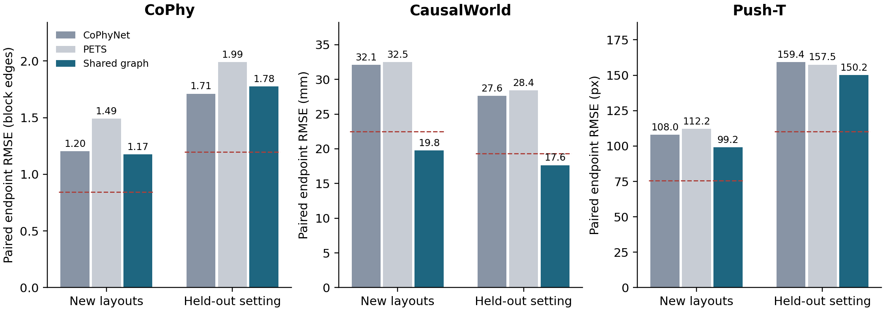
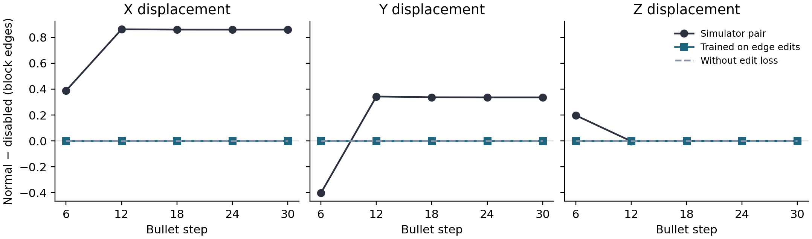

# Stage 27 · 用删边后的运动训练共享反事实世界模型

同一份模型在 CoPhy、CausalWorld 和 Push-T 上从头训练。给它一段已发生的轨迹和四个可替换动作，它需要画出五个时段的接触图，并预测各分支的位置、姿态和奖励。预先确定的主指标是**同一起点换动作的终点位移差 RMSE**。CausalWorld 在新布局和未见协议上相对较强的标准基线分别降低 **38.4% 和 36.1%**，两项达到 30%。Push-T 降低 **8.2% 和 4.7%**。CoPhy 在三四块塔下降 **2.4%**，五块塔增加 **3.7%**。

我们第一次让模型和 Bullet 一样执行“只关掉这一对物体的碰撞”，再用所有对象的有符号位移差反向训练传递消息的网络。三四块塔的删边轨迹 RMSE 由 **.720 降至 .705** 个边长，五块塔的远端动作差由 **1.887 升至 1.946**。模型能更接近一部分删边实验。怎么把正确的运动量传到下游物体，仍是难点。

## 同一个事实怎样产生四个未来

每个场景提供有效对象、角色和三个三维因子，即位置和两个朝向轴。候选图由有效对象集合产生，节点间的函数及参数三域共用。CausalWorld 用三指指端、推物和地面，Push-T 用推杆、T 块和四面墙，CoPhy 用实际存在的积木。三个域的模型长度单位分别为 65 mm、100 px 和积木边长。推物使用同一种两路点开环动作采样。CoPhy 的命令指定一个对象的初始平移，数据适配器据此提供局部位姿干预。每段原生时长作为网络输入。

对观察到的五段事实，先编码起始位姿、实际命令、角色和时长，得到局部特征 \(v_{it}\) 和初始事实边 logit \(\ell^0_{ij,t}\)。网络用先验边传消息，预测事实运动 \(\tilde d_{it}\)，并编码实际变化相对预测的创新 \(e_{it}=x_{i,t+1}^F-x_{it}^F-\tilde d_{it}\)。时间注意力把历史汇总为 \(h_i,\bar e_i,\bar\ell^0_{ij}\)。用 \(d_i(\ell)\) 表示有效邻居的平均边概率，事实推断及显式修图为

$$
t_i^0=L_\theta(h_i,d_i(\bar\ell^0)),\qquad
\ell^F_{ij}=\bar\ell^0_{ij}
+B_\theta(h_i,m_i^0,\mu_i^0,\bar e_i,h_j,m_j^0,\mu_j^0,\bar e_j,\bar\ell^0_{ij}),
\qquad
t_i=t_i^0+R_\theta(h_i,d_i(\bar\ell^0),d_i(\ell^F)).
$$

\(t_i\) 划出 16 个机制组合 logit、四维扰动均值和对数尺度。\(m_i=\sum_{k=1}^{16}\mathrm{softmax}(t_{i,1:16})_k c_k\)，\(c_k\in\mathbb R^{12}\) 可学习。扰动 \(u_i=\mu_i+\exp(s_i)\epsilon_i\)，训练共享一次 \(\epsilon_i\)，评测取后验均值。四个动作和删边分支都复用这组 \(m,u,G^F\)。

每段先将候选命令加到它指向的对象因子上。前一段的位姿、运动和传入消息都参与下一段建图。记 \(b_i^t=E_\theta(h_i^t,M_i^{t-1},\hat x_i^t,\hat x_i^t-\hat x_i^{t-1})\)。关系网络从 \(b_i^t,b_j^t,\hat x_j^t-\hat x_i^t,\ell^F_{ij},\tau_t\) 输出接触修正、传递方向、强度和九个因子门。接触概率 \(p^t_{ij}\) 用对称接触 logit，作用和传递权重保留方向性。接收因子 \(g\) 的消息为

$$
W^t_{ijfg}=\mathrm{valid}_{ij}\,B_{ij}\,
\mathbf 1[p^t_{ij}\ge .5]\,c^t_{ij}(1+\tanh s^t_{ij})\,
\mathbf 1[F^t_{ijfg}\ge .5]\tanh w^t_{ijfg},
\qquad
M^t_{jg}=\sum_{if}W^t_{ijfg}V_\theta(h^t_{if}).
$$

\(B\) 表示碰撞机制是否允许。一般预测中所有有效边都允许，删碰撞预测将指定物体对的两个方向置零。节点用共享 GRU 残差更新，再从三个因子解码相对初始位姿的变化。\(c=\sigma(\mathrm{direction}+1.5)\)，\(s=\mathrm{softplus}(\mathrm{strength})\)。有向作用读出 \(A^t_{ij}=1-(1-p^t_{ij}c^t_{ij})(1-\gamma^t_{ij}A^{t-1}_{ij})\) 保留退出接触后仍可测到的影响。奖励头读移动体的图状态、位姿和目标。观测过同起点事实终点时，用 \(\hat Y(a)=P_a+Y^F-P_{a^F}\) 校正最后时刻。普通推物给定已结束的前缀预测下一段，端点直接用 \(P_a\)。

## 怎样训练运动差

对塔动作 \(a\)，用正常碰撞运行一次，然后逐对禁用碰撞重跑，保存每个接收对象 \(k\) 在五个时段的有符号 XYZ 差
\(Z^a_{ij,k,t}=X^{a,\rm on}_{k,t}-X^{a,\rm off}_{ij,k,t}\)。方向标签取各自接收端的 \(\mathbf 1[\|Z^a_{ij,j,t}\|>.1]\)。例如关掉下面两块的碰撞，上面第三块也可能改变轨迹。两种模型都有相同的接触、有向标签、作用强度与动作差监督。完整模型额外学习

$$
\mathcal L_{\rm edit}=1.10\,\mathrm{wMean}_{a,ij,t,k}\,\mathrm{Huber}_{.25}
\left[(\widehat X^{a,\rm on}_{k,t}-\widehat X^{a,\rm off}_{ij,k,t})-Z^a_{ij,k,t}\right].
$$

每个动作抽两条有效物体对。只要有接收体相差超过 .10 个边长，该对的抽样权重为 5，其余为 1。损失里的显著接收体响应与其余响应分别用权重 3 和 1。屏蔽持续五段，后续图仍根据各分支自己的预测运动重新计算。

各域都用四分支的六个动作对学习 XYZ 和姿态差。令 \(E_{ab}=(\widehat Y_a-\widehat Y_b)-(Y_a-Y_b)\)。XYZ 逐坐标用平方误差加 .15 倍绝对误差，整体权重 .85。未被任一动作命令的接收体、两动作发生不同接触的接收体，训练权重分别增加 .70 和 .80。两条件都由命令掩码和实测接触算出。接触项包含全边 BCE、发生开关的 BCE、因换动作而分歧的 BCE，权重 .58/.25/.20。事实接触和事实运动重建各 .10，高斯后验 KL 为 .002。[完整训练目标](../../whatif/effects/fit.py)

每个时段、每个 XYZ 或奖励坐标的随机读出为 \(Y_a=\mu_a+\delta_{ah}+\lambda_{ah}\xi+\tau_{ah}\epsilon_a\)。四个成分及 \(\xi\) 在配对分支共用，\(\epsilon_a\) 独立。权重 \(\pi_h\) 来自同一事实，\(\sum_h\pi_h\delta_{ah}=0\)。因此动作差是四分量高斯混合，均值为 \(\mu_a-\mu_b+\delta_{ah}-\delta_{bh}\)，方差为 \((\lambda_{ah}-\lambda_{bh})^2+\tau_{ah}^2+\tau_{bh}^2\)。比较独立读出时，两端各抽自己的成分与噪声，得到 16 分量，点差保持相同。初训的 NLL 只看配对差，公共偏移或载荷幅度可以变化。最后冻结图、事实推断和所有均值，在同一训练数据上联合优化边际和动作差 NLL，校准后再报告 CRPS。[差值分布实现](../../whatif/effects/model.py) · [联合校准](../../whatif/effects/calibrate.py)

## 数据和比较口径

| 域 | 训练/验证/新布局测试 | 未见设置测试 | 一条候选的物理时段 |
|---|---:|---|---|
| CoPhy | 768/144/256 座三四块塔 | 256 座五块塔 | 30 个 Bullet 步，每六步保存一次 |
| CausalWorld | P1/P7 的 1,536/192/320 个布局 | P2/P8 的 320 个布局 | 八个原生步，取第 1、2、4、6、8 步 |
| Push-T | 阻尼 0、.08、.55 的 1,536/192/320 个布局 | 阻尼 .25 的 320 个布局 | 同样的八步和窗口，保留各段原生奖励 |

一个布局有四个从同一物理状态开始的动作。推物先执行 1–5 次原生开环命令，重放到相同前缀终点后再分叉，保留最后一次命令的五段事实。三域共享模型与无删边轨迹损失对照各从头训练 2,600 次 AdamW，每次每域 32 布局，四分支，初始学习率 .0013，余弦降至 .0002。前 500 步从软门过渡到硬门。验证按各域在对象单位中的动作位移差 RMSE 平均选模型。概率头额外校准最多 800 步，每域每步 48 布局。完整模型选中第 1,690 步和第 800 步概率头，对照为第 1,950 步和第 700 步概率头。另一个检查点用 CoPhy 和 CausalWorld 从头训练 2,200 步，选模及概率校准也只看这两域，用来测整个 Push-T 留出的迁移。训练种子为 271。[事先落盘的指标、预算和种子](../../whatif/effects/protocol.json)

**CoPhyNet 和 PETS。** 三域分别重训一次发布的 CoPhyNet 状态动力学和 MBRL-Lib 标准 PETS 动力学。CoPhyNet 用上游提交 `170fe46` 的 GCN、GRU、稳定性门和损失，Adam .001、batch 32、`--epochs 50`，原循环实际运行 49 轮。输入为真实三维对象位置，推物的两个已知路点作为静态点接入原接口。CoPhy 的 \(C\) 用动作指定的初始位置。PETS 用上游 `3f93ccc` 的 GaussianMLP、步进模型、经验迭代器和训练器，按 Pusher 配置用四层 200、7 个成员、5 个 elite、batch 32、25 轮、学习率 \(10^{-5}\)。输入平铺物体位姿、事实、已知动作与时长，使用 20 粒子的 TS∞ 推进。两者都在同一原生训练记录上拟合普通未来。CoPhyNet 的位置预测用点质量分布计算 CRPS，其发布模型没有姿态、奖励和图头。[CoPhyNet 上游](https://github.com/fabienbaradel/cophy/tree/170fe463c9e80ddf0978110438a710cabb4997e2/cf_learning) · [PETS 配置](https://github.com/facebookresearch/mbrl-lib/blob/3f93cccfc8d635f74e335a2f07aab6e9a48fc021/mbrl/examples/conf/overrides/pets_pusher.yaml) · [输入适配](../../whatif/effects/baseline.py)

**NCII 结构参照。** ICLR 的补充包有原作者代码，服务器取到的 ZIP 不完整，本批使用论文 §4.1 和附录 D 的 PointNet 复现。用宽度 512、三层、Leaky ReLU、最小归一化方差 .001、对数似然差阈值 1 和 Adam \(10^{-4}\)。每域固定 2,400 步，batch 64，前 399 步训练动力学，随后用遮蔽前后的似然差为交互头造标签。按被动模型似然选择可模拟缺失的对象，复现用批内中位数和 .25 遮蔽概率。训练只用原生状态转移。评测滚动它自己的状态预测，再与原生接触及 CoPhy 整段删碰撞标签比较。原论文的对象置空和本实验的成对禁碰撞是不同干预，下面明确标为 **NCII 复现**。[ICLR 论文与补充包](https://proceedings.iclr.cc/paper_files/paper/2025/hash/36848567d39a5128e671ad04a6075374-Abstract-Conference.html) · [本批复现](../../whatif/effects/ncii.py)

## 实测结果

主指标用 \(\sqrt{\mathrm{mean}\|E_{ab,xyz}\|_2^2}\)，覆盖同布局所有无序候选对及移动体。提升率 \(100(1-\mathrm{RMSE}_{\mathrm{ours}}/\mathrm{RMSE}_{\mathrm{best}})\)，每行用两种标准位置基线的较小误差作参照。

| 域与条件 | 单位 | CoPhyNet | PETS | 共享模型 | 降幅 |
|---|---|---:|---:|---:|---:|
| CoPhy，三四块 | 块边长 | 1.203 | 1.493 | **1.175** | +2.4% |
| CoPhy，五块 | 块边长 | **1.711** | 1.992 | 1.775 | −3.7% |
| CW，P1/P7 | mm | 32.10 | 32.52 | **19.76** | **+38.4%** |
| CW，P2/P8 | mm | 27.63 | 28.41 | **17.65** | **+36.1%** |
| Push-T，见过的阻尼 | px | 107.99 | 112.16 | **99.16** | +8.2% |
| Push-T，未见阻尼 | px | 159.42 | 157.50 | **150.15** | +4.7% |

下表的位置组为**终点位置 RMSE / 终点位移差 CRPS**，沿用各域长度单位。奖励组为**原生窗口加权平均奖励 RMSE / 两动作平均奖励差 RMSE**。括号为两个方向轴合成的无量纲姿态 RMSE。

| 域与条件 | CoPhyNet 位置组 | PETS 位置组（姿态） | 共享模型位置组（姿态） | PETS 奖励组 | 共享模型奖励组 |
|---|---:|---:|---:|---:|---:|
| CoPhy，三四块 | .893 / .381 | 2.250 / .390 (1.100) | 1.011 / .268 (1.066) | — | — |
| CoPhy，五块 | 1.321 / .567 | 2.876 / .571 (1.333) | 1.547 / .430 (1.282) | — | — |
| CW，P1/P7 | 37.18 / 10.30 | 36.37 / 8.71 (.481) | 23.16 / 5.28 (.460) | .0915 / .1077 | .0863 / .1011 |
| CW，P2/P8 | 32.17 / 8.88 | 32.05 / 7.64 (.480) | 19.95 / 4.74 (.454) | .0777 / .0864 | .0741 / .0815 |
| Push-T，见过的阻尼 | 94.71 / 32.46 | 109.70 / 26.37 (.859) | 87.47 / 21.63 (.807) | .0787 / .0426 | .0673 / .0408 |
| Push-T，未见阻尼 | 133.07 / 39.70 | 145.75 / 32.10 (.959) | 141.95 / 27.80 (.918) | .0574 / .0302 | .0731 / .0289 |

在同一组均值上，**独立 → 共享** 位移差 CRPS 为 CoPhy 三四块 **.286 → .268**、五块 **.461 → .430**，CW P1/P7 **6.10 → 5.28 mm**、P2/P8 **5.63 → 4.74 mm**，Push-T 见过阻尼 **22.42 → 21.63 px**、未见阻尼 **28.90 → 27.80 px**。两推物域的奖励差 CRPS 在未见设置分别为 **.0583 → .0524** 和 **.0232 → .0166**，按原生时长加权窗口得分。

### 图能否随不同动作改变

结构主指标对 CoPhy 取最后时刻的有向删碰撞作用，对推物取五段原生接触。BER 为假阳性率和假阴性率的平均。报告阈值在同域验证集选定，未见设置沿用同一阈值。实际消息仍用 .5 门。新边 AP 只在上段真实无边的对象对中测量。

| 域与条件 | NCII 复现主图 AP / BER | 共享主图 AP / BER | BER 降幅 | NCII / 共享新接触 AP |
|---|---:|---:|---:|---:|
| CoPhy，三四块 | .265 / .502 | .931 / .130 | 74.0% | .004 / .009 |
| CoPhy，五块 | .329 / .526 | .877 / .206 | 60.9% | .010 / .020 |
| CW，P1/P7 | .326 / .474 | .960 / .092 | 80.6% | .057 / .466 |
| CW，P2/P8 | .320 / .499 | .967 / .087 | 82.6% | .059 / .501 |
| Push-T，见过的阻尼 | .242 / .348 | .601 / .166 | 52.3% | .123 / .505 |
| Push-T，未见阻尼 | .177 / .396 | .509 / .194 | 51.1% | .113 / .434 |

在“两个端点都未被直接命令、前段两分支都无边、当段恰有一个新开”的同布局比较中，Push-T 见过阻尼有 1,108 对，覆盖 219 个布局。把真开边分支排在前面的比例为 **83.0%**，在 .5 门下两边都判对为 **44.0%**。未见阻尼有 1,279 对，两项为 **80.6% / 40.0%**。CW P1/P7 有 93 对，为 **75.8% / 28.0%**。CoPhy 五块塔有 185 对，为 **53.8% / 3.8%**。每对无序物体只计一次。

### 删边轨迹监督实际带来了什么

| CoPhy 结果 | 三四块 无/有轨迹损失 | 五块 无/有轨迹损失 |
|---|---:|---:|
| 直接执行删边后，所有接收体的 XYZ 差 RMSE | .720 / **.705** | .889 / **.886** |
| 显著受影响的第三方接收体，同一指标 | 1.442 / **1.441** | **1.468** / 1.475 |
| 换动作后，离两受控块均至少两层的终点差 RMSE | **1.432** / 1.461 | **1.887** / 1.946 |

五块塔的 CoPhyNet 在最后一项为 **1.842**。同一删边监督在 CW P1/P7 的动作差由 20.44 降到 19.76 mm，在 Push-T 未见阻尼却由 147.88 升至 150.15 px。下一轮优先改第一两个传播时段的运动和开边。

下图取五块塔测试里，终点显著受影响的第三方接收体按真实效应大小排序的中位样例。禁用第 2、1 号块间碰撞后，实际第 3 号块的 X 位置在第 12 步相差 .862 个边长。两种模型在该对象上都预测了零差。[样例原始数值](../../results/effects/excision-example.json)

### 整个任务留出

只在 CoPhy 和 CW 训练的检查点，直接在 Push-T 两组测试上得到动作差 **108.09 / 158.36 px**、接触 AP **.129 / .144**、奖励差 RMSE **.0700 / .0576**。同结构见过 Push-T 后，分别为 **99.16 / 150.15 px**、**.601 / .509**、**.0408 / .0289**。同一模型能处理三域输入，整个推物任务留出后的接触迁移仍弱。

用 `bash whatif/effects/reproduce.sh` 的 `data`、`fit`、`calibrate`、`baseline`、`ncii` 和 `evaluate` 入口重放。共享模型训练涉及 GPU 0、3、5，基线另用 7、8、9。[原生数据](../../data/effects) · [结果和权重](../../results/effects) · [完整指标](../../results/effects/metrics.json)
