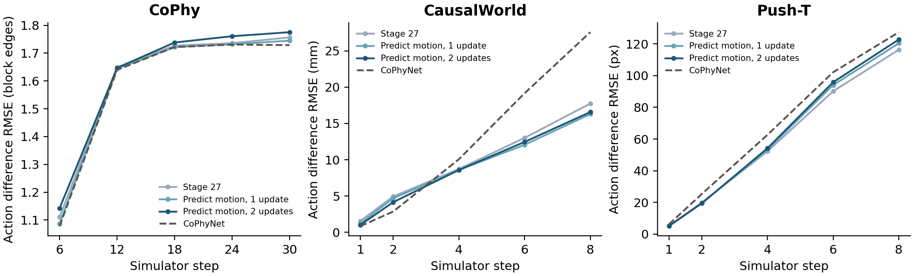
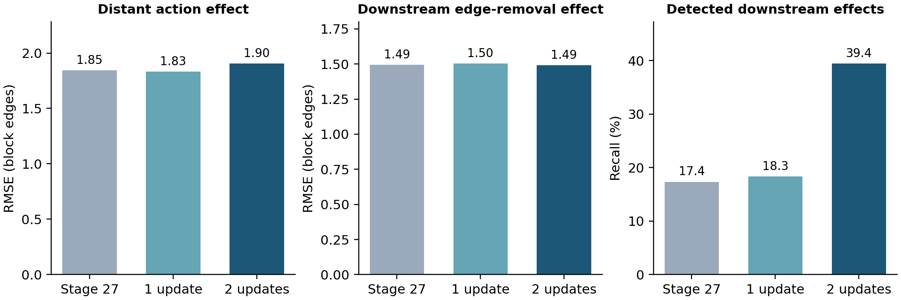

# Stage 28 · 先预测局部运动，再判断接触

这批让图先看到各对象预测到的局部位移，再决定边要不要打开。按验证集预选的单次更新版，在一批全新的 P2/P8 布局上把两动作终点位移差从 Stage 27 的 **17.74 降到 16.29 mm**，相对较强标准基线下降 **40.9%**。同一批五块塔和 Push-T 上分别得到 **−0.9% 和 +5.4%** 的基线降幅。两次更新能发现更多删碰撞后真正有反应的第三方积木，召回由 **17.4% 升到 39.4%**，但其位移差 RMSE 基本持平。图更容易把影响传下去，影响的大小和方向还没有学准。

## 图怎样跟着预测运动变

Stage 27 的五块塔中，禁用两个积木间的碰撞，真实第三块的轨迹发生了变化，但图网络给出零响应。这个版本在每次传消息前先预测每个对象自己的运动，用预测到的端点建立接触。另训练同样的网络，允许它在每个真值窗口内连续更新两次，以便在一个窗口内连续打开两条不同的边。

输入是有效对象和角色、位置与两个朝向因子、事实轨迹以及候选动作。所有位置先减去共同起点上移动物体的水平中心，输出时加回。动作仍表示位移向量，时长来自原生步数，垂直原点保留。同一事实先推断 \(m,u\) 和初始事实图，再通过观察到的运动创新显式修改 \(\ell^F\)，根据修正前后的图重新估计物理后验。\(m\) 是 16 个可学习机制基的连续组合，\(u=\mu+\exp(s)\epsilon\) 是四维高斯扰动，每布局的每个候选和删边分支用同一次样本。[事实推断与动态图](../../whatif/effects/model.py)

对候选 \(a\)，命令编码只注入它实际指定的对象。记 \(h_{if}\) 是对象 \(i\) 的因子状态，\(x_{if}\) 是这一因子的三维物理量，\(v_{if}\) 是上一预测子步的变化，\(\tau\) 给出本子步及已过去的时间。当前状态有对应的最近事实观测时，首步以该事实最后两帧之差初始化 \(v\)。接下来用同样的三组因子网络得到局部预测

$$
d^{\mathrm{local}}_{if}=D_{\theta,f}(h_{if},x_{if},v_{if},\tau),\qquad
\tilde x_{if}=x_{if}+d^{\mathrm{local}}_{if}.
$$

对象关系网看到当前位姿、上一轮消息、本轮局部位移，以及两端预测后的相对位置 \(\tilde x_{j,\mathrm{xyz}}-\tilde x_{i,\mathrm{xyz}}\)。它输出接触 \(p_{ij}\)、方向 \(c_{ij}\)、强度 \(s_{ij}\) 和因子门。边掩码 \(B_{ij}\) 在禁用碰撞时双向置零，正常预测时允许所有有效对象对。

$$
M_{jg}=\sum_{if}
\mathrm{valid}_{ij}B_{ij}\mathbf 1[p_{ij}\ge.5]\,
c_{ij}(1+\tanh s_{ij})\mathbf 1[F_{ijfg}\ge.5]\tanh(w_{ijfg})\,V(h_{if}).
$$

共享 GRU 根据 \(M,\tau\) 更新 \(h\) 得到 \(h^+\)。一个位移网络给出收到消息后相对局部运动的修正

$$
x_{jg}^+=\tilde x_{jg}+
\left[Q_{\theta,g}(h^+_{jg},M_{jg},\tau)-Q_{\theta,g}(h^+_{jg},0,\tau)\right].
$$

括号在当步无传入消息时恰为零。之前的消息仍可经状态和预测运动影响以后各步。两次更新版把每个物理窗口分成两个等长子步，子步之间用自己的位姿和接收消息重新建边。窗口接触概率取两个子步的最大值，因为标签记录该窗口内任意时刻是否曾接触。位姿、奖励和删边效果继续在原生记录点监督。[局部运动与传播代码](../../whatif/effects/motion.py)

## 训练与独立测试

两个共享版本各从头训练 2,600 步。用 Stage 27 同一批三域样本、四个分支、16 基和高斯扰动、原接触和有向作用标签、接触分歧的动作差加权，以及相同的有符号删边轨迹损失。后者实际执行 \(B_{ij}=0\) 后，拟合所有接收体的 \((\widehat X^{\rm on}-\widehat X^{\rm off})-(X^{\rm on}-X^{\rm off})\)。一次与两次的优化步数相同，后者多运行五轮消息传播。每批以 32 布局/域训练，AdamW 学习率 .0013 降至 .0002，种子 271。另从头训练一份两次更新架构，训练、验证及概率校准的域只有 CoPhy 和 CausalWorld，用于整域留出测试。三份骨干完成后，各用最多 800 步更新四分量分布头，同拟合边际 NLL 和配对差 NLL。高斯混合共享成分和载荷的形式见 Stage 27，两个读出的均值相同。

在新采的 256 座五块塔、320 个 P2/P8 布局、320 个阻尼 .25 的 Push-T 布局上重评 Stage 27、本批模型和冻结基线。布局种子从 13400000 起，全部与 Stage 27 的训练、验证和测试分离。每布局四候选，沿用同状态原生开环分叉和五段标签。CoPhy 逐对关闭碰撞并记录各对象有符号轨迹。模型选型使用 Stage 27 的验证集，以三域在各自对象尺度下的终点位移差 RMSE 等权平均。位置参照沿用 Stage 27 已训练的发布 CoPhyNet 核心与标准 PETS，逐评测条件取误差较低者。结构参照沿用固定的 NCII 论文复现。原作者补充 ZIP 的下载仍不完整，原装 NCII 的测量缺项。[本批配置](../../whatif/effects/motion_protocol.json) · [Stage 27 数据与基线](27-motion-under-edge-interventions.md)

## 实测

验证等权 RMSE 为 Stage 27 的 **.84885**、单次版的 **.84338**、两次版的 **.85021**。据此在评测前选中单次版。它的骨干选在第 1,300 步，概率头选第 800 步。两次版分别为第 1,690 和 600 步，整域留出为第 1,170 和 600 步。两个共享骨干的完整训练分别用 412 和 745 秒。[验证选择](../../results/effects/motion-selection.json)

主指标用同一布局四个动作产生的六个无序动作对，比较各移动体最终三维位移差的 RMSE。表中的降幅分别使用该行 CoPhyNet 和 PETS 中误差较低者。下面是新采的独立测试。

| 域 | 单位 | CoPhyNet | PETS | Stage 27 | 单次更新（预选） | 两次更新 | 单次版基线降幅 |
|---|---|---:|---:|---:|---:|---:|---:|
| CoPhy，五块塔 | 块边长 | **1.729** | 1.999 | 1.757 | 1.745 | 1.775 | −0.9% |
| CW，P2/P8 | mm | 27.58 | 27.95 | 17.74 | **16.29** | 16.57 | **+40.9%** |
| Push-T，阻尼 .25 | px | 127.41 | 128.19 | **116.37** | 120.48 | 122.81 | +5.4% |

在 Stage 27 的新布局测试上，预选单次版相对较强基线的降幅依次为 CoPhy **3.8%**、CW **37.8%**、Push-T **4.9%**。在 Stage 27 的首次未见设置测试上为 **−2.4%、41.2%、3.1%**。此外，两次版在新三四块塔上动作差为 **1.131** 个边长，优于 Stage 27 的 **1.175**，五块塔上没有重复出这一收益。现有三组布局的 30% 目标只有 CW 达到。本批用固定随机种子 345 分配 PETS 的评估粒子和噪声。

下表给出新采的独立测试。位置单位沿用上表，姿态为两个方向向量合成的无量纲 RMSE。奖励用原生步长加权每段均值，最后两列写边际奖励 RMSE 与两动作奖励差 RMSE。

| 域 | 方法 | 终点位置 RMSE | 姿态 RMSE | 动作位移差 CRPS | 奖励 RMSE | 奖励差 RMSE |
|---|---|---:|---:|---:|---:|---:|
| CoPhy | CoPhyNet | 1.330 | — | .576 | — | — |
| | PETS | 3.218 | 1.318 | .576 | — | — |
| | Stage 27 | 1.584 | 1.283 | .433 | — | — |
| | 单次 / 两次 | 1.639 / 1.648 | 1.292 / 1.282 | .433 / .446 | — | — |
| CW | CoPhyNet | 31.38 | — | 9.01 | — | — |
| | PETS | 31.27 | .449 | 7.63 | .0794 | .0916 |
| | Stage 27 | 19.46 | .425 | 4.71 | .0744 | .0830 |
| | 单次 / 两次 | 15.93 / 16.84 | .418 / .426 | 4.37 / 4.49 | .0703 / .0770 | .0820 / .0835 |
| Push-T | CoPhyNet | 107.22 | — | 38.20 | — | — |
| | PETS | 124.61 | .946 | 30.63 | .0728 | .0359 |
| | Stage 27 | 102.19 | .890 | 26.11 | .0623 | .0323 |
| | 单次 / 两次 | 108.60 / 112.65 | .901 / .889 | 26.23 / 27.02 | .0698 / .0703 | .0369 / .0324 |

单次版使用同一组均值时，独立分布改为共享分布的位移差 CRPS 分别为 **.442 → .433**、**4.92 → 4.37 mm**、**26.51 → 26.23 px**。CW 和 Push-T 的奖励差 CRPS 为 **.0546 → .0504** 和 **.0218 → .0173**，按原生窗口时长加权。预测大幅位移的困难集中在 Push-T，按真实位移差排在前 5% 的 96 个动作对贡献了单次版 **49.1%** 的总平方误差。表中所有指标仍包含这些布局。

### 图上的变化

CoPhy 主图用有向删碰撞作用，推物主图用原生接触。在所有行中，BER 阈值从原验证集确定，新边 AP 只在上段无边的样本上算。主图和新边均用同一个共享检查点。

| 域 | NCII 复现 AP / BER | Stage 27 AP / BER | 单次 AP / BER | 两次 AP / BER | 单次版 BER 降幅 | 新接触 AP（NCII / Stage 27 / 单次 / 两次） |
|---|---:|---:|---:|---:|---:|---:|
| CoPhy | .324 / .524 | .874 / .208 | .868 / .210 | .878 / .203 | 59.9% | .010 / .022 / .028 / .026 |
| CW | .319 / .497 | .968 / .086 | .969 / .085 | .969 / .085 | 82.9% | .054 / .524 / .535 / .539 |
| Push-T | .173 / .400 | .525 / .181 | .507 / .187 | .521 / .192 | 53.2% | .110 / .453 / .433 / .432 |

Push-T 有 1,318 对候选满足“前段 T 块与同一面墙都未接触，本段恰有一个候选接触”。两次更新把真分支排前的概率是 **82.1%**，Stage 27 为 **80.7%**。按对象层 .5 硬门，两边都判对分别为 **38.1%** 和 **38.5%**。单次版是 **81.1% / 31.2%**。多一次更新略改进排序，对真正打开和关闭边的收益很小。

五块塔中对 1,857 个远端接收体—动作对，CoPhyNet、Stage 27、单次版、两次版的终点位移差为 **1.791 / 1.846 / 1.831 / 1.904** 个边长。另有 53,225 个真实第三方删边响应超过 .10。两次版在模型中执行同一删边后，预测幅度也超过 .10 的比例为 **39.4%**，Stage 27 和单次版分别为 **17.4%** 和 **18.3%**。三者对这些响应的平均方向余弦分别为 **.102、.047、.041**，零向量计零。位移差 RMSE 仍约 **1.49–1.50**，表明模型更常传出响应，但仍传错相当一部分方向和力的大小。

整域留出的模型在新采 Push-T 上得到 **125.23 px** 动作差 RMSE、**.167** 接触 AP 和 **.0434** 奖励差 RMSE。Stage 27 对应的整域留出模型在这批为 **127.55 px、.135、.0633**，本批同结构的三域两次更新版为 **122.81 px、.521、.0324**。迁移改善主要出现在边和奖励，完整任务留出的差距还很大。

本批的实际收益集中在 CW 对新协议的位移和概率预测，以及 CoPhy 下游作用的召回。下一步最值得补的训练信号是接触前后的真实短步运动和带符号的下游响应，两项都可以用共用的图传播损失处理。三个检查点、固定基线和原生分叉都可重放。[完整指标](../../results/effects/metrics-motion.json) · [原生分叉](../../data/effects) · [权重](../../results/effects) · [运行入口](../../whatif/effects/reproduce.sh)
+
