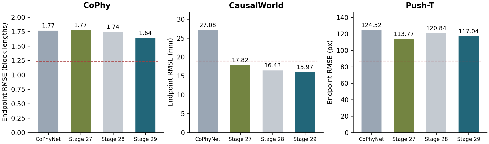
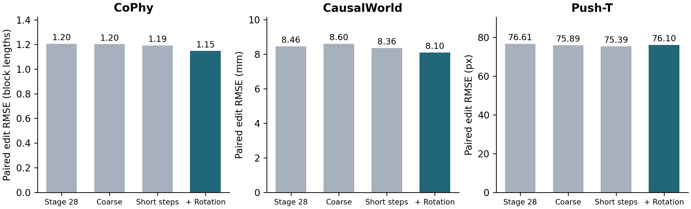
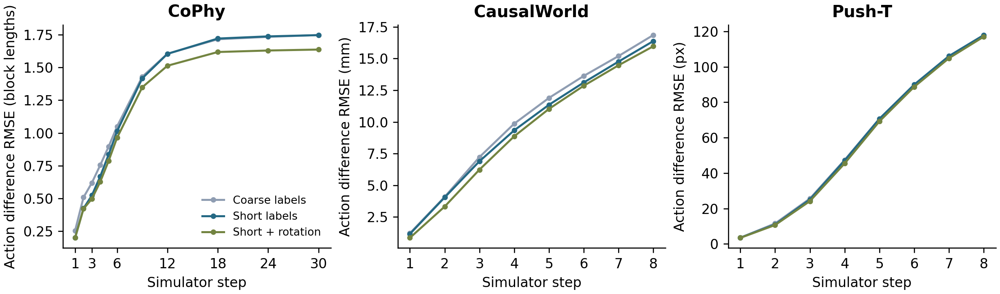

# Stage 29 · 用原生短步和同一条边的两动作效应训练传播

同一份共享模型在新采的五块塔、CausalWorld P2/P8 和 Push-T 阻尼 .25 上，动作差 RMSE 相对较强标准基线分别降低 **7.4%、41.0%、6.0%**。CausalWorld 保持 30% 以上，CoPhy 的远端位移和方向均有改善。Push-T 的图更准，但终点动作差仍高于同批复测的 Stage 27。

## 同一场景里做四种对照

Stage 28 把五块塔上的第三方删边响应召回从 17.4% 提到 39.4%，响应误差仍在 1.49 个积木边长附近。这批从三个域的原生模拟器补采真实短步数据，并用同一条边在不同动作下产生的响应训练有向传播。

每条测试和训练记录都有四个候选动作。固定初始状态、事实、物理参数和动作 \(a\)，分别运行正常碰撞和禁用无序物体对 \(e=\{i,j\}\) 的分支。对接收对象 \(k\)，有符号响应为 \(Z^a_{e,k,t}=X^{a,\mathrm{on}}_{k,t}-X^{a,\mathrm{off}}_{e,k,t}\)。同一个布局的四个动作都禁用同一条边，因而可以比较

$$
I^{a,b}_{e,k,t}=Z^a_{e,k,t}-Z^b_{e,k,t}
= (X^{a,\mathrm{on}}_{k,t}-X^{b,\mathrm{on}}_{k,t})
-(X^{a,\mathrm{off}}_{e,k,t}-X^{b,\mathrm{off}}_{e,k,t}).
$$

如果关闭一条碰撞关系让两动作结果的差别缩小或反向，\(I\) 会记录它的方向和幅度。CoPhy 保留所有有效积木对的原生重放。两项推物在同一前缀下为每布局抽一个可由模拟器禁用的物体对，并为四个分支重放。候选边的采样权重为 \(1+4\mathbf 1[\text{有动作发生接触}]+6\mathbf 1[\text{各动作的接触记录不同}]\)。禁用只发生在求反事实标签的模拟器副本里。同一布局的输入命令、事实位姿、正常响应都保持对应。该标签包含禁用后经第三个对象继续传播的影响。[采集与同前缀重放](../../whatif/shortstep/collect.py) · [原生接触开关](../../whatif/mechanism/native.py)

## 图如何传出有方向的运动

场景仍由变长对象集合和三个三维因子组成，即位置和两个朝向轴。共享事实编码由观测到的运动创新推断 \(m,u\) 与事实图，随后显式修图。设 \(\ell^0\) 是事实边的初始 logit，\(v_i\) 是时间注意力汇总的对象证据，\(\bar e_i\) 是实际位姿变化减去预测变化后的创新。第一遍由 \(L_\theta(v_i,\deg\ell^0)\) 推断 \(m_i^0,\mu_i^0\)，用

$$
\ell^F_{ij}=\ell^0_{ij}
+B_\theta(v_i,m_i^0,\mu_i^0,\bar e_i,v_j,m_j^0,\mu_j^0,\bar e_j,\ell^0_{ij})
$$

显式修正边，再使用修正前后的度数更新物理后验。\(m_i=\sum_{\ell=1}^{16}\alpha_{i\ell}c_\ell\)，\(\boldsymbol\alpha_i\) 为 softmax 系数，\(c_\ell\in\mathbb R^{12}\) 可学习。\(u_i=\mu_i+\exp(s_i)\epsilon_i\) 是四维高斯。一个场景的动作和删边分支共享同一物理样本，测点值时取扰动后验均值。[共享事实推断](../../whatif/effects/model.py)

每个短步只给命令指向的对象注入 \(A_\theta(a_i,\tau)\)。时间输入 \(\tau\) 由原比较窗口长度和已过去的时间比例组成。设 \(\rho_t=\Delta t_t/\Delta t_{\mathrm{window}}\)。先用局部因子状态、预测位姿和最近速度预测自由位移 \(d_{if}^{\rm loc}\)，得到 \(\tilde x_i=x_i+\rho_t d_i^{\rm loc}\)。边网络用两个端点的局部运动、上一轮传入消息及 \(\tilde x_j-\tilde x_i\) 更新图。普通的因子消息权重为

$$
W^t_{ijfg}= \mathrm{valid}_{ij}B_{ij}\mathbf 1[p^t_{ij}\ge .5]\,
c^t_{ij}(1+\tanh s^t_{ij})\mathbf 1[F^t_{ijfg}\ge .5]\tanh(w^t_{ijfg}),\qquad
M_{jg}^t=\sum_{i,f} W^t_{ijfg}\,V(h_{if}^t).
$$

新增的位移消息使用 **同一组接收位置因子的权重**。六个方向向量 \(b_{ij\ell}\) 由当前相对位置、局部预测后的相对位置、两端最近速度和两端局部位移组成，每个都缩放为 \(b/(1+\|b\|)\)。共享关系网络输出每个发出因子和每个方向向量的系数 \(\beta^t_{ijf\ell}\)。实际位移消息为

$$
H^t_j=\sum_{i,f,\ell}W^t_{ijf,\mathrm{pos}}\beta^t_{ijf\ell}
\frac{b^t_{ij\ell}}{1+\|b^t_{ij\ell}\|}.
$$

GRU 按时间比例更新因子状态。下一步位姿为

$$
x_j^{t+1}=\tilde x_j+
\rho_t\left(Q_\theta(h_j^{t+1},M_j^t,\tau)-Q_\theta(h_j^{t+1},0,\tau)
+\operatorname{pad}_{\rm pos}(H^t_j)\right).
$$

其中 \(\operatorname{pad}_{\rm pos}\) 将有符号 XYZ 位移加到位置因子，朝向通过共享因子消息更新。关闭 \(B_{ij}\) 时，两种消息都无法经过该边，之后的图仍根据预测状态逐步重建。对于同起点已有事实结果的 CoPhy，各分支在最后一个端点加共同的事实校正 \(Y^F-\widehat Y(a^F)\)。动作差及删边响应的比较保留各自的有符号运动。[短步方向传播](../../whatif/shortstep/model.py)

训练保留五个标准窗口的位姿、动作差、奖励、接触与概率损失。额外短步损失监督真实原生位姿、位移差及其逐步增量、接触开关和原生奖励。删边损失同时监督 \(Z\)、\(I\)、随时间的 \(\Delta Z/\sqrt{\Delta t}\)，以及归一化后的有符号响应 \(Z/(.10+\|Z\|)\)。四项权重为 .68、.52、.34、.16，方向和幅度共用同一张会被实际删掉的图。粗标签对照运行同样的短步网络和模拟器分支，但只在原来的五个窗口监督。旋转版本在 65% 的训练布局上，将事实、候选动作、位姿轴、两套轨迹一起绕垂直方向旋转，变换后的标量奖励、边标签和时长保持相同。[损失实现](../../whatif/shortstep/fit.py) · [旋转增强](../../whatif/shortstep/augment.py)

每个位置坐标和奖励信号用四成分高斯联合读出。两动作共用成分 \(h\) 及 \(\xi\)，各自有条件独立的 \(\eta_a\)。\(Y_a=\mu_a+\delta_{ah}+\lambda_{ah}\xi+\tau_{ah}\eta_a\)，其中 \(\sum_h\pi_h\delta_{ah}=0\)。因此两动作的差具有均值 \(\mu_a-\mu_b\)，各成分方差为 \((\lambda_{ah}-\lambda_{bh})^2+\tau_{ah}^2+\tau_{bh}^2\)。独立读出分开抽取两侧的成分和噪声。短步奖励按原生时长聚合到统一窗口，分量偏移与共享载荷取加权和，独立项用方差加权。校准时冻结世界模型的点预测，同时优化预测边际和配对差的 NLL。[校准实现](../../whatif/shortstep/calibrate.py)

## 训练和比较设置

| 域 | 同一组训练 / 验证布局 | 额外记录的物理时刻 | 新采的未见条件测试 |
|---|---:|---|---|
| CoPhy | 768 / 144 座三、四块塔 | 第 1–6、9、12、18、24、30 步 | 256 座五块塔 |
| CausalWorld | 1,536 / 192 个 P1/P7 布局 | 八个原生步逐步记录 | 320 个 P2/P8 布局 |
| Push-T | 1,536 / 192 个布局，阻尼 0/.08/.55 | 八个原生步逐步记录 | 320 个 .25 布局 |

训练和验证用 Stage 27 原来的状态、事实、布局和候选动作。五段标签按同一时标从短步聚合并与原归档核对。额外监督是短程状态、接触和物理删除后的位置，模型仍用原五段事实输入。新测试布局种子从 13500000 起，与已有布局分离。历史新布局测试也按原五段记录复测。基线使用发布 CoPhyNet 核心、MBRL-Lib PETS 及既有标准训练配置、输入适配和冻结权重，在同一批正常分支评分。NCII 仍为论文复现，会议补充包重取仍不完整。结构表分开标明。[上一轮基线来源与预算](27-motion-under-edge-interventions.md) · [本批预先落盘的指标与数据](../../whatif/shortstep/protocol.json)

三个共享变体沿同一 Stage 28 骨干初始化，方向向量头从零开始，各训练 2,000 个 AdamW 更新，每域每步 24 布局。旧参数学习率 .00065，方向头 .00110，余弦降至 .00014。前 300 步逐渐从四分之三以上硬门过渡到完全硬门。另有 1,800 次更新的整域留出模型，从 Stage 28 的未见 Push-T 模型初始化，训练、选模与概率校准只用 CoPhy 和 CausalWorld。各版本再以每域 40 布局、最多 500 步拟合概率头。所有训练用种子 271。预选以各域验证终点动作差 RMSE 除以初始化模型在同域的值后取平均。

## 实测结果

按验证集归一化 RMSE 预选短步加旋转的模型，记为 Stage 29。三个共享变体的分数分别为粗标签 **.9764**、短步 **.9725**、短步加旋转 **.9359**，后者训练选在第 2,000 步。这一份权重用于三域全部结果。各概率头均选第 500 步。[选型记录](../../results/shortstep/selection.json)

主指标是同一布局所有无序动作对、各移动体终点位移差的三维 RMSE。每行的提升率按 \(100(1-\mathrm{RMSE}_{29}/\min(\mathrm{RMSE}_{\mathrm{CoPhyNet}},\mathrm{RMSE}_{\mathrm{PETS}}))\) 算。下表所有模型均在新一批未见设置上使用相同实际动作。

| 未见设置 | 单位 | CoPhyNet | PETS | Stage 27 | Stage 28 | Stage 29 | 对较强基线的降幅 |
|---|---:|---:|---:|---:|---:|---:|---:|
| CoPhy 五块塔 | 块边长 | 1.769 | 2.027 | 1.774 | 1.743 | **1.637** | **7.4%** |
| CW P2/P8 | mm | 27.08 | 28.15 | 17.82 | 16.43 | **15.97** | **41.0%** |
| Push-T 阻尼 .25 | px | 124.52 | 130.75 | **113.77** | 120.84 | 117.04 | **6.0%** |

原来新布局测试的三项 RMSE 为 **1.066 个块边长、17.71 mm、98.36 px**，相对于较强基线分别降低 **11.4%、44.8%、8.9%**。同样只有 CausalWorld 达到设定的 30%。

下表使用同一批新布局。姿态误差为两个方向向量合成的无量纲 RMSE。奖励按原生步长加权，最后两列为奖励及动作间奖励差的 RMSE。

| 域 | 方法 | 终点位置 RMSE | 姿态 RMSE | 动作位移差 CRPS | 奖励 RMSE | 奖励差 RMSE |
|---|---|---:|---:|---:|---:|---:|
| CoPhy | CoPhyNet | 1.360 | — | .585 | — | — |
| | PETS | 3.523 | 1.349 | .585 | — | — |
| | Stage 28 | 1.611 | 1.287 | .430 | — | — |
| | Stage 29 | 1.500 | 1.276 | .395 | — | — |
| CW | CoPhyNet | 32.17 | — | 8.76 | — | — |
| | PETS | 32.00 | .499 | 7.60 | .0813 | .0926 |
| | Stage 28 | 16.84 | .456 | 4.36 | .0759 | .0851 |
| | Stage 29 | 15.25 | .445 | 4.20 | .0751 | .0843 |
| Push-T | CoPhyNet | 121.21 | — | 37.21 | — | — |
| | PETS | 139.88 | 1.048 | 31.16 | .0555 | .0335 |
| | Stage 28 | 120.84 | .993 | 26.18 | .0582 | .0354 |
| | Stage 29 | 113.67 | .979 | 24.90 | .0520 | .0296 |

Stage 29 同一组均值下，位移差 CRPS 随独立读出改为共享读出分别为 **.403 → .395、4.81 → 4.20 mm、25.59 → 24.90 px**。CW 和 Push-T 的奖励差 CRPS 分别为 **.0597 → .0520**、**.0164 → .0129**。这是分布质量的比较。

### 接触和有向作用图

CoPhy 的主图标签为最终删碰撞有向作用，推物为五段原生接触，阈值从各模型验证集取得。新接触 AP 在前一段真实无边的样本上测量。

| 域 | NCII 复现 AP / BER | Stage 28 AP / BER | Stage 29 AP / BER | 相对 NCII 的 BER 降幅 | 新接触 AP（NCII / Stage 28 / Stage 29） |
|---|---:|---:|---:|---:|---:|
| CoPhy | .318 / .530 | .873 / .205 | .884 / .197 | 62.7% | .009 / .027 / .041 |
| CW | .320 / .496 | .966 / .090 | .972 / .078 | 84.3% | .053 / .501 / .555 |
| Push-T | .183 / .395 | .498 / .194 | .572 / .166 | 58.0% | .114 / .431 / .521 |

Push-T 中有 1,296 对动作在前一段都未碰同一面墙，当段只有一个发生接触。真分支排在前面的比例由 **82.5% 升至 87.1%**，按实际对象硬门 .5 两边都判对的比例由 **34.1% 升至 41.5%**。CoPhy 五块塔同类远端新边的排序由 **49.7% 升至 65.1%**，硬门两边都判对由 **7.8% 降至 1.8%**。总 AP 提升与实际打开正确边可以不同。

### 同一条边对两动作的区别学到了多少

| 数据 | 指标 | Stage 28 | 粗标签 | 短步 | 短步加旋转 |
|---|---|---:|---:|---:|---:|
| 五块塔 | 两动作的删边差 \(I\) RMSE，块边长 | 1.205 | 1.202 | 1.192 | **1.148** |
| | 第三方显著 \(Z\) RMSE，块边长 | 1.535 | 1.512 | 1.507 | **1.446** |
| | 第三方显著 \(Z\) 平均方向余弦 | .047 | .145 | .142 | **.158** |
| CW | \(I\) RMSE，mm | 8.46 | 8.60 | 8.36 | **8.10** |
| | 显著 \(Z\) 平均方向余弦 | .306 | .602 | .579 | **.683** |
| Push-T | \(I\) RMSE，px | 76.61 | 75.89 | **75.39** | 76.10 |
| | 显著 \(Z\) 平均方向余弦 | .234 | .267 | .285 | **.310** |

在 1,838 个五块塔远端接收体—动作对上，Stage 29 的动作差为 **1.737**，Stage 28 与 CoPhyNet 分别为 **1.832、1.837**。整段删边的真实显著下游响应中，Stage 29 预测幅度也超过 .10 的比例为 **45.3%**，Stage 28 为 **17.9%**，粗标签对照为 **51.2%**。粗标签对照虽然召回更高，方向和幅度的误差仍大于预选模型。

在相同短步架构里，增加真实短步标签后，阶段动作差增量 RMSE 为 CoPhy **.500 → .484**、CW **3.33 → 3.21 mm**、Push-T **27.80 → 27.74 px**。CoPhy 的终点变化很小，加旋转后才由 **1.747 降到 1.637**。Push-T 的终点收益仍有限，真实动作效果最大的 5% 贡献了 Stage 29 **48.3%** 的平方误差。Stage 27 在同一批最大效果上的 RMSE 为 **340.09 px**，Stage 29 为 **363.80 px**。

### 整个 Push-T 留出

用 CoPhy 和 CW 训练的模型在新 Push-T 上，接触 AP 从旧整域留出模型的 **.169 升至 .197**，奖励差从 **.0419 降到 .0406**，终点动作差从 **126.64 升到 127.18 px**。包含 Push-T 数据的三域预选模型为 **.572、.0296、117.04 px**。短步标签为新任务的接触图带来一些迁移，终点动作效果仍需要在新物理条件下推断得更准确。

原生样本、训练曲线、完整指标和权重均已归档。训练用 GPU 0、3、5、7，评测用 GPU 8。[运行入口](../../whatif/shortstep/reproduce.sh) · [新测逐项指标](../../results/shortstep/metrics.json) · [原生短步与删边数据](../../data/shortstep)
