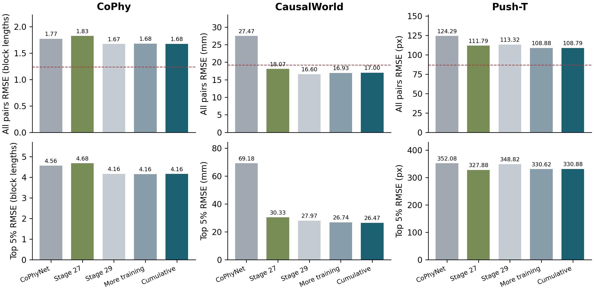
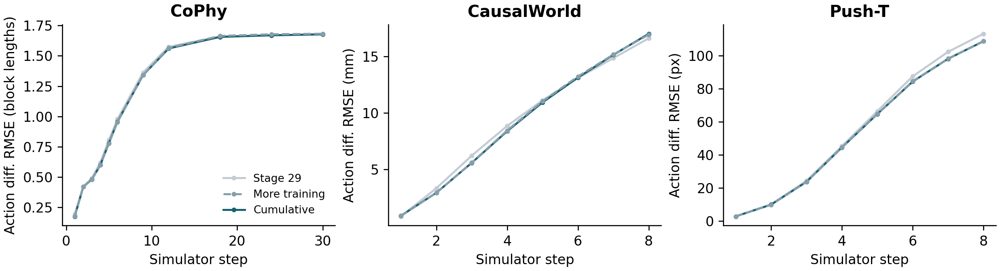

# Stage 30 · 用图上的因子状态估计累计位移

同一份预选模型在新布局上把 Push-T 动作差 RMSE 从 113.32 降到 **108.88 px**，相对固定基线降低 **12.4%**。新增累计位移头也得到 **108.79 px**，等训练步数的原架构复现了几乎全部收益。五块塔和 CausalWorld 对固定基线的降幅分别为 **5.1% 和 38.4%**。

Stage 29 的同批新布局中，Push-T 最大的 5% 动作差贡献了 48.3% 的平方误差。这一段中，Stage 27 的终点读出误差为 340.09 px，短步积分版为 363.80 px。图在短步之间何时开边，与对象最后被推多远，是相关但不同的学习问题。这批在保留短步建图的基础上，让因子网络估计到当前时刻累计少算或多算的位移。

## 同一张图如何学习两种时间尺度

输入仍是对象位姿、对象角色、事实历史、目标和局部对象命令。对可变对象集合中的每个对象建一个位置因子和两个朝向因子。先从事实的运动创新提取历史证据 \(v_i\)，用初始图 \(G^0\) 的度数及 \(v_i\) 推断物理机制 \(m_i^0\) 和扰动均值 \(\mu_i^0\)。图网络根据两个端点的证据与创新 \(\bar e_i,\bar e_j\) 作显式修订，再用修订图重新估计物理后验。

$$
\ell^F_{ij}=\ell^0_{ij}+B_\theta(v_i,m_i^0,\mu_i^0,\bar e_i,v_j,m_j^0,\mu_j^0,\bar e_j,\ell^0_{ij}),\quad
m_i=\sum_{c=1}^{16}\alpha_{ic}m_c,\quad
u_i=\mu_i+\exp(s_i)\epsilon_i.
$$

\(\alpha_i\) 为 softmax 权重，16 个可学习 \(m_c\) 各有 12 维，\(\epsilon_i\sim\mathcal N(0,I_4)\)。同一条事实下，候选动作和删边分支共用这一后验。每一步把命令编码只加到命令指定的对象。用各对象试走一步所得的预测相对位置、局部隐状态和上一步收到的消息重算接触图。记对象门和因子门相乘后的有效边权为 \(W^t_{ijfg}\)，实际删边时将对应的权重设为零。普通因子消息 \(M^t_{jg}=\sum_{i,f} W^t_{ijfg}V(h^t_{if})\) 更新因子 GRU；接收位置因子的同一组 \(W\) 还控制有符号的空间位移消息。这个路径及短步积分 \(x^{t+1}_{j,\mathrm{short}}\) 沿用 [Stage 29](29-signed-short-step-effects.md)。

这一批的新增量只读对象 \(j\) 的位置因子。令 \(h^0_j\) 为该分支注入命令之前的位置因子，\(h^{t+1}_j\) 为收到当步图消息后的位置因子，\(\tau_t\) 为保留的两维时钟，\(s_t\in[0,1]\) 为已过时间占比。用一个两层隐藏层宽 64 的共享 MLP \(R_\theta\) 学习

$$
C^{t+1}_j=s_t\left[R_\theta(h^{t+1}_j,h^0_j,\tau_t)-R_\theta(h^0_j,h^0_j,\tau_t)\right],\qquad
x^{t+1}_j=x^{t+1}_{j,\mathrm{short}}+\operatorname{pad}_{\mathrm{pos}}(C^{t+1}_j-C^t_j).
$$

\(C^0_j=0\)。每步只加修正量的增量，以免累计修正被重复计入。新的位姿和速度直接进入下一轮动态图，正常和删边分支都执行相同的计算。一个命令改变其他对象的位置因子时，信息仍须经过实际打开的对象–因子边。读出末层从零开始，可从 Stage 29 的预测接着训练。对同一起点已有事实结果的 CoPhy，端点保留共同的事实校正 \(Y^F-\widehat Y(a^F)\)，该项会在两动作的差中抵消。[短步递推](../../whatif/shortstep/model.py) · [累计位移头](../../whatif/cumulative/model.py)

训练目标沿用相同的未来位姿、动作差、奖励、接触和分布损失。令 \(D_t^{a,b}=X^a_t-X^b_t\)，\(Z^a_t=X_t^{a,\mathrm{on}}-X_t^{a,\mathrm{off}}\)，\(e_D=\widehat D-D,\ e_Z=\widehat Z-Z\)。在五个比较窗口的主损失之外，原生短步监督含以下运动项

$$
\begin{aligned}
\mathcal L_{\mathrm{short,motion}} &=
.36\|\widehat X-X\|_{\mathrm{pos}}^2+.09\|\widehat X-X\|_{\mathrm{axes}}^2
+.55\|e_D\|^2+.45\|\Delta e_D/\sqrt{\Delta t}\|^2,\\
\mathcal L_{\mathrm{cut}} &=
.68 L_{\rm huber}(e_Z)+.52 L_{\rm huber}(e_Z^a-e_Z^b)
+.34 L_{\rm huber}(\Delta e_Z/\sqrt{\Delta t})
+.16\|\nu(\widehat Z)-\nu(Z)\|^2,\qquad \nu(v)=v/(.10+\|v\|).
\end{aligned}
$$

上式省略训练时做加权平均的对象角色和响应权重。原生接触、开关变化和奖励分别另有监督。累计位移因此也要解释同一条边被关掉以后，各动作带来的有符号响应。

分布读出仍是学习的四成分高斯。每个场景抽一个共享成分 \(h\) 和共享扰动 \(\xi\)，各动作另有独立噪声 \(\eta_a\)。对状态坐标和奖励分别读出 \(Y_a=\mu_a+\delta_{ah}+\lambda_{ah}\xi+\sigma_{ah}\eta_a\)，成分偏移按权重中心化。动作差的成分方差为 \((\lambda_{ah}-\lambda_{bh})^2+\sigma_{ah}^2+\sigma_{bh}^2\)。训练后冻结图与点预测，再最小化边际和配对的 NLL。报告比较共享成分与独立成分两种读出在同一组均值下的 CRPS。[短步损失](../../whatif/shortstep/fit.py) · [概率校准](../../whatif/shortstep/calibrate.py)

## 数据和训练

| 域 | 训练 / 验证布局 | 新物理条件与物体数组合 |
|---|---:|---|
| CoPhy | 768 / 144 座三、四块塔 | 新采 256 座五块塔 |
| CausalWorld | 1,536 / 192 个 P1/P7 布局 | 新采 320 个 P2/P8 布局 |
| Push-T | 1,536 / 192 个布局，阻尼 0/.08/.55 | 新采 320 个布局，阻尼 .25 |

新测试里真实终点动作差幅度的第 95 百分位，CoPhy 从训练的 3.49 个边长到 4.58，Push-T 从 237.44 px 到 301.00 px。CausalWorld 从 68.13 mm 到 57.90 mm。前两项的未见设置尤其放大了大效果预测的难度。

训练、验证和校准继续用 Stage 29 的归档。测试是从种子 13600000 开始的新一批独立布局，按原接口生成同一起点和四个候选动作。原生短步与删边标签的设置保持一致。CoPhy 正常及删边分支在同一原生时钟重放所有有效积木对，两项推物对每布局重放同一对碰撞的四个动作。

预测比较用发布 CoPhyNet 核心与标准 PETS 的冻结权重，使用同一输入适配在新布局上重新评分。CoPhyNet 的配置为 50 轮参数预算，按上游训练循环实际 49 轮，使用三维物体位置和已知路点。PETS 为四层宽 200、7 个成员、25 轮、20 粒子 TS∞，使用平铺的位姿、事实、动作和时间。图比较为固定 2,400 步的 NCII 论文复现。原作者版本仍缺实测结果。[主指标、数据和预算](../../whatif/cumulative/protocol.json) · [基线实现与适配](27-motion-under-edge-interventions.md)

累计位移版和继续训练对照均从 Stage 29 三域共享权重初始化。两组都使用种子 271、每域每步 24 布局、1,800 次 AdamW 更新及 65% 水平旋转增强。骨干学习率 .00048，累计头 .00115，余弦降至 .00010。训练的图使用硬门。两组各做 450 次分布校准。整域留出版从 Stage 29 留出 Push-T 的检查点初始化，继续只用 CoPhy 与 CausalWorld 训练、选型和校准。三域结果在原验证集上按终点动作差相对 Stage 29 的误差比等权选型，原 Stage 29 也参加选型。

## 实测结果

三域验证归一化终点误差为 Stage 29 **1.0000**、原架构续训 **.9789**、累计位移 **.9808**。两项新训练的最佳点预测均在第 1,800 步，概率校准选在第 400 步。按约定由原架构续训的同一份权重给出主结果，累计位移版也在相同测试条件下完整评分。整域留出的累计版在两域验证上为 **.9682**，选中第 1,300 步，概率校准选在第 450 步。[选型记录](../../results/cumulative/selection.json)

主指标是同一布局各无序候选动作对和移动对象的终点三维位移差 RMSE。降幅为 \(100(1-\mathrm{RMSE}_{\rm model}/\min(\mathrm{RMSE}_{\rm CoPhyNet},\mathrm{RMSE}_{\rm PETS}))\)。下面按同一组测试记录比较。

| 未见设置 | 单位 | CoPhyNet | PETS | Stage 27 | Stage 29 | 续训（预选） | 累计位移 | 预选版降幅 |
|---|---|---:|---:|---:|---:|---:|---:|---:|
| CoPhy 五块塔 | 块边长 | 1.773 | 2.050 | 1.825 | 1.674 | **1.682** | 1.678 | **5.1%** |
| CausalWorld P2/P8 | mm | 27.47 | 28.06 | 18.07 | 16.60 | **16.93** | 17.00 | **38.4%** |
| Push-T 阻尼 .25 | px | 124.29 | 128.30 | 111.79 | 113.32 | **108.88** | 108.79 | **12.4%** |

原有的同分布留出布局上，三项预选成绩依次为 **1.061 个边长、16.90 mm、98.15 px**，相对较强标准基线的降幅分别为 **11.8%、47.3%、9.1%**。两个测试口径中均只有 CausalWorld 达到 30%。

### 为什么最大的动作差仍然难

| 新测试的最高 5% 对象–动作对 | 真值平均幅度 | Stage 29 预测幅度 | 续训预测幅度 | 累计位移预测幅度 | Stage 29 / 续训 / 累计位移 RMSE |
|---|---:|---:|---:|---:|---:|
| 五块塔，384 对 | 5.757 | 2.843 | 2.962 | 2.985 | 4.165 / 4.157 / 4.157 |
| CausalWorld，96 对 | 68.39 mm | 50.40 mm | 54.24 mm | 54.88 mm | 27.97 / 26.74 / 26.47 mm |
| Push-T，96 对 | 362.20 px | 49.51 px | 74.18 px | 73.94 px | 348.82 / 330.62 / 330.88 px |

Push-T 最高 5% 的方向余弦从 Stage 29 的 **.285** 增至续训的 **.446** 和累计位移的 **.482**。新增头在这组样本上更会判断朝哪个方向变化，预测幅度仍只有真值平均幅度的约五分之一，RMSE 和等步数续训几乎相同。这个尾部占续训模型 **46.1%** 的总平方误差，Stage 27 在同一批尾部仍略好，为 **327.88 px**。普通动作对的总体改进与这些强作用的误差可以同时存在。

### 位姿、奖励和分布

| 域 | 模型 | 位置 RMSE | 姿态轴 RMSE | 位置动作差 CRPS | 奖励 RMSE | 奖励差 RMSE |
|---|---|---:|---:|---:|---:|---:|
| CoPhy | CoPhyNet | 1.349 | — | .586 | — | — |
| | PETS | 3.100 | 1.328 | .583 | — | — |
| | Stage 29 | 1.473 | 1.262 | .404 | — | — |
| | 续训 | 1.454 | 1.266 | .407 | — | — |
| | 累计位移 | 1.453 | 1.266 | .406 | — | — |
| CW | CoPhyNet | 31.13 | — | 8.87 | — | — |
| | PETS | 30.83 | .477 | 7.54 | .0838 | .0912 |
| | Stage 29 | 15.72 | .432 | 4.37 | .0762 | .0793 |
| | 续训 | 15.47 | .425 | 4.44 | .0754 | .0780 |
| | 累计位移 | 15.35 | .424 | 4.45 | .0753 | .0780 |
| Push-T | CoPhyNet | 106.41 | — | 37.00 | — | — |
| | PETS | 126.91 | 1.053 | 30.19 | .0638 | .0388 |
| | Stage 29 | 104.51 | .994 | 24.02 | .0569 | .0365 |
| | 续训 | 98.80 | .987 | 23.18 | .0552 | .0358 |
| | 累计位移 | 98.74 | .987 | 23.12 | .0558 | .0361 |

表中位置与位置动作差采用主指标各域的物理单位，姿态为无量纲，奖励为原生奖励单位。对续训模型固定同一组均值，独立成分改为共享成分后的动作位移差 CRPS 依次为 **.4095 → .4070、4.836 → 4.443 mm、23.38 → 23.18 px**。CW 和 Push-T 的奖励差 CRPS 为 **.0586 → .0498、.0176 → .0149**。累计模型对应为 **.4080 → .4057、4.785 → 4.453 mm、23.41 → 23.12 px**，奖励差为 **.0581 → .0497、.0177 → .0150**。

### 图及有符号删边响应

CoPhy 主图为最终删碰撞的有向作用标签，CW 和 Push-T 为五窗口接触。BER 用从原验证集选定的阈值，小值更好。新接触和消失接触按上一窗口的真实边分别取样。

| 域 | NCII 复现 AP / BER | Stage 29 AP / BER | 续训 AP / BER | 累计位移 AP / BER | 续训 BER 降幅 |
|---|---:|---:|---:|---:|---:|
| CoPhy | .317 / .528 | .882 / .200 | .881 / .197 | .881 / .197 | 62.8% |
| CausalWorld | .317 / .498 | .973 / .074 | .974 / .072 | .974 / .071 | 85.6% |
| Push-T | .176 / .401 | .543 / .168 | .566 / .160 | .566 / .159 | 60.2% |

| 域 | 新接触 AP（NCII / Stage 29 / 续训 / 累计位移） | 消失接触 AP（同序） | 两个动作的有符号删边双差 RMSE（Stage 29 / 续训 / 累计位移） |
|---|---:|---:|---:|
| CoPhy | .008 / .043 / .034 / .035 | .432 / .622 / .627 / .626 | 1.134 / 1.141 / 1.138 |
| CausalWorld | .056 / .566 / .591 / .591 | .034 / .384 / .372 / .370 | 8.39 / 8.48 / 8.50 mm |
| Push-T | .108 / .489 / .513 / .511 | .448 / .598 / .629 / .627 | 78.13 / 77.48 / 77.68 px |

在 Push-T 的 1,229 个间接新接触动作对上，续训版按 .5 硬门两侧都判对的比例为 **45.9%**，Stage 29 为 **43.6%**。五块塔的第三方删边效应方向余弦由 **.153** 升至 **.164**，其幅度和方向合计的轨迹 RMSE 从 **1.428 到 1.430**，基本持平。累计位移版为 **.166 / 1.427**。

### 整域留出及模型取舍

从 CoPhy 和 CW 训练的累计版迁移到从未训练的 Push-T，正常接触 AP 从旧留出模型的 **.200 升至 .207**，终点动作差从 **124.87 降到 124.16 px**。新接触 AP 从 **.123 降到 .117**，奖励差 RMSE 从 **.0436 升到 .0467**，位置动作差 CRPS 从 **31.15 降到 30.58 px**。与见过 Push-T 的共享预选模型相比，整域留出的动作差仍高 **15.28 px**，图也有明显差距。

本批保留两个累计位移检查点、等预算续训检查点及原 Stage 29 权重。累计估计的独立收益很小。CoPhy 和 Push-T 的共同瓶颈是，模拟器里的大幅变化到了模型输出里往往只剩一小部分。扩充强作用的同起点分叉、让物理推断学习解释这些幅度，比单独扩展终点读出更值得投入。

训练使用 GPU 0、7、9，评测使用 GPU 9。[复现入口](../../whatif/cumulative/reproduce.sh) · [完整指标和检查点](../../results/cumulative)
