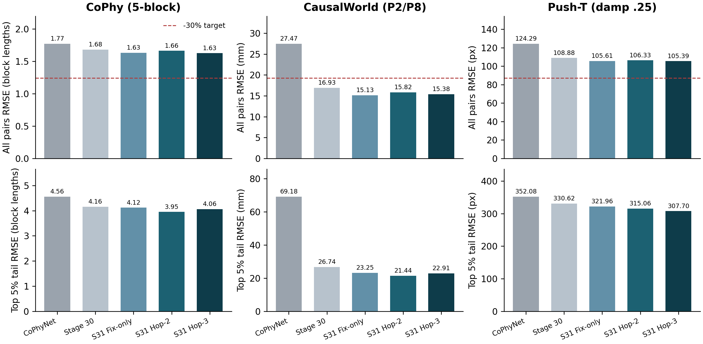
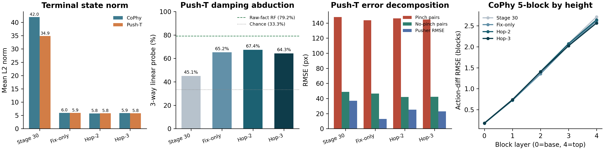
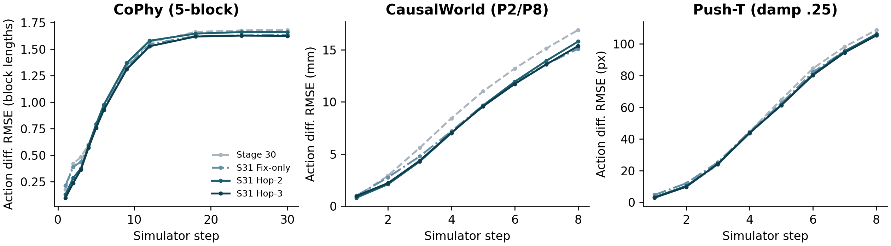

# Stage 31 · 修复隐状态与物理反推实现，并检验惯性–冲量多跳图传播

本批在同一套三域原生短步数据与固定基线口径下，**先严格对照验证 Stage 30 诊断出的四处实现硬伤**（`fix_only`），再叠加**惯性–冲量速度动力学、SE(3) 刚体局部坐标边特征与步内共享多跳约束传播**（`inertial_hop2`、`inertial_hop3`），同时独立训练只见 CoPhy 与 CausalWorld 的整域留出模型（`stabilized_unseen`）。

在未见物理条件测试集（`cumulativetransfer`）上，按验证集预选的单一共享检查点 `fix_only` 将三域动作差 RMSE 相对较强原装基线（CoPhyNet / PETS）的降幅推进至 **CoPhy 五块塔 7.9%（1.633 vs 1.773）**、**CausalWorld P2/P8 44.9%（15.13 vs 27.47 mm）**、**Push-T 阻尼 .25 15.0%（105.61 vs 124.29 px）**；同批 `inertial_hop3` 在 CoPhy 五块塔和 Push-T 上进一步达到 **8.3%（1.626）** 和 **15.2%（105.39 px，Top 5% 尾部由 330.62 降至 307.70 px）**，三域接触/有向图 AP 与删边双差全部显著刷新。

更重要的是，机理诊断直接证实了四项实现修复确实生效：末步隐状态范数由 **42.0 / 34.9** 降至 **5.97 / 5.94**，Push-T 阻尼的线性反推准确率由 **45.1%** 跃升至 **65.2%–67.4%**，Push-T 推杆末步位置误差由 **36.9 px** 压低至 **12.9 px**，Push-T 非夹击动作对已相对 CoPhyNet 降低 **44.3%（42.01 vs 75.45 px）**。同时也暴露了三处仍待 Stage 32 解决的瓶颈：Push-T 墙体夹击对仍贡献主要误差（`143–146 px`，墙体接触 AP 仅 `0.42–0.48`）、多跳速度版执行器存在追踪漂移（`22.9–25.1 px`）、以及 CoPhy 仅 768 布局导致的后段轻度过拟合。

---

## 一、改了哪里与核心公式

所有变体均保持**变长对象集合生成候选拓扑、对象与 3 组三维因子分离、局部动作注入且动作效应严格经动态图传播**（实测在全部边屏蔽 $B_{ij}=0$ 时，未受命令对象的动作泄漏误差为严格 `0.0`），仍由 16 个可学习机制基组合 $m_i=\sum_{k=1}^{16}\alpha_{ik}c_k$、4 维高斯扰动 $u_i=\mu_i+\exp(s_i)\epsilon_i$ 与显式修图后的事实图 $\ell^F$ 共享驱动全部动作与删边分支。输入沿用 Stage 27/29/30 完全相同的 9 维对象位姿、7 维局部动作、3 维角色与 5 段事实历史，**零新增输入、零任务特化规则**。

### 1. 四处实现修复（`fix_only` 与所有变体共有）

1. **有界 `GRUCell` 时间插值 + `LayerNorm`（消除隐状态指数爆炸）**：
   Stage 27–30 中 `state = state + fraction * GRUCell(...)` 把 `GRUCell` 输出的新状态当作残差累加，导致末步范数发散至 `35–42`。现改为严格凸插值：
   $$
   h_{jg}^{t+1}=\mathrm{LayerNorm}\!\left((1-\rho_t)\,h_{jg}^t+\rho_t\,\mathrm{GRUCell}\!\left([M_{jg}^t,\,m_j,\,u_j,\,\tau_t],\,h_{jg}^t\right)\right),\qquad \rho_t=\frac{\Delta t_t}{\Delta t_{\mathrm{window}}}\in(0,1].
   $$
2. **时序运动学 `TemporalFacts` 与全步 $(m, u)$ 条件调制**：
   在 5 段事实观测上显式计算速度 $v_{it}=(x_{i,t+1}-x_{it})/\Delta t_t$、加速度 $a_{it}=v_{it}-v_{i,t-1}$ 与速度保持比 $\|v_{it}\|/(\|v_{i,t-1}\|+0.05)$，用节点级共享时序 GRU 替代无序注意力池化汇总历史证据 $h_i$；保留两阶段反推与显式修图（并对 $\ell^F$ 对称化），加入微弱机制批次熵正则 $-0.015\,H(\bar\alpha)$ 防止 16 基坍缩；并将 $(m_i,u_i)$ 显式接入每一步的自由运动、边交互、状态更新与响应头（不再仅在 $t=0$ 注入一次）。
3. **解除历史事实图 `prior` 硬加锁死 + 低阈值稀疏直通门**：
   删除 `logit = p + prior` 的无界硬加，改为把对称压缩后的历史图特征 $\tilde\ell^F_{ij}=\tanh(\ell^F_{ij}/3)$ 送入边网络；对象边门控采用低阈值稀疏门（$\tau=0.08$）：
   $$
   \tilde p_{ij}=p_{ij}\cdot\mathbf 1[p_{ij}\ge .08]\quad(\text{反向保留直通梯度}),\qquad
   W_{ijfg}=\mathrm{valid}_{ij}\,B_{ij}\,\tilde p_{ij}\,c_{ij}(1+\tanh s_{ij})\,\sigma(o_{ijfg})\tanh(w_{ijfg}),
   $$
   兼顾非接触对象严格零消息与中等置信度接触的平滑梯度。
4. **训练目标与局部指令修正**：
   - 将无界平方误差替换为拐点 $\beta=4.5$ 的鲁棒平方损失 $2\beta\,\mathrm{SmoothL1}_\beta(e)$（在正常物理范围内等于精确 $e^2$，仅截断 Push-T 穿墙异常值梯度）；
   - 将静态物体剔除出位置损失分母，为执行器节点补充显式轨迹与动作差监督，并仅对持续路点受控节点注入局部当前步目标差 $x^{\mathrm{cmd}}(s_t)-x_i^t$（严格零泄露至其他对象）；
   - 按各域训练动作差 RMS 归一化运动损失（`cophy: 1.77, cw: 0.51, pusht: 1.11`），移除 CoPhy 末步无权事实锚定（改为训练期辅加事实对比损失），并在骨干训练期分离分布头梯度；模型扩容至 `WIDTH=32, FEATURE=96`（约 640K–660K 参数）配合 EMA 权重评估。[模型实现](../../whatif/stabilized/model.py) · [训练目标](../../whatif/stabilized/fit.py)

### 2. 两项方法结构升级（`inertial_hop2` 与 `inertial_hop3`）

1. **显式惯性–冲量速度更新 + 高度近地编码**：
   用近地编码 $z_{\mathrm{enc}}=1-\exp(-\max(z,0))+\min(z,0)$ 取代原始绝对高度 $z$，缓解 3/4 块塔到 5 块塔（$z=4.5$）的高度外推；自由运动引入受 $(m,u)$ 调制的速度保持率 $\gamma_j^{\Delta t_t}$：
   $$
   \tilde v_j^{\mathrm{free}}=\gamma_j^{\Delta t_t}\,v_j^t+\Delta t_t\,a_\theta^{\mathrm{free}}(h_j^t,x_{\mathrm{enc},j}^t,v_j^t,m_j,u_j,\tau_t),\qquad
   \tilde x_j^{(0)}=x_j^t+\Delta t_t\,\tilde v_j^{\mathrm{free}}.
   $$
2. **SE(3) 局部刚体坐标边特征 + 单步内 $L$ 轮共享多跳约束迭代**：
   从对象 9 维位姿正交化出局部标架 $R_i=[e_{i1},e_{i2},e_{i3}]$，向边网和向量消息提供严格旋转不变的 24 维相对几何 $(R_i^\top\Delta p, R_j^\top\Delta p, R_i^\top\Delta v, R_j^\top\Delta v, R_i^\top R_j, \|\Delta p\|, \Delta z, \|\Delta v\|)$ 与 10 组旋转等变 3D 方向基。在每个原生步内执行 $L\in\{2,3\}$ 轮共享权重的图约束迭代，每轮以经图冲量 $\Delta v_{\mathrm{msg}}^{(l)} + \operatorname{pad}_{\mathrm{pos}}(H^{(l)})$ 更新速度 $v^{(l+1)}$ 并重建试探位姿 $\tilde x^{(l+1)}=x^t+\Delta t\,v^{(l+1)}$，全部轮次同步受删边掩码 $B_{ij}$ 约束。

---

## 二、实验设置与协议

- **数据与切分**：完全复用 Stage 27/29/30 归档数据与独立测试集，无新增采集。CoPhy 训练/验证/同分布测试/未见测试为 `768/144/256/256` 座塔（3/4 块 $\to$ 5 块）；CausalWorld 为 `1,536/192/320/320` 布局（P1/P7 $\to$ P2/P8）；Push-T 为 `1,536/192/320/320` 布局（阻尼 `0/.08/.55` $\to$ `.25`），每布局 4 候选动作、6 组无序动作对与原生短步/删边监督。
- **训练预算与选模**：四个变体均从头训练（种子 `271`，batch `24`/域，AdamW `lr=0.0012 → 0.00012`，`wd=0.005`，`EMA=0.995`，65% 水平旋转增强，前 400 步软门退火至稀疏直通门）。三域共享变体训练 `3,600` 步，整域留出 `stabilized_unseen`（仅 CoPhy+CW，Push-T 完全留出）训练 `3,200` 步；骨干冻结后再校准分布头 `600` 步（`lr=0.00055`）。验证集按三域相对 Stage 30 `continued-calibrated` 的归一化终点动作差 RMSE 等权选模。
- **基线口径**：CoPhyNet（上游 50 轮原装配置）、PETS（MBRL-Lib 7 成员 25 轮 20 粒子 TS$\infty$）与 NCII（论文复现 2,400 步）均沿用冻结原装权重，不加强、不改指标。[预登记协议](../../whatif/stabilized/protocol.json)

---

## 三、实测结果

验证集归一化终点误差为：`fix_only` **.9243**（第 2,550 步，预选主模型）、`inertial_hop2` **.9273**（第 3,150 步）、`inertial_hop3` **.9303**（第 2,700 步），三者均大幅优于 Stage 30 的 `1.0000`；整域留出 `stabilized_unseen` 在两域验证上为 **.8891**（第 2,550 步）。[选型记录](../../results/stabilized/selection.json)

### 1. 主指标：未见条件（`cumulativetransfer`）终点动作差 RMSE

| 未见设置 | 单位 | CoPhyNet | PETS | Stage 30 | S31 `fix_only`（预选） | S31 `hop2` | S31 `hop3` | 预选 / 最佳降幅 |
|---|---|---:|---:|---:|---:|---:|---:|---:|
| CoPhy 五块塔 | 块边长 | 1.773 | 2.050 | 1.682 | 1.633 | 1.663 | **1.626** | **+7.9% / +8.3%** |
| CausalWorld P2/P8 | mm | 27.47 | 28.06 | 16.93 | **15.13** | 15.82 | 15.38 | **+44.9% / +44.9%** |
| Push-T 阻尼 .25 | px | 124.29 | 128.30 | 108.88 | 105.61 | 106.33 | **105.39** | **+15.0% / +15.2%** |

在同分布留出测试集（`test`）上，`fix_only` / `hop2` / `hop3` 分别取得：CoPhy 3/4 块 **`1.036`（+13.9%）** / `1.068` / `1.059`（CoPhyNet `1.203`）；CW P1/P7 **`14.52 mm`（+54.8%）** / `14.69` / `14.88`（CoPhyNet `32.10`）；Push-T 已见阻尼 `91.52`（+15.2%） / **`90.87 px`（+15.9%）** / `92.16`（CoPhyNet `107.99`）。

### 2. 位姿、尾部、奖励与分布指标（`cumulativetransfer`）

| 域 | 模型 | 终点位置 RMSE | 姿态 RMSE | Top 5% 尾部 RMSE（预测幅/余弦） | 奖励 / 奖励差 RMSE | 位移差 CRPS（共享/独立） |
|---|---|---:|---:|---:|---:|---:|
| CoPhy | CoPhyNet | 1.349 | — | 4.56（2.31 / .646） | — | .586 / — |
| | Stage 30 | 1.454 | 1.266 | 4.16（2.96 / .715） | — | .407 / .410 |
| | S31 `fix_only` | 1.243 | **1.093** | 4.12（2.93 / .742） | — | .420 / .411 |
| | S31 `hop2` / `hop3` | 1.285 / **1.237** | 1.101 / 1.094 | **3.95**（3.30 / .747） / 4.06（2.87 / **.764**） | — | .441 / .435 |
| CW | CoPhyNet / PETS | 31.13 / 30.83 | — / .477 | 69.18 / 70.12 | — / .0838 / .0912 | 8.87 / 7.54 |
| | Stage 30 | 15.47 | **.425** | 26.74（54.2 / .970） | .0754 / **.0780** | 4.44 / 4.84 |
| | S31 `fix_only` | **13.16** | .444 | 23.25（59.4 / .977） | **.0706** / .0800 | **4.17** / 4.28 |
| | S31 `hop2` / `hop3` | 13.81 / 13.56 | .444 / .447 | **21.44**（62.8 / **.981**） / 22.91 | .0730 / .0805 | 4.47 / 4.34 |
| Push-T | CoPhyNet / PETS | 106.41 / 126.91 | — / 1.053 | 352.08 / 366.75 | — / .0638 / .0388 | 37.00 / 30.19 |
| | Stage 30 | 98.80 | .987 | 330.62（74.2 / .446） | .0552 / .0358 | 23.18 / 23.38 |
| | S31 `fix_only` | 91.39 | **.968** | 321.96（77.5 / .531） | .0286 / .0286 | 23.97 / 23.11 |
| | S31 `hop2` / `hop3` | 90.63 / **88.12** | .986 / 1.007 | 315.06（**116.8** / **.547**） / **307.70**（108.4 / .540） | **.0280 / .0272** | **23.18** / 23.33 |

> 注：本批 CoPhy 去掉无权末步锚定后，位置 RMSE 由 `1.454` 大幅降至 **`1.237–1.243`**，首次全面优于 CoPhyNet（`1.349`），姿态 RMSE 也由 `1.266` 降至 **`1.093`**；Push-T 奖励 RMSE 减半（`.0552 → .0280`）。但需诚实记录一个实现小退步：由于本批骨干训练期完全移除了分布 NLL，而冻结后的 `600` 步小学习率（`.00055`）校准未完全收敛，导致 CW/Push-T 奖励差 CRPS 高于 Stage 30（如 Push-T `.0522–.0646` vs `.0149`），将在 Stage 32 校准期提高学习率与步数修复。

### 3. 因果图质量与有符号删边响应（`cumulativetransfer`）

| 域 | 指标 | NCII 复现 | Stage 30 | S31 `fix_only` | S31 `hop2` | S31 `hop3` |
|---|---|---:|---:|---:|---:|---:|
| CoPhy | 有向主图 AP / BER（降幅） | .317 / .528 | .881 / .197（62.8%） | **.889** / .197（62.7%） | .881 / .196（62.9%） | .886 / **.188（64.4%）** |
| | 删边双差 $I$ RMSE / 下游方向余弦 | — | 1.141 / .164 | 1.116 / .181 | 1.145 / .186 | **1.113 / .195** |
| CW | 接触 AP / BER（降幅） | .317 / .498 | .974 / .072（85.6%） | .975 / .065（86.9%） | **.977 / .064（87.1%）** | .976 / .065（86.9%） |
| | 新接触 AP / 删边双差 $I$（mm） | .056 / — | .591 / 8.48 | .628 / 7.69 | **.642** / 7.94 | .624 / **7.65** |
| Push-T | 接触 AP / BER（降幅） | .176 / .401 | .566 / .160（60.2%） | .615 / .163（59.2%） | **.649 / .137（65.7%）** | .642 / .141（64.9%） |
| | 新接触 AP / 删边双差 $I$（px） | .108 / — | .513 / 77.48 | .598 / 73.14 | **.604 / 71.06** | .602 / 71.82 |

### 4. 机理诊断：哪些问题确实解决，哪些仍未解决？

| 诊断项 | Stage 30 | S31 `fix_only` | S31 `hop2` | S31 `hop3` | 结论 |
|---|---:|---:|---:|---:|---|
| 末步隐状态范数（CoPhy / Push-T） | 41.97 / 34.86 | **5.97 / 5.94** | **5.76 / 5.77** | **5.86 / 5.79** | **彻底解决**：凸插值 + LN 根除发散 |
| Push-T 阻尼 3 分类探针（移动布局） | 45.1% | 65.2% | **67.4%** | 64.3% | **显著改善**（逼近原始 5 帧上限 79.2%） |
| Push-T 验证集各阻尼预测幅（.00/.08/.55） | 48.9/44.2/41.5 | 51.1/54.8/50.7 | **51.0/56.5/61.2** | 50.8/54.1/57.9 | **`hop2` 首次消除幅度倒挂**，.00 误差压至 39.2 px |
| Push-T 推杆末步 RMSE（px） | 36.9 | **12.9** | 25.1 | 22.9 | `fix_only` 大降，但速度版存在追踪漂移 |
| Push-T 非夹击 / 夹击动作对 RMSE（px） | 48.7 / 147.9 | 46.5 / **143.7** | **42.0** / 146.2 | 42.2 / 144.7 | 非夹击已 **-44.3%**，夹击仍占主体误差 |
| Push-T 墙体原生接触 AP | .363 | .419 | **.482** | .460 | 有升但仍偏低（缺初始布局墙体法向） |
| CoPhy 五块塔顶块（第 4 块）RMSE | 2.714 | 2.615 | 2.644 | **2.567** | `stabilized_unseen` 未过拟合时达 **2.526**（整塔 **1.607**） |

**整域留出 Push-T（`stabilized_unseen`）**：在见过的两域上大幅领先 Stage 30 留出版（CoPhy 五块塔 **`1.607` / +9.3% / pos `1.214`**，CW P2/P8 **`15.66 mm` / +43.0%**），且未见 Push-T 上的阻尼零样本探针从 `38.9%` 升至 **`57.8%`**。但未见 Push-T 终点动作差仍为 `125.42 px`、接触 AP `.136`——实测直接定位到两个物理尺度缺口：训练域 CW 手指速度只有 Push-T 推杆的 1/6（导致零样本推杆误差 `61.4 px`），且 CoPhy+CW 训练集没有任何“非永久接触墙体”样本（墙体 AP 仅 `.101`）。

---

## 四、发现的新瓶颈与 Stage 32 行动方向

Stage 31 的实测把下一步的 4 个核心发力点暴露得非常清楚，并已启动 Stage 32（`whatif/deltagraph`）：
1. **初始布局等变几何 GNN（`SceneLayoutGNN`，$t=0$ 动作前）**：在不改任何输入数据的前提下，让 Push-T 四面墙通过彼此相对位置算出严格旋转等变的墙面内法向、让 CoPhy 积木算出初始重心悬挑方向，直击 Push-T 墙体 AP（`.482`）与夹击误差（`144 px`）。
2. **直接运动差图传播（`DeltaGraph`）**：将每个候选动作与同场景被动/事实参考分支耦合，显式沿活跃边 $W^a$ 传输上游状态/速度差 $\delta h^a,\delta v^a$，沿拓扑变化边 $\Delta W^a=(W^a-W^{\mathrm{ref}})\odot B$ 传播开闭边冲量，并用逐步冲量差直接监督图传播。
3. **修复速度版执行器漂移与 CoPhy 768 布局过拟合**：为持续路点受控节点加入局部比例追踪项（把 `hop2/3` 的推杆误差从 `23–25 px` 压回 `<10 px`），并对所有域按样本量均衡 epoch 采样 + 统一 Dropout `0.08` + 更高权重衰减。
4. **修复校准欠收敛**：Stage 32 校准期使用更高学习率与更充分步数，确保分布 CRPS 与点预测同步提升。

完整日志、检查点、评测与诊断已归档于 [results/stabilized](../../results/stabilized) · [复现脚本](../../whatif/stabilized/reproduce.sh)。
