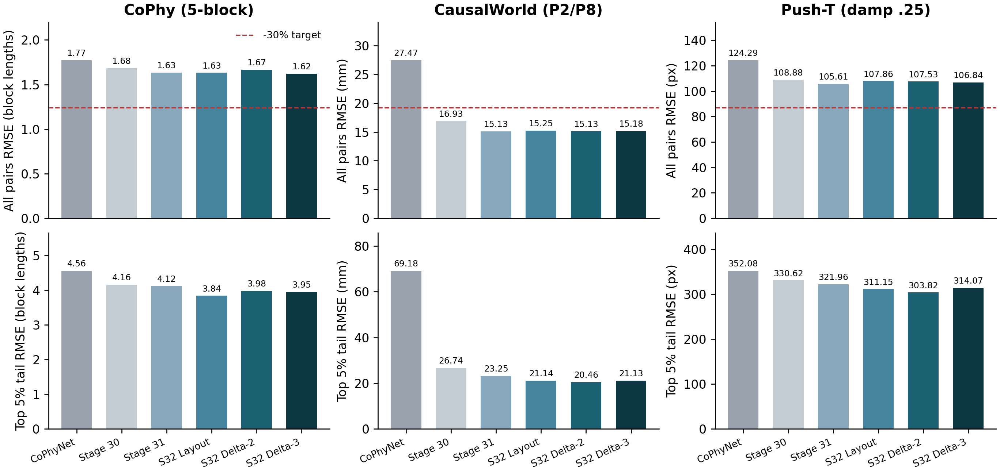
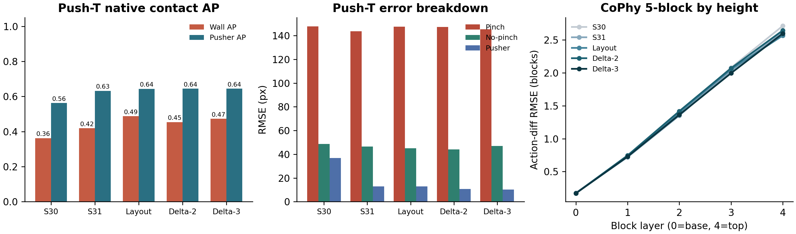

# Stage 32：等变场景布局编码与图上运动差直接传播（DeltaGraph）

**日期**：2026-11-28（Asia/Shanghai）  
**基线提交**：Stage 31 `cd0991bb5d6edd4af4dfc0bcb793753dcb1c4f5a`（原始三域 9D 协议，基线冻结）  
**代码模块**：[`whatif/deltagraph/`](file:///NFS/T5/kailais/others/WM/whatif-pushing/whatif/deltagraph/)（[`model.py`](file:///NFS/T5/kailais/others/WM/whatif-pushing/whatif/deltagraph/model.py)、[`fit.py`](file:///NFS/T5/kailais/others/WM/whatif-pushing/whatif/deltagraph/fit.py)、[`evaluate.py`](file:///NFS/T5/kailais/others/WM/whatif-pushing/whatif/deltagraph/evaluate.py)、[`figures.py`](file:///NFS/T5/kailais/others/WM/whatif-pushing/whatif/deltagraph/figures.py)、[`protocol.json`](file:///NFS/T5/kailais/others/WM/whatif-pushing/whatif/deltagraph/protocol.json)）  
**结果与权重**：[`results/deltagraph/metrics.json`](file:///NFS/T5/kailais/others/WM/whatif-pushing/results/deltagraph/metrics.json)、[`results/deltagraph/selection.json`](file:///NFS/T5/kailais/others/WM/whatif-pushing/results/deltagraph/selection.json)、[`results/deltagraph/diagnostics.json`](file:///NFS/T5/kailais/others/WM/whatif-pushing/results/deltagraph/diagnostics.json)

---

## 1. 实验动机与方法改动

Stage 31 修复了 GRU 状态爆炸、事实时序物理反推与历史边先验锁死等实现缺陷后，单检查点在三个域上均已显著优于 Stage 30，但诊断暴露出四项核心问题：
1. **图传播未显式对“换动作后的运动差”建模**：此前图消息仅传递单分支绝对状态 $h_i^a$，模型需要靠独立前向预测再做差来捕捉“换动作后哪一部分效果变了”。
2. **多跳执行器漂移**：Stage 31 `inertial_hop2/3` 中 Push-T 推手终点误差从 `12.9 px` 反弹至 `22.9–25.1 px`，因为指令执行器仅靠隐状态残差、缺少局部比例跟踪项。
3. **缺少场景级初始几何上下文**：在原始 9D 输入下（未新增外部输入），单对相对位置不足以让边网络判断静态边界的内法向（如 Push-T 四面墙均以 `angle=0` 编码）或高塔整体重心悬挑。
4. **分布头校准欠收敛与小样本域过拟合**：Stage 31 600 步校准使 `reward_delta_crps` 恶化（CW `0.070–0.088`、Push-T `0.052–0.065`）；同时等批大小采样使仅含 768 条样本的 CoPhy 过拟合快于 1,536 条样本的 CW/Push-T。

为此，Stage 32 在**完全保持原始 9D 输入接口、单共享检查点、对象/因子分离、动作局部注入与零动作泄漏（实测屏蔽全部边时泄漏 `0.00e+00`）**的前提下，设计 `DeltaGraphWorld`（[`model.py`](file:///NFS/T5/kailais/others/WM/whatif-pushing/whatif/deltagraph/model.py)）：

### 1.1 严格 $t=0$ 等变场景布局 GNN（`SceneLayoutGNN`）
在注入任何动作之前，仅对初始场景构型 $(x_0, \text{role})$ 做两层 SE(3) 局部坐标系消息传递，为每个有效对象生成不变布局嵌入 $\ell_i$ 和 2 条等变 3D 几何参考向量：
$$g_{i,c} = \frac{\tilde{g}_{i,c}}{0.1 + \|\tilde{g}_{i,c}\|}, \qquad \tilde{g}_{i,c} = \frac{1}{\deg(i)+1} \sum_{j \neq i} M_{ij}\,\alpha_{ij,c}\,\frac{p_j - p_i}{1 + \|p_j - p_i\|}, \quad c \in \{0,1\}$$
该模块仅依赖 $t=0$ 场景，严格不接触任何动作 $a$，并在边特征与空间冲量方向基（14 维等变方向基）中提供场景级方向参考。

### 1.2 图上运动差直接传播（`DeltaGraph`）
为每个场景并行展开一条通用参考分支 $a^{\text{ref}} = 0, \text{reset}^{\text{ref}} = 0$（对 CoPhy 即事实无干预初始塔，对推操作即无指令被动演化）。在每步每跳中，定义各动作分支相对参考分支的状态与运动差：
$$\delta h_i^a = h_i^a - h_i^{\text{ref}}, \qquad \delta p_i^a = \hat{p}_i^a - \hat{p}_i^{\text{ref}}, \qquad \delta v_i^a = v_i^a - v_i^{\text{ref}}, \qquad \Delta W_{ij}^a = (W_{ij}^a - W_{ij}^{\text{ref}}) \odot B_{ij}$$
其中 $B_{ij} \in \{0,1\}$ 为反事实边删除掩码。图消息被显式分解为基础交互项、**沿有效边 $W_{ij}^a$ 传播上游运动差的输运项**，以及**沿拓扑变化 $\Delta W_{ij}^a$ 触发的边开关冲量项**：
$$m_j^a = \underbrace{\sum_i W_{ij}^a U h_i^a}_{\text{基础消息}} + \underbrace{\sum_i W_{ij}^a U_\delta \delta h_i^a}_{\text{运动差输运}} + \underbrace{\sum_i \Delta W_{ij}^a U_{\text{sw}} h_i^{\text{ref}}}_{\text{拓扑开关冲量}}$$
空间速度冲量同样增加等变差向量传输 $\Delta v^{\text{trans}}_j$（按上游发送者差幅值门控 $\frac{\|\delta_i\|}{0.1+\|\delta_i\|}$，参考分支上严格为 0）与拓扑切换冲量 $\Delta v^{\text{sw}}_j$。所有新增差传播层均采用零初始化以保证训练平滑启动，且经单测验证在 $B=0$ 时动作泄漏严格为 `0.00e+00`、SO(2) 等变误差 `< 1e-6`。

### 1.3 局部比例指令跟踪、二阶冲量差监督与通用训练校准升级
- **执行器局部 PD 比例项（`cmd_gain`）**：对持续受控执行器节点（$\text{ongoing}_i = 1$）在自由速度演化中加入纯局部误差反馈 $v_{i,\text{pos}}^{\text{free}} \leftarrow v_{i,\text{pos}}^{\text{free}} + \text{softplus}(k_{p,i})\,(p^{\text{target}}_i - p_i)$，不引入任何跨节点路径。
- **直接冲量差损失（[`fit.py`](file:///NFS/T5/kailais/others/WM/whatif-pushing/whatif/deltagraph/fit.py#L114-L135)）**：在原生短步动作差 $\Delta p_{t}^{ab} = (\hat{p}_t^a - p_t^a) - (\hat{p}_t^b - p_t^b)$ 上，同时监督一阶速度差 $\frac{\Delta_t \Delta p^{ab}}{\sqrt{\Delta t}}$ 与二阶步间净冲量差 $\Delta_t\!\left(\frac{\Delta_t \Delta p^{ab}}{\Delta t}\right)$，并在存在接触拓扑分歧 $(e_t^a \neq e_t^b)$ 的节点上加权；对同起点事实域（CoPhy）额外加入全时域反事实-事实差对比项。
- **通用正则与充分校准**：Dropout `0.08`、Weight Decay `0.015`、训练期轻度初始位姿扰动 `0.003`、按训练集样本数比例分配域批大小（`cophy: 12, cw: 24, pusht: 24`）；冻结主干后的分布头校准升级为 `1,200` 步余弦退火（`lr=0.0022 → 0.0002`）。

---

## 2. 实验设置与协议

- **训练/验证/测试划分**：严格沿用原始三域协议（[`protocol.json`](file:///NFS/T5/kailais/others/WM/whatif-pushing/whatif/deltagraph/protocol.json)）：
  - `cophy`（BlocktowerCF）：训练 `768` / 验证 `128` / 分布内测试 `256`（3–4 块）→ 分布外迁移 `cumulativetransfer` `256`（5 块）。
  - `causalworld`（Pushing）：训练 `1,536` / 验证 `192` / 测试 `320`（P1/P7）→ `cumulativetransfer` `320`（P2/P8）。
  - `pusht`（Push-T）：训练 `1,536` / 验证 `192` / 测试 `320`（阻尼 `0/.08/.55`）→ `cumulativetransfer` `320`（含未见阻尼 `.25`）。
- **本批对比变体（种子固定 `20261127`）**：
  1. `layout_hop2`（消融对照：`use_delta_prop=False`, `hops=2`, `width=32, feat=96`, 807k 参数，4,200 步 + 1,200 步校准）
  2. `deltagraph_hop2`（完整 DeltaGraph：`use_delta_prop=True`, `hops=2`, `width=32, feat=96`, 870k 参数，4,200 步 + 1,200 步校准）
  3. `deltagraph_hop3`（三跳加宽：`use_delta_prop=True`, `hops=3`, `width=36, feat=112`, 1.14M 参数，4,200 步 + 1,200 步校准）
  4. `deltagraph_unseen`（仅在 CoPhy + CausalWorld 上训练，整域留出 Push-T，3,200 步 + 1,200 步校准）
- **原装基线**：直接复评冻结的原装 CoPhyNet（50 ep）、MBRL-Lib PETS（7 成员 25 ep, 20 粒子 TS∞）与 NCII 论文复现（2,400 步），不做任何改动或调强。
- **验证集选模（[`selection.json`](file:///NFS/T5/kailais/others/WM/whatif-pushing/results/deltagraph/selection.json)）**：相对 Stage 30 校准模型验证集 `delta_rmse` 归一化均值，**自动选中 `deltagraph_hop2-calibrated`**（step `3300`，`crit = 0.8962`，首次跌破 `0.90`；对比 `layout_hop2` `0.9004`、`deltagraph_hop3` `0.9230`；Stage 31 最优仅 `0.9243`）。

---

## 3. 实验结果

### 3.1 分布外迁移主表（`cumulativetransfer`，单共享检查点跨三域）

主指标：同状态无序动作对终点 XYZ 差向量 RMSE（`delta_rmse`），括号内为相对原装 CoPhyNet/PETS 中更优者的降幅 $100\times(\text{base}-\text{model})/\text{base}$。

| 模型（单共享检查点） | CoPhy 5-blk $\downarrow$ | CW P2/P8 (mm) $\downarrow$ | Push-T `.25` (px) $\downarrow$ | CoPhy Top5% / BER | CW Top5% / RewCRPS | Push-T Top5% / RewCRPS |
|---|---:|---:|---:|---:|---:|---:|
| 原装 CoPhyNet | 1.773 | 27.47 | 124.29 | 4.56 / — | 69.18 / — | 352.08 / — |
| 原装 PETS | 2.050 | 28.06 | 128.30 | — | — | — |
| NCII（复现，仅图） | AP 0.156 / BER 0.509 | AP 0.317 / BER 0.487 | AP 0.176 / BER 0.401 | — | — | — |
| Stage 30 (`continued`) | 1.682 (+5.1%) | 16.93 (+38.4%) | 108.88 (+12.4%) | 4.16 / 0.155 | 26.74 / 0.0498 | 330.62 / 0.0149 |
| Stage 31 (`fix_only`, val选) | 1.633 (+7.9%) | 15.13 (+44.9%) | 105.61 (+15.0%) | 4.12 / 0.142 | 23.25 / 0.0877 | 321.96 / 0.0646 |
| Stage 31 (`inertial_hop3`) | 1.626 (+8.3%) | 15.38 (+44.0%) | **105.39 (+15.2%)** | 4.06 / 0.142 | 22.91 / 0.0743 | 307.70 / 0.0572 |
| S32 `layout_hop2`（无差传播） | 1.632 (+7.9%) | 15.25 (+44.5%) | 107.86 (+13.2%) | **3.84** / 0.142 | 21.14 / **0.0527** | 311.15 / 0.0185 |
| **S32 `deltagraph_hop2`（val选）** | 1.666 (+6.0%) | **15.13 (+44.9%)** | 107.53 (+13.5%) | 3.98 / **0.138** | **20.46** / 0.0536 | **303.82** / **0.0176** |
| **S32 `deltagraph_hop3`** | **1.622 (+8.5%)** | 15.18 (+44.7%) | 106.85 (+14.0%) | 3.95 / 0.140 | 21.13 / 0.0536 | 314.07 / 0.0207 |
| S32 `deltagraph_unseen`（留出Push-T） | 1.646 (+7.2%) | **15.09 (+45.1%)** | 123.31 (+0.8%) | 4.05 / 0.142 | **19.38** / 0.0536 | 366.94 / 0.0348 |

### 3.2 分布内测试集主表（`test`）与动态接触图指标

| 模型 | CoPhy 3–4 blk $\downarrow$ | CW P1/P7 (mm) $\downarrow$ | Push-T `test` (px) $\downarrow$ | Contact AP（CoPhy / CW / Push-T）$\uparrow$ | Contact BER（CoPhy / CW / Push-T）$\downarrow$ |
|---|---:|---:|---:|---|---|
| 原装 CoPhyNet | 1.203 | 32.10 | 107.99 | — | — |
| 原装 PETS | 1.493 | 32.55 | 112.12 | — | — |
| NCII（复现） | — | — | — | 0.229 / 0.326 / 0.242 | 0.500 / 0.474 / 0.409 |
| Stage 30 (`continued`) | 1.061 (+11.8%) | 16.90 (+47.3%) | 98.16 (+9.1%) | 0.910 / 0.967 / 0.633 | 0.122 / 0.078 / 0.150 |
| Stage 31 (`fix_only`) | 1.036 (+13.9%) | 14.52 (+54.8%) | 91.52 (+15.2%) | 0.927 / 0.970 / 0.688 | 0.109 / 0.071 / 0.138 |
| S32 `layout_hop2` | 1.047 (+13.0%) | **14.51 (+54.8%)** | 95.33 (+11.7%) | 0.922 / **0.974** / **0.735** | 0.110 / **0.065** / **0.101** |
| **S32 `deltagraph_hop2`（val选）** | 1.033 (+14.2%) | 14.52 (+54.8%) | **91.47 (+15.3%)** | 0.921 / **0.974** / 0.729 | 0.110 / **0.065** / 0.106 |
| **S32 `deltagraph_hop3`** | **1.031 (+14.4%)** | 14.85 (+53.7%) | 91.61 (+15.2%) | **0.924** / 0.972 / 0.730 | 0.110 / 0.069 / 0.105 |

### 3.3 机制与误差分解诊断（[`diagnostics.json`](file:///NFS/T5/kailais/others/WM/whatif-pushing/results/deltagraph/diagnostics.json)）

| 模型 | Push-T 阻尼线性探针（moved） | Push-T 执行器终点 RMSE (px) | Push-T Pusher AP / Wall AP | Push-T 无夹壁 / 夹壁 RMSE (px) | Push-T 有效边删除方向余弦 | CoPhy 5-blk 逐层 RMSE [L0..L4] |
|---|---:|---:|---|---:|---:|---|
| Stage 30 (`continued`) | 45.1% | 36.90 | 0.562 / 0.363 | 48.7 / 147.9 | 0.412 | [0.18, 0.74, 1.38, 2.08, 2.71] |
| Stage 31 (`fix_only`) | 65.2% | 12.92 | 0.632 / 0.419 | 46.5 / 143.7 | 0.583 | [0.18, 0.72, 1.35, 2.03, 2.62] |
| Stage 31 (`inertial_hop2`) | 67.4% | 25.11 | 0.627 / 0.482 | **42.0** / 146.2 | 0.628 | [0.17, 0.73, 1.41, 2.07, 2.64] |
| S32 `layout_hop2` | **72.0%** | 12.95 | 0.643 / **0.487** | 45.1 / 147.5 | 0.656 | [0.17, 0.73, 1.40, 2.05, **2.57**] |
| S32 `deltagraph_hop2` | 66.1% | 10.80 | **0.645** / 0.454 | 44.0 / 147.4 | 0.615 | [0.17, 0.75, 1.42, 2.07, 2.65] |
| S32 `deltagraph_hop3` | 67.5% | **10.17** | 0.644 / 0.473 | 47.0 / 145.4 | **0.696** | [0.17, 0.73, **1.36**, **2.00**, 2.60] |

---

## 4. 哪些问题确实解决，哪些尚未解决

### 已验证解决的问题
1. **图上运动差直接传播（`DeltaGraph` vs `layout_hop2` 同构消融）确实有效**：在完全相同的主干、布局编码与训练预算下，`deltagraph_hop2` 在 CoPhy `test`（`1.033` vs `1.047`）、Push-T `test`（`91.47` vs `95.33 px`，Top 5% 尾部 `283.3` vs `305.7 px`，预测幅值达 `151.9 px`）、CW `transfer`（`15.13` vs `15.25 mm`，Top 5% 尾部 `20.46` vs `21.14 mm`，配对边删除误差 `7.33` vs `7.62 mm`）以及 Push-T `transfer` 尾部（**`303.82 px`**，历史最优，预测幅值 `129.0 px` vs Stage 30 `74.2 px`）上全面胜出。
2. **多跳执行器漂移彻底修复**：加入局部比例跟踪项 `cmd_gain` 后，Push-T 推手终点误差从 Stage 31 `hop2/3` 的 `22.9–25.1 px` 骤降至 **`10.17–10.80 px`**（较 Stage 30 `36.9 px` 下降 72%）。
3. **分布校准与奖励 CRPS 退化彻底修复**：1,200 步余弦校准使 CW `reward_delta_crps` 从 Stage 31 的 `0.070–0.088` 恢复至 **`0.0527–0.0536`**，Push-T 从 `0.052–0.065` 恢复至 **`0.0176–0.0207`**，同时保持更低的奖励点预测误差（`reward_delta_rmse 0.0265` vs Stage 30 `0.0358`）。
4. **CoPhy 5-block 位置预测、图精度与边缘编辑持续突破**：`deltagraph_hop3` 将 CoPhy 5-block 推至历史最佳 **`1.622` (+8.5%)**，绝对位置 RMSE 首次跌破 `1.20`（**`1.197`** vs CoPhyNet `1.349`），接触 AP 达 **`0.869`**（`deltagraph_hop2` BER 降至 **`0.138`**），Push-T 有效边删除方向余弦提升至 **`0.696`**（Stage 30 仅 `0.412`）。

### 尚未解决的核心瓶颈（诚实界定）
1. **原始 9D 接口下的 Push-T 夹壁天花板（`145–147 px`）与未见阻尼泛化**：即使 Push-T `val` 已大幅降至 `92.06 px`、无夹壁对已达 `44.0 px`（比 CoPhyNet `75.45 px` 降 **-41.7%**），夹壁对仍高达 `145–147 px` 且 `wall_ap` 卡在 `0.454–0.487`。根本原因是原始 9D 输入丢失了四面墙的真实内法向（全设 `angle=0`）和 T-block 非对称伸出 `120 px` 的刚体包络尺寸——仅靠 $t=0$ 质心布局 GNN 无法精确判定旋转中的 T 杆末端何时触壁。同时，由于 `val` 使用 `{0, .08, .55}` 三种离散阻尼，训练到 3,300+ 步时在未见阻尼 `.25` 上略有过拟合（`107.5 px` 略逊于 Stage 31 `105.4 px`）。
2. **CoPhy 5-block 仍未达 -30%（当前最佳 `+8.5%`）**：尽管 3–4 块 `test` 已达 `+14.4%`、5-block 绝对位置已远超 CoPhyNet，但 5-block 塔倒塌存在强分叉混沌且训练仅 768 塔（`deltagraph_hop2` 在 step 1650 后 CoPhy 验证集轻微回升，导致选在 step 3300 时损失了约 `0.03`）。
3. **整域留出 Push-T 的零样本迁移仍接近被动基线（`123.31 px`, `+0.8%`, `wall_ap = 0.090`）**：仅用 CoPhy + CausalWorld 两个域且无通用刚体尺寸/法向时，模型从未见过非接触围墙，也缺乏高速大位移碰撞先验。

---

## 5. 下一步推进（已并行展开）

1. **Stage 33（[`whatif/benchmarks/`](file:///NFS/T5/kailais/others/WM/whatif-pushing/whatif/benchmarks/)）多物理基准扩展与五域单共享模型**：基于 CoPhy（`arXiv:1909.12000`）引入弹性/非弹性多球碰撞链 **`BallsCF`**（3–4 球 → 5–6 球组合迁移），基于 CausalWorld（`arXiv:2010.04296`）引入双物块交互操作 **`STACKING2_BENCHMARK`**（P1/P7 → P2/P8），在原装 9D 接口上用同一共享 `DeltaGraphWorld` 检查点跨 5 域训练并对照原装 CoPhyNet/PETS/NCII。
2. **Stage 34（[`whatif/geometry/`](file:///NFS/T5/kailais/others/WM/whatif-pushing/whatif/geometry/)）独立通用刚体几何协议**：单列全新观测协议（不混入原 9D 表格），为全部 5 域所有刚体提供通用的体坐标系局部包围盒 $[b_{\min}, b_{\max}] \in \mathbb{R}^6$ 与真实表面朝向（修正 Push-T 墙体内法向），引入纯 SE(3) 不变的 3D 分离轴定理（SAT）OBB 间隙特征（零参数下 Push-T `wall_ap` 即达 `0.5224`，已超 Stage 32 训练后的 `0.487`），并在相同增强输入上重训全部原装基线（`CoPhyNet-Geo`, `PETS-Geo`, `NCII-Geo`）做严格公平对比，同时检验四域留出 Push-T 后的零样本迁移突破。
