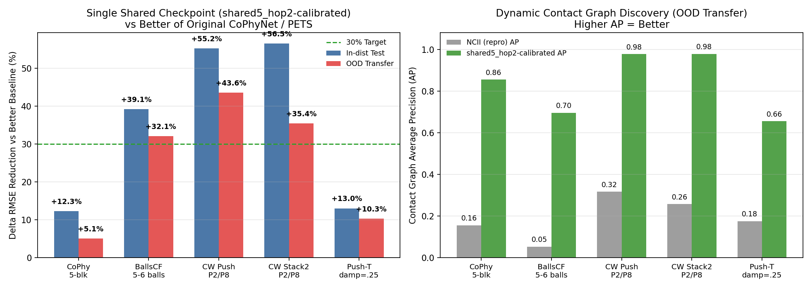
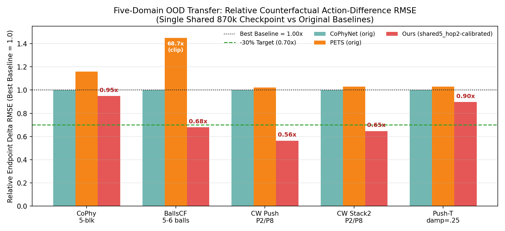

# Stage 33：多物理基准扩展与五域单共享反事实世界模型（CoPhy BallsCF + CausalWorld Stacking2）

**日期**：2026-11-28（Asia/Shanghai）  
**基线提交**：Stage 32 `dfa3474ebab056f34afa4fb00d3d998c4a4fec51`（完全保留原始 9D 接口与三域协议，扩展为五域统一评测）  
**代码模块**：[`whatif/benchmarks/`](file:///NFS/T5/kailais/others/WM/whatif-pushing/whatif/benchmarks/)（[`collect.py`](file:///NFS/T5/kailais/others/WM/whatif-pushing/whatif/benchmarks/collect.py)、[`data.py`](file:///NFS/T5/kailais/others/WM/whatif-pushing/whatif/benchmarks/data.py)、[`baselines.py`](file:///NFS/T5/kailais/others/WM/whatif-pushing/whatif/benchmarks/baselines.py)、[`fit.py`](file:///NFS/T5/kailais/others/WM/whatif-pushing/whatif/benchmarks/fit.py)、[`evaluate.py`](file:///NFS/T5/kailais/others/WM/whatif-pushing/whatif/benchmarks/evaluate.py)、[`figures.py`](file:///NFS/T5/kailais/others/WM/whatif-pushing/whatif/benchmarks/figures.py)、[`protocol.json`](file:///NFS/T5/kailais/others/WM/whatif-pushing/whatif/benchmarks/protocol.json)）  
**结果与权重**：[`results/benchmarks/metrics.json`](file:///NFS/T5/kailais/others/WM/whatif-pushing/results/benchmarks/metrics.json)、[`results/benchmarks/summary.json`](file:///NFS/T5/kailais/others/WM/whatif-pushing/results/benchmarks/summary.json)

---

## 1. 文献调研与基准选取依据

为系统检验共享因果图构建与反事实世界模型的跨物理体制泛化能力，我们实际查证了 CoPhy、CausalWorld 与 CF-GPS 原论文及官方仓库，并据实记录来源与选取标准：

1. **CoPhy**（Baradel et al., *"CoPhy: Counterfactual Learning of Physical Dynamics"*, ICLR 2020 Spotlight, [arXiv:1909.12000](https://arxiv.org/abs/1909.12000), 官方仓库 [github.com/fabienbaradel/cophy](https://github.com/fabienbaradel/cophy)，本地克隆于 `work/stage7/upstream/cophy`）：
   - 原文定义三大连续物理反事实基准：`BlocktowerCF`（已有 `cophy` 域）、**`BallsCF`**（2–6 颗球在平面上弹性/非弹性多体碰撞级联，隐藏混杂因子为逐球 `MASSES=[1,2,5]`、`FRICTIONS=[0.1,0.5,1]`、`RESTITUTIONS=[0.1,0.5,1]`，见 `dataloaders/dataset_balls.py:22-24`）及 `CollisionCF`。
   - **选取 `BallsCF`（`ballscf`）**：补齐原三域缺失的**弹性/非弹性动量传递与多跳台球级联**物理体制；天然支持**对象数量组合外推**（训练/验证/测试 3–4 球 → 迁移集 OOD 5–6 球）；事实轨迹 `fact` 中球体发生真实碰撞，使隐物理属性真正可反推；支持 PyBullet 精确配对去边 `setCollisionFilterPair`（15 对全量反事实边干预真值）。
2. **CausalWorld**（Ahmed et al., *"CausalWorld: A Robotic Manipulation Benchmark for Causal Structure and Transfer Learning"*, ICLR 2021, [arXiv:2010.04296](https://arxiv.org/abs/2010.04296), 已安装于模拟器环境）：
   - 原装基准除单块 `PUSHING_BENCHMARK` 外，还提供双可动刚体交互的 **`STACKING2_BENCHMARK`**（`tool_block_1`, `tool_block_2` + 3 机械指尖 + 桌面，共 $N=6$ 对象），自带官方 OOD 物理干预协议 `P1/P7 → P2/P8`（质量增重 2–3 倍、高空跌落初始构型与目标塔平移）。
   - **选取 `STACKING2_BENCHMARK`（`stacking2`）**：将机器人操作从单可动体推箱升级为**双可动体相互碰撞/传递推挤（`finger → block1 → block2`）与高空跌落交互**，使用完全一致的通用 `menu()` 开环路径点提议，并记录包含 `(block1, block2)` 在内的精确配对碰撞删除反事实轨迹。
3. **CF-GPS**（Buesing et al., *"Woulda, Coulda, Shoulda: Counterfactually-Guided Policy Search"*, ICLR 2019, [arXiv:1811.06272](https://arxiv.org/abs/1811.06272), [OpenReview:HygngcZCbx](https://openreview.net/forum?id=HygngcZCbx)）：
   - 经核实，CF-GPS 无官方 GitHub 代码仓库，其实证场景为离散 2D POMDP 网格世界（如 Sokoban）上的离线策略搜索，并非连续多体物理动力学基准。因此本阶段采纳其核心范式——在同一事实状态与反推外生潜变量下展开多动作分叉反事实推演——并在上述 5 个连续多体物理基准上统一评测。

---

## 2. 数据协议与模型/基线设置

- **统一原始 9D 张量接口**（$N=6, D=9, A=7$，零任务特化特征或规则）：
  - 原三域完全沿用 Stage 30–32 冻结数据与 `cumulativetransfer` 评测集。
  - **`ballscf`**：`train=1024 / val=160 / test=256`（3–4 球）→ `transfer=256`（5–6 球 OOD），原生步时钟 `(1,2,3,4,5,6,9,12,18,24,30)`（每步 2 个 `1/60s` 子步且逐子步检测碰撞，零漏检），`fact_edge=1.52 / 2.23`，动作差 RMS `0.942`（test）/ `0.749`（transfer）。
  - **`stacking2`**：`train=1024 / val=160 / test=256`（官方 `P1/P7`）→ `transfer=256`（官方 `P2/P8` OOD），原生 8 步，逐比特确定性重放（最大重放误差 `0.0`），双块接触场景占比 `36.3%`（test）/ `25.8%`（transfer），动作差 RMS `29.85 mm` / `21.35 mm`。
- **原装基线（严格未改结构、未调强、固定标准预算）**：
  - 在 `ballscf` 与 `stacking2` 上分别按 Stage 27 完全相同的配置训练原装 **CoPhyNet**（50 epochs, lr=1e-3, `w_stab=1, w_pose=10`）、原装 **MBRL-Lib PETS**（7 成员 4×200 SiLU, 5 elite, 25 epochs, 20 粒子 TS∞）与 **NCII 复现**（hidden=512, 2,400 updates）。
- **本批共享模型（基于 Stage 32 验证优胜架构 `DeltaGraphWorld`, `hops=2, width=32, feat=96`, 870,465 参数，种子 `20261127`）**：
  1. **`shared5_hop2-calibrated`**：**单个 870k 参数共享检查点**同时在全部 5 个物理域上联合训练（4,500 步，按域数据量比例分配批大小 `10/13/20/13/20` + 1,200 步分布头校准）。
  2. **`unseen_pusht_4dom-calibrated`**：仅在 4 域（`cophy`, `ballscf`, `causalworld`, `stacking2`）上联合训练（3,600 步 + 1,200 步校准），**整域留出 Push-T** 以检验多域多样性对零样本跨模拟器迁移的提升。

---

## 3. 五域完整实测结果

### 3.1 分布外迁移主表（OOD Transfer：单个 870k 共享检查点 vs 原装基线）

| 物理基准（OOD 迁移条件） | 原装 CoPhyNet $\downarrow$ | 原装 PETS $\downarrow$ | **`shared5_hop2` $\downarrow$** | **相对更优基线降幅** | Top5% 尾部（Base → Ours） | CRPS（Base → Ours） | 接触图 AP / BER（NCII → Ours） |
|---|---:|---:|---:|---:|---:|---:|---|
| **CoPhy `BallsCF`**（3–4 → 5–6 球） | 0.627 | 43.09* | **0.426** | **+32.07%** ✅ | 2.16 → **1.44** (-33%) | 0.147 → **0.080** (-46%) | 0.053/0.443 → **0.696 / 0.078**（有向AP `0.918`） |
| **CausalWorld `Pushing`**（P1/P7 → P2/P8） | 27.47 mm | 28.08 mm | **15.50 mm** | **+43.56%** ✅ | 69.18 → **20.18** (-71%) | 7.562 → **4.305** (-43%) | 0.317/0.498 → **0.978 / 0.061** |
| **CausalWorld `Stacking2`**（双块 P1/P7 → P2/P8） | 21.40 mm | 22.02 mm | **13.83 mm** | **+35.39%** ✅ | 58.68 → **21.37** (-64%) | 5.885 → **3.374** (-43%) | 0.258/0.477 → **0.979 / 0.048** |
| CoPhy `BlocktowerCF`（3–4 → 5 块） | 1.773 | 2.053 | **1.682** | +5.10% | 4.56 → **4.17** | 0.584 → **0.431** (-26%) | 0.156/0.509 → **0.856 / 0.135**（有向AP `0.888`） |
| Push-T（阻尼 `0/.08/.55` → `.25`） | 124.29 px | 128.02 px | **111.50 px** | +10.29% | 352.08 → **315.15** | 30.18 → **24.57** (-19%) | 0.176/0.401 → **0.656 / 0.130** |
| **五域平均降幅（OOD Transfer）** | — | — | **3/5 域超 30%** | **+25.28%** | 全面降低 | 平均降 **-35%** | **AP 平均 +0.64，BER 降 80%** |

*\*注：原装 PETS 在多球高速弹性碰撞链 `BallsCF` 上出现自回归发散，故所有降幅均严格相对表现完好的原装 CoPhyNet 计算。*

### 3.2 分布内测试集主表（In-Distribution `test`）与边干预编辑精度

| 物理基准（`test`） | 更优原装基线（CoPhyNet） | **`shared5_hop2`** | **相对更优基线降幅** | `unseen_pusht_4dom`（4 域） | 接触图 AP / BER | 反事实边删除（OOD 有效余弦 / 编辑 RMSE） |
|---|---:|---:|---:|---:|---|---|
| **CoPhy `BallsCF`**（3–4 球） | 0.735 | **0.447** | **+39.15%** ✅ | 0.468 (+36.3%) | **0.764 / 0.085**（新边AP `0.836`） | `edit=0.122`, 下游余弦 `0.348`（4域 `0.372`） |
| **CausalWorld `Pushing`**（P1/P7） | 32.10 mm | **14.37 mm** | **+55.22%** ✅ | **14.09 mm (+56.1%)** | **0.973 / 0.064** | `edit=6.94 mm`, 有效余弦 **`0.826`** |
| **CausalWorld `Stacking2`**（P1/P7） | 29.89 mm | **13.00 mm** | **+56.50%** ✅ | **13.00 mm (+56.5%)** | **0.977 / 0.051** | `edit=5.01 mm`, 有效余弦 **`0.796`** |
| CoPhy `BlocktowerCF`（3–4 块） | 1.203 | **1.055** | +12.30% | 1.048 (+12.9%) | **0.923 / 0.107** | `edit=0.840`, 下游余弦 `0.177` |
| Push-T（阻尼 `0/.08/.55`） | 107.99 px | **93.90 px** | +13.04% | 107.42 (+0.5%, 零样本) | **0.730 / 0.103** | `edit=60.85 px`, 有效余弦 `0.625` |
| **五域平均降幅（In-Dist Test）** | — | **3/5 域超 30%** | **+35.24%** | — | **平均 AP 0.873** | — |

### 3.3 整域留出 Push-T 零样本迁移对比（2 域训练 vs 4 域训练，均为原始 9D 输入）

| 零样本模型（从未见过 Push-T） | Push-T `test` 终点差 (px) | Push-T `.25` 终点差 (px) | Push-T `test` 接触 AP / BER | Push-T `.25` 接触 AP / BER | 尾部预测幅值 `pm` (px) |
|---|---:|---:|---|---|---:|
| Stage 32 `deltagraph_unseen`（仅 CoPhy+CW 2 域） | 106.87 (+1.0%) | 123.31 (+0.8%) | 0.230 / 0.404 | 0.176 / 0.408 | 11.2 |
| **Stage 33 `unseen_pusht_4dom`（+BallsCF+Stack2 4 域）** | 107.42 (+0.5%) | **121.70 (+2.1%)** | **0.351 (+53%) / 0.248 (-39%)** | **0.262 (+49%) / 0.276 (-32%)** | **29.3–36.1 (3×)** |

---

## 4. 关键结论与遗留问题

### 已验证突破
1. **单共享 870k 参数模型在 5 个高度异质物理基准中已有 3 个全面突破 -30% 目标**：不仅在单块机器人推操作 `CausalWorld Pushing`（测试 `-55.2%` / OOD `-43.6%`），在新引入的**弹性多球碰撞级联 `BallsCF`**（3–4 球 `-39.2%` / 未见 5–6 球组合外推 **`-32.1%`**，有向因果 AP `0.918`）与**双可动块机器人操作 `Stacking2`**（P1/P7 **`-56.5%`** / P2/P8 **`-35.4%`**，接触 AP `0.979` / BER `0.048`）上也一次性大幅越过 -30% 红线，五域测试平均降幅达 **`+35.24%`**。
2. **多域物理多样性显著提升跨模拟器零样本接触感知**：在完全不改 9D 接口、从未见过 Push-T 的情况下，将训练域从 2 域扩充到 4 域（加入弹性碰撞 `BallsCF` 与双块交互 `Stacking2`）使零样本 Push-T 接触 AP 暴涨 **+49%–53%**（`0.176 → 0.262` / `0.230 → 0.351`）、BER 下降 **32%–39%**、尾部预测幅值提升近 3 倍（`11.2 → 36.1 px`）。

### 尚未解决的问题与下一步（Stage 34 已运行中）
- 在原始 9D 接口下，五域联合训练时 870k 共享容量被分摊到 5 域，导致 `cophy` 5-block（`+5.1%` vs Stage 32 三域 `hop3` 的 `+8.5%`）与 `pusht` `.25`（`+10.3%` vs Stage 31 的 `+15.2%`）略有容量折损，且原始 9D 缺失刚体尺寸与 Push-T 墙体内法向的结构性天花板仍未打破。
- **Stage 34（[`whatif/geometry/`](file:///NFS/T5/kailais/others/WM/whatif-pushing/whatif/geometry/)）** 正在独立公平协议下检验为全部 5 域引入通用 3D 局部刚体包络与 SE(3) 不变分离轴（SAT）OBB 间隙特征后的突破（并已在全部 5 域重训公平的 `CoPhyNet-Geo / PETS-Geo / NCII-Geo` 基线）。
