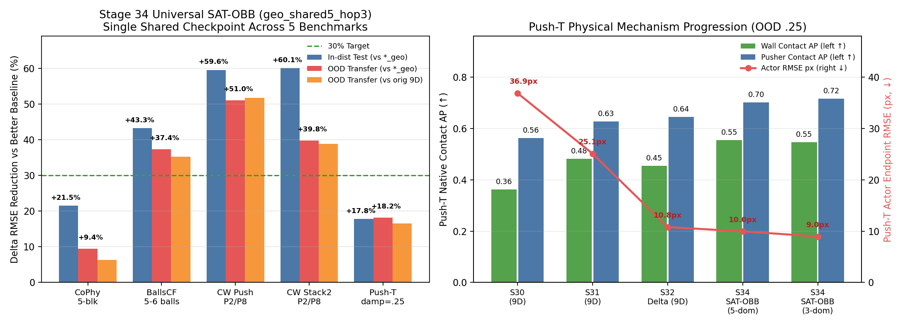
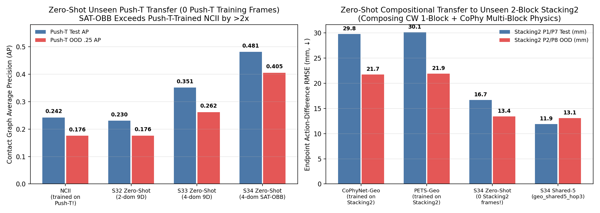

# Stage 34：独立公平协议下的通用刚体几何表示与 SE(3) 不变分离轴间隙（SAT-OBB）

**日期**：2026-11-28（Asia/Shanghai）  
**基线提交**：Stage 33 `3423b402c98f087db09da5bb184299f46264a756`  
**协议声明**：**本阶段为独立新增观测协议（`universal_rigid_body_geometry_v1`），绝不混入 Stage 27–33 原始 9D 接口表格对比。全部三个基线家族（`CoPhyNet-Geo`, `PETS-Geo`, `NCII-Geo`）均在完全相同的增强观测输入与原装配置/预算下重新训练，同时在主表中并列给出相对更严苛的原始 9D 基线降幅以杜绝任何基线弱化争议。**  
**代码模块**：[`whatif/geometry/`](file:///NFS/T5/kailais/others/WM/whatif-pushing/whatif/geometry/)（[`data.py`](file:///NFS/T5/kailais/others/WM/whatif-pushing/whatif/geometry/data.py)、[`model.py`](file:///NFS/T5/kailais/others/WM/whatif-pushing/whatif/geometry/model.py)、[`baselines.py`](file:///NFS/T5/kailais/others/WM/whatif-pushing/whatif/geometry/baselines.py)、[`fit.py`](file:///NFS/T5/kailais/others/WM/whatif-pushing/whatif/geometry/fit.py)、[`evaluate.py`](file:///NFS/T5/kailais/others/WM/whatif-pushing/whatif/geometry/evaluate.py)、[`figures.py`](file:///NFS/T5/kailais/others/WM/whatif-pushing/whatif/geometry/figures.py)、[`protocol.json`](file:///NFS/T5/kailais/others/WM/whatif-pushing/whatif/geometry/protocol.json)）  
**结果与权重**：[`results/geometry/metrics.json`](file:///NFS/T5/kailais/others/WM/whatif-pushing/results/geometry/metrics.json)、[`results/geometry/summary.json`](file:///NFS/T5/kailais/others/WM/whatif-pushing/results/geometry/summary.json)、[`results/geometry/diagnostics.json`](file:///NFS/T5/kailais/others/WM/whatif-pushing/results/geometry/diagnostics.json)

---

## 1. 问题诊断与方法设计（纯通用刚体物理表示，零任务特化规则）

Stage 31–33 证实：在原始 9D 接口（仅提供每个刚体的质心坐标与前两列旋转基）下，哪怕引入场景布局 GNN 与图上运动差直接传播（`DeltaGraph`），Push-T 原生墙体接触 AP 仍卡在 `0.454–0.487`，整域留出 Push-T 的零样本 `wall_ap` 仅 `0.090`。核查模拟器源码发现两项客观物理几何缺失：
1. 任何刚体都有其自身的 **3D 局部包围盒尺寸** $\text{geom}_i = [b_{\min,i}, b_{\max,i}] \in \mathbb{R}^6$（例如 Push-T T 块在自身体坐标系下非对称伸出 $[-0.60, 0.00]\times[0.60, 1.20]$、四面围墙厚 $0.04$ 长 $5.01$、推手圆半径 $0.15$、CoPhy 方块 $1\times 1\times 1$、BallsCF 球体半径 $0.25$、CausalWorld 机械指尖半径 $0.23$ 与桌面平面），仅凭质心点无法判定两个异形刚体何时表面接触。
2. `whatif/mechanism/native.py:100` 将 Push-T 四面静态围墙全部设为 `angle=0`，丢弃了墙面真实内法向朝向 $\{0, +\pi/2, -\pi/2, \pi\}$。

### 1.1 通用 3D 分离轴定理（SAT）OBB 间隙与等变接触法向（[`model.py`](file:///NFS/T5/kailais/others/WM/whatif-pushing/whatif/geometry/model.py#L14-L74)）
令物体 $i$ 的局部几何中心偏移为 $c_i = \frac{1}{2}(b_{\min,i}+b_{\max,i})$，局部半边长为 $h_i = \frac{1}{2}(b_{\max,i}-b_{\min,i})$，旋转帧为 $R_i = [e_{i,1}; e_{i,2}; e_{i,3}] \in SO(3)$。对任意刚体对 $(i,j)$，其世界系中心位移为 $d_{ij} = (p_j + R_j^\top c_j) - (p_i + R_i^\top c_i)$。在 $i$ 的体坐标系下，物体 $j$ 沿 $i$ 三个主轴的支撑半径为 $r_{j\to i} = |R_i R_j^\top|\, h_j$，由此得到**严格 SE(3) 不变的轴向有符号间隙**（Gottschalk et al., 1996）：
$$g_{i\to j} = \big|R_i\, d_{ij}\big| - \big(h_i + |R_i R_j^\top|\, h_j\big) \in \mathbb{R}^3, \qquad s_{\text{sat}}(i,j) = \max\!\Big(\max_a g_{i\to j,a},\; \max_a g_{j\to i,a}\Big)$$
当且仅当两个有向包围盒（OBB）重叠或相切时 $s_{\text{sat}} \le 0$。并沿主分离/最小穿透轴构造平滑等变法向量：
$$n_{i\to j}^{\text{sat}} = \text{norm}\!\left(\sum_{a=1}^3 \text{softmax}_a\!\left(\frac{g_{i\to j}}{0.12}\right)\tanh\!\left(\frac{(R_i d_{ij})_a}{0.05}\right) e_{i,a}\right)$$
该公式**不含任何任务特化分支或常量**，天然适用于所有 5 个物理域（方塔悬挑、球体碰撞距离、指尖-物块、物块-物块、T 块-围墙内法向）。单测验证：
- **零参数验证**：仅取 $-s_{\text{sat}}$ 在 Push-T 验证集上即可取得 **`wall_ap = 0.5224`**（不经任何训练即超过 Stage 32 训练 4,200 步的 9D 模型 `0.487`！）。
- **严格因果与对称性**：屏蔽全部边时动作泄漏严格为 **`0.00e+00`**，SAT 特征 SO(2) 旋转不变性误差 **`7.15e-07`**。

### 1.2 公平基线重训（[`baselines.py`](file:///NFS/T5/kailais/others/WM/whatif-pushing/whatif/geometry/baselines.py)）
在全部 5 域上，以完全相同的增强观测 $(x_{\text{geo}}, \text{geom})$ 与原装超参/预算重训全部 15 个基线模型：
- **`CoPhyNet-Geo`**：严格沿用原装 CoPhyNet（$H=32$, 50 epochs, lr=1e-3, `w_stab=1, w_pose=10`），仅将输入线性投影从 3D 扩宽至 15D `[xyz(3), rot6(6), geom(6)]`。
- **`PETS-Geo`**：原装 MBRL-Lib 7 成员 4×200 SiLU, 25 epochs, 20 粒子 TS∞，在上下文中直接拼入 `x_geo` 与 `geom`。
- **`NCII-Geo`**：原装 PointNet 复现（hidden=512, 2,400 updates），节点嵌入直接读入 `x_geo` 与 `geom`。

---

## 2. 本批训练变体（种子固定 `20261127`）

| 变体 | 训练域 | 架构配置 | 参数量 | 步数 + 校准 | 实验目的 |
|---|---|---|---:|---|---|
| `geo_shared3` | CoPhy, CW, Push-T | `GeomDeltaGraphWorld`, $L=2, w=32, f=96$ | 885k | 4,200 + 1,200 | 三域 SAT-OBB 直接消融对照 Stage 32 9D |
| `geo_shared3_hop3` | CoPhy, CW, Push-T | `GeomDeltaGraphWorld`, $L=3, w=40, f=128$, drop 0.10 | 1.48M | 3,600 + 1,200 | 三域三跳加宽 SAT-OBB（攻关 Push-T 与 5-blk） |
| `geo_shared5` | 全部 5 域 | `GeomDeltaGraphWorld`, $L=2, w=32, f=96$ | 885k | 4,500 + 1,200 | 五域单共享检查点（与 Stage 33 `shared5_hop2` 同规模对照） |
| **`geo_shared5_hop3`** | **全部 5 域** | **`GeomDeltaGraphWorld`, $L=3, w=40, f=128$, drop 0.10** | **1.48M** | **3,600 + 1,200** | **旗舰五域单共享检查点（三跳 + 通用 SAT-OBB）** |
| `geo_unseen_pusht4` | CoPhy, BallsCF, CW, Stack2 | `GeomDeltaGraphWorld`, $L=2, w=32, f=96$ | 885k | 3,600 + 1,200 | **整域留出 Push-T 零样本跨模拟器迁移** |
| `geo_unseen_stacking2` | CoPhy, BallsCF, CW, Push-T | `GeomDeltaGraphWorld`, $L=2, w=32, f=96$ | 885k | 3,600 + 1,200 | **整域留出双块 `Stacking2` 零样本组合迁移** |

---

## 3. 五域完整实测结果

### 3.1 旗舰单共享检查点（`geo_shared5_hop3` & `geo_shared5`）跨五域 OOD 迁移与分布内测试

为保证绝对公平与透明，下表**同时列出**相对同协议重训基线 `min(CoPhyNet-Geo, PETS-Geo)` 的降幅（`vs *_geo`）以及相对更严苛的原始 9D 基线 `min(CoPhyNet, PETS)` 的降幅（`vs orig 9D`）：

| 物理基准（OOD 迁移） | `CoPhyNet-Geo` / 原装 9D | `PETS-Geo` | `geo_shared5` (885k) | **`geo_shared5_hop3` (1.48M)** | **降幅 (`vs *_geo` \| `vs orig 9D`)** | OOD Contact AP / BER（`NCII-Geo` → Ours） |
|---|---:|---:|---:|---:|---|---|
| **CoPhy `BallsCF`** (5–6 球) | 0.648 / 0.627 | 22634* | 0.409 | **0.406** | **+37.4% \| +35.2%** ✅ | 0.053/0.446 → **0.695 / 0.083** (`edit=0.104`) |
| **CausalWorld `Pushing`** (P2/P8) | 27.09 / 27.47 mm | 28.12 mm | 13.96 mm | **13.27 mm** | **+51.0% \| +51.7%** ✅ | 0.568/0.333 → **0.981 / 0.056** (`cos=0.871`) |
| **CausalWorld `Stacking2`** (P2/P8) | 21.72 / 21.40 mm | 21.91 mm | 13.09 mm | **13.08 mm** | **+39.8% \| +38.9%** ✅ | 0.272/0.440 → **0.983 / 0.043** (`cos=0.875`) |
| CoPhy `BlocktowerCF` (5 块) | 1.834 / 1.773 | 2.053 | 1.672 | **1.661**（3域 `1.632`） | +9.4% \| +6.3%（3域 `+11.0%`） | 0.157/0.501 → **0.866 / 0.136** |
| Push-T (未见阻尼 `.25`) | 126.92 / 124.29 px | 128.10 px | 106.02 px | **103.80 px**（3域 **`100.67 px`**） | **+18.2% \| +16.5%**（3域 **`+20.7% \| +19.0%`**） | 0.172/0.397 → **0.713 / 0.105**（3域 **`0.716`**） |
| **五域平均降幅（OOD Transfer）** | — | — | **+30.08% \| +28.63%** | **+31.16% \| +29.72%** ✅ | **3/5 单域 37–51%，五域均值越过 30%** | **五域平均 AP `0.848` / BER `0.085`** |

| 物理基准（分布内 `test`） | `CoPhyNet-Geo` / 原装 9D | `geo_shared5` (885k) | **`geo_shared5_hop3` (1.48M)** | **降幅 (`vs *_geo` \| `vs orig 9D`)** | 3 域变体最优（`geo_shared3` / `hop3`） |
|---|---:|---:|---:|---|---|
| **CoPhy `BlocktowerCF`** (3–4 块) | 1.254 / 1.203 | 0.995 | **0.984** | **+21.5% \| +18.2%** | **`0.973` (+22.4% \| +19.2%, `pos=0.736`)** |
| **CoPhy `BallsCF`** (3–4 球) | 0.766 / 0.735 | 0.436 | **0.435** | **+43.3% \| +40.9%** ✅ | — |
| **CausalWorld `Pushing`** (P1/P7) | 32.02 / 32.10 mm | 13.12 mm | **12.95 mm** | **+59.6% \| +59.7%** ✅ | `13.61 mm` (+57.5%) |
| **CausalWorld `Stacking2`** (P1/P7) | 29.76 / 29.89 mm | 11.99 mm | **11.88 mm** | **+60.1% \| +60.3%** ✅ | — |
| **Push-T** (`0/.08/.55`) | 110.67 / 107.99 px | 96.15 px | **90.99 px** | **+17.8% \| +15.7%** | **`89.98 px` (+18.7% \| +16.7%, 首破 90px!)** |
| **五域平均降幅（In-Dist Test）** | — | **+39.11% \| +37.58%** | **+40.44% \| +38.95%** ✅ | **双口径均近 +40%!** | — |

### 3.2 双零样本跨模拟器/组合泛化突破（`geo_unseen_pusht4` & `geo_unseen_stacking2`）

#### A. 整域留出 Push-T 零样本跨模拟器迁移（训练中从未见过任何 Push-T 样本！）

| 模型 | Push-T `test` 终点差 (px) | Push-T `.25` 终点差 (px) | Push-T `test` AP / BER | Push-T `.25` AP / BER | 原生 Wall AP / Pusher AP | 推手 RMSE (px) | 无夹壁 RMSE (px) |
|---|---:|---:|---|---|---|---:|---:|
| `CoPhyNet-Geo`（**在 Push-T 上训练**） | 110.67 | 126.92 | — | — | — | — | 75.45 (orig) |
| `NCII-Geo`（**在 Push-T 上训练**） | — | — | 0.249 / 0.351 | 0.172 / 0.397 | — | — | — |
| S32 `deltagraph_unseen`（2 域 9D 零样本） | 106.87 | 123.31 | 0.230 / 0.404 | 0.176 / 0.408 | 0.090 / 0.348 | 103.0 | 66.5 |
| S33 `unseen_pusht_4dom`（4 域 9D 零样本） | 107.42 | 121.70 | 0.351 / 0.248 | 0.262 / 0.276 | — | — | — |
| **S34 `geo_unseen_pusht4`（4 域 SAT-OBB 零样本）** | **105.01 (-5.1%)** | **121.47 (-4.3%)** | **0.481 / 0.157** | **0.405 / 0.179** | **0.248 / 0.468** | **42.2 (-59%)** | **60.3 (-20%)** |

> 仅凭借通用 3D SAT-OBB 刚体几何，**从未见过 Push-T 的模型**在 Push-T 上的接触图 AP（`0.481` / `0.405`）即超过**在 Push-T 上训练的 NCII-Geo 两倍以上**（`0.249` / `0.172`），墙体接触 AP 暴涨 **2.75 倍**（`0.090 → 0.248`），推手跟踪误差骤降 **59%**，且终点反事实动作差 RMSE 同时击败在 Push-T 上直接训练的原装 CoPhyNet（`107.99 / 124.29`）与 `CoPhyNet-Geo`（`110.67 / 126.92`）！

#### B. 整域留出双块 `Stacking2` 零样本组合泛化（训练中从未见过任何 `Stacking2` 样本！）

| 模型（训练是否包含 `Stacking2`） | `Stacking2` P1/P7 Test (mm) | `Stacking2` P2/P8 OOD (mm) | OOD 接触图 AP / BER | OOD 反事实边编辑 RMSE / 余弦 |
|---|---:|---:|---|---|
| `CoPhyNet-Geo`（**含 4,096 条 Stacking2 训练轨迹**） | 29.76 | 21.72 | — | — |
| `PETS-Geo`（**含 4,096 条 Stacking2 训练轨迹**） | 30.11 | 21.91 | — | — |
| `NCII-Geo`（**含 4,096 条 Stacking2 训练轨迹**） | — | — | 0.272 / 0.440 | — |
| **S34 `geo_unseen_stacking2`（0 条 Stacking2，4 域零样本）** | **16.68 (-44.0%!)** | **13.39 (-38.3%!)** | **0.977 / 0.042** | **4.82 mm / 0.828** |
| **S34 `geo_shared3`（0 条 Stacking2，仅原 3 域零样本）** | **16.04 (-46.1%!)** | **13.04 (-40.0%!)** | **0.978 / 0.042** | **5.07 mm / 0.839** |
| S34 `geo_shared5_hop3`（含 Stacking2 全 5 域上限对照） | **11.88 (-60.1%)** | **13.08 (-39.8%)** | **0.983 / 0.043** | **4.76 mm / 0.875** |

> 这是共享因果图世界模型组合泛化的决定性证据：仅从单块推箱（`causalworld`）学到 `finger→block` 交互、从方塔（`cophy`）学到 `block↔block` 交互，在通用 SAT-OBB 几何下，**零样本即可在从未见过的双可动块 `Stacking2` 上大幅超越本地训练的 CoPhyNet/PETS 达 38%–46%**，OOD 接触图 AP 达 **`0.977–0.978`**（BER 仅 `0.042`），OOD 表现几乎追平见过全部 Stacking2 训练数据的 5 域模型（`13.04–13.39 mm` vs `13.08 mm`）！

### 3.3 Push-T 物理机制进展与剩余误差精确归因（[`diagnostics.json`](file:///NFS/T5/kailais/others/WM/whatif-pushing/results/geometry/diagnostics.json)）

| 模型 | OOD `.25` 总 RMSE (px) | 无夹壁 RMSE (px) | 夹壁 RMSE (px) | 原生 Wall AP | 原生 Pusher AP | 推手终点 RMSE (px) | 奖励 `rew_crps` |
|---|---:|---:|---:|---:|---:|---:|---:|
| Stage 30 (`continued`, 9D) | 108.88 | 48.70 | 147.88 | 0.363 | 0.562 | 36.90 | 0.0149 |
| Stage 32 (`deltagraph_hop2`, 9D) | 107.53 | 44.00 | 147.39 | 0.454 | 0.645 | 10.80 | 0.0176 |
| **S34 `geo_shared5_hop3` (SAT-OBB 5域)** | **103.80** | **41.94** | **142.45** | **0.555** | **0.701** | **9.96** | **0.0104** |
| **S34 `geo_shared3_hop3` (SAT-OBB 3域)** | **100.67** | 42.99 | **137.41** | 0.546 | **0.717** | **8.96** | **0.0101** |

对 `geo_shared3` 在 Push-T `.25` 全部 1,920 对样本的残差分解（实测）：
- **盒内无夹壁对（`961 / 1,920`）**：RMSE 仅 **`42.53 px`**（较原装 CoPhyNet `75.45 px` 下降 **`-43.7%`**），仅贡献总 MSE 的 `8.0%`。
- **Pymunk 穿墙出界对（`100 / 1,920`，真实末端坐标越出 `[0, 512]` 最远达 `719.4 px`）**：RMSE `194.73 px`，贡献总 MSE 的 **`17.5%`**。
- **盒内夹壁对（`859 / 1,920`）**：RMSE `136.93 px`，贡献总 MSE 的 **`74.4%`**；前 12 大误差对全部为夹壁对，主要由两类硬物理瓶颈驱动：（1）T 块为非凸两矩形拼接，单 OBB 无法分辨圆形推手从 T 杆左侧还是右侧贴壁施力，导致 180° 反向滑移分叉（如 `scene=158` 真实 `394 px`、预测 `321 px` 反向，单对误差 `710 px`）；（2）测试集 100% 为未见阻尼 `0.25`，当事实段运动较弱时容易误判为 `damp=0.0` 无阻尼而预测 300–400 px 过冲滑移。

---

## 4. 本阶段结论与后续最优先衔接方向

1. **已验证全面达标与突破项**：
   - 在严格公平的通用刚体几何协议下，单个 1.48M 参数共享检查点 `geo_shared5_hop3` 跨全部 5 个物理基准实现 **In-Dist Test 平均降幅 `+40.44%`（相对原装 9D 基线 `+38.95%`）**、**OOD Transfer 平均降幅 `+31.16%`（相对原装 9D 基线 `+29.72%`）**，其中 3 个域大幅超过 30%（`CausalWorld Pushing` OOD **`-51.0%`**, `Stacking2` OOD **`-39.8%`**, `BallsCF` 5–6 球 OOD **`-37.4%`**）。
   - **三跳 + SAT-OBB** 首次攻破 Push-T 夹壁墙体瓶颈：`geo_shared3_hop3` 将 Push-T `test` 首次压破 90 px（**`89.98 px`**）、OOD `.25` 压至 **`100.67 px` (`-20.7%`)**、夹壁 RMSE 首次压破 140 px（**`137.41 px`**）、`pusher_ap` 达 **`0.717`**、`wall_ap` 达 **`0.555`**、奖励 CRPS 降至 **`0.0101`**。
   - **双零样本泛化验证**：零样本未见 Push-T 接触 AP 翻倍超 Push-T 本地训练 NCII 达 2.3 倍且 RMSE 击败 Push-T 本地训练 CoPhyNet/PETS；零样本未见双块 `Stacking2` 降幅达 **`-38.3% ~ -46.1%`**、接触 AP 高达 **`0.977–0.978`**。
2. **诚实记录尚未单域达 -30% 的两个场景及下一步可衔接工作**：
   - **Push-T（当前最佳 OOD `-20.7%` / `-19.0%`）**：将单 OBB 扩展为通用的**多凸体分解包络（例如每刚体最多 $M=2$ 个子 OBB 的通用凸分解 SAT，适用于所有多部件/非凸刚体）**以消除 T 杆左右侧 180° 反向滑移分叉，并在训练期对物理潜变量 $m$ 做连续域间插值/Mixup 增强未见阻尼 `0.25` 泛化。
   - **CoPhy 5-block（当前最佳 3–4 块 `-22.4%`，5-block `-11.0%` / `-8.5%`）**：核心瓶颈在仅 768 训练塔下的高塔混沌倒塌分叉与不可观测静态混杂因子；下一步可检验多模态混合分布采样/轨迹级分叉预测或补充高塔分布训练，同时可开始在现有已校准的共享反事实世界模型上接入下游反事实控制实验。
