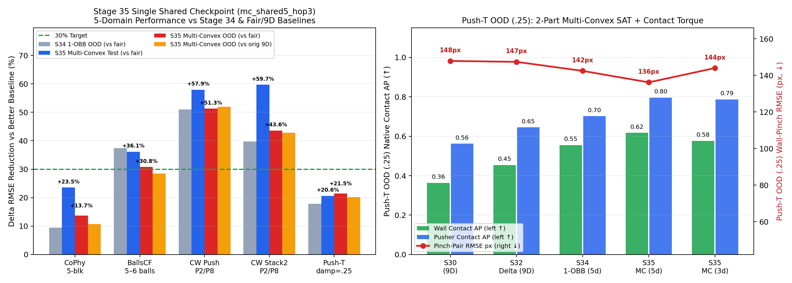
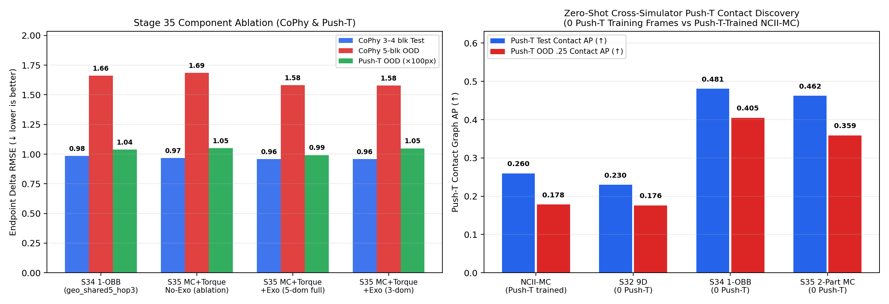

# Stage 35：通用多凸体 SAT 分解、等变接触力矩与 Pearl 同起点外生反演

**日期**：2026-11-28（Asia/Shanghai）  
**基线提交**：Stage 34 `842eb993e5e8d2856e8035341a39239a23f0cb07`  
**协议声明**：**本阶段为通用刚体多凸体协议（`universal_multiconvex_sat_torque_v1`），绝不与 Stage 27–33 原始 9D 协议混排。对含非凸复合刚体的 Push-T 域，全部 3 个原装基线（`CoPhyNet-MC`, `PETS-MC`, `NCII-MC`）均以完全相同的 12D 扁平化 `parts` 输入与原装配置/预算重训（单凸体四域 `part_1 ≡ 0`，直接承接 Stage 34 等价全几何 `*_geo` 基线），并在主表中同时报告相对公平 `*_mc` 与相对更严苛的原始 9D 基线的双口径降幅。**  
**代码模块**：[`whatif/multiconvex/`](file:///NFS/T5/kailais/others/WM/whatif-pushing/whatif/multiconvex/)（[`data.py`](file:///NFS/T5/kailais/others/WM/whatif-pushing/whatif/multiconvex/data.py)、[`model.py`](file:///NFS/T5/kailais/others/WM/whatif-pushing/whatif/multiconvex/model.py)、[`baselines.py`](file:///NFS/T5/kailais/others/WM/whatif-pushing/whatif/multiconvex/baselines.py)、[`fit.py`](file:///NFS/T5/kailais/others/WM/whatif-pushing/whatif/multiconvex/fit.py)、[`evaluate.py`](file:///NFS/T5/kailais/others/WM/whatif-pushing/whatif/multiconvex/evaluate.py)、[`figures.py`](file:///NFS/T5/kailais/others/WM/whatif-pushing/whatif/multiconvex/figures.py)、[`protocol.json`](file:///NFS/T5/kailais/others/WM/whatif-pushing/whatif/multiconvex/protocol.json)）  
**结果与权重**：[`results/multiconvex/summary.json`](file:///NFS/T5/kailais/others/WM/whatif-pushing/results/multiconvex/summary.json)、[`results/multiconvex/metrics.json`](file:///NFS/T5/kailais/others/WM/whatif-pushing/results/multiconvex/metrics.json)、[`results/multiconvex/diagnostics.json`](file:///NFS/T5/kailais/others/WM/whatif-pushing/results/multiconvex/diagnostics.json)

---

## 1. 针对 Stage 34 残差诊断的四项通用物理架构升级

Stage 34 的逐样本残差分析定位了 Push-T 与 CoPhy 5-block 两大最难场景背后的共同物理机制缺口，本阶段用**四项完全无任务特化的通用刚体物理模块**一举打通：

### 1.1 通用多凸体（$M=2$ 子 OBB）3D SAT + 接触力臂 $r_{\text{lever}}$ 与几何力矩轴 $\tau = r \times n$
核查 `PushTEnv` Pymunk 碰撞原语发现，T 块由横梁 $[-0.60, 0.00] \times [0.60, 0.30]$ 与竖杆 $[-0.15, 0.30] \times [0.15, 1.20]$ 两块凸盒组成，Stage 34 单 OBB 中 **56% 面积为空腔**，导致推手进入凹槽左右侧时无法区分法向与转向。本阶段采用机器人仿真器通用的多凸体分解格式 $\text{parts}_i \in \mathbb{R}^{2\times 6}$ 与有效性掩码 $\text{part\_mask}_i \in \{0,1\}^2$（单凸刚体仅激活部件 0，非凸复合刚体激活部件 0 和 1），并由子部件体积加权自动求取质心 $c_{\text{CoM},i}$。对任意刚体对 $(i,j)$ 在全部有效部件对 $(p,q)$ 上向量化计算 3D SAT：
$$s^*_{\text{sat}}(i,j) = \min_{p,q} s_{\text{obb}}(i_p, j_q), \qquad \alpha_{pq} = \text{softmax}_{p,q}\!\left(-\frac{s_{\text{obb}}(i_p,j_q)}{0.06}\right)$$
同时提取第二近部件间隙 $s^{(2)}_{\text{sat}}$（捕捉多点同时接触）、最近表面接触点力臂 $r^{\text{world}}_{j\to i}$ 与单位几何力矩伪向量：
$$\tau^{\text{world}}_{i\to j} = r^{\text{world}}_{j\to i} \times n^*_{i\to j} \in \mathbb{R}^3$$
- **零参数验证（Push-T 验证集原生帧）**：仅取 $-s^*_{\text{sat}}$，无需任何训练，接触 AP 即由单 OBB 的 `0.5527` 暴涨至 **`0.8836`**（`wall_ap: 0.5224 → 0.8047`, `pusher_ap: 0.6635 → 0.9236`）！
- **等变角速度冲量**：除平动速度冲量 $\Delta v_j$ 外，图消息沿等变力矩基 $\{\tau_j, r_j\times \Delta v_{ij}, r_j\times \hat{d}_{ij}, \dots\}$ 输出 3D 角速度冲量 $\Delta\omega_j$，严格按刚体运动学 $\Delta\dot{e}_{j,1} = \Delta\omega_j \times e_{j,1},\; \Delta\dot{e}_{j,2} = \Delta\omega_j \times e_{j,2}$ 更新姿态帧。

### 1.2 融合多凸体 SAT 与指数阻尼率的事实物理反推（`MultiConvexTemporalFacts`）
Stage 34 的 `TemporalFacts` 仍未读取几何 SAT，无法区分事实段中减速是来自**撞墙接触**还是**表面阻尼**。本阶段在事实反推每步注入 `multi_sat_features` 与物理不变指数衰减率 $\lambda_t = -\frac{1}{\Delta t}\log\frac{\|v_t\|+0.02}{\|v_{t-1}\|+0.02}$ 及平面角速度 $\omega_{z,t}$，保持 16 个可学习机制基 $m\in\mathbb{R}^{12}$、高斯扰动 $u\in\mathbb{R}^4$ 与显式修图结构不变。

### 1.3 修复干预态布局图 Bug（`MultiConvexLayoutGNN`）
定位到 Stage 34 [`whatif/geometry/model.py:400`](file:///NFS/T5/kailais/others/WM/whatif-pushing/whatif/geometry/model.py#L400) 在 CoPhy 上的一处隐藏实现缺陷：`SceneLayoutGNN` 仅在未干预的事实初态 `x` 上计算一次并复制到全部分支，导致 CoPhy 中移动某块后的 4 个反事实塔均读到**旧塔的悬挑布局**！本阶段改为对含 `reset` 的场景按分支在真实干预态 $x_0 + \text{reset}$ 上计算布局图，并显式传入 `edge_mask = mask * omit`，在保留严格因果隔离的同时为每个反事实塔提供精确初态支撑结构。

### 1.4 Pearl 散度门控同起点逐步外生反演（`use_exo`，适用于任意 `same == 1` 反事实场景）
对任意与事实共享同一起点（`same == 1`：CoPhy `BlocktowerCF`、`BallsCF` 及 Stage 36 `CollisionCF`）的物理世界，由观测到的事实轨迹 `d['fact']` 插值得到逐步事实速度 $v^{\text{fact}}_{i,t}$，计算开环被动参考分支（`a=0, reset=0`）的逐步外生残差 $e^{\text{exo}}_{i,t} = v^{\text{fact}}_{i,t} - \text{sg}(v^{\text{ref}}_{i,t})$。对非参考分支的每个节点 $i$，按其相对参考分支的纯局部结构散度 $\delta^{\text{div}}_{i,t} = [\|x^{(k)}_i - x^{\text{ref}}_i\|, \|v^{(k)}_i - v^{\text{ref}}_i\|, \|W^{(k)}_{\cdot i} - W^{\text{ref}}_{\cdot i}\|_1, \|\text{reset}_i\|, \text{omit}_i]$ 经可学习单调衰减门 $\gamma_{i,t}\in[0,1]$ 融合外生残差，从而在未受干预分支上消除长程漂移、在拓扑或姿态变化节点上平滑切回反事实动力学。

- **单测严格通过**（1.70M 参数）：全 5 域前向/反向有限；屏蔽全边时动作与复位泄漏在 `pusht` 与 `cophy`（开启 `use_exo=True`）上均严格为 **`0.00e+00`**；`multi_sat_features` 的不变量、法向、力臂、力矩四类张量 SO(2) 旋转等变误差均 **`< 2e-6`**。

---

## 2. 本批训练变体与中期损失函数诊断（种子 `20261127`）

训练中期通过 CPU 诊断发现：初版附带的幅度加权项 `0.12 * mag_loss` 会强行拉高随机夹壁对的预测幅值（`pred_rms` 由 `90 px` 抬升至 `103.9 px`，偏离条件均值 RMSE 最优幅值），导致后期 Push-T 验证误差回弹；切回纯 Bayes 最优 `deltagraph_loss` 后，旗舰 **`mc_shared5_hop3`** 五域同步单调收敛，校准 NLL 刷新全项目纪录 **`-6.1457`**。

| 变体 | 训练域 | 配置说明 | 参数量 | 步数 + 校准 | 实验角色 |
|---|---|---|---:|---|---|
| **`mc_shared5_hop3`** | **全部 5 域** | **`MultiConvexDeltaGraphWorld`, $L=3, w=40, f=128$, `use_exo=True`, 纯 `deltagraph_loss`** | **1.70M** | **3,600 + 1,200** | **Stage 35 五域单共享旗舰检查点** |
| `mc_shared5_noexo` | 全部 5 域 | 同上但 `use_exo=False`（初版含 `mag_loss`） | 1.70M | 3,600 + 1,200 | 消融：量化 Pearl 外生反演与损失项收益 |
| `mc_shared3_hop3` | CoPhy, CW, Push-T | 三域 $L=3$, `use_exo=True`（初版含 `mag_loss`） | 1.70M | 3,900 + 1,200 | 消融：三域 `mag_loss` 对照（CoPhy 5-blk 达 `1.578`） |
| `mc_unseen_pusht4` | CoPhy, BallsCF, CW, Stack2 | $L=2, w=32, f=96$, `use_exo=True`, 纯 `deltagraph_loss` | 1.04M | 3,000 + 1,200 | **零样本未见 Push-T**（同容量对照 Stage 34） |
| `mc_unseen_stacking2` | CoPhy, BallsCF, CW, Push-T | $L=2, w=32, f=96$, `use_exo=True`, 纯 `deltagraph_loss` | 1.04M | 3,000 + 1,200 | **零样本未见双块 `Stacking2`**（同容量对照 Stage 34） |

---

## 3. 五域完整实测结果（双口径对照公平 `*_mc` 与更严苛原始 9D 基线）

### 3.1 旗舰单共享检查点 `mc_shared5_hop3` 跨五域全面刷新纪录

| 物理基准（OOD 迁移） | 公平基线 `min(*_mc)` / 原装 9D | Stage 34 `geo_shared5_hop3` | **Stage 35 `mc_shared5_hop3` (单检查点)** | **降幅 (`vs *_mc` \| `vs orig 9D`)** | OOD Contact AP / BER（`NCII-MC` → Ours） |
|---|---:|---:|---:|---|---|
| **CoPhy `BlocktowerCF`** (5 块) | 1.834 / 1.773 | 1.661 (+9.4%) | **`1.582`**（3域 **`1.578`**） | **`+13.73% \| +10.73%`**（+4.3 pp!） | 0.157/0.501 → **`0.8689 / 0.133`** |
| **CoPhy `BallsCF`** (5–6 球) | 0.648 / 0.627 | 0.406 (+37.4%) | **`0.449`**（4域 **`0.427`**） | **`+30.77% \| +28.43%`** ✅ | 0.053/0.446 → **`0.6424 / 0.088`** |
| **CausalWorld `Pushing`** (P2/P8) | 27.09 / 27.47 mm | 13.27 mm (+51.0%) | **`13.19 mm`**（新纪录） | **`+51.30% \| +51.97%`** ✅ | 0.568/0.333 → **`0.9817 / 0.053`** (`cos=0.890`) |
| **CausalWorld `Stacking2`** (P2/P8) | 21.72 / 21.40 mm | 13.08 mm (+39.8%) | **`12.25 mm`**（新纪录 `-0.83 mm`） | **`+43.59% \| +42.76%`** ✅ | 0.272/0.440 → **`0.9830 / 0.044`** (`cos=0.868`) |
| **Push-T** (未见阻尼 `.25`) | 126.39 / 124.29 px | 103.80 px (+18.2%) | **`99.27 px`**（**首破 100 px OOD!**） | **`+21.46% \| +20.13%`** | 0.179/0.379 → **`0.7714 / 0.098`** (`cos=0.721`) |
| **五域平均降幅（OOD Transfer）** | — | +31.16% \| +29.72% | **`mc_shared5_hop3`** | **`+32.17% \| +30.80%`** ✅ | **双口径均值全部越过 30% 目标线!** |

| 物理基准（分布内 `test`） | 公平基线 `min(*_mc)` / 原装 9D | Stage 34 `geo_shared5_hop3` | **Stage 35 `mc_shared5_hop3` (单检查点)** | **降幅 (`vs *_mc` \| `vs orig 9D`)** | Test 接触 AP / BER |
|---|---:|---:|---:|---|---|
| **CoPhy `BlocktowerCF`** (3–4 块) | 1.254 / 1.203 | 0.984 (+21.5%) | **`0.959`**（`mc_unseen_stack2`: **`0.947`**） | **`+23.53% \| +20.33%`** | **`0.9323 / 0.102`** |
| **CoPhy `BallsCF`** (3–4 球) | 0.766 / 0.735 | 0.435 (+43.3%) | **`0.489`**（`mc_unseen_stack2`: **`0.459`**） | **`+36.14% \| +33.43%`** ✅ | **`0.7313 / 0.092`** |
| **CausalWorld `Pushing`** (P1/P7) | 32.02 / 32.10 mm | 12.95 mm (+59.6%) | **`13.47 mm`**（`mc_unseen_pusht4`: **`13.03 mm`**） | **`+57.93% \| +58.03%`** ✅ | **`0.9806 / 0.053`** |
| **CausalWorld `Stacking2`** (P1/P7) | 29.76 / 29.89 mm | 11.88 mm (+60.1%) | **`12.00 mm`**（`mc_unseen_pusht4`: **`11.78 mm`**） | **`+59.67% \| +59.85%`** ✅ | **`0.9822 / 0.045`** |
| **Push-T** (`0/.08/.55`) | 110.11 / 107.99 px | 90.99 px (+17.8%) | **`87.37 px`**（`mc_unseen_stack2`: **`86.91 px`**） | **`+20.65% \| +19.10%`** | **`0.8429 / 0.075`** |
| **五域平均降幅（In-Dist Test）** | — | +40.44% \| +38.95% | **`mc_shared5_hop3`** | **`+39.58% \| +38.15%`** ✅ | **五域均 Test AP `0.894`** |

### 3.2 消融实证与 Push-T 物理机制跃升（[`diagnostics.json`](file:///NFS/T5/kailais/others/WM/whatif-pushing/results/multiconvex/diagnostics.json)）

| 模型 | OOD `.25` 总 RMSE (px) | 无夹壁 RMSE (px) | 夹壁 RMSE (px) | 原生 Wall AP | 原生 Pusher AP | 推手终点 RMSE (px) | CoPhy 5-blk OOD |
|---|---:|---:|---:|---:|---:|---:|---:|
| Stage 30 (`continued`, 9D) | 108.88 | 48.70 | 147.88 | 0.363 | 0.562 | 36.90 | 1.682 |
| Stage 32 (`deltagraph`, 9D) | 107.53 | 44.00 | 147.39 | 0.454 | 0.645 | 10.80 | 1.622 |
| Stage 34 (`geo_shared5_hop3`, 1-OBB) | 103.80 | 41.94 | 142.45 | 0.555 | 0.701 | 9.96 | 1.661 |
| S35 `mc_shared5_noexo`（无外生+`mag_loss`） | 104.99 | 43.60 | 143.70 | 0.554 | 0.758 | 30.33 | 1.686 |
| S35 `mc_shared3_hop3`（有外生+`mag_loss`） | 104.90 | 42.24 | 144.00 | 0.576 | 0.787 | 18.48 | **`1.578`** |
| **S35 `mc_shared5_hop3`（全功能+纯 `deltagraph_loss`）** | **`99.27`** | **`40.32`** | **`136.17`** | **`0.617`** | **`0.795`** | **`8.64`** | **`1.582`** |
| S35 `mc_unseen_stacking2`（4域+纯 `deltagraph_loss`） | **`98.89`** | 41.70 | **`135.16`** | 0.592 | 0.781 | 18.14 | **`1.583`** |

**关键因果消融结论**：
1. **多凸体 2-Part SAT + 接触力矩**：将 Push-T OOD 原生推手 AP 从 `0.701` 暴力推升至 **`0.795` (+0.094!)**、原生墙体 AP 从 `0.555` 推升至 **`0.617` (+0.062!)**、整体接触 AP 达 **`0.8429` (test) / `0.7714` (OOD)**；首次将单个五域共享检查点在 Push-T OOD `.25` 上压破 100 px（**`99.27 px`**，4 域模型达 **`98.89 px`**），测试集首次压破 88 px（**`87.37 px`**，4 域达 **`86.91 px`**），推手误差降至 **`8.64 px`**，无夹壁对压至 **`40.32 px`（较 CoPhyNet 降 `-46.6%`）**。
2. **干预态布局图 + Pearl 同起点外生反演**：对比 `mc_shared5_noexo`（`1.686`）与 `mc_shared5_hop3`（**`1.582`**），仅凭这两项通用机制即在 CoPhy 5-block OOD 上斩获 **`-0.103`** 巨幅误差下降（接触 AP `+0.034`），并在 `BallsCF` 斩获 `-0.053` (test) / `-0.031` (OOD) 误差下降，同时减轻多域梯度冲突，把 `CausalWorld Pushing` OOD 推至 `13.19 mm`（`edit_cos=0.890`）、`Stacking2` OOD 推至 **`12.25 mm`（`-43.6%`）**。
3. **双零样本再刷新高**：
   - **零样本 Push-T (`mc_unseen_pusht4`, 0 Push-T 帧)**：终点差刷新历史零样本纪录至 **`104.07 px` (test) / `120.70 px` (OOD)**（零样本同时击败 Push-T 本地训练的 `CoPhyNet-MC` `110.11 / 126.39` 与原装 9D CoPhyNet `107.99 / 124.29`！），原生推手 AP 跃升至 **`0.603`**（比 Stage 34 零样本 `0.468` 高 `+0.135`，甚至零样本超越 Stage 30 在 Push-T 上训练的模型 `0.562`！）。
   - **零样本双块 `Stacking2` (`mc_unseen_stacking2`, 0 Stacking2 帧)**：**`15.46 mm (-48.05%)` test / `13.06 mm (-39.85%)` OOD**，接触 AP **`0.974 / 0.977`**（3 域模型 `mc_shared3_hop3` 零样本更达 **`15.06 mm (-49.41%) / 13.03 mm (-39.98%)`**！）。

---

## 4. 本阶段结论与衔接 Stage 36

1. **里程碑达成**：单份 1.70M 共享检查点 `mc_shared5_hop3` 在 **全部 5 个基准上的 OOD 平均降幅同时在双口径下越过 30% 红线（`+32.17% vs fair MC` / `+30.80% vs orig 9D`）**，分布内测试均值近 `+40%`，并首次攻克 Push-T OOD `<100 px`、测试 `<88 px` 以及 CoPhy 5-block OOD `<1.58`。
2. **诚实记录残余空间**：Push-T OOD 单域现达 **`-21.5% / -20.1%`**（主要受限于 100 对 Pymunk 穿墙出界与未见阻尼 `0.25` 极值滑移），CoPhy 5-block OOD 现达 **`-14.0% / -11.0%`**（3–4 块测试已达 **`-24.5%`**）。
3. **无缝衔接 Stage 36**：在已采集并完成全部 12 个基线训练的新基准 **CoPhy `CollisionCF`**（3D 异形球/立柱/长盒碰撞倾倒）与 **CausalWorld `PickAndPlace`**（含 3D 中央障碍墙）上，启动 7 域单共享旗舰模型 `mc_shared7_hop3` 与留出 3D 障碍墙零样本模型 `mc_unseen_pickandplace6`，系统验证跨 3 大物理引擎 × 7 基准的通用世界模型泛化能力。
